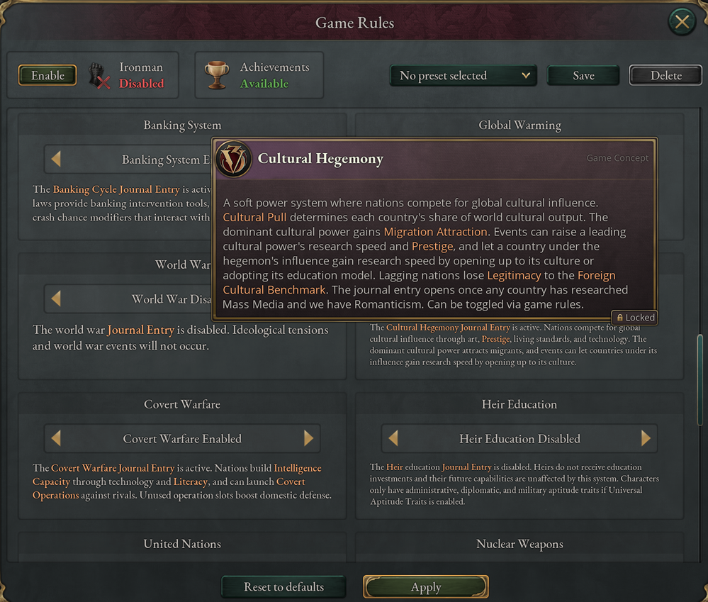

# Introduction

Vic3TimelineExtended carries Victoria 3 past its 1936 end date, through the
twentieth century and into a speculative future; a campaign now runs to 2136. It
adds seven eras of technology, new goods and buildings, over a hundred laws, and
a set of systems that run alongside the base game: a banking cycle with monetary
policy, a construction market, climate change, decolonization, nuclear weapons,
a United Nations, a space race, cultural and covert competition between powers,
and social movements. Most of these systems have their own journal entry, and
most can be switched off with a game rule. The journal lists the systems'
entries together in a section of their own, Timeline Extended Systems, and the
social movements in another, Rights and Society.

The mod adds one button to the sidebar, under Map List, in every game. It opens
the Timeline Extended window: first the [Nation tab](#the-nation-tab), then a
tab each for the space race, your Grand Monuments and your colonial empire, the
same panels as their journal entries, one for the seabed and one for your
[power grids](03-economy.md#power-grids). Two more rows of
tabs hold the mod's tabs in the Budget, Market, Population, Society, Diplomacy
and Military panels, the same as there, so every system is in one place. Full Screen, at
the window's top right, spreads it across the screen, each tab in columns; Side Panel, at its top
left there, brings it back to the width of the other panels. The tab you chose
stays chosen when you switch. Map Room, beside it, opens the Map Room (below).

Each system has a Help page that explains how it works, with a heading for
each topic. The "?" opens it: at the right of the tab's header, and at the top
right of the system's journal entry and of a state's Demographics subtab. Press
Escape or click outside the page to close it.

A tab with a journal entry ends on the entry's modifier icons, the ones its
journal page shows at the top right, above the Open Journal Entry button. Hover
an icon for its effects.

The Map Room is a page of world maps with a button for each, in eight
groups by theme. Click a group's header to open it or close it; every group
starts closed, and one you open stays open as you switch maps. The census's
maps show only while the Demographics census runs, and a system's map only
while its game rule is on; a group with none of its maps to show is hidden.

| Group | Maps |
|---|---|
| Population | Population, Population Density, Urban People, Population Growth, Net Migration, Crowding Penalty, City Rank |
| Families and Ages | Birth Rate, Death Rate, Natural Change, Fertility, Family Planning, Median Age, Aged 65 and Over, Sex Balance |
| Living Conditions | Standard of Living, Wealth, SoL vs Wealth, SoL vs Expected, Below Expected SoL, Literacy, Life Expectancy, Infant Mortality, Leading Cause, Health Care |
| Classes | Every pop type, from Aristocrats to Soldiers and the mod's Spacers |
| Economy | GDP, GDP per Capita, Unemployment, Vacant Jobs, Gini Coefficient, Dynastic Wealth, Ownership, Company HQs, Investment, Trade Capacity, Infrastructure, Market Access, Power Grids, Grid Flows |
| Politics | Turmoil, Radicals/Loyalists, Discrimination, Political Models, United Nations, Colonies |
| Military and Security | Armed Forces, Fighting-Age Men, War Dead, Devastation, Nuclear Weapons, Nuclear Reach, Agent Networks |
| Land and Environment | Base Comfort, Current Comfort, Tourism Appeal, Pollution, Emissions, Ocean Basins, Grandeur |

Hover a state for its figure. Trade Capacity colors each state by its own
Trade Capacity, what its Trade Center can carry. Investment colors it by what
its owners pay into the Investment Pool each week, an estimate from the
profit of its financial districts, manor houses and company headquarters.
Population Density colors it by its people per km² of land; where countries
split a state region, each part takes the region's land in proportion to its
provinces. A class map colors each state by how many of the class live there, a
doubling at a time, in the color the state panel's pop chart gives that pop
type, and leaves a state with none of the class pale; set Map Options' Classes
row to Share and it colors the class's share of the state's people instead. The
hover gives both, and the classes are counted once a year.

Standard of Living and Wealth are each state's averages over its people at the
same yearly count. SoL vs Wealth is the one less the other: what a place adds
to its people's living standards, or takes from them, beyond what they can
afford, from pollution, health institutions, laws, rulers, principles and
events. It is small at the start and grows through the game. SoL vs Expected
compares the standard of living with the one people expect, the gap that turns
them radical. Unemployment is the share of a state's workforce without work,
counted when you pick the map and each month after while it is up.
Infrastructure is what a state has less what it uses: below the middle it is
short and loses market access. Radicals/Loyalists is the loyalists' share of
the people less the radicals'. Literacy, GDP and Population read the game's own
figures, and a state with no people is pale on the last two.

Market Access is crimson where a state falls short of full access, because it
uses more infrastructure than it has or is cut off from its market's capital,
and pale at full access. Pollution is the state region's, 0 to 255, so every
state of a region shares it; it drives the Pollution Impact the state panel
shows, and a clean region is pale. Vacant Jobs counts the jobs open in a
state's buildings, subsistence farms aside, a doubling at a time, and leaves a
state with none open pale. Below Expected SoL is the share of a state's people
living below their expected standard of living, the ones who turn radical, and
Discrimination the share short of Full Acceptance, counted once a year.

A map of figures shows how states differ now, not how the world has moved: its
colors run from the fifth lowest state in the world to the fifth highest, the
few beyond each end at its colors' limits, unless Map Options (below) sets
another area or trim. The button's tooltip gives the range and what it was
measured over. The range is measured when you pick a map and again each month. A map
with a meaningful middle keeps it: Fertility's is replacement, Natural
Change's, Net Migration's, Population Growth's, SoL vs Wealth's, SoL vs
Expected's, Infrastructure's and Radicals/Loyalists' none, Sex Balance's even and
the comfort maps' no penalty, cream in each map's own colors, and each side's colors
run to the world's extreme on that side.
Where every state is on one side, the colors run over the states there, the
middle's color at the one nearest it. Agent Networks keeps its fixed scale, 0 to 100, and City Rank its ranks.
The two comfort maps show what a
state's Local Climate does to its migration attraction: Base Comfort before any
technology eases it, Current Comfort after its owner's, in the same colors so
you can compare them. Crowding Penalty is the cut Migration Crowding makes, and
Tourism Appeal the state's Base Appeal; it and the comfort maps are gray for a
game's first month. City Rank shows the world's city ranking that tourism's
Cities bonus reads: the 20 largest cities amber to crimson, the rest in blue
that pales as the rank falls. Company HQs colors each state that holds a
company's headquarters by their weekly profit, sets a loss apart (red in the
map's own colors), and leaves every other state gray; gold stripes mark a
company's regional headquarters.
Ownership colors a state by who holds most of its buildings, private owners
gold, their own workers green and the state red, paler where the lead is
narrow. Population Growth counts land changing hands as well as births, deaths
and migration. Armed Forces counts each state's Soldiers and Officers,
Fighting-Age Men its men aged 20 to 39, the pool conscription draws on, and
War Dead its deaths to war and devastation in the last census year. The census
shares a country's war dead out by where its soldiers are, so War Dead shows
where the dead came from, not where they fell. Emissions colors a state by its
share of the world's emissions last year. Nuclear Weapons shows the world's
nuclear powers as the world sees them, the countries that host your weapons or
shelter under your umbrella, and, while the world believes you armed, those
whose independence you guarantee. Nuclear Reach shows where your weapons can
strike, by what carries them there: your own states blue, your bombers' reach
orange, the coasts only your missile submarines reach green, and what only
your ICBMs reach pink, with the rest pale. Green stripes mark a coast both your
bombers and your submarines reach, and a pale state's hover says what would
reach it. Before your first warhead the orange shows where your bombers would
fly. Your bombers' reach is worked out when you pick the map and each month
after, and a war that brings a country into reach shows at once. Agent Networks
shades each country by your network there. Power Grids colors each grid,
bordering grids apart, with its hub striped white and a station on no grid gray.
Grid Flows colors each state with a station by what the station does this
month: blue where it sends power to its grid, orange where it receives it, pale
where it is on a grid but moves nothing, and gray where it is on no grid. Its
hover gives the flow, or why the station moves nothing.
Colonies colors each colony by its empire's colonial stability. Leading Cause
colors a state by what killed most of its people, in the colors of the Causes
of Death chart, full where that cause took 90% of the deaths and paler as its
share falls toward 30%. Stripes in a second cause's color mark a state where
that cause took at least half as many deaths as the leader. Leading Cause,
Birth Rate, Death Rate, Natural Change, Net Migration and War Dead need a
state's first full census year, Standard of Living, Wealth, SoL vs Wealth,
Discrimination and the class maps its first yearly count, and Population Growth its second, so they
start gray.

Map Options, below the groups, changes where the Map Room draws its maps,
how a map of figures measures its range, the scale its colors run on and the
colors themselves, and whether the class maps count people or shares. Its header
names whatever is off its default, and the page says so at the top; the Classes
group's header says By Count or By Share.

| Option | Settings | What it does |
|---|---|---|
| Area | World, Continent, Market, Power Bloc, Country | Limits every map to one continent, your market, your power bloc or your own country. States outside turn slate and show no figure, and a map of figures runs its colors over the states inside. |
| Outliers | Trim 4 Each End, Keep All, Trim 5% | Sets how many states each end of a range leaves out: four, none, or 5% of the states with a figure. |
| Scale | Map Default, Linear, Logarithmic, Ranked | Sets how the colors run between the range's ends: on the curve drawn for the map, straight, by doublings, or by each state's place in line. |
| Color | Map Default, Colorblind-Safe, Grayscale | Sets the colors a map of figures is painted in: the map's own, a ramp that stays readable with color blindness, or grays. |
| Classes | Count, Share | Sets whether a class's button picks its people or its share of the state's people. A class map on the page changes at once; on any other map the buttons are grayed. |

Limit GDP per Capita to Europe and its colors run over Europe's states alone,
so you see how they differ where the world map shows them all as rich.
Continent starts on the one your capital stands in,
and each continent's tooltip lists its strategic regions: the Middle East and
Siberia count as Asia, Mexico and the Caribbean as North America. Market,
Power Bloc and Country follow your country, a month behind at most; if you
leave your bloc, the area goes back to the world. In an area smaller than the
world, Trim 4 Each End leaves out at most a tenth of the area's states at each
end. Outliers, Scale and Color do nothing to a map of categories or on a fixed
scale, such as Leading Cause or City Rank, and their buttons are grayed there.
The options apply to the Map Room only: a system's own journal entry draws its
map over the whole world, on its own curve and in its own colors, whatever you
set here.

Map Default leaves each map on the curve drawn for its figure: straight for
some, most of the color for the common figures on others, a doubling at a time
for money and head counts. Linear runs the colors straight instead.
Logarithmic gives each
doubling the same share of the color, so low figures spread apart; on a map
with a meaningful middle it doubles by the distance from the middle on each
side, and the middle keeps its color. Ranked colors each state by its place in
line, lowest to highest, with states that share a figure sharing a place, so
no outlier matters and the Outliers buttons are grayed. A map with a
meaningful middle ranks each side outward from it. A Ranked map takes its
places when it is measured, so it can be a month old: Turmoil under Ranked
moves at the turn of the month, not from week to week.

Colorblind-Safe paints every map of figures from one ramp, pale yellow at the
low end to brown at the high, which stays readable with red-green or
blue-yellow color blindness. A map with a meaningful middle runs orange below
it and purple above, near white at it. A state its map sets apart below its
scale, such as a company headquarters at a loss, is blue. Grayscale runs light
gray at the low end to dark gray at the high, with a meaningful middle at the
middle gray; a state with no figure, with none, or off the scale is striped
where the other colors leave it gray or pale, since a gray of its own would
read as a figure, and Company HQs' gold stripes are not drawn.

A map's tooltip follows the options: it says what the map shows, its range
now, the scale in force and the colors in force, so it tells you which color
is the low end whatever you have set.

The tabs of the nine systems with a map here (Emissions, Nuclear Weapons,
Agent Networks, United Nations, Political Models, Ocean Basins, Grandeur,
Colonies and Power Grids), and Demographics', have a map button left of the
"?" that opens the Map Room on their map. Seven of the nine (all but Ocean
Basins and Power Grids) also draw the same map in their own journal entry while its page is
open. Banking's button opens its journal entry,
which colors every country by the phase of its banking cycle. A journal
entry's map shows only while its page is open, so the crossed-out eye at the
top left of every journal page fades the page until you click it again or close
the page, and the map shows through. The faded page still takes your clicks.

National Info, the base game's Census Data window under a new name, shows
another country's panels. Open it from the button above Draft a Treaty at the
foot of that country's panel, on any of its tabs, or for your own country from
the Population panel. A row of tabs over the
window holds Pops, the base game's list, then a tab for each of the mod's
systems a country shows the world, Demographics and the Seabed among them. For another
country a tab shows its figures and none of its buttons; for your own it is the
same tab as in the Timeline Extended window, buttons included. A tab is grayed
where its system isn't running in that country, and the tab you chose stays
chosen when you open another country's window, where it runs. Another country's
charts open full size the same way, and an empty chart there says when the
country keeps no history: only played countries and major powers do.

This guide explains what each system does and how to play it. It assumes you
know the base game: pops, interest groups, laws, markets, construction and
diplomatic plays are not explained here except where the mod changes them.

## How to use this guide

Each chapter covers one area of the game and can be read on its own. Start with
the chapters for the systems you meet first. In an 1836 start the construction
market changes how building works from the first day ([Economy and
construction](03-economy.md)), and the banking cycle begins once you have
researched Stock Exchange and have an Urban Center of level 5 or more ([Banking
and monetary policy](04-banking.md)). Most later systems unlock with technology,
so you can read about them as they approach.

Numbers in this guide are there to help you plan: thresholds, tiers, durations
and caps. They are rounded, and they can change between versions of the mod. The
game's tooltips show the exact values for your country, and many of the mod's
journal entries and panels break their numbers down line by line when you hover
over them.

Many panels chart a system's history month by month or year by year. The round
button beside a chart's title opens that chart alone, across most of the screen,
with the same range buttons and hovers. Escape or a click outside closes it.

The Markdown source of this guide is kept in the mod's repository, and the
[chapters](https://github.com/jakeOmega/Vic3TimelineExtended/tree/main/docs/player_guide)
can be read there as web pages.

## Setting up a game

Two things need attention before your first campaign: where the mod sits in your
load order, and which of its game rules you want.

### Installing the mod

Subscribe to the mod on the Steam Workshop, or copy it into your Victoria 3
`mod` folder, then enable it in a playset in the launcher. The mod overrides the
base game's ideologies, a number of its production methods, the state-region map
files and several interface panels, so other mods that change those will
conflict with it. Put Vic3TimelineExtended last in the load order so its
versions win. Mods that only add content usually work alongside it.

Start a new campaign with the mod enabled. Don't add it to, or remove it from, a
game already in progress. In multiplayer, every player needs the same version of
the mod.

### Game rules

The mod adds twenty-four game rules to the game setup screen. Each one turns a
system on or off, and a few offer a reduced version of the system. You choose
them when you start a campaign, and outside Ironman you can change them later.

Turning a system off hides its journal entry and stops its events, but the
technologies, laws and buildings connected to it stay in the game and keep their
ordinary effects. With the Banking System off, for example, the financial
regulation laws still change Urban Center output, investment, innovation and
government dividends; only their effects on the banking cycle go.

Switched off in a campaign already under way, a system's journal entry closes
within a few days, with no reward and no penalty, and what the system was doing
goes with it: its bonuses and costs, covert operations, nuclear status, the
United Nations itself. A legislated tax code gives way to the base-game taxation
law closest to it. What you finished stays: completed space milestones,
monuments already built, a religion already founded. Culture merges and a probe
already on its way to another star pause instead, and carry on when the rule is
turned back on. Turned back on, the Banking Cycle, Monuments, Colonial Empire,
Covert Warfare, Cultural Hegemony and space race entries come back within a
month or two wherever their conditions are met (Covert Warfare with no
operations or agent networks). The other systems' entries, World War's
included, don't return in that campaign.

The mod is balanced with its default systems on, and switching one off removes
its costs along with its benefits. A choice whose drawback lives in a disabled
system loses that drawback: a financial regulation law that trades faster growth
for a more volatile banking cycle is simply better with the Banking System off.
Expect some laws, technologies and policies to become obvious picks when you
turn a default system off.

| Rule | Default | Settings and what they control | Chapter |
|---|---|---|---|
| Banking System | Enabled | *Enabled*: the banking cycle with the full monetary-policy layer (policy rate, inflation, exchange rate, currency pegs and shared currencies). *Simplified*: the banking cycle only; you still borrow at your own interest rate but can't set it. *Disabled*: no banking cycle. | [Banking and monetary policy](04-banking.md) |
| Free Market Construction | Enabled | *Enabled*: construction is a good bought on the market, and buildings use some as maintenance. *Without AI Retooling Costs*: as Enabled, but AI countries' buildings don't retool; players' still do. *Without Retooling Costs*: as Enabled, but switching production methods doesn't raise that maintenance. *Without Maintenance*: construction is still a market good, but buildings don't consume it. *Disabled*: base-game construction sectors. | [Economy and construction](03-economy.md) |
| Global Warming | Enabled | Greenhouse emissions, rising temperatures, climate events and climate policies. | [Climate and pollution](15-climate.md) |
| United Nations | Late Unlock | Founding and joining the UN, its votes, resolutions and agencies. *Late Unlock*: a great power founds it with Intergovernmental Organizations. *Early Unlock*: with Multilateral Alliances, and it can't reform its charter until some country has Intergovernmental Organizations. *Disabled*: no UN. | [The United Nations](10-united-nations.md) |
| Nuclear Weapons | Enabled | Nuclear programs, arsenals, doctrine, crises, strikes and the nuclear taboo. | [Nuclear weapons](14-nuclear.md) |
| Space Race | Full Colonies | *Races Only*: the space race milestones and their events, with colonies founded the month their fleet leaves and staying with their holder. *Simple Colonies*: as Races Only, and colony fleets travel for months or years and claim their site on arrival, colonies hold settlers sent from Earth and are built up with modules, Extraplanetary Bases work the room the near-Earth asteroids and colonies give, a colony can change hands by the Cede Colony treaty article, sold, given or demanded in a war, and colonies grow restless, can be abandoned or break away, and live on as free colonies. *Full Colonies*: as Simple Colonies, and Space Command builds warships that move between the planets, fight, blockade colonies and seize or destroy them; an enemy fleet in Earth orbit stops your launches until you put up your reserve, and ground-to-orbit batteries fire on it. *Disabled*: no space race. | [The space race](16-space.md) |
| Decolonization | Enabled | Colonial stability, the decolonization journal entry and its events. | [Colonial empires and decolonization](12-decolonization.md) |
| Cultural Hegemony | Late Unlock | The competition for global cultural influence. *Late Unlock*: the journal entry opens once any country has Mass Media. *Early Unlock*: once any country has the Electric Telegraph; broadcast programs and events still wait for Mass Media. *Disabled*: no hegemony. | [Cultural hegemony and covert warfare](11-influence.md) |
| Covert Warfare | Late Unlock | Intelligence agencies and covert operations against other countries. *Late Unlock*: the agency opens with Mainframe Computers, a later technology that adds an operation slot, or the Ministry of Intelligence and Security. *Early Unlock*: it opens with Central Archives, with funding and operations limited until then. *Disabled*: no covert operations. | [Cultural hegemony and covert warfare](11-influence.md) |
| Social Movements | Enabled | The six social-movement journal entries (civil rights, human augmentation, morphological freedom, digital rights, mental health and post-scarcity) and their events. Feminism, LGBTQ+, religious, anti-war, transhumanist and environmental events fire either way. | [Social movements](07-social-movements.md) |
| Internal Resettlement | Enabled | *Enabled*: the Settlement Authority and government resettlement programs. *AI Voluntary Only*: AI countries run only voluntary programs. *Disabled*: no resettlement. | [States and population](08-states.md) |
| Grand Monuments | Enabled | Grand Monuments, their dedications, the Monuments journal entry and contested monuments. | [The extended timeline](02-timeline.md#grand-monuments) |
| Demographics | Full | *Full*: every state keeps a census of its people by age and sex, shown in a Demographics tab in the Population panel and National Info and a subtab on the state panel, and the census sets each state's births and deaths. *Display only*: the same census and panels, with births and deaths left to the base game. *Disabled*: no census and no tabs. Dynastic Wealth keeps working. The census is experimental; a game saved before it was added keeps it off. | [States and population](08-states.md#demographics) |
| Culture Merges | Enabled | Closely related cultures merging into one national culture. In a game saved before it was added, the merges that make a new culture never start. Turned off mid-game, every merge pauses where it stands and carries on when the rule is turned back on. | [States and population](08-states.md#culture-merges) |
| Assimilation Across Heritages | Unrestricted | How pops assimilate when none of your primary cultures shares their heritage group. *Unrestricted*: they join your majority culture, as in the base game. *Hybrid Cultures*: they take up your majority's language and keep their heritage, in a hybrid culture such as Anglophone African, and join your majority culture only under a Bodily Autonomy law that allows it. *None*: no hybrid cultures; they stay as they are until such a law. Changed mid-game, hybrid pops keep their culture. A game begun before the rule was added has no hybrid cultures and plays as Unrestricted unless set to None. | [States and population](08-states.md#assimilation-across-heritage-groups) |
| Small-Economy Construction | Full Cost for Every Country | Experimental. Construction and construction maintenance cost a small economy less, rising to the full price at a GDP of 10 million. *Half the Cost*, *A Fifth of the Cost* and *A Tenth of the Cost for Small Economies* set the price with almost no GDP. Switched in a running game, on, off or to another strength, it reaches each country within a year. | [Economy and construction](03-economy.md) |
| Private Actors | Private Actors Disabled | Experimental. Every company becomes a firm with an aim of its own: each year it reads its markets, the laws and its workers, picks one of eight goals and keeps Funds, Connections and Standing. You are told when one of your firms starts failing or holds 40% of its sector. AI countries' firms play the same way. Switched off in a running game, the firms stop, and pick up where they were when it is switched back on. | [Economy and construction](03-economy.md) |
| Batched Private Investment | Batched Investment Enabled | A late-game speed measure. *Enabled*: once a country's investors queue hundreds of building levels a week, each building they choose at home grows by up to a tenth of its size at once. *Disabled*: one level at a time, as in the base game, and each late-game week takes longer to work out. Switched in a running game, it applies at once. | [Economy and construction](03-economy.md#excess-private-construction) |
| Global Commons | Enabled | *Enabled*: seabed licenses that cap the Deep-Sea Mine, which only governments build, the Law of the Sea's seabed terms at the UN, Antarctic research stations and the Antarctic Treaty. *Disabled*: the Deep-Sea Mine has no cap, and private investors build it too. | [The extended timeline](02-timeline.md#seabed-licenses) |
| Power Bloc Principle Slots | Up to Eight | *Up to Eight*: four technologies the bloc leader researches each add a principle slot, up to eight. *Four (Base Game)*: the base game's slots only. | [Diplomacy](09-diplomacy.md#principle-slots) |
| World War | Disabled | A journal entry for great powers that tracks ideological tension into a world war and its aftermath. *Late Unlock*: it opens with Combined Arms. *Early Unlock*: it opens with Trench Works, democratic and authoritarian powers also count as opposed until Combined Arms, and a world war begun before Combined Arms can be followed by a second. | [Military and war](13-military.md) |
| Heir Education | Disabled | Educating your heir, and administrative, diplomatic and military aptitude traits for rulers and heirs. | [Government, laws and characters](06-politics.md) |
| Universal Aptitude Traits | Disabled | Gives aptitude traits to every adult character, with or without Heir Education. | [Government, laws and characters](06-politics.md) |
| Legislated Tax Code | Tax Code Disabled | Experimental. *Tax Code Enabled*: the five taxation laws can't be enacted; every country holds the Legislated Tax Code instead, and each tax rate changes only through a bill that enough interest groups commit to, taking effect on the 1st of its month. AI countries legislate their taxes the same way. *Tax Code and Customs Enabled*: as Enabled, and a country that owns its market sets its tariffs and subsidies by bill too. *Light Tax Code*: the taxation laws stay and set each tax's range; within it you set each tax directly from the Tax Code tab, your heaviest tax sets the tax level, and interest groups react to each change. AI countries keep choosing their tax level. *Tax Code Disabled*: base-game taxes. | [Taxation (experimental)](05-tax-code.md) |
| Custom Religion Allowed | Not allowed | A journal entry that lets you design a religion of your own. | [Government, laws and characters](06-politics.md) |

The base game's Base Construction Capacity rule shows one setting, No Effect.
The mod removes the base construction that rule scales to GDP, and the Free
Market Construction rule decides what replaces it ([Economy and
construction](03-economy.md)).

## Reading the Budget breakdown

The Budget panel's Breakdown tab, also the Timeline Extended window's Budget
Breakdown tab, shows weekly income and expenses as pie charts and expandable
lists. Groups start collapsed; click an arrow to see their
components. Entries are ordered from largest to smallest amount at each level.
The tab is available under every game-rule setting.
Colors and percentages match across the pies and lists. Hover a tax, tariff,
welfare or interest amount for the Overview's graph of it, an institution for
its share of the pool, and Administration for the pool itself. Investment Pool Transfer and the construction it funds are
private spending, so they are excluded from the totals and Construction Goods.

Taxes groups the individual tax receipts. Military expands into Army and Navy,
which each expand into Wages plus Materials and Support. Materials and Support
includes logistics centers and naval fortifications, whose operating costs
combine their own wages, goods and any slave upkeep. Barracks, conscription
and naval administration stay in the native branch entries, while support
buildings contribute their full upkeep. Navy also includes warship construction and
maintenance. Shipping and diplomatic flows have their own expandable groups. A collapsed group occupies one pie slice; expanding it
replaces that slice with its visible components.

Administration groups your institutions and General Administration. Government
Administration's operating costs are divided between your institutions
and General Administration. Institutions receive the share corresponding to the
bureaucracy they use, then divide it in proportion to their current levels.
General Administration covers the remainder, including unused capacity. Other
civil buildings, the military, construction and welfare have their own rows.

Recurring costs from Banking, Covert Actions, Cultural Hegemony, the United
Nations and other journal systems appear under Program Costs, and so does the
Space Program building's running cost, in the Space Race row. Expand it and
hover over a system to see its
current sources and amounts. One-time treasury payments and costs in resources
such as innovation are outside this weekly money breakdown. The Banking row's
hover also names what the Foreign Exchange Surrender Requirement buys for the
central bank's gold each month, which stays outside the weekly budget.

The charts show positive component amounts; negative adjustments stay in the
list. Expanding a group preserves the chart total, including when costs and
refunds offset each other inside that group. The "?" in the tab's header
opens the Help page with the accounting details.

## The Nation tab

The Timeline Extended window opens on its Nation tab, unless the tab you last
chose is open. The Nation tab gathers what your country carries for good, and it
is open in every game from the first day.

At the top, five boxes: Legislative Override Capacity, Dynastic Wealth and
the score it is heading for, Construction Cost, Global Technology, and Judicial
Independence and its ceiling. The first names the strongest Forceful Legislation
option open to you, which also depends on the authority you produce.

Below them are five sections: Governance, Society, Economy, Science and Space,
and International. Each starts with its scores, if it has any. Legislative
Override Capacity's figure names every source on hover, and the lines on its bar
mark where Forceful Legislation's options open, at 0, 2 and 4. Once a United
Nations exists, International starts with your place in it: a member, a
permanent member, suspended, or outside. Once you have joined it adds your
International Standing, kept if you leave, and while you are a member your UN
Dues, with any months in arrears.

Under the scores, each section has a row for each kind of effect the mod's
permanent effects give your country, grouped under small headings: "Arable
Land: +45%" under Production, Prestige under Standing Abroad, each interest
group's approval under Interest Groups. The figure is your country's whole
total. Hover the row for what the effect does and then every source: the
technologies, laws, institutions and principles that add to it as well as the
mod's effects, such as agricultural diffusion, space race milestones,
demographic policies and the UN conventions you are bound by. A row
appears once one of those permanent effects adds to it. A state, building or
interest group row is what your country gives each of them; their own panels add
their local sources.

Where These Come From, collapsed below the sections, lists the permanent effects
themselves under the section whose systems granted them, and its heading gives
how many there are. Hover one to see what it does at its current size.

All Modifiers, collapsed under it, lists every modifier your country holds, as
the base game's country panel does: the timed effects, such as what an event has
just done to you, with the time each has left; the permanent effects the sections
add up; and a few that no section covers, such as Nuclear Power and what a
foreign operation is doing to you. Its heading gives how many there are.

The country panel's Information tab doesn't list modifiers. Under its Modifiers
heading, a line gives how many the country holds. On your own country an arrow
beside that line opens the Nation tab; on another country's it opens that
country's Nation tab in National Info, which shows all of it: the scores, the
rows, the permanent effects, All Modifiers and the UN lines. A system's weekly
costs are in the Budget panel's Breakdown tab. Tooltips that break down a
figure, such as legitimacy, still name every source.

## How the guide is organized

The chapters follow the game's own areas rather than the order systems appear.

| Chapter | Covers |
|---|---|
| [The extended timeline](02-timeline.md) | The seven new eras, their technologies, new goods and buildings, company buildings, wonders and megaprojects. |
| [Economy and construction](03-economy.md) | The construction market, construction costs, living-standard expectations, transport goods, the Strategic Reserve and wartime demand for munitions. |
| [Banking and monetary policy](04-banking.md) | The banking cycle, crashes and contagion, the policy rate, inflation, exchange rates and international monetary arrangements. |
| [Taxation (experimental)](05-tax-code.md) | The Legislated Tax Code rule: the Light Tax Code's rates within your taxation law; drafting tax bills, winning interest groups over, promises, passed bills and legislated customs. |
| [Government, laws and characters](06-politics.md) | New laws and law groups, ministries, political movements and parties, elections, heir education, custom religions and state collapse. |
| [Social movements](07-social-movements.md) | The movement journal entries, from civil rights to post-scarcity, and the movements carried by events. |
| [States and population](08-states.md) | Migration crowding, dynamic homelands, cultural acceptance, culture merges, tourism, world city rankings and internal resettlement. |
| [Diplomacy](09-diplomacy.md) | New treaty articles, diplomatic play escalation, irredentism and reunification, power blocs and formable countries. |
| [The United Nations](10-united-nations.md) | Founding the UN, its authority, the Security Council, votes, resolutions, conventions and missions. |
| [Cultural hegemony and covert warfare](11-influence.md) | Soft power and intelligence operations. |
| [Colonial empires and decolonization](12-decolonization.md) | Colonial stability, independence and what follows it. |
| [Military and war](13-military.md) | Combined arms, new units and ships, military bases and the World War journal entry. |
| [Nuclear weapons](14-nuclear.md) | Building a bomb, doctrine and posture, crises, strikes, the nuclear taboo and disarmament. |
| [Climate and pollution](15-climate.md) | Emissions, warming, climate policy and state pollution. |
| [The space race](16-space.md) | The milestones from suborbital flight to colonizing the solar system. |
| [Quick reference](17-reference.md) | When each system appears, the journal entries at a glance, and a glossary. |
| [Appendix: social movement details](18-appendix-social-movements.md) | The numbers and event lists behind the social movements chapter. |
| [Appendix: events](19-appendix-events.md) | The event lists behind the chapters, from resettlement to the space race, with when each event fires and what its options do. |
| [Appendix: reference lists](20-appendix-reference-lists.md) | The longer lists the chapters summarize: wonders, banking tools, government types, culture merges, combat units, ships, ship modifications, mobilization options and military base production methods. |

## Reporting problems

A mod this size has bugs. Report them on the Steam Workshop page or, better, on
the [issue tracker](https://github.com/jakeOmega/Vic3TimelineExtended/issues).
The most useful report says what you did, what you expected and what happened,
and attaches a save and the game's `debug.log` and `error.log` (in the `logs`
folder under `Documents/Paradox Interactive/Victoria 3`). If a mechanic is
confusing even when it works as intended, that is worth reporting too.

Three systems have had the least play-testing: the monetary-policy layer of the
banking system, the United Nations, and nuclear deterrence and crises. This guide describes what their scripts are written to
do. Where the game behaves differently, either the game or the guide is wrong,
and a report helps fix whichever it is.
