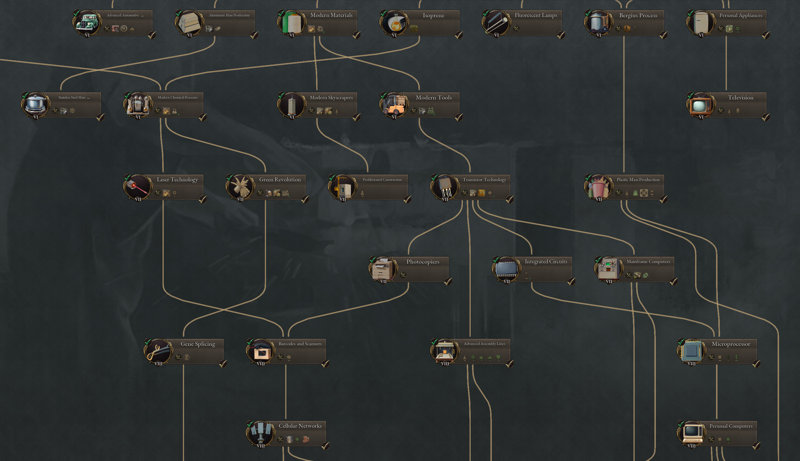
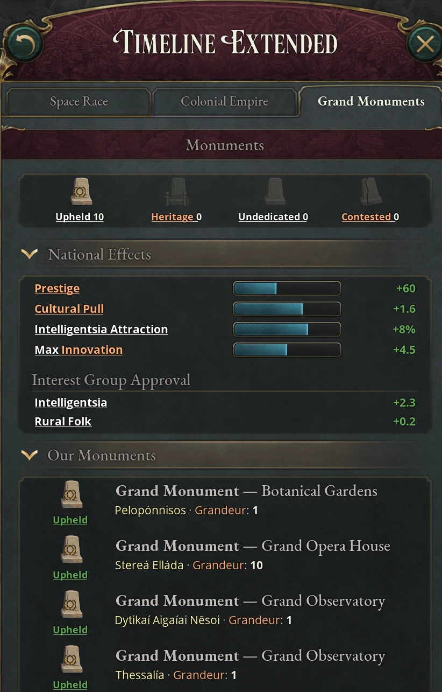

# The extended timeline

The base game ends in 1936 after five eras of technology. This mod moves the end
date to 2136 and adds seven more eras, numbered 6 to 12, with 171 new
technologies. The base game has 179, so the technology tree roughly doubles. The
new eras bring twelve new goods, dozens of new buildings and production methods,
a flagship building for every company, 37 wonders and seven megaprojects. None
of this is behind a game rule: the eras and everything they unlock are always
in the game, even when you switch off the systems that some of their
technologies start. The one exception is the International Space Station
wonder, which needs a Moon landing from the space race. The repeatable [Grand
Monument](#grand-monuments) has a game rule of its own.

## Eras six to twelve

The technology tree continues past the base game's fifth era. Eras 6 to 9 follow
the twentieth century, and eras 10 to 12 run from the present into the future.
The game shows eras only by number; the periods below are the ones the mod's
technologies were chosen to fit, so treat them as a rough guide.

| Era | Rough period | Research cost per technology | Technologies | Broad theme |
|---|---|---|---|---|
| 6 | 1919–1945 | 20,000 | 38 | Synthetics, appliances, aviation, radar, rockets and the atomic bomb |
| 7 | 1946–1967 | 65,000 | 29 | Transistors, nuclear power, jets, the Green Revolution, missiles and satellites |
| 8 | 1968–1987 | 115,000 | 21 | Computer networks, robotics, containerization, pharmaceuticals, stealth |
| 9 | 1988–2012 | 210,000 | 28 | The internet, renewable energy, biotechnology, globalization, drones and cyber defense |
| 10 | the present to about 2030 | 450,000 | 17 | Machine learning, electric vehicles, reusable rockets, hypersonic and cyber weapons |
| 11 | about 2030–2060 | 800,000 | 20 | Advanced materials, fusion power, deep-sea and asteroid mining, genetic engineering, augmentation |
| 12 | after 2060 | 2,000,000 | 18 | General AI, nanofabrication, megaprojects in orbit, antimatter, mind uploading, post-scarcity |

### Research costs in the new eras

Each technology costs its era's base research cost, before the usual modifiers.
The base game's last era costs 17,500 per technology; era 6 is only a small step
up at 20,000, but era 7 more than triples it, and an era 12 technology costs a
hundred times as much as an era 6 one. The base game's surcharge for researching
ahead of unresearched technologies in the same tree still applies, and it grows
with the number of eras between them.

Your innovation has to grow to match. Many of the new technologies raise the
weekly innovation cap by 10 to 100 each, adding between 250 and 1,000 per era
through era 11. Five [wonders](#wonders) raise it further, and new University
production methods (National Labs, Academic Computing and AI Assisted Research)
raise the innovation each university produces.

### What each new era brings

Era 6 opens synthetic industry and the consumer economy. Bergius Process and
Isoprene unlock Synthetic Fuel Works and Synthetic Rubber Works, Personal
Appliances unlocks Consumer Appliance Industries, Commercial Aviation the
Airport, and Public Works Programs the Hydro Plant. Nine of the era's
technologies each open a new kind of mine, such as Modern Tools (Manganese
Mine). Radar, Rocketry, Nuclear Weapons, Combined Arms, Keynesian Economics (the
Fiat Money law), Intergovernmental Organizations and Decolonization are here
too.

Era 7 is the postwar boom. Transistor Technology unlocks the Electronic
Components and Semiconductor Industry, Nuclear Energy the Nuclear Plant, and
Green Revolution modernizes farms and plantations (Modern Farming, Mechanized
Farm) and unlocks the Artificial Sweeteners Plant. Guided Missiles unlocks the
Space Program building, and Space Exploration, Satellite Communications and
Intercontinental Ballistic Missiles follow. Plastic Mass Production, Modern
Urban Planning, Pollution Control and the Civil Rights Movement round out the
era.

Era 8 brings computers and automation. Computer Networks unlocks the Software
Industry and Network Infrastructure, Industrial Robotics the Robotics Industry,
and Modern Pharmaceuticals the Rational Drug Design method for Pharmaceutical
Industries ([Pharmaceutical Industries and
Drugs](#pharmaceutical-industries-and-drugs)). Containerization,
Fiber Optics, Cellular Networks, Microprocessor, Gene Splicing, Stealth
Technology and Video Games are also here.

Era 9 is the internet age. World Wide Web opens the internet laws, Clean Energy
Technologies unlocks the Renewable Energy Plant, Hydraulic Fracturing adds
fracking to oil rigs, and Biotechnology brings GMO plantations and two synthetic
plants. Globalization, Social Media, E-Commerce, Cybersecurity, Missile Defense
Systems and Network Centric Warfare are also in this era.

Era 10 is the present day: Machine Learning, Generative AI, Additive
Manufacturing, Electric Vehicles, Internet of Things, Reusable Rocketry,
Hypersonic Weapons, Cyber Warfare, Universal Basic Income and Mental Health
Awareness.

Era 11 is the near future. Modern Material Science unlocks the Advanced Material
Fabricator, Abyssal Plain Mining the Deep-Sea Mine, Asteroid Mining the
Extraplanetary Base, and Fusion Power the Fusion Plant. Genetic Engineering
unlocks the Carbon Conversion Works and Integrated Biorefinery, Lab-Grown Food
the Cultured Meat Plant and Cultured Produce Facility, and Synthetic Biology
adds bioengineered production methods such as Designed Crops. Brain-Computer
Interfaces and Human Augmentation bring augmentation laws.

Era 12 is the far future. Artificial General Intelligence adds AI-managed
production methods to many industries, and Molecular Assemblers, Programmable
Matter and Orbital Manufacturing add a final tier to many more. Space Elevator,
Space-Based Solar Power, Orbital Weapon Platforms, Antimatter Production, Mind
Backups, Molecular Assemblers and Telepathic Communities each unlock a
[megaproject](#megaprojects). Space Colonization, Biological Immortality and
Post-Scarcity Economy are among the last technologies in the tree.

Some of the mod's buildings arrive earlier, with base-game technologies: the
Aerospace Industry with Military Aviation, the Highway with Paved Roads, and the
Tourism Industry with Romanticism.

### Global technological development

The further the world's leading powers advance, the faster everyone else
catches up. Once a year, every country checks a list of 54 mid-century and later
technologies, from Television and Cryptography to Space Colonization. Each one
that any great power has researched adds a bonus to technology spread, the
trickle of innovation that pulls you toward technologies others already have.
The bonuses add up, and the later the technology, the more it is worth: the
earliest tier adds a small step, and the last tier (Artificial Intelligence,
Space Colonization and their peers) adds ten times as much. Only great powers count, so a technology first reached by a
minor country does not move the world's pace until a great power follows.

The bonus appears on your country as the Global Technological Development
modifier, and every country gets the same one, recognized or not. It is a
catch-up mechanism, not a research boost for the leaders. A backward country
gains the most from it, because spread only works on technologies you lack. The
leaders gain little, since spread only ever feeds technologies someone has
already researched. The further ahead the great powers pull, the larger the
bonus, but it closes the gap less than that suggests. The bonus is a flat amount
of spread, and technology costs climb much faster than its tiers do: an era 12
technology costs a hundred times as much as an era 6 one. So the same bonus
pays for less of each technology as the eras go on. The tooltip on the modifier shows your current figure. It sits alongside the
usual sources of spread (literacy, laws and power bloc principles) and is
separate from [agricultural diffusion](#agricultural-diffusion), which grants
arable land rather than research.

### Agricultural diffusion

Five farming technologies spread around the world once someone invents them:
Nitrogen Fixation (a base-game technology), Modern Chemical Processes, Green
Revolution, Gene Splicing and Biotechnology. The first country to research one
gets an event naming it the pioneer, a permanent bonus to arable land, and a
decaying +5% prestige and authority bonus that lasts 20 years. Two weeks later
every other recognized country gets an event and the same arable-land bonus,
whether or not it has the technology. Each diffusion bonus is half the
technology's own arable-land bonus: +15% for Nitrogen Fixation, Modern Chemical
Processes and Gene Splicing, +25% for Biotechnology and +60% for Green
Revolution. It stacks with the technology's bonus once you research it.
Countries that appear later, through release or formation, receive the bonuses
already in the world.

### Why some technologies lower education access

Four technologies take 10 points off education access in every state: Public
Works Programs and Computing Machines in era 6, Digital Education in era 9 and
Brain-Computer Interfaces in era 11. Literacy drifts toward education access, so
with nothing else changed each one lowers the level your literacy settles at by
10 points, and literacy follows down over the next years. All four together take
40 points off.

This is deliberate. Each of these technologies raises the standard for what
counts as literate: working with computers, networks and digital systems asks
more of a person than reading a newspaper, so someone who counted as literate
under the old standard may not under the new one. The technology tooltip shows
the penalty. It also keeps education relevant in the late game, because the
gain has to be kept up as the bar rises.

Each of the four also raises the Schools institution's maximum investment by one
level. Funding schools and the laws that raise education access are how a
country holds its literacy against the drop.

### Technologies that open the mod's systems

Several of the new technologies first bring a system from another chapter into
view. Each system also needs its game rule, and some have further conditions.

| Technology | Era | What it opens | Chapter |
|---|---|---|---|
| Intergovernmental Organizations | 6 | The United Nations journal entry; the Power Bloc Headquarters and the Peace Palace | [The United Nations](10-united-nations.md) |
| Decolonization | 6 | The colonial empire journal entry | [Colonial empires and decolonization](12-decolonization.md) |
| Nuclear Weapons | 6 | The nuclear program | [Nuclear weapons](14-nuclear.md) |
| Rocketry | 6 | The first space race milestone, for great and major powers | [The space race](16-space.md) |
| Combined Arms | 6 | The Gathering Storm, the world war journal entry, for great powers | [Military and war](13-military.md) |
| Civil Rights Movement | 7 | The civil rights journal entry | [Social movements](07-social-movements.md) |
| Automated Surveillance or Cybersecurity | 9 | The digital rights journal entry | [Social movements](07-social-movements.md) |
| Mental Health Awareness | 10 | The mental health journal entry | [Social movements](07-social-movements.md) |
| Universal Basic Income | 10 | The post-scarcity journal entry | [Social movements](07-social-movements.md) |
| Brain-Computer Interfaces or Human Augmentation | 11 | The human augmentation journal entry | [Social movements](07-social-movements.md) |

Some society technologies also start occasional narrative events (Second Wave
Feminism, Contraceptive Pill, Social Media and others), covered in [Social
movements](07-social-movements.md).

## New goods

The new industries trade in twelve goods the base game doesn't have, and the mod
renames twelve base-game goods to fit a longer timeline.

### Goods the mod adds

| Good | Category | Made by | Used for |
|---|---|---|---|
| Consumer Appliances | Luxury | Consumer Appliance Industries | The pops' Convenience need; inputs for some high-tech buildings |
| Electronic Components | Industrial | Electronic Components and Semiconductor Industry | The most widely used modern input: over a hundred buildings take it in their later production methods |
| Industrial Robotics | Industrial | Robotics Industry | Automation production methods in factories and mines |
| Software | Luxury | Software Industry | The Convenience need; digital and automation production methods |
| Digital Access | Luxury, local | Network Infrastructure | The Convenience need and many modern production methods; like Personal Transportation it is only available in the state that produces it |
| Launch Capacity | Industrial | Aerospace Industry (with rocket production methods), Space Elevator, Antimatter Engine | Space programs, satellites, orbital production methods and megaprojects |
| Advanced Materials | Industrial | Advanced Material Fabricator, Nanofabrication Center | Late-game production methods and megaproject construction; base price 4,000, the most expensive good in the game |
| Construction Services | Industrial | Construction Sector | The construction market ([Economy and construction](03-economy.md)) |
| Tourism | Luxury | Tourism Industry, National Park and others | The pops' Tourism need |
| Tech-Critical Metals | Industrial | Nickel and Cobalt, Lithium, Rare Earth Metals and Platinum Group Metals Mines; also the Deep-Sea Mine and Extraplanetary Base | Electronics, robotics, modern power plants and other high-tech production methods |
| Motor Ships | Industrial | Shipyards, from Advanced Submarine Technology | Later production methods for ports, fishing wharves and whaling stations; the pops' Leisure need, as Steamers |
| Magnetic Drive Ships | Industrial | Shipyards, from Modern Material Science | The last tier of the same production methods; the Leisure need too |

The Convenience and Tourism needs, which wealthier pops fill with these goods,
are covered in [Pop consumption at high
wealth](03-economy.md#pop-consumption-at-high-wealth).

### Renamed base-game goods

Several base-game goods now stand for a broader family of materials. They are
the same goods underneath, so base-game buildings still make and use them.

| Base-game name | Name in this mod |
|---|---|
| Coal | Energy and Carbon Minerals |
| Iron | Structural Metals |
| Lead | Conductive and Base Metals |
| Sulfur | Chemical and Industrial Minerals |
| Fertilizer | Chemicals |
| Glass | Glass and Plastics |
| Opium | Drugs |
| Telephones | Wired Telecommunication Gear |
| Radios | Wireless Telecommunication Gear |
| Fine Art | Art and Entertainment |
| Transportation | Personal Transportation |
| Merchant Marine | Bulk Transportation |

Chemicals is the base game's fertilizer. Farms and plantations still take it,
and dozens of modern industrial production methods now take it too. Bulk
Transportation is explained in [Bulk Transportation and
freight](03-economy.md#bulk-transportation-and-freight). Four buildings are
renamed to match: Fertilizer Plants are Chemical Plants, Electrics Industries
are Wired Telecommunications Industries, Synthetics Plants are Synthetic Dyes
Industries, and the Arts Academy is Creative Industry.

## New buildings and production methods

The mod adds new buildings in families that follow the goods above, and extends
most base-game buildings with production methods for the new eras.

### New mines and extraction

Fourteen new mines work deposits of specific minerals. Ten of them produce one
of the renamed resource goods, adding supply to existing chains; the other four
produce the new Tech-Critical Metals. Resource deposits are covered in [New
mineral deposits](03-economy.md#new-mineral-deposits).

| Mine | Produces |
|---|---|
| Manganese, Chromium, Bauxite, Specialty Alloy Metal | Structural Metals |
| Copper, Precious and Minor Base Metal | Conductive and Base Metals |
| Nickel and Cobalt, Lithium, Rare Earth Metals, Platinum Group Metals | Tech-Critical Metals |
| Graphite | Energy and Carbon Minerals |
| Phosphate, Potash, Industrial Mineral and Salt | Chemical and Industrial Minerals |

Two late buildings mine several goods at once. The Deep-Sea Mine (Abyssal Plain
Mining) can be built in any coastal state, and each level needs a seabed licence
([Seabed licences](#seabed-licences)). Like a fishing wharf, it loses up to
three quarters of its throughput while its state is blockaded. The
Extraplanetary Base (Asteroid Mining) costs 20,000 construction per level. It
mines metals and minerals, and after Space Colonization it can switch to the
Resort Colony production method, which produces art and tourism instead.

The Deep-Sea Mine costs 5,000 construction per level, a quarter of the
Extraplanetary Base's, and at base prices earns more per level: about three
times as much in era 11, and still more than a Mining Colony after Advanced
Nanofabrication. Most of an Extraplanetary Base's running cost is Launch
Capacity, and in era 12 two production method groups each cut that bill by 30%:
Launch to Orbit, whose Tethered Launch needs the Space Elevator technology (not
an elevator of your own), and Transport in Space, whose Fusion Tugs need
Muon-Catalyzed Fusion Reactors. A Mining Colony with Fusion Tugs already earns
about as much per level as an Advanced Deep-Sea Mine, and with both upgrades half
as much again. With the Global Commons rule off, the Deep-Sea Mine has no
licences and keeps its older, smaller output.

### Seabed licences

With the Global Commons rule on (the default), each Deep-Sea Mine level needs a
seabed licence. The seabed is split into five ocean basins, each holding a fixed
pool of licences. A coastal state belongs to the basin its sea lane opens onto.

| Basin | Licences | Includes |
|---|---|---|
| Pacific | 300 | the Sea of Japan and the East and South China Seas |
| Atlantic | 250 | the Mediterranean, Black Sea, Baltic, North Sea, Caribbean and Gulf of Mexico |
| Indian | 200 | the Red Sea, Persian Gulf and Arabian Sea |
| Southern | 150 | Patagonia, the Cape of Good Hope, southern Australia and the Tasman Sea |
| Arctic | 100 | the Barents Sea, Greenland and Hudson Bay |

Every January the pools are shared out by claim weight among the countries with
Abyssal Plain Mining. A country that has just researched it gets its share the
month after, and that sharing divides every pool again, so your own share can
move in the middle of a year. In a basin where you have coastal states, your
weight counts those states twice, their port levels, and your naval power
projection, scaled to about one unit a warship (the weight hover shows the
divisor), in proportion to the coast you have there; an unincorporated state
counts half, its ports in full. In any other basin it is a
twentieth of that naval term, so you can claim far from home, but only a small
share. Power projection rather than fleet size counts, so a modern fleet
outweighs a larger obsolete one.

An event announces the seabed rush when the first coastal country researches
Abyssal Plain Mining. After that, a notification tells you when a country wins
its first share in a basin on your coast where you have one, and when a basin
you have coast or a share in has all its licences held. Both can be muted in
the message settings, under Seabed Licences.

A licence is held by a level, built or queued, and stays with it for good. It
belongs to the state the mine stands in and passes with it: conquer a mined
state and its licences come with it. Built levels are never taken away. If your
share in a basin falls below what you hold there, you keep every level and
can't take more licences from that basin until you are back under it; levels
you downsize, or that are destroyed, give their licences back. A new level
takes its own basin's licence first. Once your claims there are used up it
takes one from another basin and works at -25% throughput (Long-Haul Seabed
Operations), until a local claim frees up and replaces it on its own. The
building's requirements list how many licences you have to spare and which
kind the next level would take.

#### Claims, protection and the holding fee

What your share entitles you to and no level holds yet are your seabed claims.
Each January divides them again, so a rival's naval buildup can take them. On
Sponsor Contractors the January sharing leaves you at least three quarters of
each basin's claims, so they fade by a quarter a year at most; on the other
policies they are divided again in full. A sharing in the middle of the year,
when a new claimant appears, honours January's protection without adding to it.
A Scramble ends all protection. When the Law of the Sea comes into force after
open years, protected claims can come out of the reserved half, as the real
convention's pioneer investors kept the sites they had registered; they fade by
a quarter a year like any other, so the reserved half refills.

Queueing a level turns a claim into a licence at once, so you can hold a
basin's claims by queueing far ahead. That costs a holding fee: a licence on a
level still unbuilt a year after it was queued pays 2% of a level's base output
value a week (about 900), half the royalty, until the level is built. Building
at a normal pace never pays it, whoever queued the level. Under the Regulated
regime a party's fee goes to the same place as its royalties; anyone else's is
simply an expense. The Budget Breakdown lists it under United Nations.

You can Relinquish a basin's claims from your own row in that basin's list of
claimants: they are gone at once, so Sponsor Contractors' influence falls with
them, and the next sharing divides them among the other claimants. You claim
nothing there until you press Claim Again, which counts from the sharing after.
Licences on your levels are untouched.

#### Leasing seabed claims

A Lease Seabed Claims treaty article, one for each basin, leases some of one
country's own claims there to another, up to the number agreed. They pass at
once, so the lessee can build before January. Each sharing divides them again,
and the lease then takes them back from the lessor's new share, as far as it
goes, until the licences built on the lease and its unused claims make up the
number. Licences built on a lease are the lessee's for good, but they count
against the lessor's share, not the lessee's, even after the lease ends, for as
long as both countries take part in the sharing; meanwhile the lessee can lease
that basin's claims again only from the same lessor. When the lease ends, its
unused claims go back at the next sharing. The usual price is a Money
Transfer the other way. The article can be enforced, so a war's winner can take
a rival's claims as a lease. No country barred by the Antarctic Treaty can lease
Southern claims or receive them, and Sponsor Contractors protects no leased
claims. AI countries offer claims they are unlikely to use soon, and ask for
them when they are short of claims and Tech-Critical Metals sell above base
price.

An overlord can take its subject's unused claims with Administer Seabed Claims,
an action like Raise Subject Payments: no approval, and not on a protectorate
or a personal union. While it stands, the subject's claims pass to the overlord
at once and after every sharing, with no limit, and the licences the overlord
builds on them count against the subject's share, even after the action ends,
while both take part. The subject keeps its own licences. Its liberty desire rises as under Raise Subject Payments, and
relations between the two fall. Only the overlord starts or ends it; when it
ends, the subject's claims are its own again from the next sharing. AI
overlords use it on subjects with claims to spare and liberty desire below 25,
and end it at 50.

#### The Seabed tab

The Seabed tab of the Timeline Extended window answers four questions. Its
overview says how many more Deep-Sea Mines you can queue (and how many at home,
without the long-haul penalty), your licences and any holding fee, your
long-haul levels, your unused claims and what next January can take of them,
your policy and when it can next change, and the regime. The Ocean Basins table
has a row for each basin: Free is your claims there, green where you have coast
to build on at full throughput; Pool is a bar of the whole pool, from your
mines and claims to rivals' mines and the rivals' claims a buildup could win;
Weight is your share of the basin's claim weight; +1 licence is about how much
more naval power projection would win you one more licence at the next sharing,
a figure that is enough and often more than needed. Click a basin to see its claimants, largest
share first, with your own row and its Relinquish button. A Seabed Licences
tile on every coastal state's panel shows that state's basin, the licences its
mines hold and how many are long-haul, your unused claims in its basin (what a
new level there would take at full throughput) and what the state adds to your
claim weight there. The tile's tooltip has the national figures.

| Policy | Influence held | Claim weight | When to use it |
|---|---|---|---|
| Scientific Survey (default) | none | ×0.25 | You aren't building Deep-Sea Mines yet. |
| Sponsor Contractors | 50, plus 0.5 for each unused claim | ×1, claims protected | You want licences, and want to keep the claims you can't build on yet: the lawful route under the Law of the Sea. |
| Unilateral Licensing | 1.5 times Sponsor Contractors' figure, at least 150 | ×1, naval power projection counted twice | A large navy and little coast. Relations fall by 10 a year with each other unilateral claimant in a basin where you both have coast, and while the Law of the Sea regulates the seabed, a party that licenses unilaterally defects from it ([The United Nations](10-united-nations.md)). |

A new policy holds its influence from the day you choose it; its weight counts
from the next sharing. Any change holds your policy for five years, whichever
way you change. Two changes are open sooner: Unilateral Licensing, once a rival
in one of your home basins has switched to it since your last change, and
Scientific Survey, while your influence is in deficit. Sponsor Contractors'
cost has no cap, so claiming a whole basin is expensive; to cut it, build on
the claims, relinquish a basin, or drop to Scientific Survey when you can. AI
countries take up Sponsor Contractors when it would bring them a licence and
Tech-Critical Metals sell above base price, and more readily the more unused
claims they hold. A few great powers, mostly those with poor UN standing or a
rival claimant, choose Unilateral Licensing. The AI keeps to the five-year lock
too.

### New industries

| Family | Buildings |
|---|---|
| Synthetics | The base game's Synthetics Plants split into twelve buildings, one per product: Synthetic Dyes Industries, Synthetic Clothes Industries, Synthetic Fuel Works, Synthetic Rubber Works, Pharmaceutical Industries, Carbon Conversion Works, Phenolic Resin Panels Plant, Artificial Sweeteners Plant, Cultured Meat Plant, Cultured Produce Facility, Beverage Concentrates Plant and Integrated Biorefinery. |
| Electrics | The base game's Electrics Industries split into Wired Telecommunications Industries, Wireless Telecommunications Industries and Consumer Appliance Industries. |
| High technology | Electronic Components and Semiconductor Industry, Robotics Industry, Software Industry, Network Infrastructure, Advanced Material Fabricator, Aerospace Industry. |
| Power | Hydro Plant, Nuclear Plant, Renewable Energy Plant and Fusion Plant, alongside the base game's Power Plants. |
| Transport | Airport and Highway, both producing Personal and Bulk Transportation. |
| Leisure | Tourism Industry and National Park ([States and population](08-states.md)). |
| Government | Space Program ([The space race](16-space.md)), which counts as a monument like the wonders below; State Youth Centers, which need Pro-Natalist Policy, State-Sponsored Family Planning, Communal Child-Rearing, State Eugenics Program or Mandatory Augmentation; and Military Base ([Military and war](13-military.md)). |

### Pharmaceutical Industries and Drugs

Drugs, the base game's opium, also come from Pharmaceutical Industries, which
arrive with the base game's Pharmaceuticals technology and gain better
production methods with later medical technologies. Opium plantations are the
cheaper source of Drugs until Antibiotics brings the factory level with them;
its later methods pull ahead. Pops buy Drugs for Intoxicants and, from wealth
16, for the mod's Healthcare need ([Pop consumption at high
wealth](03-economy.md#pop-consumption-at-high-wealth)), so in a rich country
most Drugs are bought as medicine. The Ministry of Health and the Ministry of
Consumer Protection cut the throughput of your own opium plantations, and a
rich country whose market runs short of Drugs can get a Medicine Shortage
event. The base game's journal entry The Opium Trade is not offered after
January 1912, and one still open then fails.

### Later production methods for existing buildings

Most base-game buildings gain production methods through the new eras, so a
building you built in 1850 keeps upgrading. Mines move on to Continuous Miners,
Smart Miners and Laser Excavation Technology; grain farms to Modern Farming,
Automated Harvesters and Planters and Designed Crops; plantations to Mechanized
Farm and GMO Plantation; and automation groups end in AI-managed methods such as
AI Managed Fab. A few polluting buildings get pollution-control groups
([Pollution-control methods](15-climate.md#pollution-control-methods)), and many get a hidden maintenance
group used by the construction market ([Construction maintenance and
retooling](03-economy.md#construction-maintenance-and-retooling)).

## Company flagship buildings

The mod gives every company a unique flagship building: the Krupp Essen Works,
the Standard Oil Refinery, the Ford Rouge Plant, and so on.

A flagship building works like this:

- You can build it only while you have the company, and only while the company's
prosperity bonus is active, because that bonus supplies its level cap of one.
- Only the government can build it, at 5,000 construction, and only in your own
states. Investment rights in another country don't let you build or expand its
flagships.
- You can have each flagship in only one state.
- Most are highly profitable at base prices, and each gives its state modifiers
that fit the company, such as extra Highway levels and migration pull from the
Volkswagen Autostadt.
- If you lose the company, the building is demolished.
- Once it stands, you can privatize it to its own company. A building the
company owns gets the company's throughput bonus, which is often worth having
on a flagship.

The mod also adds extension buildings and prosperity bonuses to many base-game
companies, and eighteen new prestige goods, from Luxury Automobiles to Heavy-Lift
Launch Systems.

### Companies added by the mod

The mod adds 93 company types. 82 are flavored companies, mostly real firms of
the twentieth and twenty-first centuries (Volkswagen, Intel, SpaceX, Pfizer,
Saudi Aramco and many more) plus a few fictional far-future ones such as
Tessier-Ashpool S.A. The other eleven are generic companies for the new sectors:
Entertainment, Power, Electronics, Aerospace, Software, Advanced Materials,
Biotechnology, Infrastructure, Megastructure, Synthetic Fuels & Rubber and
Synthetic Dyes & Fibers.

The mod's flavored companies are not tied to a country. The base game's usually
require you to hold the company's home state, but the mod's need only a
technology and industrial conditions, such as a high production rank or being
the leading producer of their good. Japan can found Saudi Aramco and the United
States can found Volkswagen if they meet those conditions. Generic companies
need a large enough building of their industry.

Biotechnology companies, the generic one and eight flavored ones such as
Genentech and BioNTech, also need the Corporate Genetic Licensing law
([Economic law groups](06-politics.md#economic-law-groups)), which
Biotechnology unlocks.

## Wonders

The mod adds 37 wonders: landmarks of the twentieth and twenty-first centuries.
Each costs 5,000 construction, has one level, and exists once in the world.
Wonders, like the base game's monuments and the Space Program, count as
monuments: each one raises Tourism Industry throughput in its state by 25% and
adds 3 cultural pull ([Where cultural pull comes
from](11-influence.md#where-cultural-pull-comes-from)).

Most wonders can only be built in one state, the landmark's real location, so
only that state's owner can build them: the Golden Gate Bridge in California,
the Burj Khalifa on the Trucial Coast, the Three Gorges Dam in Western Hubei and
26 more. [Wonder list](20-appendix-reference-lists.md#wonder-list) gives each
one's state and the technology that unlocks it.

Each wonder employs 10,000 workers, and its effects scale with how fully it is
staffed. The effects are modest and themed: the dams add 10 to 20 Hydro Plant
levels to their state and 25% Hydro Plant throughput, towers and trade landmarks
raise trade advantage or Urban Center, Trade Center or service throughput,
religious landmarks please the Devout, and several give flat prestige.

Eight science and diplomacy wonders can be built in any state, so the first
country to meet their conditions and finish one claims it:

| Wonder | Unlocked by | Also requires | Main effect |
|---|---|---|---|
| Peace Palace | Intergovernmental Organizations | Ministry of Foreign Affairs at level 3 | Foreign affairs ministry impact, prestige, +0.5 UN Authority Target |
| Palais des Nations | (no technology) | Major power or better, Ministry of Foreign Affairs at level 5 | Foreign affairs ministry impact, prestige, Government Administration throughput, +0.5 UN Authority Target |
| International Space Station | Satellite Communications | Major power or better, a completed Moon landing ([The space race](16-space.md)) | +200 innovation cap, university throughput, education |
| LIGO Observatory | Fiber Optics | Great power | +100 innovation cap, university throughput |
| Large Hadron Collider | World Wide Web | Ministry of Science at level 3 | +200 innovation cap, +50% university throughput |
| Svalbard Global Seed Vault | Biotechnology | Ministry of the Environment at level 3 | Agriculture throughput, prestige |
| Continental Union Headquarters | Globalization | Major power or better, Ministry of Foreign Affairs at level 3 | Foreign affairs ministry impact, +100 prestige |
| ITER Fusion Reactor | Fusion Power | Major power or better, Ministry of Science at level 3 | +150 innovation cap, Nuclear Plant throughput |

The Continental Union Headquarters is the exception to "one in the world": each
continent can have one, built on the builder's home continent. The United
Nations Headquarters and the Power Bloc Headquarters are government buildings,
not wonders, and don't count as monuments; see [Founding the United
Nations](10-united-nations.md#founding-the-united-nations) and [Other power bloc
changes](09-diplomacy.md#other-power-bloc-changes).

## Megaprojects

Megaprojects are the far-future wonders of era 12, too large to build with
construction points alone. Instead you feed a construction site vast quantities
of goods and specialists for one to four years.

### How megaproject construction works

Every megaproject follows the same two-phase pattern.

1. Build the construction site. It costs only 400 construction and the government
builds it.
2. Choose its pace with its production method: Paused, 4 years, 2 years or 1 year.
Faster paces consume more goods per week. The site employs 50,000 to 100,000
engineers and academics (the Orbital Battlestation's also takes officers), and
it uses Advanced Materials, Electronic Components and other high-tech goods,
plus Launch Capacity for the Space Elevator, Orbital Solar Collector and Orbital
Battlestation.
3. Progress builds monthly in proportion to how fully the site is staffed. It
stops completely in any month the site is short of an input good, so a supply
gap stalls the whole project. Hover over the site to see its progress.
4. When progress reaches 100%, the site disappears and the megaproject gains a
level (or appears at level 1). To add another level, build a new site in the
same state.

<!-- screenshot: a Space Elevator Construction Site's building panel with the pace production methods and the progress modifier visible -->

The finished buildings run on inputs of their own, most employ several thousand
specialists per level, and their effects scale with how fully they are staffed.

### The seven megaprojects

| Megaproject | Technology | Levels | What it does |
|---|---|---|---|
| Space Elevator | Space Elevator | 20 | Produces a million Launch Capacity per level and adds space race progress. Can only be built in states near the equator: most of tropical Africa, northern South America and Panama, southern India and Ceylon, Southeast Asia, the Pacific islands and a few others. |
| Orbital Solar Collector | Space-Based Solar Power | 10 | Each level opens three slots for Solar Power Receivers, ordinary buildings you build in any state; each receiver level produces a million electricity. |
| Orbital Battlestation | Orbital Weapon Platforms | 5 | Raises unit offense, defense, morale recovery and morale damage by 5% per level and improves defense against nuclear strikes. |
| Antimatter Containment Facility | Antimatter Production | 10 | Each level opens five slots, shared between Antimatter Engines (Launch Capacity, faster army and fleet movement, space race progress) and Antimatter Warhead Plants (nuclear strike success, unit offense). Each level of either uses one slot. |
| Mind Upload Nexus | Mind Backups | 5 | Produces software, services, tourism and art, and raises research speed by 5% per level. Under the Demographics rule's Full setting it hosts uploaded minds and produces only as far as they fill it ([Life extension](08-states.md#life-extension)). |
| Nanofabrication Center | Molecular Assemblers | 10 | Produces Advanced Materials and lowers space race risk. |
| Consciousness Network | Telepathic Communities | 10 | Adds bureaucracy, innovation, infrastructure, tax capacity and education access. Its Network Mode is Open Network (research, innovation, influence, prestige, standard of living) or Social Control Network (authority, government approval, lower turmoil and radicalism). Social Control Network needs Secret Police, Single-Party State, Autocracy, Mandatory Augmentation or Intrusive Surveillance System, and those laws rule out Open Network. |

Each type of megaproject you complete adds 3 cultural pull ([Where cultural pull
comes from](11-influence.md#where-cultural-pull-comes-from)). The Space
Elevator, Orbital Solar Collector, Orbital Battlestation and Antimatter
Containment Facility have their own events during construction and after
completion. The military and nuclear effects are covered in [Military and
war](13-military.md) and [Nuclear weapons](14-nuclear.md).

## Grand monuments

A Grand Monument can be raised in any state from the start of the game. A
government raises one to what it stands for: its crown, its republic, its
revolution, its leader, its faith or the nation. You build it as a **Grand
Monument (Under Construction)**: each level costs 1,000 construction, and while
it is being built it has no upkeep and no effects. Dedicating it finishes it: a
Grand Monument stands in its place at level 1, keeping the levels it was built
with, and needs only maintenance for those levels and a small caretaker staff.
A monument's **grandeur** starts at what its levels were worth when they were
built and grows as the monument ages (see [A finished monument and its
age](#a-finished-monument-and-its-age)). The Grand Monuments game rule can
switch the system off.

A monument is impressive for what it cost its time. In 1836 a level adds 5
grandeur, and in a world ten times as rich it adds a tenth as much: 5 times the
world's GDP in 1836, divided by the world's GDP when the level is finished,
updated each January, to the nearest 0.001 and never less than 0.001. So the
same share of the world's wealth buys the same grandeur in any era. The rate
shows at the top of National Effects, on a construction site's card and in the
build menu before you build. The monuments standing in 1836, the trophies
abroad in 1836 and the monuments dug up count at the 1836 rate, 5 grandeur a
level, split as if each had been dedicated in the year it was built and had aged
ever since (see [A finished monument and its age](#a-finished-monument-and-its-age)).
The Brandenburg Gate (1791) starts with about half of its 50 grandeur in
years, the Parthenon, like anything a century old, with two thirds of it.

Everything a monument gives grows with grandeur in steps, and each step takes
more grandeur than the one before. Inside a step every point counts. There are
two kinds of step:

- **Effects in the monument's own state, prestige and cultural pull** taper
  slowly. The first step takes 5 grandeur, the second 10, the third 15 and so
  on, so steps complete at 5, 15, 30, 50, 75 and so on. Effects in a state stop
  at 30 steps, at 2,325 grandeur, and two stop sooner (see the table below).
  Prestige and cultural pull never stop.
- **The other national effects and interest group approval** taper fast. Each
  step takes twice the grandeur of the one before, so steps complete at 5, 15,
  35, 75, 155 and so on, up to the eighth at 1,275.

Legitimacy and cultural pull take steps of 10. National effects count all your
monuments' grandeur together, so twenty small monuments give the same national
effects as one tall one; local effects count each monument on its own.

Forty-two monuments already stand when a game begins, among them the Arc de
Triomphe in Paris, the Alexander Column in Saint Petersburg, the Temple of
Heaven in Beijing, Topkapı Palace, La Scala in Milan and the Jantar Mantar in
Jaipur. Nineteen stand where the great powers' armies and collectors took the
most: the Uffizi and the Capitoline Museums, the Parthenon, Bodrum Castle,
Xanthos, the Temples of Baalbek, Palmyra, the Mesha Stele, the Arch of
Ctesiphon, the Obelisks of Karnak, the royal palaces of Benin, Kumasi and
Abomey, Great Zimbabwe, Persepolis, the Red Fort in Delhi, the
Bukgwan Victory Stele in Korea, the Imperial City of Huế and Klungkung Palace
on Bali. Most monuments to a crown or a republic stand in countries that still
honor them; two start contested: the Lion of Saint Mark, the old Venetian
Republic's, in Austrian Venice, and Sans-Souci, a king's palace in republican
Haiti. Each is a historical monument: it keeps its own look and picture while it stands, through a contest,
a change of owner or a rededication. It keeps its name too unless it is
rededicated; then it is named again like any new monument, and the naming event
can give the historical name back. Rename and Name It are greyed out while it
carries its historical name. Only pulling it down, or demolishing it, ends it.

<!-- screenshot: the Monuments panel with Contested lit in the overview and a contested monument's row with its three buttons -->

### The Monuments journal entry

The Monuments journal entry appears when you own a Grand Monument, an
[opportunity](#monument-opportunities) is open or on offer, you hold a
[trophy](#monument-trophies) or one taken from your lands stands abroad, or you
are digging a [buried site](#buried-sites) or have one open to dig. After
your last monument is gone, it stays until the fading approval and legitimacy it
shows, and any boon it carries, have run out.

The same panels appear on the Grand Monuments tab of the Timeline Extended
window, which the button under the sidebar's Map List opens, and a change made
in one shows in the other. The tab is grayed until the journal entry is active, and it
ends with an Open Journal Entry button.

The state panel of a state with a Grand Monument, yours or another country's,
shows a Grand Monument card under the tourism card: the monument's status, name
and dedication, its grandeur with a bar toward its next step, its levels and age
once finished, and the Tourism
Industry throughput and local effect it gives that state. Hover a line for its
breakdown. The card's arrow, on your own states, opens the Grand Monuments tab of
the Timeline Extended window, where the buttons are. While you can carry the
monument off as a trophy, the card has a Carry It Off button. A Grand Monument
under construction has a card of its own under it: the levels built, the
grandeur they come to, whether levels are still being built, and on your own
state its Dedicate button. A state with more
than one monument lists the others in the same card, under these details, and a
state where trophies stand shows a Trophies on Display card under it.

The overview at the top is always shown. It has an icon for each status a
monument can hold, with the number of your monuments in that status beneath:
Upheld (a gold wreath on the stone), Heritage (a railing in front), Being Built
(the bare stone: your monuments under construction) and Contested (cracked, and its word red while any monument is
contested). An icon is dimmed while no monument holds its status. Hover an icon
for what the status means; Heritage and Contested are also terms you can hover.
While a finished level would cause [vanity backlash](#vanity-backlash), a red
Hard Times appears under the icons; hover it for why. The last line names your
[monument policy](#monument-policy); hover it for what the policy does and when
it can next change.

These sections follow:

| Section | Starts | Shows |
|---|---|---|
| Opportunity | Open | Only while an opportunity is open: the moment that brought it, who asks for which dedication, what the monument will be named for, a bar of the grandeur added against the target, the months left, what completing it gives, Raise It and Let It Pass. |
| Archaeological Expeditions | Open | Only while you dig a buried site or one is open to you: the digs under way and the innovation they divert each week, each with its state, its weekly innovation and, abroad, its terms; then the sites you can dig, with the levels each will raise, the terms if you would dig it abroad, and a button for each method you can use. |
| National Effects | Open | A row for each national effect in force: Prestige, Legitimacy, Cultural Pull, each dedication's own effect, such as Authority or Max Innovation, and each [unique dedication](#unique-dedications)'s. Each row's bar shows how far the step now being filled has come. Hover the row for the full effect, the grandeur behind it and where its next step completes. Below them, Interest Group Approval lists each group with a total, and Fading Legitimacy shows what remains from pulling monuments down (The Old Order Torn Down) and from levels finished in hard times (Palaces amid Hardship). Opportunities Seized lists each boon in force with its months left, and each unique dedication you hold for a monument still to come. The four monument policy buttons are at the foot. |
| Awaiting Dedication | Open | Only while one of your Grand Monuments is under construction: a row for each, with its levels built, the grandeur they come to and whether levels are still being built, and a Dedicate button under it. |
| Our Monuments | Open | A row for each finished monument: its status as an icon with the word beneath, its name and dedication, and its state and grandeur. An upheld monument's row has Rename, Name It and Clear Name under it. A monument shows Unsettled for a moment after a change of government, until the month's check decides whether it still fits. A contested row names its Old Supporters and the group it is Resented By, with Pull Down, Rededicate and Keep as Heritage under it. A monument you can carry off as a trophy has Carry It Off. A monument that stands beside a state's own has a row after the states' rows, with where it stands. |
| Trophies | Open | Only while you hold a trophy or The Homecoming runs: what your trophies count for, The Homecoming's months left, and a row for each trophy with its monument's picture, what it was, where it came from and when, its worth here, who claims it, and Return It or Bring It Home. |
| Held Abroad | Open | Only while a trophy taken from your lands stands abroad: a row for each, with its holder and where it stands. |
| How Grand Monuments Work | Collapsed | The explanations: grandeur and steps, what counts where, contested monuments, hard times, opportunities, unique dedications, names, the monument policy and trophies. |

Every monument, whatever it honors, gives:

- +25 prestige for each step of standing grandeur, counting every monument that
  is not contested.
- +25% Tourism Industry throughput in its state for each step of its own
  grandeur, so five grandeur matches one of the base game's monuments.
- +1 cultural pull for each step of standing grandeur (steps of 10, 20, 30 and
  so on), with no ceiling.

### A finished monument and its age

A monument is **finished** once it is dedicated. Until then it stands under
construction and every level built on it joins it, for as long as you like: you
can pause its construction and come back to it decades later. Its **Dedicate**
button, on its card in the state view and under Awaiting Dedication, holds the
dedication ceremony. The button is greyed while any of its levels are under
construction: let them finish or cancel them first. The dedication finishes the
monument at the levels built: a Grand Monument stands in its place at level 1,
and the state card and its row under Our Monuments show "Finished: 15 levels ·
Age: +3.2". Damage to its building never shrinks it.

A finished monument grows grander with the years: by 2% of the grandeur it was
dedicated with a year, so it doubles its grandeur in fifty years and triples it
in a hundred, and then it stops. A historical monument's earlier years are
already counted: the Parthenon has finished ageing, the Brandenburg Gate grows
for another 55 years to 79, and the Arc de Triomphe, finished in 1836, grows
from 75 to 225 by 1936.

| Grandeur at dedication | +25 years | +50 years | +100 years |
|---|---|---|---|
| 5 | 7.5 | 10 | 15 |
| 10 | 15 | 20 | 30 |
| 25 | 37.5 | 50 | 75 |

It ages while its message stands or while it is kept as heritage, at half the
rate under Mothballed, and not at all while it is contested. A
trophy abroad does not age; it starts again once home. Each anniversary's first
option adds a tenth of the grandeur it was dedicated with, at least 1, and
completing an [opportunity](#monument-opportunities) adds 5. Pulling a monument
down throws its years away with its stone, and rededicating it halves its
levels and its years, so
an old monument is worth more than a new one of the same size.

More building in the state of a finished monument is a new construction site,
and once dedicated a **new monument beside it**, with its own name and picture,
as below. A site can't be started there while the monument is contested, while
a dedication, unveiling or naming is under way, or once six monuments stand
there, the site among them; the build tooltip names the reason. Levels already
under construction always go on. The AI raises new monuments in other states
before it builds beside one.

### Several monuments in one state

A state has one Grand Monument building, so a second monument there stands
beside the first instead of as a second building. It is a monument raised beside
a finished one, a [trophy](#monument-trophies) that came home to a state with a
monument already standing, such as the Luxor Obelisk coming back to Upper Egypt,
where the Obelisks of Karnak stand, or a [buried site](#buried-sites) dug up
where a monument stands. Each keeps its own name, picture and dedication.

The state's one Grand Monument building stands at level 1 whatever stands
there; each monument keeps its own levels. Each monument counts on its own: its dedication gives its own effect in the state and in the nation
while its message stands, its interest groups approve or object, and it ages and
can be contested on its own. A civic obelisk beside a crown column adds to the
Petty Bourgeoisie's approval, not to the crown's legitimacy, and Tourism
Industry throughput counts every monument's grandeur together.

The first monument is the grandest: once a new monument raised beside it has
its dedication and name, the grander of the two stands first. Each of the others
has its own row in the state's monument card, under the first one's details, and
under Our Monuments, with its status and grandeur. A contested one's row under
Our Monuments has Pull Down, Rededicate and Keep as Heritage; rededicating it
makes it the state's first monument, at half its levels. An army that
holds the state carries monuments off one at a time, with the Carry It Off on
the first one's details or on another's row, and the rest stay. If the first
monument is pulled down or carried off whole, the largest of the others takes
its place.

### Monument dedications

A monument's Dedicate button holds its dedication ceremony, which asks what it
honors. The choice is permanent, and the ceremony's tooltips list each
dedication's effects. The ceremony lists every dedication: one you can't raise
yet is greyed out, with what it needs. Choosing to leave it as it is for now
closes the ceremony and keeps the button for later; a monument under
construction has no effects until it is dedicated.
Dedicating a monument finishes it (see
[A finished monument and its age](#a-finished-monument-and-its-age)). The AI
dedicates its monuments once nothing more is queued for them.

| Dedication | Requires | Approves / objects | National, per step | In its state, per step |
|---|---|---|---|---|
| To the Crown | A crowned head of state | Landowners / Intelligentsia | +2 legitimacy | +10% loyalists from movements |
| To the Republic | A republic | Intelligentsia / Landowners | +2 legitimacy | +10% loyalists from movements |
| To the Revolution | Single-Party State or Council Republic | Trade Unions / Industrialists | +2 legitimacy | +10% loyalists from movements |
| To the Leader | Autocracy or Single-Party State, not crowned | The ruler's own group / the strongest group outside the government | +2 legitimacy, +25 authority | +10% loyalists from movements |
| Grand Shrine | No State Atheism | Devout | +5% Devout attraction | +10% conversion |
| To the Nation | | Petty Bourgeoisie | | +10% loyalists from movements |
| War Memorial | | Armed Forces | 3% less war support lost to casualties | +1% conscription rate, up to +10% |
| Grand Opera House | Romanticism | Intelligentsia | +5% Intelligentsia attraction | +10% Creative Industry throughput |
| Botanical Gardens | Romanticism | Rural Folk | | 5,000 less pollution |
| Grand Observatory | Empiricism | Intelligentsia | +3 innovation cap | Faster literacy growth |
| Great Exhibition Hall | Marketing Research, no Industry Banned | Industrialists | +5% Industrialists attraction | +10% migration pull |
| Grand Stadium | Television Broadcasting | Trade Unions | | 10% lower turmoil effects, up to 50% |

Legitimacy counts the grandeur of all your monuments to the Crown, the Republic,
the Revolution and the Leader together, in steps of 10, and only while each
still fits. Each interest group's approval counts the grandeur of the monuments
it approves of, minus those it objects to, and moves by 1 per step either way.
No number of monuments can buy a group outright: each group has one total.

### Unique dedications

Most historical monuments carry a **unique dedication** of their own on top of
the dedication they stand on. The Temple of Heaven stands To the Crown and
carries The Mandate of Heaven. A unique dedication does everything its
dedication does and adds an effect of its own. Its name shows in place of the
dedication's in the monument's row, on its state card and on its trophy; hover
the name for the dedication it was given on, what it adds and whether it counts
now.

It counts only while the monument stands on the dedication it was given on:

| The monument | What its unique dedication gives |
|---|---|
| Upheld | Its national effect, its effect in its state, and its group's approval |
| Contested or kept as heritage | Its effect in its state only |
| Rededicated to another dedication | Nothing, and the row shows the new dedication's name; it counts again if the monument is rededicated back |
| A trophy abroad | Its national effect, for whoever holds the trophy, at the trophy's grandeur |

National effects count every monument that carries the same unique dedication
together, in steps of 5 like the dedications' own, and each in force has its own
row in National Effects. Ancestral Antiquity's cultural pull tapers slowly, like
the monuments' own pull; the others taper fast. Mothballed halves them. Monuments of one kind share one:

| Unique dedication | Carried by | Per step |
|---|---|---|
| Ancestral Antiquity | The ruins, tombs and treasures of the ancient world: the Obelisks of Karnak, Persepolis, the Venus de Milo, Troy, the Tomb of Tutankhamun and 32 more | +1 cultural pull, on top of the monuments' own pull and with no ceiling, and +10% Tourism Industry throughput in its state; the Intelligentsia approve |
| Epigraphic Archive | Inscriptions and lost libraries: the Rosetta Stone, the Temple of Dendera, the Mesha Stele, the Library of Ashurbanipal, the Dead Sea Scrolls and 10 more | +2 innovation cap and +2% technology spread, and +10% University throughput in its state; the Intelligentsia approve |
| Seat of the Throne | Royal palaces: Topkapı Palace, the Red Fort, Sans-Souci Palace, the Royal Palace of Benin and 6 more | +3% authority |
| Royal Pantheon | Royal tombs and statues: the Alexander Column, the Basilica of Superga, Nikkō Tōshō-gū and 4 more | +5% loyalists from high legitimacy |
| Martial Glory | Monuments to victories: the Brandenburg Gate, the Lion Monument, Tipu's Tiger, Baba Merzoug and 2 more, and three [historical opportunities](#historical-opportunities) | +5% morale recovery |
| Liberty | Baltimore's Washington Monument, the Liberty Column, the Lion of Saint Mark, and the Washington Monument | +3% migration pull |
| Heroes of the Nation | Walhalla | +5% assimilation |

Four monuments have one of their own, which counts as their kind's as well and
adds a little more: The Mandate of Heaven (the Temple of Heaven, Seat of the
Throne and +1 legitimacy), To the Grande Armée (the Arc de Triomphe, Martial
Glory and +3% prestige), The Glory of Athens (the Parthenon, Ancestral
Antiquity and +2% influence) and The First Emperor's Army (the Terracotta Army,
Ancestral Antiquity and +25% Tourism Industry throughput in its state). La
Scala, the Teatro di San Carlo, the Jantar Mantar, the Shalimar Gardens, the
Jardim Botânico and the Muhammad Ali Mosque have none.

Some [opportunities](#monument-opportunities) give the monument that completes
them a unique dedication, worth a fifth of the opportunity's boon for each step,
for as long as it stands:

| Unique dedication | On | National, per step | From |
|---|---|---|---|
| To Victory | War Memorial | +2% prestige | Victory |
| To the Unknown Soldier | War Memorial | −5% radicals from low legitimacy | Defeat |
| To the Concert of Nations | To the Nation | +2% influence | Among the Great Powers |
| To the Conquerors of Space | To the Nation | +2% innovation; the Intelligentsia approve | A space race first |
| Olympic | Grand Stadium | −1% mortality | Television Broadcasting researched |

Each completion gives one monument, so each Victory completed raises another
memorial To Victory. A monument that already carries a unique dedication keeps its own,
and then you hold the new one instead, shown as Held in National Effects: the
dedication ceremony of your next monument of that dedication offers it, and
nothing else does. The AI always takes a held one. Pull the monument down or
rededicate it and its unique dedication is gone for good; carried off as a
trophy, it goes with the trophy and comes home with it.

### Monument opportunities

Moments in your country's history bring **opportunities** to raise a
monument, whatever your rank. Each comes as an event, An Opportunity,
titled for the moment that brought it, and names the interest group that wants
it, the dedication, where it stands and what completing it gives. Seize the
Opportunity opens it; Seize It and Start Building opens it and queues the levels
its grandeur takes at today's rate at once, as government construction, in the
state its tooltip names; Let
It Pass closes it. Passing costs nothing, and an offer left unanswered is seized.
Only one opportunity is open or on offer at a time; a moment that comes while
one is open passes without one.

While it is open it has its own section on the Grand Monuments tab: where it
counts, the grandeur added, the months left and what completing it gives. Raise
It queues the levels still missing on a Grand Monument under construction in
the state its tooltip names, at 1,000 construction each, which count once it is
dedicated; it is grayed while any of your Grand Monuments is under
construction, so a second press can't queue them twice. Levels count only once
they are finished, and the section says so while any are being built. Let It
Pass closes the opportunity. A monument that counts toward it is marked Counts
toward the opportunity in its row under Our Monuments and on its state card. A
year before time runs out, a notice reminds you.

| Moment | Who asks | For | Where | Boon for ten years, and unique dedication |
|---|---|---|---|---|
| A New Reign: a new ruler takes power, but not a regent | Landowners, or the new leader's own group | To the Crown when the ruler is crowned, otherwise To the Leader under Autocracy or a Single-Party State, named for the new ruler; under any other government, such as a democratic republic electing its president, none | Anywhere | +10% authority |
| A New Order: a new crown, republic or revolution that has no fitting monument | Landowners, Intelligentsia or Trade Unions | To the Crown, To the Republic or To the Revolution | Anywhere | +25% loyalists from high legitimacy |
| Among the Great Powers: you become a great power for the first time | Petty Bourgeoisie, or the strongest group in government if they are marginal | A column To the Nation | The capital | +10% influence; To the Concert of Nations |
| Victory: you end a war of a year or more as a war leader, having enforced a war goal | Armed Forces | A War Memorial, named for the victory | Anywhere | +10% prestige; To Victory |
| Defeat: you end such a war with a war goal enforced against you | Armed Forces, or the strongest group outside the government if they are in it | A War Memorial to the fallen | Anywhere | −25% radicals from low legitimacy; To the Unknown Soldier |
| A Centenary: the 100th or 200th year since your founding | Petty Bourgeoisie, or the strongest group in government | A column To the Nation | The capital | +25% assimilation |
| A Reign Remembered: a ruler who reigned 15 years or more dies | The late ruler's group | A mausoleum To the Nation, named for them | The capital | +5 legitimacy |
| A space race first: First into Orbit, First on the Moon, First Lunar Colony, First on Mars or First Interstellar Probe | Intelligentsia | An obelisk To the Nation | The capital | +10% innovation; To the Conquerors of Space |
| A New Faith: your state religion changes | Devout | A Grand Shrine | Anywhere | +25% conversion |
| Romanticism researched | Intelligentsia | A Grand Opera House | Anywhere | +10% Arts Academy throughput |
| Empiricism researched | Intelligentsia | A Grand Observatory | Anywhere | +10% technology spread |
| Marketing Research researched | Industrialists | A Great Exhibition Hall | Anywhere | +5% Manufacturing Industries throughput |
| Television Broadcasting researched | Trade Unions | A Grand Stadium | Anywhere | −5% mortality; Olympic |
| The Environmental Movement researched | Rural Folk | Botanical Gardens | Anywhere | +25% pollution health effects reduction |

An opportunity asks for 5 grandeur of its dedication within 60 months in a
great power, 120 in a major power and 180 in any other. Monuments of the
dedication you finish count for the grandeur they were dedicated with, a new
one or one raised beside a finished one; years of age do not. Late in the game
that takes many more levels than 5, and Raise It queues what it takes at
today's rate, at most 100 levels a press. An opportunity for the capital counts only the capital's monuments. One for the
capital can be met anywhere when the capital already holds a monument of
another dedication. A monument that becomes contested stops counting. Its
levels count once it is dedicated, so press its Dedicate button before the
deadline. When a new monument's dedication ceremony could answer the open
opportunity, its first choice is "As the opportunity asks", with its
dedication, and that is what the ceremony picks if you let it pass.

Each moment that comes once comes once a game: the first time you are a great
power, the space firsts, each technology. What you already have when a game
starts brings nothing, so a great power of 1836 and a country that already
knows Empiricism get no opportunity for them. When a long-reigning ruler dies,
A Reign Remembered comes at once and the successor's A New Reign passes.
Countries that won independence before 1836 count their founding from that
year, from the United States (1776) to Belgium and Ecuador (1830); a country
formed or released in play is founded the year it appears. Other countries of
1836 have no founding year and no centenary.

| Outcome | What follows |
|---|---|
| Completed | An event, An Opportunity Seized, names the monument and the boon. The monument that completed it gains 5 grandeur at no cost. The group that asked approves, about +2 at first and fading over several years. The moment's boon runs for ten years, under Opportunities Seized in National Effects. The monument takes the opportunity's name, and its [unique dedication](#unique-dedications) where the table above names one. |
| Let it pass, or time runs out | Nothing. The next moment can bring another. |
| Lapsed | Nothing. An opportunity lapses when its state is lost or its dedication can no longer be raised, as when a crown falls. |

A second boon of the same kind restarts its ten years. An offer that brings a
unique dedication names it, and for a moment that comes once, says that letting
it pass loses it for good.

The AI gets the same offers. It seizes one unless it is below a major power, at
war, in hard times, has more than a year of government construction queued or
is in debt, and then queues the levels itself, at most 100 at a time; once those
are dedicated it queues what is still missing.

#### Historical opportunities

Six monuments that history raised in the game's early years come as
opportunities of their own. Each is offered once a game, to whoever holds its
state, at any rank, from the year shown for forty years, while its holder
matches the Holder column. When another opportunity is open or on offer, it waits
and comes once that one closes, if its years have not run out.

| Monument | State | From | Who asks | For | Levels | Holder |
|---|---|---|---|---|---|---|
| Walhalla | Bavaria | 1836 | Petty Bourgeoisie | To the Nation | 5 | German-speaking culture |
| Bunker Hill Monument | Massachusetts | 1836 | Armed Forces | War Memorial | 5 | Anyone |
| Obelisk of the Second of May | New Castile | 1836 | Armed Forces | War Memorial | 5 | Anyone |
| Muhammad Ali Mosque | Lower Egypt | 1836 | Devout | Grand Shrine | 10 | Sunni state religion |
| Nelson's Column | Home Counties | 1840 | Armed Forces | War Memorial | 5 | Anyone |
| Washington Monument | District of Columbia | 1848 | Intelligentsia | To the Republic | 10 | Republic |

It asks for its levels in the state within the usual months, twice as long for
10 levels. It brings no boon: the monument that completes it becomes the
historical monument, with its name, look and picture, and the unique dedication
it carries (Heroes of the Nation for Walhalla, Martial Glory for the three war
memorials, Liberty for the Washington Monument), on top of the 5 grandeur and
the approval of any opportunity. It lapses when you lose the state or stop
matching its Holder column, as when the republic falls. Letting it pass or
running out of time costs nothing, but it does not come again. The AI decides as it does for
any opportunity.

### Monument names and forms

A monument to the Crown, the Republic, the Revolution, the Leader or the nation,
or a War Memorial, can take the style of your primary cultures' classical
heritage: a forum and triumphal column for a Romance-speaking country, a hall of
dynasties for a Chinese, Japanese or Korean one, an Aksumite stele for an
Amharic or Tigrinya one, and so on through the classical languages that language
reform can revive. A Grand Shrine takes the style of your state religion's great
building: a basilica, a great mosque, a great temple, a pagoda. An opera house,
gardens, an observatory or a stadium can take a style where your heritage has a
tradition of its own, such as a Greek open-air theatre, a Persian garden, a
Jantar Mantar or a Roman amphitheatre; for these the style changes only the
look. When more than one style fits, an event asks which, and each style's
option names what makes it fit; the AI keeps the most specific style without
being asked. The style changes the monument's name and look, not what it does.
Each monument shows a picture of its style and form in its row of the journal
entry and on its state's monument card. The picture's frame marks how many
grandeur steps the monument has reached: plain below the first, then bronze,
bronze and silver, silver and gold, gold, and from the fifth step gold set with
rubies.
If you have revived the matching language under a state-led language reform,
the monument's row says its dedication is carved in it.

Every dedicated monument has a name, from what it is named for and its form:
the Lisbon Gate, Victoria's Column, the Arch of 1856. After the style, two events
ask: The Form It Takes, when the style offers more than one form (a column, an
arch, a gate, a pagoda, a sun stone), and A Name for the Monument, which names it for its
city, its state, the ruler, what it honors (the Crown, the Republic, the
Revolution, the Nation, the Faith or the Fallen), the year, or the occasion an
opportunity marks. Each event keeps what was proposed unless you pick another.
An opera house, gardens, an observatory, an exhibition hall or a stadium takes
its own building's form, and a Grand Shrine of your faith takes its building's
name. The AI names its monuments for their city, or as their opportunity asks.

From an upheld monument's row, Rename asks both again at no cost, and Name It
opens the game's rename box so you can type a name of your own. Confirming the
name there names the monument; Clear Name removes it. The box belongs to a
company that exists only while you name, so if your companies are at their limit
an alert may flash as it opens and closes. A contested or heritage monument
keeps its name.

### Monument policy

One policy covers all your monuments. You set it with the four buttons at the
foot of National Effects, and the overview's last line names the one in force.
After a change the policy cannot change again for five years, but your first
choice starts no wait.

| Policy | Gives | Costs | When it is worth it |
|---|---|---|---|
| Standard | Nothing changes. | Nothing. | The default. |
| Open to the Public | The Tourism Industry throughput each monument gives ×1.5, and anniversaries about twice as often. | Maintenance ×1.5. | Monuments that stand beside a Tourism Industry. |
| State Ceremonial | Legitimacy and authority from monuments to the Crown, the Republic, the Revolution and the Leader ×1.5. | Tourism from each monument ×0.5. | Low legitimacy with regime monuments standing. |
| Mothballed | No maintenance. | Prestige and cultural pull from monuments, and each monument's tourism and local effect, ×0.5; no anniversaries. | Hard times or debt. |

The national effects change at once, and each monument's own at the start of
the next month. The AI picks each January: Mothballed in hard times or in debt,
State Ceremonial with legitimacy under 40 and regime monuments standing, Open to
the Public with a monument in a state with a Tourism Industry, and otherwise
Standard.

### Contested monuments

A monument to the Crown, the Republic, the Revolution, the Leader or a faith can
outlive what it honors. It becomes **contested** when its crown, republic or
revolution falls, when its leader stops ruling for any reason, when the country
adopts State Atheism or changes its state religion, or when another country
takes its state. A contested monument keeps its tourism and its effect in the
state, but gives no prestige, legitimacy or approval, and the group that objected
to its message resents it every month it stands undecided.

When it happens, a notice lets you decide for all of them at once or one at a
time. You can also decide later from the monument's row under Our Monuments on
the Grand Monuments tab.

| Choice | What happens |
|---|---|
| Pull Down | The monument and all its grandeur are gone. The new government gains legitimacy that fades over about five years. The group that objected to the old message approves and the group that raised it resents it, both fading. |
| Rededicate | The ceremony asks first, under your current laws. Dedicating it again costs 500 per level, and it keeps half its levels, rounded up, and half its years; Keep It As It Is changes nothing. Its old supporters resent it a little. |
| Keep as Heritage | The monument stays and its prestige returns, but under this government it lends no legitimacy and gives no approval. The group that objected resents it, less each year. |

Pulling down many monuments at once gives what pulling down one of their
combined grandeur would: each reward and resentment comes from a single total
that fades month by month. If what a contested or heritage monument honors
comes back, for example when the monarchy is restored, it counts in full again.
Pulling it down is the only permanent choice. A shrine in a state that another
country takes becomes heritage at once and cannot be pulled down. After a civil
war the winner inherits the monuments the loser raised, and they are contested
only if its laws no longer fit them. A revolt that takes part of a monument's
state leaves the monument whole with the part that keeps it; the rebels' part
gets none of it.

A Grand Monument cannot be downsized or demolished from its building panel, by
you or by the AI. Pull Down is the only way to remove one yourself.

### Monument trophies

A country can carry off a Grand Monument, or part of one, as a **trophy**, in
three ways:

- In a war, from a state where your armies hold half the provinces or more. The
  state view's Grand Monument card has a Carry It Off button while you hold it,
  and an event asks the first time your armies hold such a state.
- From your own unincorporated state, if you did not raise the monument: a
  recent conquest or a colony. The button is on the card and on the monument's
  row under Our Monuments. Once you incorporate the state, the monument stays.
- By treaty, with the Surrender a Monument article, which a war can enforce (see
  [treaty articles by purpose](09-diplomacy.md#treaty-articles-by-purpose)).

What goes depends on the monument's form. A Grand Shrine is never taken, and a
monument that loses a piece is spared for ten years.

| Form | What is carried off |
|---|---|
| Column, obelisk, statue, stele, pillar, high cross, rune stone, menorah, sun stone or stela | The whole monument |
| Arch, gate, tower, bell tower, round tower or rock-cut monument | A quarter of its levels, at least one, and the same share of its years. What stands keeps its name and dedication. |
| Any other form: halls, a pantheon, forum, mausoleum, pyramid, pagoda or church, and the five civic-progress buildings | A tenth of its levels, at least one |

A trophy stands in its taker's capital. It counts for half the grandeur carried
off, rounded up, in the standing grandeur that gives prestige and cultural pull,
and the Armed Forces approve of it. Whoever holds that capital's state holds the
trophy, so conquering the state takes its trophies too. A trophy keeps its
monument's name and picture, and a piece is named for what was taken, such as
the Brandenburg Gate's Quadriga, shown with the Gate. A trophy keeps its
monument's [unique dedication](#unique-dedications) too, and its holder counts
it at the trophy's grandeur, whatever its government; the monument a piece was
taken from keeps its own at its smaller size.

| Taken | You pay | The other side |
|---|---|---|
| In a war | 2 infamy, plus 1 for every 5 grandeur carried off, at most 8; doubled once the UN's Cultural Heritage Program (UNESCO) is in force. Relations −30. | +10 war support in the war |
| From your own unincorporated state | A tenth of the state's people turn radical. Relations −30 with the country you took the state from, if it still exists. | |
| By treaty | Relations −30 | |

Your trophies have their own Trophies section on the Grand Monuments tab. A
trophy taken from your lands shows under Held Abroad, with its holder. To get
one back:

| Way home | How |
|---|---|
| Return It | Its holder's button on the trophy's row. Relations between the two rise by 40. |
| Bring It Home | The same button, when the holder owns the state it came from, as after conquering the state where it stands. |
| Occupation | Occupy the state where it stands in a war. Its Trophies on Display card in the state view has a button for each trophy, and one taken from your lands goes straight home. |
| Return Cultural Property | A treaty article: the holder returns every trophy taken from your lands. A war can enforce it. |

The Trophies on Display card has three views, chosen by the buttons in its
header. Full shows each trophy with its picture, where it came from and its
Grandeur, with aggregated effects on hover. Short is one line for each trophy,
with the rest on hover. Collapsed shows only how many trophies stand in the
state and what they count for together. The card opens in Full, and your choice
lasts until you leave the game.

A trophy that comes home goes back where it was taken from, with all the levels
and years carried off. A piece of the monument standing there rejoins it, as the Quadriga
goes back on the Brandenburg Gate. Anything else stands beside the monument that
is there, as [several monuments in one state](#several-monuments-in-one-state);
with no monument standing, the monument stands again with its name, style and
dedication. Its owner gains The Homecoming,
+5 legitimacy for ten years, shown in the Trophies section, unless it carried
the trophy off itself: bringing home what you took from your own colony only
moves it.

Ten trophies are already abroad when a game begins: the Parthenon's marbles,
the Rosetta Stone and Tipu's Tiger in London, and the throne of the kings of
Kandy at Windsor; the Dendera Zodiac, the Luxor
Obelisk and the Venus de Milo in Paris; Baba Merzoug, the great cannon of
Algiers, at Brest; and the Piraeus Lion and the Horses of Saint Mark in Venice.
Greece, Egypt, the Ottoman Empire, Mysore, Mascara and British Ceylon see
theirs under Held Abroad from the start. A trophy from a historical monument has a Historical
monument line in its row; hover it for how it came to stand abroad.

The AI carries off monuments in the states it occupies, more often when its
governing interest groups favor Total War, Ethnostate or National Supremacy,
when it is unrecognized, or for a monument of 10 levels or more, and much less
once UNESCO is in force. It brings home every trophy taken from it that it
can, but keeps what it carried off itself, and now and then returns one to an
ally or a power bloc partner.

### Buried sites

Thirty-five monuments lie buried when a game begins, and a country that holds
the ground, or the right to dig it by treaty, can dig them up: Nineveh's
library, Troy, Mycenae, Olympia, Delphi, Knossos, the Pergamon Altar, the Ishtar
Gate of Babylon, Machu Picchu, the tombs of Tutankhamun and Philip II, the
Terracotta Army, Göbekli Tepe and others. A dug-up site is a historical monument
like those standing at the start. It keeps its name and look, and an army can
carry it off as a [trophy](#monument-trophies).

Pompeii is already being dug when the game begins: whoever holds Campania runs
an Antiquarian dig there, a third done, which diverts 5 innovation a week from
the first month. At 15 levels it is one of the largest sites. Suspend it to
keep the innovation, or
restart it by Systematic Stratigraphy once you have Empiricism to bring it out
whole; the progress is kept either way.

A site opens when you own a part of its state and have its technology:
Romanticism for Nineveh, Empiricism for Troy, Mycenae, Pergamon, Olympia and
Sidon, and later ones for the finds of the twentieth century, up to E-commerce
for Göbekli Tepe. Some are known and open at once, and The Scholars Know Where
to Look tells you when one is. The rest are found by chance: once you have the
technology, each month there is about a 1% chance that a plough, a railway
cutting or a hiker turns one up, and Something Under the Spade tells you. Both
events name the place and the state, say what was found, add a short note on
how it was found in history, and offer the dig.

You choose a method for each dig, from the Archaeological Expeditions section
of the Grand Monuments tab. A button appears for each method you have the
technology for.

| Method | Needs | Months (5, 10, 15 levels) | Weekly innovation | Result |
|---|---|---|---|---|
| Antiquarian | Romanticism | 17, 25, 34 | −5 | A 35% chance the dig destroys half the levels, at least 3 |
| Systematic | Empiricism | 27, 40, 54 | −20 | The whole monument |
| Forensic | Computer Networks | 20, 29, 39 | −100 | 2 levels more than the site's own |

Innovation is the only cost: a dig takes no money from the treasury. Each dig
lowers your weekly innovation by its method's figure for as long as it runs;
the innovation cap stays. A site's size sets its months, so a 10-level site dug
by Systematic Stratigraphy diverts 20 innovation a week for 40 months, a 5-level
one for 27. The button's tooltip gives this site's months, and a dig's row
gives the innovation it diverts. Nothing caps how many digs you run, but a
method's button is greyed while you make less weekly innovation than it would
divert, so a new dig never takes your innovation below zero. Suspend Dig stops
a dig and keeps its progress. A dig also stops if you lose the state,
or the treaty that let you dig there ends, and whoever may dig it next can take
it up from where it stopped.

A finished dig stands in the state it was dug in, To the Nation, at the site's
levels (5 to 15). With no monument there it is a new one; otherwise it stands
beside the one there as [several monuments in one state](#several-monuments-in-one-state).
An event tells you how it went, again with the place, the find and its history.
The AI, at peace and out of default, starts a dig now and then, never runs
more than two, and digs only by a method whose innovation it makes four times
over: 20 weekly innovation for Antiquarian, 80 for Systematic, 400 for
Forensic.

#### Digging abroad

Two treaty articles let you dig the buried sites in another country's state.
Both name a state that has a site open to you: a known site whose technology
you have, or a chance find already turned up. The country that owns it
concedes, and you pay the influence. While the article stands, the site is
listed in your Archaeological Expeditions with the terms, and you dig it as you
would at home, diverting the same innovation.

| Article | You need | Influence | When the dig finishes |
|---|---|---|---|
| Excavation Concession | Romanticism | 75 | Half the levels, rounded down, go to your capital as a trophy; the rest stand in the host's state as its monument. A rock-cut site has nothing to carry: it stays whole, and you gain Foreign Scholarship. |
| Excavation Permit | Empiricism | 40 | The monument stands in the host's state at its full levels, and you gain Foreign Scholarship: +10 prestige and +1 cultural pull for ten years. |

A concession's trophy is like any other: it counts for half its grandeur in
yours, and the host can ask for it back with Return Cultural Property or
take it in a war. The host may still dig its own sites, and may end the treaty,
which stops your dig with its progress kept; the host can then finish the dig
itself. A war can enforce a concession but not a permit. An AI host signs a
permit far more readily than a concession, and hardly ever a concession once it
has researched Pan-nationalism. A major AI power with Empiricism asks for one
now and then.

### Vanity backlash

Finishing monument levels while the country is in default, in famine or in
recession angers people: 0.5% of the state's pops turn radical, and legitimacy
falls by 1 for each point of grandeur the levels add, fading over about two
years. While this would
happen, the journal entry shows a red Hard Times under its overview, so you can
pause construction first.

### Monument anniversaries

Every dedication has an anniversary event that can fire once a monument of that
dedication reaches level 3 and still fits. Each offers a choice between two
benefits, usually for two interest groups, and the only cost is money. A
contested or heritage monument holds no anniversaries, and none come while your
monument policy is Mothballed.

The AI raises most of its monuments through opportunities. Without one, it raises
them mainly as a great or major power, in a state with a
Tourism Industry, or when its legitimacy is low, and never while at war or in
hard times. It decides its contested monuments within a few months: small ones
and those under a revolutionary government tend to come down, tall ones are kept
as heritage, and it rededicates only with money in the treasury.
