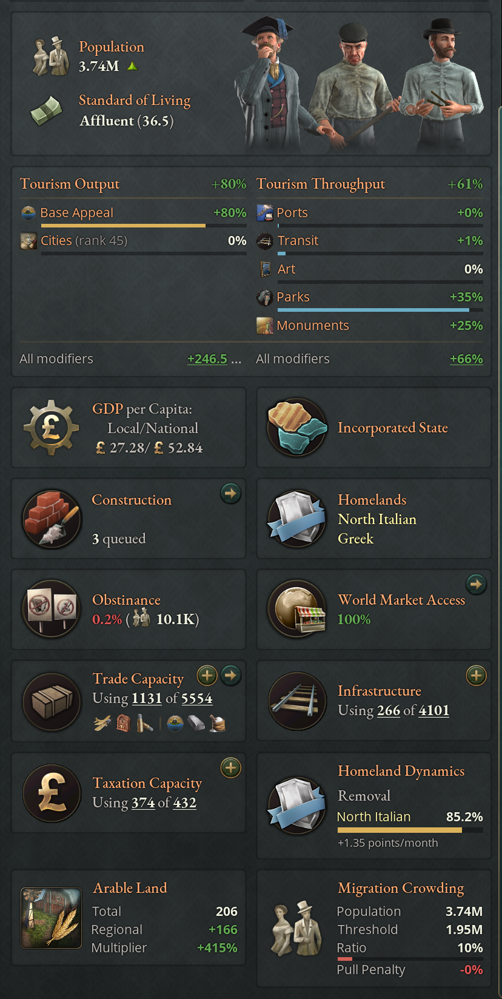
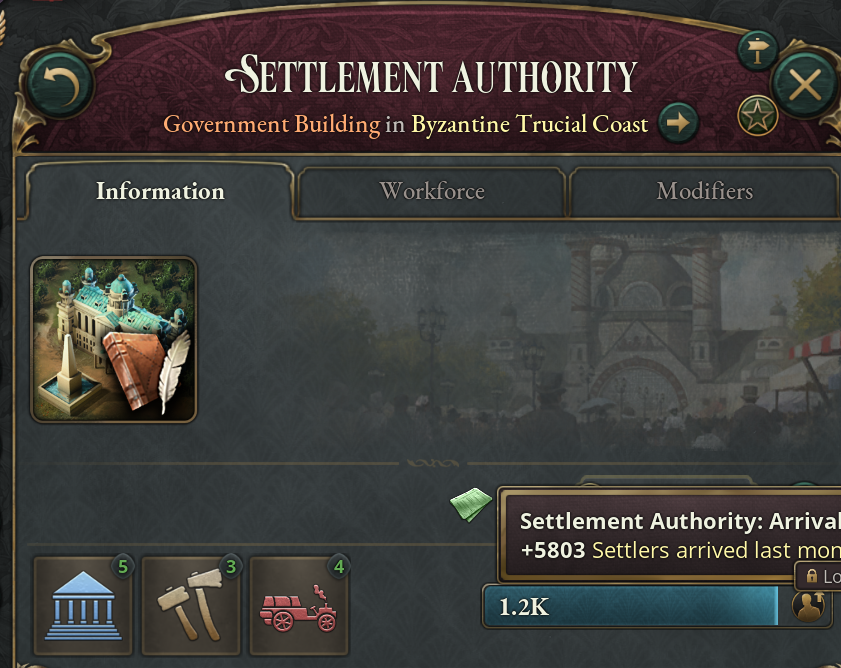

# States and population

The mod changes how people spread across your country and how its states
develop. Crowded states draw fewer migrants, homelands follow the cultures that
actually live in a region, a state's tourism depends on what it offers visitors,
a government can move settlers onto an empty frontier, and a yearly census counts
your people by age and sex. The state panel gains tiles that show most of these.
Everything in this chapter is always on except internal resettlement, which the
Internal Resettlement game rule controls (see the
[Introduction](01-introduction.md)), and the census, which is experimental and
not yet in released versions (see [Demographics](#demographics)).

## State panel additions

The mod adds tiles to the status grid of the state panel, and above the grid a
tourism card and, in a state with a Grand Monument, a Grand Monument card. Each
tile is titled with a game concept you can hover for an explanation, and its
tooltip breaks the numbers down.

| Tile | Shown | What it tells you |
|---|---|---|
| Homeland Dynamics | Always | Which cultures are gaining or losing homeland status here, with a progress bar for each, or why nothing can change. |
| Arable Land | Always | Total arable land, how much technologies and other regional effects add to the geographic base, and the arable-land multiplier. |
| Migration Crowding | While the state is over its crowding threshold | Population, crowding threshold, crowding ratio with a bar, and the migration pull penalty. |
| Wealth Concentration | While the state carries a modifier from its wealth concentration or the inheritance law | The state's score heading for its target, and the modifiers it carries from them (Concentrated or Dispersed Property, Land Hunger, and the inheritance law's farming effect), which the state's modifier icons leave out; see [Who inherits](06-politics.md#who-inherits). |
| Solar Collector | Once your country has one | Receiver slots available and generated (3 per staffed level). A megaproject; see [The extended timeline](02-timeline.md). |
| Antimatter Facility | Once your country has one | Engine and warhead-plant slots available and generated (5 per staffed level). |
| Seabed Licences | On a coastal state, once your country has had its first share of seabed licences | The state's ocean basin, the licences its Deep-Sea Mine levels hold and how many are long-haul, your unused claims in that basin and the claim weight the state adds there; see [Seabed licences](02-timeline.md#seabed-licences). |
| UN Mission | While a UN mission works in the state | The mission's type, months, strength and progress; see [The United Nations](10-united-nations.md). |
| Tourism card | Always | Tourism output and throughput from each source, with a bar toward each source's cap. |
| Grand Monument card | While a Grand Monument stands in the state, yours or another country's | The monument's status, name and dedication, its grandeur with a bar toward its next step, its levels and age once finished, and what it gives the state: Tourism Industry throughput and its dedication's local effect. A contested monument also names its Old Supporters and the group it is Resented By. On your own state the arrow at its corner opens the Grand Monuments tab of the Timeline Extended window; see [The extended timeline](02-timeline.md#grand-monuments). |
| Grand Monument (Under Construction) card | While a Grand Monument is being built in the state | The levels built, the grandeur they come to, what a level finished now adds, whether levels are still being built, and on your own state the Dedicate button. |

In every version of the mod, the birth, death and workforce effects of laws,
technologies and institutions appear in the birth rate, mortality and workforce
tooltips of a state and its pops as Laws and Institutions lines, one for each
kind of effect rather than one for each law. The workforce line also holds the
workforce effects of amendments, interest groups, Woman Soldiers and pollution.
Each law's or technology's own tooltip still lists its effect.

## Migration crowding

Every state has a crowding threshold of 10,000 people for each unit of its
geographic arable land, the land the state starts with before technologies add
to it, plus 1,000 people for each point of Urban Engineering. Once the
population passes the threshold, the state carries a Population Pressure
modifier that cuts its migration pull. The modifier is recalculated once a
year.

Urban Engineering takes the place of the base game's Construction Sector Max
Level, which the mod's construction has no use for, on the same technologies:
Urbanization gives 10 points, and Urban Planning, Modern Sewerage, Steel-Frame
Buildings and Elevators 5 each. With all five, every state houses 30,000 more
people before crowding. That barely moves a large farming province, but it
doubles the threshold of a state with three units of arable land, so a small
state can still hold a large city.

The penalty starts gently and then climbs fast. Up to ten times the threshold it
grows with the square of the excess; beyond that it adds 10 percentage points
for each further multiple.

| Population (× threshold) | Migration pull penalty |
|---|---|
| 1× or less | none |
| 4× | 5% |
| 7× | 20% |
| 10× | 45% |
| 15× | 95% |
| 20× | 145% |

### Raising crowding tolerance

The Migration Crowding Tolerance modifier multiplies the threshold, Urban
Engineering's share included: +50% tolerance lets a state hold half as many
people again before the penalty starts. The tile's tooltip breaks the threshold
into arable land, Urban Engineering and tolerance; hover the Urban Engineering
and tolerance figures for their sources.

| Source | Tolerance |
|---|---|
| Ministry of Urban Planning (institution) | +10% per level |
| Highway on the Civil Highway, Electric Civil Highway or Autonomous Highway method | +10% per level, scaled by staffing |
| Modern Skyscrapers, Wireless Internet (Wi-Fi), Autonomous Vehicles, Post-Scarcity Economy | +15% each |
| Modern Urban Planning, Advanced Structural Engineering | +20% each |
| Urban Planning power bloc principle | +25% at tiers I to III, +50% at IV, +100% at V, plus +5% per Ministry of Urban Planning level (+10% at IV, +20% at V) |
| National Park building on National Park, National Forest or National Wildlife Refuge | −5%, −7.5% or −10% per level, scaled by staffing |

Ministries are explained in [Ministries](06-politics.md#ministries). The same
tolerance also raises the densities that open and close a resettlement frontier.

## Dynamic homelands

With the mod, homelands follow population. A primary culture of yours that makes
up enough of a state's people can gain a homeland there, and a culture that is
not primary and has dwindled can lose one. Each change fills its own progress
bar over years, with no random rolls. A completed change applies to the whole
state region, and you get a notification.

### Enabling homeland changes

Nothing changes until your country enables homeland changes with one of these:

- the Ancestral Citizenship law (Citizenship), Violent Hostility (Minority
Rights) or Linguistic Purity (Language Policy);
- tier II or higher of the Cultural Unity principle in your power bloc;
- the Mass Media technology.

You must also own the whole state region. Losing either condition pauses every
project in the state, and the Homeland Dynamics tile says why. Progress resumes
where it stopped.

### Homeland thresholds

A primary culture without a homeland in the state can start forming one once it
makes up at least the creation threshold of the state's population, 60% by
default. Laws and principles move the creation threshold, but never below 10% or
above 90%.

A culture with a homeland in the state that is not one of your primary cultures
starts losing it once its share falls below the removal threshold. The default
removal threshold is 0%, so no homeland can be removed until a law or principle
raises it.

A culture's progress resets to zero if the state changes owner or the culture
stops qualifying; the tile marks such a project before it is cleared.

### Speed of homeland change

A project gains 10 percentage points a year by default, so a homeland forms or
disappears in ten years. The Homeland Change Speed modifier scales that rate.
Turmoil of 25% or more multiplies it by 1.25, and 50% or more by 1.5. Legitimacy
below 25 halves it, and legitimacy of 75 or more multiplies it by 1.25. The rate
stays between 1 and 95 points a year. The Promote National Values decree adds
+300% speed in its state, which on its own brings a change down to 30 months.
In the states of a party to the UN Convention on Cultural Diversity, a homeland
is lost 30% more slowly at the Established tier, scaled by the UN's enforcement
(see [UN conventions and
agencies](10-united-nations.md#un-conventions-and-agencies)); forming one is not
affected.

Laws and principles that move the three numbers:

| Law or source | Creation threshold | Removal threshold | Change speed |
|---|---|---|---|
| Ancestral Citizenship | −20% | +10% | +50% |
| Violent Hostility | −20% | +10% | +25% |
| Ghettoization | −15% | none | none |
| Linguistic Purity | −10% | +10% | +50% |
| Cultural Assimilation | −10% | +5% | +25% |
| Racialized Citizenship | −10% | +5% | +25% |
| Protection | +10% | −5% | −15% |
| Affirmative Action | +20% | −10% | −25% |
| Universal Citizenship | +20% | −5% | −25% |
| Cultural Unity principle, tier II / III / IV / V | −5 / −15 / −25 / −35% | +5 / +10 / +20 / +40% | +5 / +10 / +20 / +30% |

Other Citizenship, Minority Rights and Language Policy laws, a few technologies
and the language-reform amendments move them too; the tile's tooltip lists every
source. Under Ancestral Citizenship alone, a primary culture needs 40% of a
state to start a homeland, a minority's homeland goes once it falls below 10%,
and each change takes under seven years.

## Cultural acceptance and minorities

When a new cultural community appears in a state, the base game gives it a
temporary local acceptance penalty that wears off over time. The mod makes the
penalty harsher and much slower to fade: a new community starts 40 points of
acceptance down instead of 30 and recovers 1 point a year instead of 3, so the
penalty lasts about 40 years rather than 10. The mod also adds two state
modifiers that act on the penalty:

- Annual Cultural Acceptance closes the penalty faster, adding its value in
acceptance over a year to every culture that still carries one. The Cultural
Integration decree gives +5, the Ministry of Refugee Affairs +0.2 per level, and
tiers III to V of the Cultural Plurality principle +0.25 to +0.5.
- Minimum Local Acceptance limits how deep the penalty can go: no deeper than
−40 plus the modifier's value. Indifference gives +5, Protection +10 and
Affirmative Action +20 (all Minority Rights laws), and Cultural Plurality tiers
III to V give +5 to +10. Without either modifier there is no floor.

These matter most where migration keeps bringing new communities into a state.

The Violent Hostility law and the Cultural Emigration Initiative decree give a
state Violence Against Minorities. Each year, every culture there with
acceptance below 60 risks an outbreak, more likely the lower its acceptance. A
severe outbreak kills 10% of that culture in the state, radicalizes the
survivors, devastates the region and sets off a mass migration; a lesser one
kills 2% and does the same on a smaller scale. Minority laws are in [Rights and
society laws](06-politics.md#rights-and-society-laws).

## State tourism

Tourism is a luxury good in the mod, made by the Tourism Industry building
(unlocked by Romanticism, see [The extended timeline](02-timeline.md)) and
bought by wealthy pops. Two state modifiers, refreshed monthly and shown on the
tourism card, set how much a Tourism Industry makes: Tourism Output and Tourism
Throughput.

### Tourism output

Two sources on the card set a state's output bonus:

| Source | Bonus |
|---|---|
| Base Appeal | A fixed score for each state region, from its scenery, climate and history. It runs up to +100%; Wyoming scores 90%, Nebraska 20%, and any region without its own score gets 20%. Nothing changes it. |
| Cities | +100% for the largest city in the world, 5% less for each place below it, nothing below 20th. See [World city rankings](#world-city-rankings). |

The card's "All modifiers" line adds everything else that changes output. An
Airport or Spaceport adds +15% per level, scaled by staffing. A Highway adds +5%
on the Civil, Electric Civil and Autonomous Highway methods and +2.5% on the
Industrial and Electric Industrial ones. Laws add between
−30% (Secret Police, Outlawed Dissent) and +15% (Universal Citizenship).
Pollution, turmoil and obstinance cut output in proportion to how bad they are,
at their worst by 200%, 100% and 50%, so heavy pollution can shut a state's
tourism off entirely.

### Tourism throughput

Four sources set a state's throughput bonus, and each capped one shows a bar
toward its cap:

| Source | Bonus | Cap |
|---|---|---|
| Excess Infrastructure | The infrastructure the state produces less what its buildings use: +25% at 10,000, +50% at 30,000, +75% at 90,000. Each point adds less than the one before. | +100%, never quite reached |
| Art | +1% per Creative Industry level up to 20, +0.25% up to 100, +0.05% up to 500, +0.01% up to 1,500 | +70% |
| Parks | +25% with a National Park, rising with Base Appeal to +37.5% | +37.5% |
| Monuments | +10% for a Skyscraper, +25% for each monument | none |

Railways and Highways raise Excess Infrastructure by supplying infrastructure.
Each building you add uses some, so a crowded industrial state has little to
spare for visitors.

The "All modifiers" line for throughput also carries the Promote Tourism decree
(+50%), a Grand Monument (+25% for each step of its grandeur, see [Grand
monuments](02-timeline.md#grand-monuments)) and bonuses from events.

## World city rankings

Each month the game ranks every state in the world by city size: the services it
produces (only with an Urban Center), weighted up by its average standard of
living, ×1.5 for a capital and ×1.5 for a great power's states, halved for an
unrecognized country. The tourism card shows the rank. The top 20 get the Cities
bonus to tourism output, from +100% for first to +5% for twentieth; nothing else
uses the ranking.

## Demographics

The census is experimental, and released versions of the mod leave it out. A
development build offers it as the Demographics (Experimental) game rule, off by
default: set it to Full or Display only when you start a new game. A save from
an earlier version keeps it off. The rest of this section describes the census
with the rule on.

With it on, every state keeps a census of its people by single year of age and
by sex. It is taken when the game starts and again once a year, and it opens a
Demographics tab in the Population panel, beside the base game's four, and a
Demographics subtab on the state panel's Population section. The tab is open
from the first day.

Under the Demographics (Experimental) rule's Full setting, the census sets each
state's births and deaths from its age structure, children per woman and causes
of death, described below. From its first step in a state, the Laws and
Institutions lines (see [State panel additions](#state-panel-additions)) go. The effects the census models become part of its own
rates: those of the child labor and women's rights laws, the health laws, the
Contraceptive Pill, State-Sponsored Family Planning, vaccines and antibiotics,
mild starvation, Primogeniture's larger farm families, which late marriage replaces, and Forced Heirship's smaller ones, which Family Limitation replaces. The late medical technologies' cuts to deaths become part of its rates too (see [Life extension](#life-extension)). The rest, such as Communal Child-Rearing, the State Eugenics Program, the Sexual Revolution and the family-policy laws, it applies at its own rate, as it does an effect on the whole state, such as pollution, devastation or a decree. Either way, a new law
or technology takes effect at the state's next census step, up to a year later.
An effect on some of a state's people, such as severe starvation, applies to
their rate in the base game. Private Health Insurance's cut for the wealthy
works at the census's rate, and no pop's deaths fall below half of it. A state's
birth rate and mortality tooltips show the census's part as Census: Births and
Census: Deaths.

Under Full the census also sets each state's workforce, from who is of working
age and how many of them work. The working ages run from 15 (children of 10 to
14 work at a share each child labor law lists among its modifiers) to the pension age, or with no
pension law for as long as people's health allows. Men of working age mostly
work; how many women work depends on the women's rights laws, the technologies
that free women's time and the state's lower strata, whose women work under any
law. This replaces the laws' and technologies' own flat workforce lines: in 1836
a state works about as in the base game, but a rich modern country has a sixth
to a quarter fewer workers than the flat lines would give it. The change moves a
state's workforce by at most a point a year, shown as Census: Workforce in its
workforce tooltip, and the game's own count follows it over time.

With Old Age Pension, you choose the pension age with five buttons on the
Demographics tab. A setting holds for five years once chosen, and the AI picks
its own with the same considerations: a heavy bill or debt toward Raised or
Linked to Average, high unemployment toward Early.

| Setting | Pension age | What you gain and what you pay | Interest groups |
|---|---|---|---|
| Early Retirement | 60 | More of the old retire and jobs open for the young; the largest bill and the smallest workforce. | Trade Unions +2, Industrialists −1 |
| Standard | 65 | The default. It grows more generous as lives lengthen, since more people live to draw it, and for longer. | None |
| Raised Pension Age | 70 | A smaller bill and more old people at work. | Trade Unions −2, Rural Folk −1, Industrialists +1 |
| Linked to Average Longevity | Five years below where old age begins for your people, at least 65 | Follows lengthening lives, so the bill stays in check, a year at a time. | Trade Unions −1, Rural Folk −1, Industrialists +1 |
| Linked to Common Longevity | Five years below where old age begins for those who still age, at least 65 | The same until longevity treatment exists; after that it keeps the pension within reach of the untreated, at a larger bill. | Trade Unions +1, Rural Folk +1, Industrialists −1 |

The pension age changes at once, but a linked setting moves at most a year a
year; the bill and the workforce follow at the next census. Under Full, Old Age
Pension costs money for its pensioners: each year's census sets a weekly expense
worth 6% of your output per person for each pensioner, per level of Social
Security: Census: Pension Bill, which the Budget panel's Breakdown tab lists
under Old-Age Pensions. A rich country at Standard with a
fifth of its people pensioned pays about a fifth of its revenue. Universal Basic
Income and the Post-Scarcity Economy pay everyone already and have no pension bill. An older
people also needs more care: the Ministry of Health costs more bureaucracy as the
census's health need rises above 1836's, and more for each chronic-care
technology (Modern Pharmaceuticals, Telemedicine, Personalized Medicine): about
two fifths more for a rich country today. Outside Full none of this changes
anything, and the buttons are greyed.

The census also counts each state's men of fighting age, 20 to 39, its young
adults and its men per 100 women aged 20 to 59, and takes war dead from the men
of fighting age. Under Full each count sets a state modifier, refreshed at the
state's yearly census:

- **Census: Fighting-Age Men** scales the state's conscription by its share of
  men of fighting age against 1836's: a state short of young men raises fewer
  conscripts, and one rich in them proportionally more, with no upper limit. An
  aging country loses conscripts as its people grow older. This one stays out of
  the state's modifier list; the conscription tooltip names it and the Fighting-Age
  Men row on the Demographics tab shows the figure.
- **Census: Youth Bulge** appears where young adults aged 20 to 29 are more than
  18% of the people while work is short. At full strength (24% young adults and
  a fifth of the workforce without work) radicals from movements rise by 15% and
  the effects of turmoil by 10%.
- **Census: Fewer Men** appears below 90 men per 100 women, as after a war with
  many dead. Fewer women marry, so children per woman fall with the balance (by
  at most a fifth), more women work, and support for women's rights movements
  rises, by up to 10% at 80. **Census: More Men** appears from 110 men per 100
  women and raises radicals from movements, by up to 10% at 150.

The census books migration as whole families once a state gains or loses many
people in a year, so migration alone seldom carries a state's balance past 90
or 110.

Display only keeps the tabs and changes nothing: births, deaths and the workforce
follow the base game's rules, and the tab reports what they produce. Disabled,
the default, also removes the census and both tabs. Wealth Concentration and its
effects on each state (see
[Who inherits](06-politics.md#who-inherits)) keep working under all three.

### What the tab shows

The tab covers your country as a whole. Most figures have a tooltip that explains
them, and some break the figure down for your capital.

| Section | What it shows |
|---|---|
| Overview | Eight readings, each with an icon and a figure beneath: natural change (births less deaths per 1,000 people), net migration, life expectancy (100+ past 100; the share of infants who die), the leading cause of death and its share of deaths, children per woman, median age (the share aged 65 and over), the working-age share (the dependency ratio) and the Gini coefficient (Wealth Concentration and its target). Hover a reading for more. |
| Causes of Death | Last year's deaths per 1,000 people and a pie of those deaths by cause; see below. |
| Population pyramid | Men per 100 women, then people by five-year age band, with an outline twenty years ahead; once longevity care exists, a button shows the people in care at their biological ages. |
| Work and Retirement | The workforce as the working-age share times the share of them at work, plus those still working past the working ages; old age from (the age with fifteen years of life left; None when no age has); under Old Age Pension the pension age with its five buttons, the pensioners and, under Full, the pension bill; then health need against 1836's, the men of fighting age with the conscription they give, and young adults where they are many while work is short. |
| Longevity | Once longevity care exists: Living to 100, the mean biological age beside the calendar one, the share of people within the care's reach, with the health system's part and the wealth from which the market brings it, and the longevity gap. |
| Family Policy | Under Full, your Family & Reproductive Policy law and the measures it allows, each with its running cost, its term and a button; the measures only other laws allow, dimmed. See [Family policy measures](#family-policy-measures). |
| History | Eight charts by year, over 5, 20 or 100 years: births and deaths per 1,000 people, net migration, life expectancy, children per woman, median age, deaths by cause, the Gini coefficient and Wealth Concentration. A mark over a year shows war dead, a famine or a demographic event. |
| Wealth | The Gini coefficient, the average income of each stratum, and what sets the Wealth Concentration target, with your most and least concentrated states. |
| Where people live | Urban share, the largest city's share of urban people, the effective number of cities, the urban pattern and your three largest cities. Under Full, the urban pattern's tooltip shows its effects. |
| States | Your ten largest states, with people, life expectancy, median age, children per woman and Gini; hover a row for its age shares, men per 100 women and Wealth Concentration, and click it to open the state. Show All lists up to 40. |
| How Demographics Works | A collapsed section that explains the method. |

The subtab shows one state's overview, causes of death, pyramid, work and
retirement (without the buttons), longevity and wealth, in the tab's order, for
any state you open, and says when the state is next counted. The first count of a state comes from the age structure its own birth and
death rates would settle into, so 1836 opens with a settled population, not a
baby boom or a gap.

### Reading the pyramid

The pyramid has a row for each five years of age, from 0 to 4 at the bottom to 85
and over at the top, with men on the left and women on the right. A wide base
means many children; a column that narrows slowly means few births and long
lives. Hover a row for the numbers. The pale outline behind the bars carries
your people twenty years forward at the census's own birth and death rates for
this year, five years at a time. It leaves out migration and holds the rates where they are, so it
shows where today's course leads, not a forecast. Only your own country gets it.

### Reading the figures

Each year, the people of every age lose their dead at that age's rate, the
newborn enter at age 0, and the war dead, people killed by events and migrants
are taken from or added to the ages they belong to. The war dead are people aged
18 to 40, nineteen in twenty of them men. Children per woman follows wealth and
women's legal standing, and two customs lower it. Under late marriage, strongest
at the start in north-western and central Europe, women marry in their
mid-twenties and many never marry. Under birth spacing, strongest in Japan and
slight in China and Korea, couples space and stop births by custom. Modern
contraception wears both away, and health care wears away birth spacing; women's
paid work and farms that pass whole to one heir make late marriage more common.
Both customs also spread slowly from neighbouring states.
The figure then falls with literacy, child survival and city life, and family policy moves it (see [Family policy measures](#family-policy-measures)). Under Full, the figure shown is what births came to that
year, so decrees, famine and other effects on births count in it; its tooltip
lists them as births added on top of the census. The means to plan a family
grow with literacy and with contraception: Vulcanization, Feminism, the
Contraceptive Pill and Modern Pharmaceuticals each add some, in any order, and
State-Sponsored Family Planning adds more, whoever can read. Their tooltips show
each line. Under Full, family limitation adds to them too: the share of couples
who stop at the family size they want by older methods, which France starts with
at 60%. It spreads from neighbouring countries that practise it, grows under
Forced Heirship in farming countries and in nearly universally literate ones,
less under a state religion, and never falls back, though modern contraception takes over its part
of the means as it arrives. It shows as Family Limitation among a country's
modifiers. Under Full, too, where a cultural hegemon's culture outweighs yours
(the Foreign Cultural Benchmark), the size of family its people want pulls yours
a little toward it: a few percent at most, shown as the cultural hegemon's
example in the children-per-woman tooltip. Life expectancy follows five
causes of death, which standard of living, medicine, health laws and institutions
bring down. Medicine saves lives only as far as health care reaches. Markets and
charity give some care everywhere; a health law adds more with each level of the
Ministry of Health, in incorporated states only. So a Public Health Insurance
law does little before antibiotics, and medicine without a health system
reaches less than half the people. The medical technologies and the health,
policing, criminal justice, pension and labor laws show what they do to each
cause in their tooltips. Deaths from accidents and violence fall with each
level of the Ministry of Public Safety in incorporated states: 3% a level under a
Dedicated or Militarized Police Force, 2% under Local Police or Private Policing,
nothing under No Police. Restorative Justice lowers them 4% and
Rehabilitation-Focused Criminal Justice 8%; Penal Labor Camps raise deaths at
work. Later technologies make work and everyday life safer whatever the
laws: Prefabricated Construction, Industrial Robotics, Containerization and
Knowledge Economy together prevent nine in ten deaths at work, and Modern Urban
Planning, Computer-Aided Design and Cellular Networks two in five deaths from
accidents and violence, half once Autonomous Vehicles is researched. Medicine
cuts adults' deaths from infection by more than children's, since it cures the
tuberculosis and pneumonia that killed adults in 1836, so in a rich country
adults die of infection about as rarely as in the rich world today; Personalized
Medicine and Advanced Nanofabrication cut deaths from infection to about a sixth
of that. Life
expectancy and infant mortality are the census's own figures, before famine, war
and disasters.

Medicine also takes time to arrive. A new medical technology, health law or
Ministry of Health level moves a state's medicine part of the way at each yearly
count: a tenth of the gap at first, and up to two fifths once the Electric
Telegraph, Modern Nursing, Radio, Intergovernmental Organizations, the World
Wide Web and Telemedicine are researched. Under Full, the Medical Outreach
decree closes a further fifth of the gap at each count in one state, and it
ends once the state has caught up. Turmoil raises deaths from accidents and
violence, by half at full turmoil. Where the map marks a state with malaria
(most of tropical Africa, parts of Indonesia and the Pacific islands), deaths
from infection run higher, more so with severe malaria, until Malaria
Prevention; Quinine protected colonists, not the people who lived there, so it
changes nothing here.

The Causes of Death section, on the tab for your country and on the subtab for
one state, splits last year's deaths in a pie: infection and hunger, chronic
illness and old age, accidents and violence, work, childbirth, people killed by
events and the war dead, and under Full the deaths added on top of the census's
own. The census counts deaths, not causes, so the five causes share out its own
deaths by each cause's rate in each age band, at the body's age for people in
longevity care; the rest are counted as they are.
Hover a cause for its rate against a poor country's without modern medicine,
what makes it up and where medicine is heading. Below the pie is health care
access. Under Full the Added on Top row's tooltip gives the deaths against the
census's own rate, in red from a quarter above it, split into effects on the
whole state and effects on some of its people, such as severe starvation. The Landowners' Famine Reserves
is the exception: under Full the census sets the farm workers' saved lives
against the rest of the state, so it moves deaths within a state without
lowering them.

An arrow beside a figure shows whether it rose or fell since the last census.
Life expectancy rising is green; the other figures are neutral. Arrows appear only after the census has been brought forward
a full year twice, so in a new 1836 game the first ones come with the census at
the end of 1838. Births and deaths per 1,000 people appear from the first full
year.

### The urban pattern and a planned capital

The urban pattern counts each state as one city and its urban people as everyone
who does not work a farm, plantation, ranch, mine or other rural workplace. The
pattern is Primate when the largest city holds 40% or more of all urban people,
Dominant from 25%, Balanced from 10% and Dispersed below that.

Under the Full setting a Dominant or Primate pattern has effects; Balanced and
Dispersed are the baseline. Your largest city gets Primate City, with more Urban
Center throughput and migration attraction. Every other state gets Provincial
Neglect, with less migration attraction and higher penalties from turmoil. Both
grow with the largest city's share of urban people, from nothing at 25% to their
full size at 60%: Urban Center throughput +10% and migration attraction +15% for
the city, migration attraction −10% and turmoil penalties +10% for the rest. A
country of fewer than three states gets neither. Each state takes the new figure
at its yearly count, and the Urban Pattern tooltip names your largest city and
shows the current figures. Under Display only it says what Full would do.

The decision Plan a New Capital, also under Full, moves your seat of government
away from your largest city. It appears once you research Modern Sewerage and
can be taken with Steel-Frame Buildings, a Dominant or Primate pattern, 100
authority to spare, at peace and outside any diplomatic play, when you have not
moved your capital recently, and once in 50 years. It offers up to three sites:
your largest incorporated states that are a homeland of one of your primary
cultures, hold at least 1% of your people, and are neither the capital nor the
largest city. The capital moves at once.

| You pay | You get |
|---|---|
| 3% of a year's GDP, at once | The capital in the chosen state |
| 100 authority for five years (Building the New Capital) | Planned Capital on the new capital for 20 years: migration attraction +25%, state construction efficiency +20%, infrastructure +10 and Government Structures throughput +10% |

Planned Capital ends if the capital moves away again. Not now spends nothing,
and the decision stays open; it is also what happens if you let the choice
lapse. A site you lose, or a war that starts, while the choice is open takes
that site off the list. A planned capital draws migrants and building to a
region your largest city leaves behind, so over the years it can lower that
city's share and with it Provincial Neglect. The AI plans one only with a
Primate pattern of 45% or more, eight states or more, a largest city crowded to
Migration Crowding's ceiling (ten times the reference density), and the money
in its treasury.

### Life extension

From mRNA Therapeutics on, medicine slows ageing itself as well as treating
illness, and the census tracks each person's body apart from the calendar.
People in longevity care age nine-tenths of a year each year with mRNA
Therapeutics, seven-tenths once Personalized Medicine, Genetic Engineering and
Synthetic Biology follow, and not at all with Biological Immortality, under which bodies older than
35 also wind back toward 35. Children are never treated: people join at 25.

Who is in care depends on your laws and your people's wealth. Each law below
lists its part among its modifiers.

| Law | Longevity care |
|---|---|
| Public Health Insurance | Everyone the health system reaches. |
| Charity Hospitals | A quarter of those it reaches. |
| Private Health Insurance, No Health System | The market alone; Private Health Insurance brings its price down twice as fast. |
| Mandatory Augmentation | At least nine in ten people. |
| Unrestricted Augmentation | The market reaches 20 levels of wealth further down. |
| Regulated Augmentation Market | The market's price falls half again as fast; with Private Health Insurance, two and a half times as fast. |
| Human Purity | None. |

The market reaches the rich first: from your first ageing technology, people
from wealth 80 can buy care, and the line falls about a level a year, faster with
the technologies that spread medicine. Care rolls out as fast as new medicine
spreads, and a ban winds it down the same way; people who lose care keep the
bodies they have and age normally from there. The Longevity section shows the
share in reach and the gap between those in care and those not, as the chance of
living to 100.

Under Full, people in care die at their bodies' rates. Where the market reaches
the rich first they die less, so your wealthy pops grow against the poor. The
health system's share of the care costs your Ministry of Health more bureaucracy.
Women in care can have children they put off, and births nobody planned go on as
long as their bodies allow, even past 50 by the calendar; State Youth Centers on
Ectogenesis carry a share of planned births with no risk in childbirth. A society
that stops ageing turns a slow decline into slow growth, about 1% a year at 1.6
children per woman: the brakes are the means to plan a family and the size of
family people want. Old Age From rises with longer lives and reads None once no
age has fifteen years left; Linked to Average Longevity follows it, Linked to
Common Longevity follows those not in care, and the AI moves to Linked to Common
when the gap is wide. Under Full a wide gap also costs you politically: the
Trade Unions and the Rural Folk lose up to 3 approval, more the wider the gap and
the fewer of your people are in care, and the labor movement gains support in
the states where the gap is widest. Mental Health Awareness cuts deaths from
accidents and violence, and Mind Backups halves deaths from accidents, violence
and work among the people in care, whose minds it restores to new bodies: a
state with half its people in care loses a quarter of those deaths. Outside Full
these technologies cut deaths by a flat share, and nothing else of this changes
the game.

With Mind Backups and a Mind Upload Nexus, under Full, people in care who face
death from illness or old age upload instead and go on as minds, as far as your
Nexuses have room: a million minds a level, shared across the country. Their
bodies die and leave your states' people, but Living to 100 counts them as
living, deaths per 1,000 leave them out, and the Longevity section's Uploaded
Minds row shows how many you host. Each year a thousandth of the minds choose to
end. A Nexus makes only what its minds produce: an empty one makes nothing, and
a full level about five times what a Nexus makes outside Full, most of it
software, with its research bonus following the same share. The fill is fastest
in the decades after Biological Immortality, while bodies that aged before it
still die of old age; once they have wound back, few in care die of illness and
a Nexus fills slowly. If you lose Nexus levels, the minds that no longer fit are
archived, frozen, and come back before anyone new uploads once you build again.

### Family policy measures

Under the Full setting, the tab's Family Policy section lets you act within your
Family & Reproductive Policy law. It shows the law in force, a row for each
measure that law allows, with its running cost, its term and a button, and,
dimmed, the measures only another law allows; hover one for the laws that allow
it. Under Display only the rows show what each measure would do and the buttons
are greyed.

A measure takes effect as soon as you start it and costs its upkeep while it
runs: a weekly share of GDP for the ones paid in money, recalculated each year,
authority, or a costlier Ministry of Education. A measure acts on every state
at once, so the ones that need enforcement cost more authority than a decree
does for one state, and one child with the Crash Campaign takes 700. As with a
decree, a measure paid in authority can't start until you have its upkeep free,
and Birth Limit can't tighten to one child without the further 100; ending a
measure needs no authority. Each also moves the approval of
the interest groups its tooltip lists. Once started, a measure runs for at least
five years, and its button can't end it before then. A change to a law that
doesn't allow a measure ends it at once, with a notice, and taking it up again
under another law starts a new term. Under Communal Child-Rearing your form of
government adds measures: a Council Republic or Anarchy also allows Sex
Education, and a Single-Party State or Autocracy that has outlawed dissent also
allows Honours for Large Families and Restricted Contraception. A change of
government ends what the new laws don't allow. Birth Limit's button moves from two
children to one child, then ends the limit. The Crash Campaign ends itself after
five years and can't return for ten.

| Measure | Laws that allow it | What it aims at | Upkeep |
|---|---|---|---|
| Child Allowance | Pro-Natalist Policy, Communal Child-Rearing | Families want more children | 0.5% of GDP a year, more where children are many |
| Family Housing | Pro-Natalist Policy, State-Sponsored Family Planning, Communal Child-Rearing | Offsets half of city life's pull toward smaller families | 0.25% of GDP a year, by the share of people in cities |
| Honours for Large Families | Traditional Family Structure, Pro-Natalist Policy; Communal Child-Rearing under a Single-Party State or Autocracy with Outlawed Dissent | Families want a few more children | 50 authority |
| Restricted Contraception | Pro-Natalist Policy; Communal Child-Rearing under a Single-Party State or Autocracy with Outlawed Dissent | Families have less means to plan their children; more mothers die; the feminist movement gains support | 200 authority |
| Parental Leave | State-Sponsored Family Planning, Communal Child-Rearing | Families want more children, and more women work | 0.3% of GDP a year, by the share of women at work |
| Free Contraception | State-Sponsored Family Planning, Population Control Measures, Communal Child-Rearing | Families have more means to plan their children | 0.1% of GDP a year |
| Sex Education | State-Sponsored Family Planning, Population Control Measures; Communal Child-Rearing under a Council Republic or Anarchy | Knowing how to plan a family reaches people as if literacy were 20 points higher | The Ministry of Education costs 10% more bureaucracy |
| Later, Longer, Fewer | State-Sponsored Family Planning, Population Control Measures | Families want fewer children | 150 authority |
| Birth Limit | Population Control Measures | Families want far fewer children, fewer still at one child; once Microprocessor is researched, more boys are born than girls | 300 authority, 400 at one child |
| Rural Exemption | Population Control Measures, with Birth Limit | Halves Birth Limit for farming families, by the state's share of Peasants and Farmers | None |
| Crash Campaign | Population Control Measures | Families want fewer children still; legitimacy −10 and more radicals from movements | 300 authority |

The census reads a measure at each state's next yearly count: how many
children families want, city life's pull toward smaller families, the means to
plan a family, mothers' deaths in childbirth and, once Microprocessor is
researched, how many boys are born per 100 girls. Births follow over the year
after. Under Full, Pro-Natalist Policy itself makes families want a few more
children, and the law's own boost to births and Population Control Measures' cut
no longer apply: the measures carry those laws' force. Pro-Natalist Policy with
Child Allowance, Family Housing and Honours adds about 0.3 children per woman in
a rich country that has few, for 0.4–0.5% of GDP a year. Restricted
Contraception, Birth Limit and the Crash Campaign move births further, at their
political price. The Children per Woman tooltips list family policy beside the
other terms. Parental Leave's women's work counts toward the workforce as the
women's rights laws' does.

The AI starts the measures that raise births when its population shrinks or
many of its people are old, and the ones that lower births in a famine, when
half its people live in states crowded to Migration Crowding's ceiling, or with
a youth bulge, as its treasury and authority allow, at most one measure paid in
money a year. It takes
Restricted Contraception, Birth Limit's one child and the Crash Campaign only
when the need is pressing and its legitimacy is high.

### Demographic events

Under the Full setting, ten events mark the moments the census records: the
Demographic Dividend (the working-age share a tenth above 1836's), the Baby Boom
(after a long war with heavy losses), the Lost Generation (war dead past a
twentieth of the men of fighting age), the Greying of the Nation (pensioners at a
fifth of the people), the Youth Bulge (a fifth of the people in their twenties
while work is short), Missing Girls (110 boys born per 100 girls under Birth
Limit), Bare Branches (110 men per 100 women), the Empty Villages (an old,
shrinking farm state), the Overspill (a dominant city crowded to Migration
Crowding's ceiling) and the Last Generation? (Biological Immortality). Each comes
at most once in 25 years, and the Last Generation? once a game; at most one of the
yearly ones arrives on a given 31 December. The Lost Generation and the Empty
Villages offer only harms: each choice spares one and pays its own cost. Some
choices use the census's own levers: the pension age, Birth Limit and, for the
Overspill, your Settlement Authorities' Planned Towns. Every event and choice is
listed in [Demographic event list](19-appendix-events.md#demographic-event-list).

<!-- screenshot: the Demographics tab with the population pyramid and its twenty-year outline -->

## Internal resettlement

Internal resettlement is government-run settlement of an empty frontier. You
build a Settlement Authority in a thinly populated state. Each month it recruits
settlers across your country under its program and moves them there. You never
choose a culture or religion to move: programs select by occupation, strata,
acceptance and radicalism.

The Internal Resettlement game rule has three settings. Enabled (the default)
gives everyone every program their laws allow. AI Voluntary Only is the same for
players, but each month it switches AI countries off Penal Transportation,
Special Settlements and Rustication. Disabled removes the system. Moving people
between countries by treaty is a different mechanic, the Population Transfer
article in [Diplomacy](09-diplomacy.md).

### The Settlement Authority

The Settlement Authority is a government building available from the start of
the game, with a low construction cost. It can only be built on an open
frontier, measured over the whole state region whoever owns each part:

- a new Authority needs fewer than 2 people per km²;
- an existing one keeps running, and can add levels, until the region reaches
10 people per km².

Both densities scale with Migration Crowding Tolerance, and the building's
requirements show the region's current density against them. In an 1836 start
the open frontiers include the American West, Siberia, the Kazakh steppe,
Hokkaido and the Argentine pampas.

An Authority can have up to 5 levels. Nationalism, Civilizing Mission, Mass
Propaganda, Keynesian Economics and Civil Rights Movement each add 5, to a
maximum of 30. Capacity and costs scale with level.

When the region reaches the closing density, the Authority is wound up and you
get the event "The Frontier Is Closed". To keep settling, build one on the next
frontier.

### Resettlement programs

The Resettlement Program method decides who is recruited and how many move each
month. Half the capacity comes with each level and half depends on staffing, so
a new Authority moves settlers from the first month and speeds up as it fills
its jobs. The state's modifiers show the total as Settlers Moved per Month. The
table gives each program's settlers a month for every fully staffed level.

| Program | Needs | Recruits | Settlers a month per level | Die in transit |
|---|---|---|---|---|
| Land Grants | nothing | Unemployed and peasants of the lower strata who are at least second-class citizens; no peasants under Serfdom | 300 | none |
| Military Colonies | Standing Army | As Land Grants, but fully accepted only | 250 | none |
| Penal Transportation | Law Enforcement; not under Guaranteed Liberties, Restorative Justice or Rehabilitation-Focused Criminal Justice | Lower-strata pops in which at least a fifth are radicals | 100 | 5% |
| Organized Colonization | Railways | Unemployed, peasants and laborers of the lower strata who are at least second-class citizens | 500 | none |
| Special Settlements | Mass Propaganda and Collectivized Agriculture; not under Guaranteed Liberties, Protected Speech or Right of Assembly | Farmers | 1,000 | 15% |
| Development Program | Keynesian Economics; not under Laissez-Faire | As Organized Colonization, plus machinists, engineers and clerks, all at least second-class citizens | 800 | none |
| Rustication | Mass Media and Single-Party State; not under Guaranteed Liberties, Protected Speech or Right of Assembly | Laborers and clerks who do not work in farming, plantations, ranching or subsistence | 800 | 1% |
| Managed Retreat | Environmental Movement | Everyone except slaves, from coastal states while you suffer Coastal Flooding or Coastal Population Relocation, and from states hit by a nuclear strike or a weapons accident | 600 | none |

Programs cost bureaucracy, paper and staff. The voluntary programs and Managed
Retreat also use services; Military Colonies and the coercive programs (Penal
Transportation, Special Settlements and Rustication) hire soldiers and use small
arms instead. Slaves are never recruited. If a law change retires the running
program, the Authority falls back to Land Grants. Managed Retreat's damage comes
from [Climate events](15-climate.md#climate-events) and [What a nuclear strike
does](14-nuclear.md#what-a-nuclear-strike-does).

Each program also speeds up the destination's incorporation and its growth as a
colony, by 10% to 25%. Military Colonies also reduce the effect of turmoil there
by 25%, and Penal Transportation and Special Settlements raise mortality there.
These bonuses grow with the month's arrivals and reach full strength at 2,000
settlers a month, so a small or idle Authority buys little of them.

### Settlement plans and transport

The Settlement Plan decides what settlers build. Any plan works with any
program, and every plan adds +1 migration pull per level to help the frontier
hold its settlers.

| Settlement plan | Needs | Effect on the destination |
|---|---|---|
| Homesteads | nothing | Virgin Soil: +10% farm and ranch throughput and more subsistence output. No arable land is added, and the bonus ends with the Authority. |
| Work Settlements | nothing | The Authority employs 100 laborers per level and uses tools; +10% mining and logging throughput, more infrastructure. |
| Planned Towns | Modern Urban Planning | +10% construction, more infrastructure and migration pull; employs engineers and uses services. |

The settlement bonuses scale with arrivals in the same way as the program's.

Transport adds capacity for every fully staffed level and costs transportation
goods:

| Transport | Needs | Extra settlers a month |
|---|---|---|
| Overland | nothing | none |
| Rail and Steamship | Railways | +200 |
| Motor Transport | Combustion Engine | +400 |
| Airlift | Commercial Aviation | +600 |

### How settlers are recruited

Each month an Authority works down your other states, most eligible people
first, until its capacity is met; it skips other Authorities' states. A state
gives at most 2% of its eligible people a month across all your Authorities, and
any draw of fewer than 100 people from a pop is skipped, so a pop smaller than
5,000 is never recruited. The Authority's Modifiers tab shows "Settlers arrived
last month" and "Died in transit last month", and each source state's modifiers
show how many it gave.

The Resettlement Recruitment Drive decree steers recruitment. Every Authority
recruits from a drive state before any other, and may take 4% of its eligible
people a month instead of 2%, which reaches pops of 2,500 or more. The decree
lowers the state's migration pull by 10% and needs at least one Authority
elsewhere.

### Costs and consequences of resettlement

Coercive programs lose some recruits in transit. Special Settlements radicalize
the farmers left behind, and Rustication the laborers and clerks.

Settlers press on the people already there: each month, destination pops below
second-class citizens gain radicals in proportion to the arrivals.

Each program has one political modifier for your country, however many
Authorities run it. It reaches full strength when the program settles 0.25% of
your population a year, and fades over several years after it stops (a third is
left after one year).

| Program | Interest group approval at full strength |
|---|---|
| Land Grants | Rural Folk +3, Landowners −3 |
| Military Colonies | Armed Forces +3, Rural Folk −3 |
| Penal Transportation | Intelligentsia −3 |
| Organized Colonization | Rural Folk +3 |
| Special Settlements | Rural Folk −10, Intelligentsia −5 |
| Rustication | Intelligentsia −10, Petite Bourgeoisie −5 |
| Development Program, Managed Retreat | none |

If you are a party to the Universal Declaration of Human Rights, a UN convention
([UN conventions and
agencies](10-united-nations.md#un-conventions-and-agencies)), running Penal
Transportation, Special Settlements or Rustication gives you Violating the
Declaration: up to −10% prestige as the programs grow. It fades over several years after they stop. The first month
you run a coercive program as a party, an event explains the penalty and offers
to switch every coercive program to your best voluntary one.

Settlers change the culture shares at the destination. Over time that can create
or remove a homeland there, under the rules in [Dynamic
homelands](#dynamic-homelands).

### Resettlement events

While an Authority is receiving settlers, you have a 10% chance each month of a
resettlement event, and at most one every eighteen months however many
Authorities you run. The events follow the program. Voluntary programs bring
land rushes and speculators, Homesteads bring dust storms after ten years, and
settling among people below second-class citizens brings land disputes. The
coercive programs draw the harshest ones: reform campaigns, famine in Special
Settlements, and after five years a petition from the settlers to go home. Most
events offer a choice between paying (money, authority or fewer settlers) and
letting the settlers or their neighbors bear it (deaths, radicals, lost
throughput or prestige). Every event and option is listed in [Resettlement
event list](19-appendix-events.md#resettlement-event-list).

### Resettlement and the AI

The AI values a Settlement Authority on an open frontier when one of its states
has more than 10% of its workforce out of work or migration crowding, and on any
frontier emptier than 0.5 people per km². It stops founding new ones once it has
three. It issues the Recruitment Drive in states with more than 10% of the
workforce out of work or a crowding penalty above 10%. The mod gives the coercive programs a low AI weight, but only
the AI Voluntary Only rule guarantees that AI countries stay off them.
