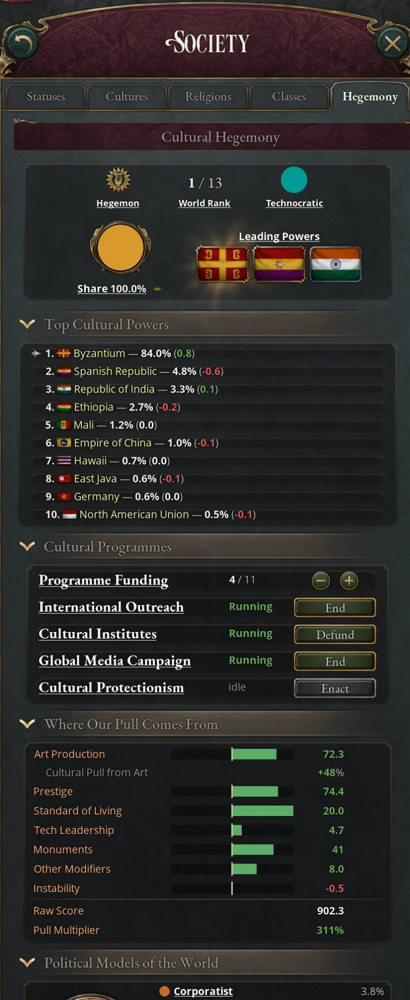
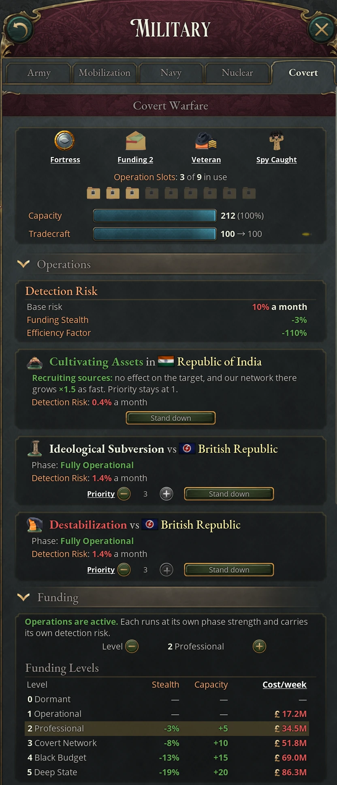

# Cultural hegemony and covert warfare

Two systems let countries compete for influence without going to war. Cultural
Hegemony measures how much of the world's cultural influence each country holds
and turns a large share into migrants, legitimacy pressure on trailing countries
and pressure on foreign political movements. Covert Warfare gives you an
intelligence agency that runs espionage, subversion and sabotage against other
countries, at the risk of being caught. Each has its own game rule, Cultural
Hegemony and Covert Warfare, and both are on by default.

## The Cultural Hegemony journal entry

The game scores every country's cultural pull from the first day of the
campaign, but the Cultural Hegemony journal entry and everything it does wait
until some country in the world has researched Mass Media (an era 6 society
technology) and you have Romanticism. Until then the scores run in the
background and have no effect. The entry never completes. Before it opens, the
entry shows only your tier and cultural share; after that, its panels show the
rest (see [The Cultural Hegemony panels](#the-cultural-hegemony-panels)).

### The Cultural Hegemony panels

The Cultural Hegemony journal entry and the Hegemony tab in the Society panel
show the same panels, and a change made in one shows in the other. The tab is
grayed until the journal entry opens; hover it for what is still missing. It
ends with an Open Journal Entry button.

The overview at the top is always shown. Its first row is icons with a word
beneath: your influence tier (a gray sprig for Negligible, then a lyre that
gains a laurel wreath and turns bronze, silver and gold up to Hegemon), your
World Rank, the leading power's political model in its pie color, and a red
Benchmark icon while you carry the Foreign Cultural Benchmark. Below them are a
pie of your cultural share (amber for yours, gray for the rest of the world),
with an arrow for the change since last month, and the flags of the three
Leading Powers, the leader first. Hover a flag for the country and click it to
open the country. Hover the other icons for the detail: the tier's full name
and the share the next tier starts at, the model's share of world culture and
its push abroad, the benchmark's strength. Last comes Programs, with the
Ministry of Culture's icon: how many of the four programs are running and your
funding level against its cap, or No Ministry in red while you lack the law.
Hover it for each program and the funding cost.

The sections below all start open except the explanations:

| Section | Starts | Shows |
|---|---|---|
| Top Cultural Powers | Open | A table of the ten largest cultural shares at the last recount: rank, flag, country, share, its change since that country's own share at the recount before (with an arrow up or down), and its political model as a colored swatch (hover it for the model). An arrow marks your row; hover a row for that country's pull components. When you are outside the top ten, Our Rank below the table gives your place. |
| Cultural Programs | Open | Program Funding with its − and + buttons (hover the level for where its cap comes from), then a row for each program with Running or Idle and its button (International Cultural Outreach's row reads International Outreach). Hover a program's name for what it gives while it runs, and a button for what is missing and what it would do. While you lack Ministry of Culture Established, a line above the rows says so. |
| Where Our Pull Comes From | Open | A bar for each component of your pull, with zero in the middle: gains fill to the right in green, penalties to the left in red, each against that component's usual range. Hover a row for the working behind the number and the bar's range. Cultural Pull from Art sits under Art Production when it is not zero, the Pull Multiplier closes the components, and Raw Score stands under the rule. |
| Political Models of the World | Open | The pie of the world's political models and its legend, by short name. Hover a model for its full name and the laws that put a country in it. |
| History | Open | Each political model's share of world cultural influence, stacked to 100% in one bar per year, over 5, 20 or 100 years, its legend by short name. Hover a bar for its date and all fifteen model shares. Every country sees the same history. Existing saves begin collecting at the next cultural recount; up to 100 annual snapshots are kept. |
| How Cultural Hegemony Works | Collapsed | The explanations: cultural share and tiers, the programs, where pull comes from, the top cultural powers, political models and the Foreign Cultural Benchmark. |

### Cultural share and influence tiers

Your **cultural share** is your raw cultural pull as a percentage of the world's
total. Other countries' pull is recounted about twice a year and after every
war, while yours counts as it stands, so your share can step a little without
your own output changing. Your share sets your tier:

| Cultural share | Tier |
|---|---|
| Under 2% | Negligible Cultural Influence |
| 2% | Minor Cultural Influence |
| 5% | Moderate Cultural Influence |
| 10% | Significant Cultural Presence |
| 15% | Major Cultural Power |
| 25% | Cultural Hegemon |

The country with the highest share is the world's leading cultural power, the
hegemon, whatever its tier.

### Where cultural pull comes from

Your raw score is the sum of the components below, multiplied by your pull
multiplier. Where Our Pull Comes From, in the panel, shows each one for your
country as a bar.

| Component | How it counts |
|---|---|
| Art Production | Your fine art output, capped at your percentage share of world production, with diminishing returns above a third of world output. Free Speech, Church and State and LGBTQ+ Rights laws, Romanticism, Realism and Film change it through the Cultural Pull from Art modifier. |
| Prestige | Your prestige divided by 5, capped at your percentage share of world prestige. Recognized countries only. |
| Standard of Living | Your average standard of living minus the world average (−5 to +20): in full for great powers, half for major powers, a quarter for minor powers, nothing below. |
| Tech Leadership | +2 each time you research a technology no other country has yet, up to 30, fading by a tenth at each recount. |
| Monuments | +3 per monument: the mod's wonders, the base game's monuments and the Space Program (power bloc statues don't count). Grand monuments add +1 for each step of their combined grandeur, counting only monuments that are not contested. The first step takes 10 grandeur, the second 20, the third 30 and so on, with no ceiling. |
| Megaprojects | +3 for each of the seven megaproject types you have completed. |
| Other Modifiers | Flat pull from program funding, events, tiers IV and V of the Education power bloc principle and the Cultural Exchange Program treaty article. |
| Infamy | −0.1 per point of infamy. |
| Instability | Up to −10 at full turmoil, and −20 during a civil war. |

The multiplier comes from your rank (great power +25%, major power +10%), laws
(free trade, open borders and inclusive citizenship raise it; isolationist,
exclusionary and repressive laws lower it), technologies such as Romanticism,
Realism, Film and Television, the Ministry of Culture institution, programs and
events. Wonders, megaprojects and grand monuments are described in [The extended
timeline](02-timeline.md).

### What cultural dominance gives

Once your share reaches 1%, you get a Cultural Hegemony modifier whose strength
grows in step with your share:

| Effect | At 10% share | At 25% share |
|---|---|---|
| Mass migration attraction | +2.5% | +6% |
| Tourism output | +10% | +25% |
| Trade advantage for fine art | +10% | +25% |
| Loyalists from high legitimacy | +10% | +25% |
| Power bloc leverage generation | +10% | +25% |
| Diplomatic reputation | +1 | +2.5 |
| Infamy decay | +10% | +25% |
| Assimilation | +50% | +125% |

Tourism itself is covered in [State tourism](08-states.md#state-tourism).

### Legitimacy pressure on trailing countries

Every country with the journal entry whose share trails the hegemon's by more
than about three points carries the Foreign Cultural Benchmark modifier: its
people measure their government against the leading power's, and legitimacy
falls. The penalty grows with the gap. With the hegemon at 30% and you at 5%, it
costs about 4 legitimacy. The hegemon never carries it. Tier V of the Education
power bloc principle shrinks the penalty, and so does being a party to the UN
Convention on Cultural Diversity: a quarter off at Contested, half at
Established, three quarters at Strong and all of it at Supranational. A
hegemon that ratifies the convention projects 10% less cultural pull, scaled
the same way (see [UN conventions and
agencies](10-united-nations.md#un-conventions-and-agencies)). While you carry it, the overview shows
a red Benchmark icon; hover it for the current strength. Under the Demographics
rule's Full setting the same gap also pulls the family size your people want a
little toward the hegemon's (see [Reading the
figures](08-states.md#reading-the-figures)).

### Political models of the world

At each recount the game sorts every country into one of fifteen political
models by its laws, from Liberal / Progressive Democratic and Constitutional
Monarchist to Communist / Vanguardist, Technocratic, Developmentalist Junta and
Mixed / Other. Some tests also ask who runs the government, meaning the
strongest interest group in it. A Command Economy under a Single-Party State is
Communist only when that group is Communist or Vanguardist, and any other
left-wing lead makes it Socialist. Cultural Citizenship, a common starting
law, makes a Single-Party State Fascist unless that group is left-wing, and
makes Autocracy Fascist only when that group is Fascist or Ethno-Nationalist.
A left-wing planned economy that keeps the law is still Communist or
Socialist, and a monarch who takes absolute power over it is Absolutist
Monarchist.
The pie chart shows each model's share of world culture, weighted
by the cultural pull of the countries running it rather than by their number.
Hover a model in the legend for what qualifies. The tests run in a fixed
order and a country counts as the first model it fits, so a Council Republic
under Anarchy is Anarchist, not Communist, a monarchy with
Universal Suffrage is Constitutional Monarchist, not Liberal, a monarchy under
Technocracy is Technocratic, and a Single-Party State with Ancestral Citizenship
and a Command Economy is Fascist, not Communist.

The hegemon's model pushes on every country that carries the Foreign Cultural
Benchmark: the matching political movement there (a liberal movement under a
liberal hegemon, for example, or a related one if it is absent) grows more
active and attracts more pops. The push is zero while the model holds less than
15% of world culture and grows with its share after that; hover the model in
the overview for its strength. A hegemon with feminist, civil-rights,
environmental, abolitionist, labor or land-reform laws also feeds those
movements abroad, and one at peace without Mass Conscription feeds anti-war
movements. Movements are covered in [Government, laws and
characters](06-politics.md).

### Cultural programs

Every program needs the Ministry of Culture Established law (unlocked by Mass
Propaganda). If you repeal it, funding drops to zero and all four programs stop
at the next monthly update.

| Program | Controls | Effect | Cost |
|---|---|---|---|
| Program Funding | − and + | Each step adds +1 cultural pull and +5% pull. | A weekly expense per step that grows with your GDP, so the bill rises with every step. The tooltip shows the cost of one step and of your current level. |
| International Cultural Outreach | Begin / End | +10% pull, +5% prestige, +10% mass migration attraction. Needs Mass Media. | The weekly cost of one funding step. |
| Cultural Institutes | Fund / Defund | +10% pull. | 150 influence. |
| Global Media Campaign | Launch / End | +15% pull, +5% prestige. Needs Mass Media. | 200 influence. |
| Cultural Protectionism | Enact / End | +10% pull, +100 authority. | −5% society research speed, −10% mass migration attraction. |

The funding cap is one step per level of the Ministry of Culture institution,
plus one each from Mass Media and Television; the panel shows it. The four
programs run until you end them. Cultural Institutes and Global Media Campaign
need their influence available to start. Global Media Campaign and Cultural
Protectionism exclude each other: while one runs, the other's button is grayed
out.

### Cultural hegemony events

Rising powers get opportunities as their share climbs past 8%, mostly trading
authority or prestige for pull, research or migration, and two milestones fire
once, at 10% and at 25% while ranked first. Trailing countries under the
benchmark get events of their own. Most let you embrace the foreign influence
(research, relations, often a push toward the hegemon's model) or resist it
(authority and interest group approval, often at a cost in relations,
legitimacy or pull). The harshest, Hegemonic Convergence, can press you to adopt
one of the hegemon's laws once it holds 25% and your share is a tenth of its
share or less. Four more events follow the political models. All of them are in
[Cultural hegemony event list](19-appendix-events.md#cultural-hegemony-event-list).

### How the AI competes for culture

AI countries use the same programs. Those with a share of 10% or more begin
outreach and launch media campaigns, a campaign or institutes only with 200
influence to spare beyond the cost, and they end either when their influence
runs into deficit. An AI raises funding at a share of 10% or
more, or below 5%, but only while it is out of default and its weekly surplus
covers one more step; below 2% it is more likely to cut funding. Small
countries under the benchmark enact Cultural Protectionism and end media
campaigns, and drop protectionism once their share passes 10%.

## The Covert Warfare journal entry

The Covert Warfare journal entry is where you run your intelligence agency. It
becomes active when you hold one more covert operation slot than your rank
grants for free (every country gets one, major powers two, great powers three).
The first extra slots come from the Ministry of Intelligence and Security
Established law (unlocked by Mass Surveillance), whose institution adds a slot
per level, and from the era 7 technology Mainframe Computers. Once active, the
entry stays open even if you later lose that extra slot. It never completes.

You launch operations from another country's diplomatic actions, listed as
"Covert: ..." with the operation's name, which is also its name on your rows.
Everything else is on the Covert tab
of the Military panel, which shows the journal entry's own panels: a change made
in one shows in the other. The tab is grayed until the journal entry is active;
hover it for what is still missing. It ends with an Open Journal Entry button.

The overview at the top is always shown. Its first row is icons with a word
beneath:

- Your intelligence standing, a shield from gold-rimmed (Fortress) to split in
  two (Vulnerable); see [Intelligence capacity and operation
  slots](#intelligence-capacity-and-operation-slots).
- Your funding level ("Funding 3"), an envelope of banknotes, or an empty grey
  one at 0.
- Your Tradecraft tier, a fedora with up to four chevrons.
- Spy Caught, while you have exposed a foreign operation in the last ten
  years.

Below the icons, Operation Slots shows how many slots you hold and how many are
in use, as case files lit while an operation fills them. Two bars follow:
Capacity, your intelligence capacity as a share of the world's best, with a
line at each standing's threshold, and Tradecraft, with a line at each tier
(hover a line for what it unlocks), the next tier's threshold beside it and an
arrow for which way it last moved. Hover any of them for the detail: the
standing's meaning, the funding level's name and cost, the capacity breakdown,
this month's Tradecraft and why it last changed.

The sections below are open by default, except the explanations at the foot:

| Section | Starts | Shows |
|---|---|---|
| Operations | Open | A warning while funding is 0, or "No operations running" (hover it for how to launch one). Then the Detection Risk every operation shares (base risk, Funding Stealth, Efficiency Factor), and a row for each running operation: the target's flag, its icon, its name and target (hover it for what it does), its phase, its own Detection Risk (hover it for the breakdown), what its exposure would count as, the priority stepper and Stand down. |
| Funding | Open | A line while funded with nothing running, the Level stepper, and the Funding Levels table: each level's Stealth, Capacity and weekly cost, with your level's row shaded gold. |
| Agent Networks | Open, once you have a network | A table with a line for each network: the target's flag (hover it for the country, click it to open the country) and name, its strength with a bar and an arrow for growing or decaying, your operations there, the head start a new one would get, and what it reports (None, Partial or Full; hover it for the report). Hover the name for what the network adds to catching that country's operations. |
| Counterintelligence | Open | Unused slots redirected, your funding bonus and your economic, military and ideological defense, each with its breakdown on hover; then Last Caught while an exposure stands. |
| Known Foreign Operations | Open, while you are watching an operation | A row for each foreign operation you caught and let run: its sponsor's flag and name, the operation, the months you have watched it and an Expose button. |
| How Covert Warfare Works | Collapsed | The explanations: operations, funding, detection, networks, Tradecraft, counterintelligence, watching and intelligence standing. |

### Intelligence capacity and operation slots

Intelligence capacity is your agency's size: a base of 5, plus your rank (great
power +25, major power +10), your literacy (up to 50 at full literacy), your
share of world GDP (two points per percent, up to 50), and modifiers from
technologies, laws such as Secret Police and Censorship, and the Ministry of
Intelligence and Security (+4 per level). Tradecraft then multiplies the total.
The overview's first icon rates your capacity against the world's best:
Fortress at 80% of the best or more, Hardened from 60%, Defended from 40%,
Exposed from 20% and Vulnerable below that.

Capacity cuts both ways. The stronger a target's capacity is against yours, the
likelier your operations there are caught; the stronger yours, the likelier you
catch operations against you. Rank and GDP share give a great power's service an
edge that a small, literate country can't match: a small country's lightly
funded operations against a great power are caught noticeably more often,
though high funding still hides most of them. Capacity also gives separatism
and coup resistance (the Intelligence Capacity modifier), growing up to a
capacity of 125.

Each operation occupies one slot. Beyond the rank and ministry slots, Mainframe
Computers, Computer Networks, Cyber Warfare and Quantum Computing each add one,
to a maximum of ten. You can run one operation of each type at first, and one
more of each type with Mainframe Computers, with Cyber Warfare and with a
[Veteran](#tradecraft) agency.

### Covert funding levels

The Level stepper in the Funding section sets what the agency spends. Every
operation needs funding of at least 1, so stepping down to 0 ends them all; the
step's tooltip warns you first. The weekly cost grows with your GDP, the funding
level and the number of operations (weighted by priority, plus a base share paid
even with nothing running). The section's Funding Levels table shows what each
level costs you a week at your current operations, with your level's row shaded
gold.

Funding from level 2 up gives Funding Stealth, points off every operation's
Detection Risk, and counterintelligence capacity:

| Level | Name | Funding Stealth | Counterintelligence |
|---|---|---|---|
| 0 | Dormant | Nothing can run | None |
| 1 | Operational | None | None |
| 2 | Professional | −3 points | +5 intelligence capacity |
| 3 | Covert Network | −8 points | +10 intelligence capacity |
| 4 | Black Budget | −13 points | +15 intelligence capacity |
| 5 | Deep State | −19 points | +20 intelligence capacity |

From level 3, idle networks also decay half as fast.

### The covert operations

There are seventeen operations: sixteen run against another country, and one,
Counterintelligence Support, helps a friend. Every operation against another
country needs a free slot, room under the per-type limit, no operation of the
same type already running against that target, funding of at least 1, a target
that is not decentralized, no truce with it, and no Intelligence Sharing Pact
binding it (see [The Intelligence Sharing Pact's defense
shield](09-diplomacy.md#the-intelligence-sharing-pacts-defense-shield)). Good
relations don't stop any of them: you can run an operation against a friend, and
pay for it if it is exposed (see [Detection and
exposure](#detection-and-exposure)).

A **friend** is a country with which you have cordial relations plus an
alliance, a defensive pact, the same power bloc or an overlord or subject tie,
or amicable relations on their own. Two members of a bloc who dislike each other
are not friends.

Seven operations also need a technology, named first in the table's last
column: Mass Media and Cryptography (era 6), Television Broadcasting, Pop
Culture and Satellite Communications (era 7), Computer Networks (era 8) and
Social Media (era 9). The operations that can bring down a great power come
late in the tree, so a small country can't rush them before the great powers
have agencies of their own.

| Operation | What it does at base strength | Also needs | Influence |
|---|---|---|---|
| Election Interference | Target −5 legitimacy; its electoral confidence falls at the end of each election campaign | Television Broadcasting; target has an elected legislature | 50 |
| Financial Subversion | Target +2 bubble pressure a month | Computer Networks | 50 |
| Infrastructure Sabotage | Target units lose morale 15% faster; each month a random target state gets −15% infrastructure and −10% throughput for three months | War or a diplomatic play against the target | None |
| Communications Disruption | Target −10% unit offense and defense | Cryptography; war or a diplomatic play against the target | None |
| Industrial Espionage | You: [stolen production technology](#stealing-technology). Target: −3 authority | Target has researched a production technology that you could research now | 25 |
| Military Espionage | You: [stolen military technology](#stealing-technology). Target: −3 authority | Target has researched a military technology that you could research now | 25 |
| Influence Campaign | Target −15% leverage resistance | Mass Media; you lead a power bloc the target is not in | 50 |
| Ideological Subversion | Target −10% separatism resistance; movements there matching your political model grow more active and attract more pops | Pop Culture; target has a political movement | 100 |
| Destabilization | Target −15% separatism resistance, worse colonial stability; every movement there grows more active and attracts more pops | Social Media; target has a political movement | 100 |
| Regime Change | Target −5 legitimacy, −1 coup resistance, more radical movements; once fully operational, a coup under way there gains 5 progress a month | Satellite Communications; a rivalry; target not your subject; Seasoned [Tradecraft](#tradecraft) | 100 |
| Nuclear Program Sabotage | Target's nuclear program 25% slower | Target runs a funded program; Seasoned Tradecraft | 100 |
| Space Program Espionage | You: space race milestones 10% faster and 10% less risky. Target: −3 authority | Target has completed a milestone you have not | 25 |
| Cultivate Assets | Nothing to either country; your network there grows half again as fast | Target not your subject | 25 |
| Secure Loose Material | Once established, a 3% monthly chance (6% fully operational) of finding and destroying one of the target's missing warheads | Target has warheads unaccounted for; Nuclear Weapons rule on | 25 |
| Incite Colonial Autonomy | Every colony the target holds gains 0.5 autonomy a month; a colony that reaches 100 breaks away | Target holds a colony; Simple or Full Colonies setting of the Space Race rule | 50 |
| Sabotage Colony | The target's most populous colony loses 1% of its people a month and gains 0.25 autonomy | Target holds a colony; Simple or Full Colonies; Seasoned Tradecraft | 100 |
| Survey Colony Defenses | Your fleets fire 20% harder on the defenses of the target's colonies, and your Fleets panel shows their Defences, integrity and marines | Target holds a colony; Full Colonies setting | 50 |
| Counterintelligence Support | Target: +8 economic, military and ideological covert defense. You: nothing | Target is a friend and has no other protector | 25 |

An operation uses its influence for as long as it runs, more the worse the
world would take its exposure (see [Detection and
exposure](#detection-and-exposure)). As with any pact, a great power pays double
and a major power half again as much, and you need the influence available to
launch it.

Counterintelligence Support is open: it is never rolled for detection and never
exposed, needs no technology, and an Intelligence Sharing Pact with the target
doesn't block it. A country has one protector at a time, and the support ends
if the friendship does. It uses a slot and upkeep like any operation but gives
you nothing back. Its defense adds to the target's own (see [Covert
defense](#covert-defense)).

If you run several Space Program Espionage operations, their bonuses come
from the strongest and don't add up. Stolen technology does add up: each
Industrial or Military Espionage operation steals from its own target.
Election Interference cuts electoral confidence by 5% once establishing and 10% once fully operational, half that against a
country hosting UN [electoral observers](10-united-nations.md#electoral-observers),
which also catch it more often. Bubble pressure is
explained in [Banking and monetary policy](04-banking.md), nuclear programs and
loose warheads in [Nuclear weapons](14-nuclear.md), and milestones, colonies and
their autonomy in [The space race](16-space.md).

#### Stealing technology

From its sixth month, each Industrial Espionage operation steals production
technology from its target every month, and each Military Espionage operation
steals military technology. The progress goes to your current research if it
is in that tree and the target has researched it. Otherwise it goes to a random
technology in that tree that the target has and you could research now. Once
the target has nothing left that you could take, the operation ends.

Each theft is 5% of the technology's era cost at base strength, 10% once fully
operational, and 16% fully operational at priority 3. Progress that reaches a
technology's cost completes it. Each operation's row shows how much it has
stolen and the latest technology.

Hover over an operation before launching it: the tooltip previews its effects at
base strength (established, priority 1), your network in that country and the
head start it gives, the weekly upkeep the operation adds, and how its phase
scales the effects, and the description says how the world will read it if it
is exposed.

### Operation phases and priority

An operation does nothing for its first six months (Preparatory). From month 6
it is Establishing and has its base effect; from month 12 it is Fully
Operational and its effects double. Each row shows the phase and the months to
the next one; hover the phase for what it does. Ideological Subversion's push on
movements is the exception: it doesn't double, and stays at its establishing
strength.

Each row also has a priority stepper from 1 to 3; hover the word Priority for
what the current level multiplies. Priority multiplies what the operation does,
but costs and exposure rise faster:

| Priority | Effect | Share of upkeep | Detection risk |
|---|---|---|---|
| 1 | ×1 | 1 | Base |
| 2 | ×1.35 | 1.6 | +2 points |
| 3 | ×1.6 | 2.4 | +4 points |

Priority 3 needs an Established agency; a fully operational operation at
priority 3 works at 3.2 times base strength. A click changes detection risk at
once, in either direction, but the effects only at the start of the next month.
Raising priority raises upkeep at once; lowering it cuts upkeep only when the
effects fall. Cultivate Assets stays at priority 1. Election Interference's cut
to electoral confidence and Regime Change's push on a coup are fixed and don't
scale with priority.

### Agent networks

Every country you run operations against keeps a network of yours, rated 0 to
100, that outlives the operations. It grows by about 2 a month with one
operation there, faster with two or three and more slowly above 50, so one
operation takes it to 50 in about two years (Cultivate Assets, in about 17
months). With nothing running it decays by 1.5 a month. An exposed operation
costs its network 25. Counterintelligence Support plants no network, but an
operation you [watch](#what-the-target-learns) grows your network inside its
sponsor and keeps it from decaying.

A strong network gives new operations there a head start of up to five months
(strength ÷ 20) and takes up to 5 points off their detection risk. It also adds
up to 10 points (strength ÷ 10) to the detection risk of every operation that
country runs against you, because your agents inside its service hear of them;
hover the network's name for how many points. From strength 50 it reports the
target's intelligence capacity and technology count beside yours, and from 75
how many covert operations the target runs against you: the only way to learn
of operations your counterintelligence has not caught, though it never says
which. Each network's line shows its strength as a number and a bar, with an
arrow for growing, decaying or at full strength, and under Report the word
None, Partial or Full; hover the Report heading for what the report shows at 50
and at 75. In the space race, the same two tiers
narrow your estimate of that country's progress on a milestone from ±25% of the
goal to ±10% and ±5% (see [The space milestone
panel](16-space.md#the-space-milestone-panel)).

### Tradecraft

Tradecraft is your agency's experience, from 0 to 100. Each month every
operation against another country past its preparatory phase adds 1 (a
preparatory one half that, and Cultivate Assets always half), counting at most
four operations, and gains slow above 50. An exposed operation costs 3
(routine espionage or wartime sabotage), 6 (interference) or 9 (an attempt on a
government). With no such operation running, Tradecraft drifts down by a
quarter point a month; Counterintelligence Support adds nothing and doesn't stop
the drift. Standing an operation down costs nothing.

| Tier | Tradecraft | Unlocks |
|---|---|---|
| Untested | 0 | |
| Fledgling | 20 | |
| Established | 40 | Priority 3 |
| Seasoned | 60 | Regime Change, Nuclear Program Sabotage and Sabotage Colony |
| Veteran | 80 | One more operation of each type |

Each tier above Untested adds 5% to your intelligence capacity and makes your
networks grow 15% faster. Falling below a tier never ends a running operation.

### Detection and exposure

Each operation against another country has its own monthly Detection Risk,
shown on its row (hover it for how it is made up). It starts at 10%, falls with
your Funding Stealth and your network in the target, and rises with priority,
with the target's counterintelligence (its capacity plus its defense against
that kind of operation, compared to yours; up to +20 points) and with any
network the target holds inside your country (up to +10 points). Your
Efficiency Factor, from
the Covert Operation Efficiency modifier that technologies, laws and the
Ministry of Intelligence and Security give, then cuts it by up to four fifths,
within a range of 0.1% to 50%. The Operations section lists the base risk, your
Funding Stealth and your Efficiency Factor above the rows. Each operation rolls
separately, so three at 10% give about a 27% monthly chance of a catch, but at
most one is caught a month.

A caught operation goes to its target first, which can [expose it or let it
run](#what-the-target-learns). An exposed operation ends in the Operation
Compromised event, which also costs its network 25 and costs you Tradecraft.
Recalling your operatives and apologizing takes the full infamy and half the
relations damage. Denying everything takes
half the infamy and the full relations damage, and the target gains Heightened
Vigilance (+25 to all three of its covert defenses, decaying over five years). At
the establishing phase the costs are:

| Exposure tier | Operations | Recall and apologize | Deny everything |
|---|---|---|---|
| Routine espionage | Industrial, Military and Space Program Espionage, Cultivate Assets, Secure Loose Material | +1 infamy, −5 relations | +0.5 infamy, −10 relations |
| Interference in internal affairs | Election Interference, Financial Subversion, Influence Campaign, Incite Colonial Autonomy, Survey Colony Defenses | +2 infamy, −10 relations | +1 infamy, −20 relations |
| Attempt to bring down a government | Ideological Subversion, Destabilization, Regime Change, Nuclear Program Sabotage, Sabotage Colony | +4 infamy, −20 relations | +2 infamy, −40 relations |
| Wartime sabotage, exposed during the war | Infrastructure Sabotage, Communications Disruption | Nothing | Nothing |
| Wartime sabotage, exposed before the war | The same | +4 infamy, −10 relations | +2 infamy, −20 relations |

An operation exposed while preparatory costs half as much, and one exposed fully
operational half as much again, which makes an operation its target has watched
into that phase the costliest to have exposed. Exposing an attempt on a
government also costs 10 relations with every country in the target's power
bloc and every treaty ally of the target, and the United Nations records it
(see [The United Nations](10-united-nations.md)).

Spying on a friend costs more. The relations damage is half again as large, and
at home the political lobby that favors that friend loses appeasement and your
government loses legitimacy (Caught Spying on a Friend), fading over about two
and a half years. Each is 3, 5 or 8 points by exposure tier (routine espionage,
interference, attempt on a government; wartime sabotage exposed before the war
pays the highest) if you recall your operatives and apologize, and 2, 3 or 4 if
you deny everything. The operation's phase doesn't change them. With no lobby
that favors the friend, only the legitimacy is lost. Hover the options for the
figures.

### What the target learns

A country that catches your operation decides first whether to expose it. If it
runs a Covert Warfare journal entry of its own, a player gets an event, A
Foreign Operation Uncovered, and chooses between "Expose them" and "Let it run,
and watch"; a country without the entry exposes at once, and the AI chooses by
chance (see [How the AI runs covert
operations](#how-the-ai-runs-covert-operations)).

Exposing makes the operation public: you answer for it as described under
[Detection and exposure](#detection-and-exposure), and the operation ends. It
also turns the exposing country's public against the interest groups at home
that are friendly to you. Every group in a political lobby that favors your
country loses 5, 10 or 15% political strength (Foreign Ties Discredited) by
exposure tier, half as much again if you were its friend, fading over about two
and a half years. That follows every exposure that costs anything, whoever
chose it.

If the country lets the operation run, you are not told, and it keeps working
against that country at full strength. In return its network inside yours stops
decaying and grows each month, by 4 to 6.4 depending on the operation's
priority (more with Tradecraft, more slowly above half strength), and the
operation is not caught again. The country can expose it whenever it likes from
Known Foreign Operations, a section of its Covert Warfare journal entry and
Covert tab that lists each operation it watches with your flag and name and the
months watched. The exposure goes out at once; while another exposure of your
operations is still open, the button is grayed until you have answered for it.

A country that exposes your operation gets the Foreign Interference Detected
event, which names you and the operation. It can shore up its
counterintelligence (Counterintelligence Alert: +6 intelligence capacity and
more separatism and coup resistance, fading over five years), retaliate in kind
(a network of up to 25 inside your country, if it has a Covert Warfare journal
entry of its own), or expel your diplomats (−25 relations; your network inside
its country loses another 25, and any network it runs inside yours loses 25 when
you answer in kind). The event fires at most once every two years per country,
whether or not that country has a Covert Warfare journal entry.

When you are the target, the Spy Caught icon and the Last Caught line in the
Counterintelligence section show the latest operation exposed against you, and
who ran it, for ten years, and Known Foreign Operations names the sponsor of
each operation you watch. Outside these two sections and the events A Foreign
Operation Uncovered and Foreign Interference Detected, nothing names the country
behind an operation. You can also see an operation's effects among your own
modifiers, get an unsigned Election Interference Detected notification with
each confidence hit, and count the operations against you through a strong
network of your own.

Watching pays when the operation does little harm to you and the sponsor's
service is worth learning: one watched operation takes your network inside the
sponsor past the 25 that retaliating in kind plants in about six months. Expose
an operation that is hurting you.

### Covert defense

Each unused slot becomes Domestic Intelligence Focus: +2 intelligence capacity,
more separatism and coup resistance, calmer movements and better colonial
garrisons. You also have three covert defenses, economic, military and
ideological, each added to your capacity against operations of its kind. Strict
IP Protection and Central Bank Independence raise economic defense and Publicly
Funded Elections ideological defense, by 10 each; No IP Protection, Unregulated
Banking and No Campaign Finance Laws lower them. A friend's Counterintelligence
Support raises all three at once, by 8 each at base strength and up to 26 fully
operational at priority 3. Against an agency of about 100 capacity, 10 points
of defense add about 1.5 points to its Detection Risk. The Intelligence Sharing
Pact treaty article adds intelligence capacity and lends the weaker partner part
of the stronger one's covert defenses.

### When operations end

An operation runs until one of these happens:

- It is exposed.
- You press Stand down on its row, or break the pact in the diplomacy outliner. This frees the slot at once at no infamy or relations cost, but the months invested are lost.
- Your funding drops to 0, which ends every operation.
- A truce with the target begins (not for Counterintelligence Support).
- The target of Counterintelligence Support stops being a friend.
- A wartime operation's war ends, or its diplomatic play ends without one.
- Something it needs goes: the target's elections, its political movements, its lead in space, its last colony, the last technology you could steal from it, its missing warheads or its nuclear program (frozen by treaty, held at an arsenal ceiling or while it dismantles, or given up), your rivalry, or your power bloc lead over a target outside the bloc. The technologies named in the operations table and Tradecraft only gate the launch.

A war with the target does not end a peacetime operation.

With the Covert Warfare rule off, a few international-relations events such as
The Shadow War and The Spy Who Was Caught stand in for the operations; see
[International relations events](09-diplomacy.md#international-relations-events).

### How the AI runs covert operations

AI countries set their funding each month: none while idle, level 1 to keep
operations alive when bankrupt or without rivals (and for a major power with a
rival), level 3 for a great power with a rival or a major power at war, and
level 5 for a great power at war. They launch rarely. Peacetime operations come
mostly from major and great powers, aimed at rivals or countries they feel
antagonistic or domineering toward; espionage goes to countries with technology
to steal or ahead in space, and a funded AI at war or in a play uses the wartime
operations. An AI that holds a colony or runs a space milestone incites autonomy
in the colonies of countries that are not its friends, and sabotages them only
when the colony's holder is its rival or at war with it. An AI with fleets of
its own surveys the colony defences of a rival or an enemy. Upkeep grows with the
operator's GDP, not the target's, so an AI leaves a country with less than a
tenth of its GDP alone unless its gold reserves are at least half full and its
budget is in surplus. Espionage, Nuclear Program Sabotage, Secure Loose
Material and the colony operations ignore the target's size, and so does a
wartime operation against a country the AI is losing to. The AI
raises priority to 2 against rivals and to 3 when a great power is at war with
the target. Once launched, an operation stays until it is fully operational,
unless it is exposed or something it needs goes. After that the AI calls it off
only when its reason has gone: no rivalry either way, no hostile attitude and
relations above poor, or no space milestone of its own under way (for the colony
operations, no milestone and no colony of its own; for the defences survey, no
fleets of its own, or peace and no hostility), or when its influence runs
into deficit. It launches an operation that uses influence only
while it holds 300 or more. It stops Cultivate Assets once its network reaches
75. It needs Seasoned Tradecraft for Regime Change, Nuclear Program Sabotage
and Sabotage Colony, as you do, so it rarely launches them.

The AI doesn't start Election Interference, Financial Subversion, Infrastructure
Sabotage, Communications Disruption, Ideological Subversion, Destabilization or
any colony operation against a friend, and calls off Election Interference, Financial Subversion,
Ideological Subversion and Destabilization once they are fully operational and
the target has become a friend. Its other operations have no friend test: it
still spies on friends, and pays when it is exposed. An AI with a Covert Warfare
journal entry that catches an operation lets it run 6 times in 10 (15% for an
attempt on a government; 20 points more when the sponsor is a friend), but only
1 in 10 once its network inside the sponsor reaches 75. It then exposes each
operation it watches by a monthly chance that grows with that network: 25% once
it reaches 75. An AI that funds its service and whose agency is stronger than
that of a friend in a bloc it leads, or of its subject or ally, offers that
friend Counterintelligence Support, one at a time.
