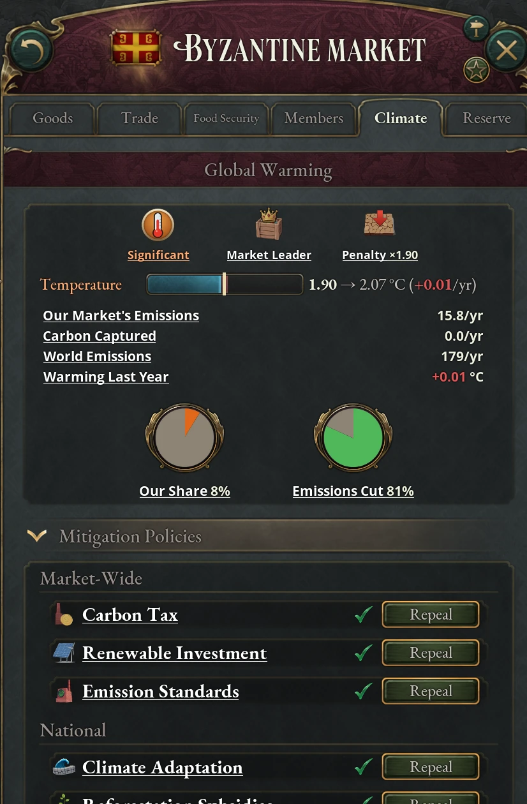

# Climate and pollution

Burning coal and oil warms the world in this mod. Every country's emissions
add to one global total, the total sets a global temperature anomaly, and the
anomaly drives penalties that every country shares. The Global Warming journal
entry tracks it and holds the climate policies you can adopt. The Global Warming
game rule (on by default) controls all of this; with it off, the world never
warms. State pollution, the Environmental Movement and the pollution scandal
event work under either setting. The emissions lines in production method
tooltips and the phaseout mandate also remain active with the rule off; capture
still costs goods.

## How emissions become warming

Each country counts the buildings and households in its own states. Buildings
contribute their production methods' greenhouse gases, with source capture and
synthetic-fuel credits subtracted. The country's own industrial reductions cut
its remaining industrial emissions. Households add a heating footprint estimated
from population and average standard of living. Direct Air Capture at Carbon Conversion
Works subtracts atmospheric removal. Buildings count where they stand, including
foreign-owned sites. Markets sum their members; every country's net annual
contribution adds once to the world's cumulative total and sets warming.

Exporting synthetic fuels can make the producing market's figure negative:
the fuel's production credit counts there, while burning it counts in the
importing market. Carbon Captured measures atmospheric removal by Direct Air
Capture; synthetic-fuel production does not add to that row.

In the dashboard's units, emissions of one million a year warm the world by
0.1 °C a year. Figures use K for thousands and M for millions. A unit of
oil produces 13% less warming than a unit of coal. The mod calls coal Energy
and Carbon Minerals; this chapter calls it coal for short.

Production methods that burn coal or oil show Greenhouse Gas Emissions in their
tooltips. Fuel methods add to the figure; capture methods subtract from it.
Process fuel and automation both contribute. The figure grows with staffing and
throughput and feeds the climate calculation. The state owner's industrial
policy cut applies afterward.

Coal Mines and Graphite Mines burn some of their own coal. Their Atmospheric
Engine Pump, Condensing Engine Pump and Steam Donkey methods take that coal off
the mine's output instead of listing it as an input, so the methods show no coal
cost but still show the emissions: 2.00 and 3.00 a level for the two pumps and
0.60 for the Steam Donkey, at full staffing and base throughput. An Iron Mine
shows the same 2.00 and 3.00 for these pumps; its Steam Donkey, which lists 4
coal as an input, shows 0.80. Oil-fired methods in every
mine list their oil as an input and show it as usual.

Household heating demand follows the buy packages at each state's average
standard of living, with fossil heating weighted by the coal, oil, wood, fabric and
electricity available in the market. Peasants contribute only 5% of the
purchased heating estimate. Green Building Codes cuts the estimated household fossil footprint by
60%, Renewable Investment by 25%, and Fossil-Fuel Divestment by 15%. These cuts
add together: all three eliminate household fossil-heating emissions. All three policies affect your own households. Industrial emissions still depend on production methods and capture.

Fuel-input discounts reduce goods costs; the custom emissions figure follows
the recipe and its staffing and throughput. Public Transit's oil discount has
an economic effect, while Fossil-Fuel Divestment also reduces household
emissions. The Environmental Sustainability principle's explicit emissions
reduction counts toward warming; its coal and oil input discounts reduce costs.
Standalone military-unit and ship fuel is outside this building-based figure.

Electric Arc Process, Aluminum Substitution and Chromium Substitution in Steel
Mills use 10 coal per level. Electric Arc Process also uses 50 electricity;
the two substitution methods use 170 electricity. Their lower coal use cuts
emissions, while electricity from fossil plants adds emissions elsewhere in
the market.

Warming does not wear off. The anomaly falls only in a year when the world as a
whole captures more carbon than it emits. Cutting your emissions slows the rise;
it does not undo what is already there.

Industrial policy reductions come from each country's Carbon Tax, Renewable
Investment, Emission Standards, Ministry of the Environment (−5% per level),
Environmental Sustainability principle (−5% to −25% by tier) and a few event
and United Nations outcomes, such as Climate Summit Leadership. Some event
choices, the Environmental Grandfather Clause amendment and the Directed Credit
to Heavy Industry banking policy raise industrial emissions instead, by 5% to
10% each. A market member's own ministry reduces its own states' emissions.
All of these add together, and the cuts stop at complete elimination. Atmospheric
removal retains its full credit and can take a country or market below zero.

Carbon Conversion Works unlock with Carbon Capture and Storage in era 10,
after Clean Energy Technologies. Their Direct Air Capture method removes CO₂
from the atmosphere without producing goods to sell. At full staffing and base
throughput, each level removes 42 a year in the dashboard's units and uses
1,200 electricity, plus engines, steel, chemicals and electronic components.
Removal and synthetic-fuel credits follow staffing and throughput. Subsidize the works to keep them
staffed; a fossil-powered grid adds emissions from the electricity they use.
Genetic Engineering in era 11 unlocks their Synthetic Coal alternative, which
produces fuel while capturing carbon.

## Capturing carbon at the source

Stationary coal and oil consumers have Carbon Capture controls, including
industrial plants, mining equipment, steam-powered automation and eligible
company sites. Each eligible fuel-consuming production group has its own
control. A Steel Mill can capture its furnace emissions and its automation
emissions independently. Each tier comes in a variant for every fuel recipe,
named for it, such as Partial Carbon Capture (10 Coal), and only the variants
matching the group's current method appear.

| Method | Needs | Captures |
|---|---|---|
| Partial Carbon Capture | Clean Energy Technologies, era 9 | 25% |
| Carbon Capture and Storage | Carbon Capture and Storage, era 10 | 50% |
| Advanced Carbon Capture | Modern Material Science, era 11 | 75% |

Capture uses engines and steel, plus chemicals for most sources. Power plants
lose electricity output to run capture equipment; other buildings buy
additional electricity. Costs follow the fuel used by that production group.
The tooltips show the reduction and goods cost. Capturing a fossil power
plant's emissions can make it unprofitable, so subsidies may be needed.

Changing a group's method to one that burns a different amount of coal or oil
can reset your capture choice. Under Managed Fossil Phaseout,
eligible sources must use at least the middle tier. Without that law, select
the tier yourself; the AI generally prefers the cheaper option without capture.
A method with no eligible fuel use has Capture Not Applicable and stays valid
under the mandate.

Transport exhaust, fishing and whaling fleets, dispersed agricultural and
logging machinery, mobile mine excavators and street lighting have no source
capture. Oil and coal used as plastics, textile and other chemical feedstock,
oil held at refineries and depots, and Synthetic Fuel Works, whose fuel output
already counts against their emissions, are also exempt. These consumers still
show emissions and contribute to the industrial climate total.

## The Global Warming journal entry

With the Global Warming rule on, the entry is listed, grayed out, for every
country from the start of the game, with a line saying that it opens once the world has warmed by 0.1 °C and its
climate policies at 0.5 °C. It activates for everyone once the anomaly reaches
0.1 °C and then stays active: it never completes and never goes away, even if
the world cools again. It also activates early for a country that adopts Fossil
Expansion Moratorium or Managed Fossil Phaseout, with the Global Warming rule on
or off ([The fossil transition](#the-fossil-transition)). The temperature bar at its top runs to 4 °C, but the
penalties keep growing past that.

The same panels appear as a Climate tab in the Market panel, and a change made
in one shows in the other. It is grayed until the journal entry is active; hover
it for what is still missing. The tab ends with an Open Journal Entry button.

The tab is on the Market panel for every market. On your own market, whether
you lead it or joined it, it is the journal entry. On another market, a line
names the market's leader, and the parts about the market show that market: in
the overview, the leader's role and any Enforce Emissions Reduction treaty that
binds it, the market's emissions and carbon captured, and its share and
emissions-cut pies; below, the leader's Mitigation Policies, with every Adopt and
Repeal grayed, since only that leader can change them. The temperature, Top
Emitters, the history charts and How Global Warming Works stay your own view.
Use it to check what a market you want to bind with Enforce Emissions Reduction
emits and which policies it already runs.

The anomaly sets the warming tier, which the entry shows as a thermometer icon
with the tier's name beneath it:

| Anomaly | Tier |
|---|---|
| Below 0.1 °C | Negligible |
| 0.1–0.5 °C | Slight |
| 0.5–1.0 °C | Moderate |
| 1.0–2.0 °C | Significant |
| 2.0–3.0 °C | Severe |
| 3.0–4.0 °C | Catastrophic |
| 4.0 °C and above | Apocalyptic |

### The Climate Warming modifier

Each month the entry gives every country the Climate Warming modifier, with
every value multiplied by the current anomaly. At 1 °C it is:

- +5% mortality and −1 standard of living in every state;
- −10% farm throughput and −2.5% throughput for every building;
- +5% construction goods used by buildings;
- +1% migration quota, as climate refugees move;
- 25% worse floods, droughts, extreme winds and torrential rains, and 50% worse
heatwaves and wildfires, in both impact and duration;
- 15% milder frost, in impact and duration, and 15% weaker hailstorms;
- 25% weaker pollinator surges and 10% weaker moderate rainfall, the two
harvest conditions that help.

At 2 °C every line doubles, and at 3 °C it triples. The Penalty figure at the
top of the entry shows the current multiplier; hover it for the modifier's
lines.

## The climate dashboard

The journal entry opens with an overview that is always shown. The sections
below it start open, except How Global Warming Works. While the entry is active
it has no status line: the overview carries the tier and the readings.

The overview's first row is icons with a word under each: the warming tier
(hover it for what the tier means), Market Leader or Market Member (whether you
set fossil-fuel tariffs), and Penalty with the Climate Warming modifier's
current multiplier. A Treaty-Bound icon joins them while an Enforce Emissions
Reduction treaty binds you.

Below them is the Temperature bar, from 0 to 4 °C, with a headline such as
"1.61 → 1.81 °C (+0.02/yr)": the anomaly now, the anomaly in ten years if every
year warms as much as the last, and last year's change. The bar shows the same
projection. While the world warms, the solid fill ends at today's reading and a
red stretch runs on to the projection: red is warming to come. While it cools,
the solid fill ends at the projection and a green stretch runs on to today's
reading: green is warming set to be lost. A thin line marks where the next tier
begins; hover it for the tier and how many years away it is at last year's
rate. Until the first yearly figures arrive in January, the headline shows the
anomaly with "(no rate yet)".

Under the bar, a table gives the year's figures: Our Market's Emissions, Carbon
Captured, World Emissions and Warming Last Year. Hover a row for what it counts.
They update each January; before the first January of a game, a line says when
they arrive.

Two pies close the overview. Our Share is your market's share of world
emissions. Emissions Cut is how far your country's remaining industrial
emissions are cut, by its policies, the Ministry of the Environment and every
other source together; hover it for how many of the ten policies you run. The cut changes the moment a policy is adopted or repealed.

| Section | Starts | Shows |
|---|---|---|
| Mitigation Policies | Open | Ten policies: market-wide Fossil-Fuel Tariffs first, then nine National policies. Each row has an icon, its name and effect tooltip, an active check, and Adopt or Repeal. Grayed controls explain the warming, authority, technology, treaty, market ownership and customs conditions. Adoption Around the World counts countries using each policy; the tariff row counts market leaders. |
| Top Emitters | Open | The five countries emitting most, largest first, including market members. Each row shows its flag, annual emissions, share of world emissions and national cumulative total. A treaty icon marks a bound country; your row says "Our country". Hover for its industrial reduction and market context, or "+N more countries" for the full list. Figures update each January; rankings update monthly. |
| Fossil Transition | Open | Your Resource Transition law, what is left of your coal mines, oil rigs and power plants with a retirement control for each, and what could replace them. See [The fossil transition](#the-fossil-transition). Shown on your own market only. |
| History | Open | Charts of global temperature and of your market's share of world emissions. Both step once a year, when the emissions figures update. |
| How Global Warming Works | Collapsed | The explanations: warming, the warming penalty, emissions and the mitigation policies. |

Top Emitters tells you whom to bind: every country controls its own industrial
policies, whether it leads its market or belongs to another country's. A country
that captures as much carbon as it emits is not listed. Its cumulative total
follows it through market joins, departures and leadership changes; negative
years subtract from it. The tooltip says when cumulative counting begins. Each member can adopt or
repeal its own policies independently.

## Climate policies

There are ten policies. Nine are national, open to every country. Only
Fossil-Fuel Tariffs is market-wide and controlled by the market leader. Every
policy needs 0.5 °C of warming, except Fossil-Fuel Divestment, which needs 1.0 °C.
A policy that depends on something you must be able to build also needs the
technology for it:

| Policy | Technology |
|---|---|
| Renewable Investment | Clean Energy Technologies, era 9 |
| Green Building Codes | Clean Energy Technologies, era 9 |
| Emission Standards | Pollution Control, era 7 |
| Public Transit | Modern Urban Planning, era 7 |
| Carbon Removal Support | Carbon Capture and Storage, era 10 |

Carbon Tax, Climate Adaptation, Reforestation Subsidies, Fossil-Fuel Divestment
and Fossil-Fuel Tariffs need no technology.

National policies stay with a country when it changes market, and the leader's
adoption or repeal changes only its own country. Most policies carry an
Authority Cost for as long as they are in force; adoption requires producing
more authority than that cost.

Fossil-Fuel Tariffs raises coal and oil import and export tariffs and costs 100
Authority. It adds 2.5 percentage points at Low, 5 at High and 10 at Maximum.
The leader's native tariff levels stay as chosen; a good on No Tariffs or
Subventions still collects none. Repeal removes only the rate increase. It can coexist with legislated
customs. Losing market control ends the former leader's policy. Tariffs can
change trade and fuel costs; they grant no automatic emissions reduction and
also apply to traded synthetic coal and oil, which use the same goods as fossil
fuels.

| Policy | Scope | Authority | Effects |
|---|---|---|---|
| Fossil-Fuel Tariffs | Market leader | 100 | Coal and oil import/export tariffs +2.5/+5/+10 percentage points at Low/High/Maximum Tariffs; No Tariffs or Subventions stays tariff-free. |
| Carbon Tax | National | none | Industrial emissions −20%; coal and oil output −10%; taxes on oil extraction doubled, manufacturing taxes +10%. |
| Renewable Investment | National | none | Industrial emissions −15%; household emissions −25%; Renewable Energy Plants +20% throughput; conventional power plants −10% throughput; hydro, nuclear, fusion and renewable plants built 25% faster. Costs 0.5% of GDP a year, listed under Climate Policy in the Budget panel's Breakdown tab. |
| Emission Standards | National | 200 | Industrial emissions −10%; generated pollution −25%; −5% throughput for every building. |
| Climate Adaptation | National | 250 | Mortality −2.5% and standard of living +0.5 in every state. |
| Reforestation Subsidies | National | 100 | Farm throughput +5%; droughts and floods 25% weaker and shorter. |
| Carbon Removal Support | National | 100 | Carbon Conversion Works require subsidies and gain +5% throughput; Environmental Movement radicalism −5 percentage points. |
| Public Transit | National | 150 | Personal Transportation output +10%; oil input −5%; infrastructure built 10% faster; pops' automobiles add less infrastructure. |
| Fossil-Fuel Divestment | National | 200 | Taxes on oil extraction +25%; coal and oil input −5%; household emissions −15%. |
| Green Building Codes | National | 100 | Construction goods input +5%; electricity input −2.5%; household emissions −60%. |

Carbon Removal Support funds the works in your own country, whether you lead
your market or joined it. The policy itself removes no CO₂: staffed works must
run Direct Air Capture or Synthetic Coal. Its subsidy requirement covers both
methods. Repealing it ends the requirement and bonus; you can still subsidize
the buildings yourself. Direct Air Capture has no sales income, so withdrawing
its funding stops it as its workers leave.

Carbon Tax, Renewable Investment and Emission Standards cut your own industrial emissions directly. Green
Building Codes, Renewable Investment and Fossil-Fuel Divestment cut your own household footprint.
Other national measures protect people and calm the Environmental Movement ([The Environmental
Movement](#the-environmental-movement)). Climate Adaptation and Reforestation
Subsidies soften warming's harm at home whatever other countries do.

Your industrial policies, household measures and capture work whether you lead
your market or are a member. Tariffs are a separate choice for leaders: they can
reduce fossil-fuel trade, but higher import tariffs can also protect domestic
coal and oil producers. Watch the actual emissions figure when judging them.

## How the AI adopts climate policy

Each AI country weighs each policy separately, from its own conditions. For
every policy it keeps a score, its will, and compares it with that policy's
threshold in the table below. Every policy's will starts from a shared core: 20
points per degree of warming (at most 100), 15 more with the Ministry of the
Environment established, and 8 more if an environmentalist leads an interest
group in government. Five signals then push it up or down, weighted by who each
policy costs or helps:

- laissez-faire economics, against every policy;
- industrialists in government, against the policies that burden industry;
- the Environmental Movement's support, for every policy;
- standard of living against the world average: wealth favors most policies
but counts against Climate Adaptation and Reforestation Subsidies;
- how far the market is a net exporter of coal and oil, strongly against
Fossil-Fuel Divestment, the Carbon Tax and Fossil-Fuel Tariffs, and mildly
against Renewable Investment, Public Transit and Emission Standards.

The AI adopts a policy once the will reaches the threshold, if it has the
authority and the policy's technology; for Carbon Removal Support it also needs
a Carbon Conversion Works. It repeals a policy only once the will falls more
than 15 points below the threshold, or while its authority is negative, and it
also drops Carbon Removal Support when it has no works. Between the two it
leaves the policy alone, so an election doesn't flip policies back and forth.

| Policy | Threshold |
|---|---|
| Climate Adaptation | 25 |
| Reforestation Subsidies | 30 |
| Renewable Investment | 35 |
| Public Transit | 40 |
| Green Building Codes, Emission Standards | 45 |
| Carbon Removal Support | 50 |
| Carbon Tax, Fossil-Fuel Tariffs | 55 |
| Fossil-Fuel Divestment | 70 |

In practice most countries take up Climate Adaptation around 1.25 °C if they
have the authority, countries with an environment ministry move early, and
Fossil-Fuel Divestment is rare below 3 °C. A laissez-faire oil exporter may
never divest.

## The fossil transition

The Resource Transition laws let you stop building fossil-fuel capacity and then
retire what you have. They sit in the Economy laws beside the Ministry of the
Environment, and both restrictive laws need that ministry:

| Law | Needs | Effect |
|---|---|---|
| Unrestricted Extraction | | The default. Nothing changes. |
| Fossil Expansion Moratorium | Environmental Movement, Ministry of the Environment | No new Coal Mine, Oil Rig or Power Plant can be built or expanded in your states, by your government, your investors or foreign investors. Those already running carry on. |
| Managed Fossil Phaseout | Carbon Capture and Storage, Ministry of the Environment funded to level 3 | The moratorium, retirement programmes, and at least 50% capture for eligible stationary sources. |

Hydro, nuclear, fusion and renewable plants, Synthetic Fuel Works, Carbon
Conversion Works and every other mine stay buildable. If you abolish the
Ministry of the Environment, the law falls back to Unrestricted Extraction;
cutting the ministry's funding later does not. Environmentalist leaders support
the transition and Corpocrat leaders oppose it. Otherwise an ideology that
favors the Ministry of the Environment approves of the moratorium, and one that
opposes the ministry disapproves of the phaseout.

Adopting either restrictive law opens the Global Warming journal entry for you
at once, and its Fossil Transition section holds the controls. With the Global
Warming rule off, the entry shows only that section; the laws work the same
way.

### Retirement programmes

Under Managed Fossil Phaseout, the Fossil Transition section has a row for each
of Coal Mines, Oil Rigs and Power Plants, with the levels you have left and a
Start button. A running programme closes the smallest building of its kind in
your states every 3 months, starting 3 months after you press Start:

- the whole building goes, every level, whoever owns it: your government, a
company, your investors or a foreign investor;
- you pay compensation from the treasury, a quarter of what the building would
cost to build at base prices, though no owner receives it;
- its state gets Transition Assistance for 5 years: half the radicals and
loyalists that a change in standard of living would make, and +25%
qualifications as the laid-off workers retrain.

Hover a row for the next building to close, its state and its compensation, and
for the cost of closing all that are left. Stop ends a programme; what it closed
stays closed. Leaving Managed Fossil Phaseout stops every programme.

### Readiness and emissions

Closing mines and rigs cuts supply. Coal and oil get dearer, buildings that burn
them earn less and switch to cleaner methods where they can, and anything still
short is imported or goes without. Under Replacement Readiness the section shows
what could take their place:

| Row | Shows |
|---|---|
| Clean Generation | Hydro, nuclear, fusion and renewable plant levels as a share of all generating levels, power plants included. |
| Synthetic Fuel Plants | Your Synthetic Fuel Works and Carbon Conversion Works levels; hover for whether you have the technologies for oil from grain and electricity (Synthetic Biology) and coal from electricity (Genetic Engineering). Carbon Conversion Works unlock earlier for Direct Air Capture with Carbon Capture and Storage, which removes CO₂ without providing replacement fuel. |
| Coal, Oil | What your whole market makes and burns each week; hover for its imports and exports. |
| Our Market's Emissions | With the Global Warming rule on, the overview's figure. |

None of this is a requirement: you can retire capacity you can't yet replace and
import the difference, burn less, or accept shortages. The transition earns no
emission cut of its own. Your market's emissions come from the coal and oil its
buildings and households burn, wherever it was mined. Closing a mine cuts only
the fuel that mine burned itself, plus whatever the market then burns less.
Power plants are safest to retire once clean generation is
most of your fleet, and mines and rigs once your market makes more of the fuel
than it burns.

The AI considers the moratorium on the same will as Fossil-Fuel Divestment
([How the AI adopts climate policy](#how-the-ai-adopts-climate-policy)), and
only with a quarter of its power fleet clean; it moves to the phaseout with a
stronger will and half its fleet clean. It starts a programme only while its
market has fuel to spare (or, for power plants, mostly clean generation) and it
is not deep in debt, stops one when the fuel or electricity runs short, and
returns to Unrestricted Extraction when its market is short of coal, oil or
electricity.

## Enforce Emissions Reduction

Enforce Emissions Reduction forces its source country to maintain seven
national policies: Carbon Tax, Renewable Investment, Emission Standards,
Reforestation, Public Transit, Fossil-Fuel Divestment and Green Building Codes.
It appears past 0.1 °C and can be signed from 0.5 °C with Intergovernmental
Organizations, including against a market member. The source must have
researched the technologies those policies need: Clean Energy Technologies,
Pollution Control and Modern Urban Planning. Below 1.0 °C it still forces
Fossil-Fuel Divestment. It can be a war goal or a requested or offered treaty
article. Climate Adaptation, Carbon Removal Support
and Fossil-Fuel Tariffs are not forced; the first and last remain freely
revocable, while the existing treaty lock also bars repealing removal support
if the bound country chooses to adopt it.

Only the source country's policies change. It also suffers −20% power plant
throughput, −10% Coal Mine and oil extraction throughput and −2 Industrialists
approval. The treaty waives the five forced policies' Authority Cost (−750 in
all). The demanding side gains +2% prestige and pays upkeep. Losing a forced
policy freezes the treaty. See [Diplomacy](09-diplomacy.md) and
[The United Nations](10-united-nations.md) for treaty mechanics and climate accords.

## Climate events

Two kinds of event come with warming. Threshold events fire once for every
country as the world crosses 0.5, 1, 2, 3 and 4 °C, and recovery events once if
it falls back below a mark it had passed. Each month every country also has a
small chance of one recurring event whose conditions it meets. Most need a level
of warming, and one, a pollution scandal at large coal mines or oil rigs, fires
even with the Global Warming rule off, and less often than the others. Their
choices trade money, authority and interest group approval against radicals,
mortality and throughput, and four have an extra option for a Ministry of the
Environment or of Consumer Protection funded to level 3. The Tide Comes In can
leave you with Coastal Flooding or Coastal Population Relocation; while either
lasts, a Settlement Authority on Managed Retreat can move people off your coasts
([Resettlement programs](08-states.md#resettlement-programs)). Both lists are in
[Climate event list](19-appendix-events.md#climate-event-list).

## State pollution

Pollution works as in the base game: a state region's buildings generate
pollution, and the region's pollution impact moves a little each day toward a
level set by that generation and the region's arable land. The mod changes how
much of a state's generation counts, adds pollution-control production methods
and makes heavy pollution hurt more.

### Generated pollution cuts

The mod adds a Generated Pollution modifier that scales how much pollution a
state generates, recalculated monthly. It is lowered by:

| Source | Generated Pollution |
|---|---|
| Pollution Control decree (needs Pollution Control) | −50% |
| Emission Standards policy | −25% |
| Ministry of the Environment | −5% per level |
| Novo Nordisk company, while prosperous | −15% |
| Novo Nordisk Kalundborg Plant, in its own state | Up to −15% |
| Biotechnology company, while prosperous | −5% |
| Electric Vehicles technology | −5% |
| The region's pollution impact ([Heavy pollution](#heavy-pollution)) | Up to −90% |

The Environmental Grandfather Clause amendment raises it by 5%. The cuts add
together, and at −100% nothing the state generates counts. They apply to what is
left after the flat cuts below.

Each level of the Ministry of the Environment also cuts emissions by 5% and
raises the National Park level cap by one. Each level costs 1% mining and
logging throughput, 2% oil extraction throughput and 1% more construction goods.

Other sources take a fixed amount off a state's generated pollution. The
pollution-control methods below and National Parks do it per level at full
staffing (500 on the National Park and National Wildlife Refuge methods, 250 on
National Forest), and a monument dedicated as Botanical Gardens takes 5,000 a
step (see [Monument dedications](02-timeline.md#monument-dedications)). A
polluting production method adds between 3 and 100 a level.

### Pollution-control methods

Seven production method groups let polluting buildings clean up, each with a
method that does nothing, a basic one and an advanced one:

| Group | Buildings | Basic, per level | Advanced, per level |
|---|---|---|---|
| Tailings and Wastewater Management | Mines | Settling Ponds, −5 | Tailings Treatment, −10 |
| Facility Emission Standards | Tooling Workshops, Arms Industries, Munition Plants | Ventilation Systems, −5 | Green Assembly, −10 |
| Industrial Synthesis Scrubbing | Fertilizer Plants | Basic Fume Scrubbers, −10 | Closed-Loop Synthesis, −15 |
| Precision Environmental Management | Rye, Wheat, Rice, Maize and Millet Farms | Improved Crop Rotation, −5 | Precision Agriculture, −10 |
| Effluent Filtration | Paper Mills | Waste Fiber Recovery, −3 | Effluent Filtration, −5 |
| Fume Ventilation | Glassworks | Fume Extraction, −5 | Closed-Loop Recycling, −10 |
| Emissions Control | Power Plants, Automotive Industries, Ports, Steel Mills | Basic Emissions Control, −10 | Advanced Emissions Control, −20 |

The basic methods need Pollution Control. The advanced ones need the Ministry of
the Environment and, outside Emissions Control, one of the building's later
production methods; the tooltips name them. Once the ministry is established,
the methods that do nothing are no longer allowed, so these buildings run at
least the basic method. Improved Crop Rotation and Waste Fiber Recovery cost
nothing; the others use electricity, tools or fertilizer. The groups cut local
pollution only: greenhouse gas emissions have their own controls ([Capturing
carbon at the source](#capturing-carbon-at-the-source)).

### Heavy pollution

Heavy pollution hurts more than in the base game. As a state region's pollution
impact rises toward 100%, the mod adds up to +5% mortality, −3 standard of
living and −5% workforce ratio on top of the base game's penalty. It also cuts
tourism output by up to 200%, so a region at half its maximum pollution has no
tourism left.

Pollution impact also damps each state's own generation, adding up to −90% to
its Generated Pollution modifier: −45% at 50% impact and −90% at 100%. Pollution
health protections don't weaken it. The
dirtier a region gets, the less each extra unit of pollution adds, so its impact
settles lower than it would in the base game. With no other cuts, generation
that would hold a region at 50% impact in the base game holds it near 34%,
generation that would just reach 100% holds it near 53%, and it takes ten times
that much to reach 100%.

This keeps a dirty region responsive to cleanup. In the base game, a region that
generates several times what it takes to reach 100% stays at 100% until its
generation falls below that level, so the first cuts show nothing. Here the same
region sits below 100%, and every cut lowers it unless the region still
generates ten times that level. Cuts take effect gradually: the modifier is
recalculated monthly, and impact moves toward its new level a little each day.

### The Environmental Movement

The Environmental Movement is a political movement that forms once you research
Pollution Control, if you have not established the Ministry of the Environment.
Its support comes from polluted states, from academics and literate middle-class
pops, and from warming, rising at 0.5, 1.0, 1.5 and 2 °C; the Environmental
Movement technology doubles it, and Genetic Engineering adds a quarter more.
Seven climate policies move its radicalism by 10 points: Carbon Tax, Renewable
Investment, Climate Adaptation, Emission Standards, Reforestation Subsidies,
Public Transit and Fossil-Fuel Divestment. Each one in force lowers it, and each
one you could adopt but haven't raises it. Carbon Removal Support only lowers
it, by 5 points, and Green Building Codes and Fossil-Fuel Tariffs don't count.
Each unfunded level of the ministry raises it by 5 points. It disbands once the
Ministry of the Environment is established and funded to its maximum. Its
support also pushes AI countries toward climate policies.
