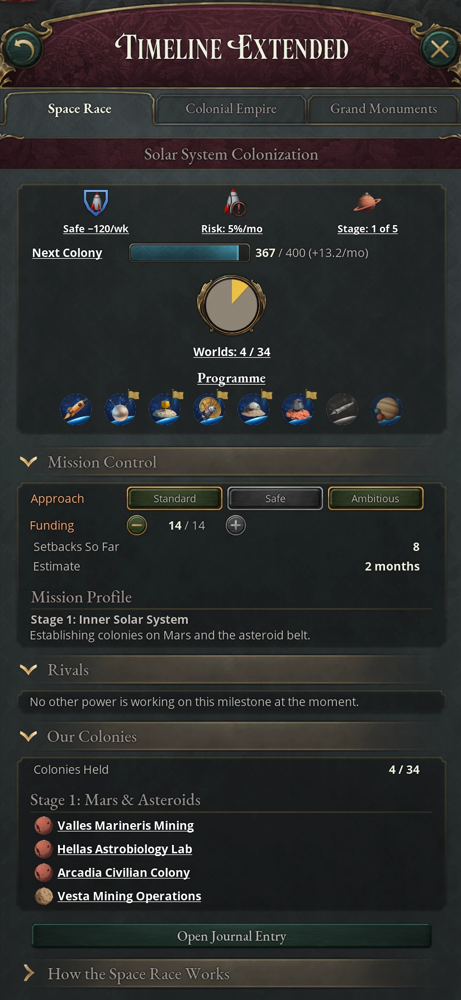

# The space race

The space race is a sequence of journal entries in which great and major powers
compete to reach space milestones, from a first suborbital flight to colonies in
the Kuiper Belt. The first country to finish each of the seven single-goal
milestones keeps a larger permanent reward than anyone who follows. The entries
start to appear once you research Rocketry in era 6, but you need a Space
Program building, unlocked by Guided Missiles in era 7, before any of them can
make progress. The Space Race game rule controls the system; with it off, the
journal entries and their events never appear. Its Full Colonies setting, the
default, and its Simple Colonies setting also make colony fleets take months or
years to arrive, give colonies settlers and modules, tie Extraplanetary Bases to
the room colonies give, let a colony change hands, and let colonies grow
restless and break away (see [Colony fleets in
flight](#colony-fleets-in-flight), [Colony settlers](#colony-settlers),
[Colony modules](#colony-modules), [Extraplanetary Base
room](#extraplanetary-base-room), [Ceding a colony](#ceding-a-colony) and
[Colony autonomy and free colonies](#colony-autonomy-and-free-colonies)).
Full Colonies adds warships in space: fleets you build, move between the
planets and fight with, to blockade, seize or destroy colonies, and to hold
Earth orbit (see [Space fleets](#space-fleets)).

## Joining the space race

Only great powers and major powers can run a space program. If you drop below
major power, your running milestones stop and their progress is lost. The one
exception is Solar System Colonization once you hold a colony: it keeps running
whatever your rank. A player country of either rank always makes progress. An AI
country makes progress only while it is in the top three of the global country
ranking, so in practice you race against the AI powers that hold those places.

### The Space Program building

The Space Program is a monument in your market capital, and every milestone
depends on it. It is a single, government-built building with a very high
construction cost, but you don't have to build it: once you research Guided
Missiles, the decision Found a Space Program places it in your market capital at
once, with no construction cost, running Earth Orbit. Either way it can stand
only in the capital of a market you lead, so a country in another country's
market can't have one. It is removed if the state stops being your market
capital, for example when you lose it in a war or join another market. It
employs 40,000 engineers, academics and clerks and consumes Launch Capacity, the
good your Aerospace Industry makes. That weekly bill is what the program really
costs; the Budget panel's Breakdown tab lists it under Programme Costs, in the
Space Race row.

Its production method decides which milestones you can run. Each method includes
everything the ones before it allow, so you only ever need the highest one your
program calls for. Each step up uses far more Launch Capacity and gives more
innovation, innovation cap and prestige.

| Production method | Technology | Milestones it allows | Launch Capacity used |
|---|---|---|---|
| Earth Orbit | Guided Missiles (with the building) | Suborbital Flight, Orbital Flight | 500 |
| Moon Mission | Space Exploration | adds Moon Landing and Deep-Space Probe | 1,500 |
| Mars Mission | Knowledge Economy | adds Mars Landing and Moon Base | 5,000 |
| Solar Colonization | Directed Energy Weapons | adds Solar System Colonization, stages 1 and 2 | 25,000 |
| Deep Space Exploration | Space Colonization | lets a country with no colony start colonizing at stages 3 to 5 | 50,000 |
| Interstellar Mission | Muon-Catalyzed Fusion Reactors | adds the Interstellar Probe | 100,000 |

> Lowering the production method, or losing the building, fails every running
> milestone the new method no longer supports and wipes its progress. The event
> Program Discontinued (or The Silent Gantry, if the building is gone) lists what
> was lost. Solar System Colonization only pauses once you hold a colony.

### Moving to the next mission

You can switch the production method in the building panel at any time, but the
decisions panel also offers each next mission when you are ready for it. A
"Begin" decision appears once you research the method's technology, and you can
take it once the milestones before it are complete, while you are a great or
major power. It switches the Space Program to that method.

| Decision | Appears while you run | Needs complete |
|---|---|---|
| Begin the Moon Mission | Earth Orbit | Orbital Flight |
| Begin the Mars Mission | Moon Mission | Moon Landing and Deep-Space Probe |
| Begin Solar Colonization | Mars Mission | Moon Base and Mars Landing |
| Begin Deep Space Exploration | Mars Mission or Solar Colonization | Moon Base and Mars Landing |
| Begin the Interstellar Mission | Mars Mission or any later method | Deep-Space Probe and Mars Landing |

Begin Solar Colonization appears only while there are worlds left that Solar
Colonization can reach: those of stages 1 and 2, or any stage once you hold a
colony. Begin Deep Space Exploration appears only when you need it: every world
of stages 1 and 2 is claimed and you hold no colony. You can begin the
Interstellar Mission without finishing colonization, and colonization goes on
under it.

## Space race milestones

There are nine space race journal entries: seven milestones with a single goal,
the repeatable Solar System Colonization, and a waiting entry that follows the
interstellar probe. Each entry appears, inactive, once you have finished the
milestone before it and researched its technology, and it starts when your Space
Program runs a method that supports it.

| Milestone | Needs completed | Technology | Progress needed | Setback risk | Cost factor |
|---|---|---|---|---|---|
| Suborbital Flight | nothing | Rocketry (era 6) | 50 | 5% | ×1 |
| Orbital Flight | Suborbital Flight | Guided Missiles (era 7) | 100 | 6% | ×1.5 |
| Moon Landing | Orbital Flight | Space Exploration (era 7) | 200 | 6% | ×2 |
| Deep-Space Probe | Moon Landing | Space Exploration (era 7) | 150 | 6% | ×2 |
| Mars Landing | Moon Landing | Knowledge Economy (era 9) | 450 | 9% | ×6 |
| Moon Base | Moon Landing | Reusable Rocketry (era 10) | 300 | 8% | ×5 |
| Interstellar Probe | Deep-Space Probe and Mars Landing | Muon-Catalyzed Fusion Reactors (era 12) | 600 | 9% | ×12 |
| Interstellar Probe: Awaiting Data | Interstellar Probe | none | 132 months | none | none |
| Solar System Colonization | Moon Base and Mars Landing | Directed Energy Weapons (era 11) | 400 to 650 per colony | 10% | ×8 |

The setback risk is the base chance each month; the cost factor scales the
milestone's innovation cost (see [Space race funding and
cost](#space-race-funding-and-cost)). The order is mostly a chain, but it
branches after the Moon Landing: the Deep-Space Probe, Mars Landing and Moon
Base can then run at the same time, as long as you have their technologies and
the Mars Mission method. The Interstellar Probe and Solar System Colonization
each need two of those three finished. The Deep-Space Probe and Mars Landing
show up in the journal as soon as you reach orbit and have their technologies,
but neither can start before the Moon Landing.

### The space milestone panel

A running milestone's journal entry shows its panel: an overview at the top and
sections below it. An entry that hasn't started yet shows only its status text.

The same panels appear on the Space Race tab of the Timeline Extended window,
which the button under the sidebar's Map List opens, and a change made in one
shows in the other. The tab is grayed until your first milestone starts; hover
it for what is still missing. From then on it stays open, whether or not a
milestone is under way. It opens with two sections of its own, Space Powers and
Orbit (see [The Space Race tab](#the-space-race-tab)), then shows every
milestone you have under way, each under its own name and followed by an Open
Journal Entry button, and How the Space Race Works once at the end. While no
milestone is under way, a note stands in their place.

The overview is always shown. Its first row is three icons, each with a label
under it:

| Icon | Reads | Means |
|---|---|---|
| Approach | Standard, Safe −30/wk or Ambitious −60/wk | The approach in force. Safe and Ambitious show their weekly innovation cost. |
| Approach, during a post-setback review | Shielded: 4 mo | No milestone can suffer a setback for the months shown. The approach itself is unchanged. |
| Setback risk | Risk: 6%/mo | This month's chance of a setback. The icon is faint while it reads 0%. |
| The first | First: Open or First: Claimed | Whether the larger reward is still there to win. The icon is faint once another power has claimed it. |

Below them, the Progress bar fills toward the goal. Beside it are your progress,
the goal and this month's pace, as in "124 / 200 (+3.5/mo)". Hover the bar for
the reward for finishing first and for finishing later. Hover the pace for where
it comes from: each source that adds progress every month, each that multiplies
it, and the pace that results, which is never below 0.5. Every running milestone
gains the same pace.

At the foot of the overview, the Programme row has an icon for each entry, in
order. An icon is lit once you have achieved that milestone, with a flag if you
were first. It is half-lit while under way, and faint if you haven't begun it
or another power finished it first. The Interstellar Probe and its wait for data
share one icon with four pictures: the probe greyed (not begun), the probe with
a wrench (under way), radio dishes with a clock (launched, awaiting data) and
the dishes with a check (data received). Hover any icon for its state.

Three sections follow the overview:

| Section | Starts | Shows |
|---|---|---|
| Mission Control | Open | The Approach buttons (Standard, Safe and Ambitious; the one in force is greyed, and each tooltip gives its effect and weekly cost), the Funding stepper with your level and the cap, Setbacks So Far, the Estimate of months left at this month's pace (setbacks not counted), the Orbital Debris index (see [Orbital debris](#orbital-debris)), and the Mission Profile. |
| Rivals | Open | The other powers running the same milestone, each with an estimate of its progress. |
| How the Space Race Works | Collapsed | The explanations: approach and pace, funding, setbacks, the first, rivals, the programme, space powers, and satellites and debris. |

A rival's progress is an estimate. The first five rivals each show a band
reaching 25% of the goal to either side of a marker, which always contains the
true figure, with the band's range in percent beside it. Programs are announced but their schedules are
not, so where the marker sits in the band is drawn again once a year. An agent
network in the rival's country narrows the band to ±10% at strength 50 and ±5%
at 75 (see [Agent networks](11-influence.md#agent-networks)). Hover a rival for
its figures; any rivals past the fifth are listed when you hover the line below
them.

Solar System Colonization's overview shows its stage (Stage: 2 of 5) in place
of the first, and its bar is Next Colony, the progress toward your next colony.
While a full bar waits for a launch window, Staged in Orbit gives the progress
built so far in colony fleets ("1.4 fleets"); hover it for each destination's
next window. Under the bar, the Worlds pie counts the 34 worlds: gold for your
colonies, red for other powers' and grey for the worlds no one holds; hover it
for the counts. Its Mission Control adds Next Windows, the destinations of the
stage with a world left and the months to each window (see [Launch
windows](#launch-windows)).
While the program isn't running, because every world is claimed or your Space
Program no longer runs the method it needs, the approach reads Idle, the risk
and progress rows are hidden, and Mission Control shows only the Mission
Profile.

Solar System Colonization also has a fourth section, Our Colonies (open), below
Rivals. It lists every world you hold, grouped by stage, under the
specialization you chose for it, with Colonies Held (out of 34) at the top. A
stage's heading appears once you hold one of its worlds, and hovering a colony
shows its permanent effects. Each row has a small icon for its kind of world:
Mars, the asteroids, a moon of Jupiter, Saturn, Uranus or Neptune, Venus,
Mercury, or a dwarf planet. It stays on the panel when the program is Idle, so
you can always see where your colony modifiers come from.

Interstellar Probe: Awaiting Data has nothing to control, so it has no Mission
Control or Rivals. Its overview is the Transit bar ("40 / 132 months") and the
Programme row; hover the bar for the months to go and what the probe might
find.

A new milestone starts on the Standard approach at funding level 1. It moves at
your program's pace and rolls against its base setback risk from its first
month.

### The Space Race tab

The Space Race tab of the Timeline Extended window opens with two sections that
don't belong to any milestone, so you can follow the race between milestones
too. Both start open.

Space Powers puts your own program first, then every other power that has
started the race, furthest along first: the most milestones achieved, then the
most colonies and the furthest milestone under way. Each row is the country's name, its program as the same
eight icons as the Programme row (lit once achieved, with a flag for a first,
half-lit while under way, faint otherwise) and its furthest milestone under way
with its progress, as in "Moon Landing: 35%–85%". Your own progress is exact.
Another power's is an estimate, in the same band as the Rivals rows, which an
agent network in its country narrows. Hover an icon for that milestone's state
and the name for the milestones achieved and colonies held. The other powers are
listed afresh at the start of each month: the first eight as rows, the rest when
you hover the line below them. Unlike Rivals, the list includes AI powers
outside the top three of the world ranking, whose programs have stalled.

Orbit gathers what anti-satellite strikes and debris mean for you now:

| Row | Shows |
|---|---|
| Orbital Debris | The index and its tier, as in Mission Control (see [Orbital debris](#orbital-debris)). |
| Our Satellites | Intact, Disrupted or None in Orbit. Hover it for the months a disruption has left, or how long until anyone can strike you again. |
| Anti-Satellite Strikes So Far | The strikes since the game began. Hover it for who struck whom last, and when. |
| Anti-Satellite Moratorium | Not Adopted, Bound or Not Bound (see [The anti-satellite moratorium](10-united-nations.md#the-anti-satellite-moratorium)). |
| Our Anti-Satellite Strike | Ready once you have Guided Missiles and a Space Program. Hover it for what is missing, or for the countries at war with you that have something in orbit to strike, each marked if it was struck in the last 12 months. |

### Standard, Safe and Ambitious approaches

The approach decides how fast a milestone moves, how often it goes wrong and what
it costs on top of funding. You can switch a running milestone between the three
at any time, back to Standard included.

| Approach | Effect | Innovation cost |
|---|---|---|
| Standard | None. | None. |
| Safe | −50% setback risk. | One extra funding level's worth. |
| Ambitious | +50% progress. | Two extra funding levels' worth. |

The approach label in the overview shows the weekly innovation cost of the
approach in force, and each approach button's tooltip gives its own: 15 times
the milestone's cost factor for Safe and twice that for Ambitious, so 30 and 60
a week on the Moon Landing.

Approach, funding and mission choices apply to your whole program, not to the
milestone they sit on. Their modifiers appear on each milestone's journal entry,
but the game adds them up for your country as a whole: every running milestone
moves at the same pace, and every milestone's base risk is
scaled by the same total. A Safe approach on one milestone cuts the risk on all
of them, including those on Ambitious, and an Ambitious one speeds up all of
them, including those on Safe. They stack: two Ambitious milestones add +100%
progress, and two Safe ones bring every milestone down to the 1% floor. What
stays with each milestone is its innovation cost and the kind of setback it
suffers, which follows its own approach (see [Space race
setbacks](#space-race-setbacks)). Setback risk never drops below 1% a month or
rises above 50%. The panel's pace and risk figures are the ones the game uses,
so check them after every change.

### Mission profile choices

Thirty days after Orbital Flight, the Moon Landing, the Deep-Space Probe, the
Moon Base or the Mars Landing starts, an event asks you to choose how to fly it.
While that milestone runs, your choice changes the setback risk, and sometimes
the pace, of your whole program, in the same way as an approach. When the
milestone is finished it also decides a reward that fades over ten years.

| Event | Milestone | Options |
|---|---|---|
| Who Flies First? | Orbital Flight | Civilian volunteer (riskier; prestige, cultural pull); military test pilot (lower risk, faster; military research, influence); scientist (a little riskier; research, innovation cap) |
| Where the Eagle Shall Land | Moon Landing | Shackleton Crater (much riskier, faster; research, innovation cap); Equatorial Plain (lower risk; prestige, research); Sea of Tranquility (a little riskier; prestige, cultural pull); far side of the Moon (riskier, faster; research, innovation cap) |
| Where Shall We Send the Probe? | Deep-Space Probe | Venus (riskier; research, space race progress); Mars (lower risk, faster; the most space race progress, prestige); the asteroid belt (much riskier; space race progress, innovation cap) |
| The Purpose of the Base | Moon Base | Scientific outpost (lower risk, faster; research, innovation cap); industrial facility (riskier; Extraplanetary Base throughput, Launch Capacity output); military installation (much riskier; military research, influence, cheaper military goods) |
| The Mars Strategy | Mars Landing | Direct landing (much riskier, much faster; prestige, cultural pull); orbital-first (slightly lower risk, faster; research, Space Program throughput); robotic precursors (lower risk; Extraplanetary Base throughput, innovation cap, and Mars Resource Extraction: research speed, space race progress and cultural pull) |

## Space race funding and cost

Each milestone has its own funding level, from 0 up to your cap. The cap starts
at 3 and rises with technology: eleven space-related technologies from era 7 to
era 11 raise it by 1 each, and four in era 12 raise it by 2 each. Tier V of the
Advanced Research power bloc principle, its highest, adds another level.

Every funding level, on any milestone, adds 0.5 to your monthly pace, and so to
every running milestone. It also raises the Space Program's throughput
by 25%, which makes the building consume more Launch Capacity. Funding and
approach cost weekly innovation: 15 for each funding level, plus nothing for
Standard, 15 for Safe or 30 for Ambitious, multiplied by the milestone's cost factor
from the table above. A Suborbital Flight at funding 1 on Safe costs 30
innovation a week; an Interstellar Probe at funding 3 on Ambitious costs 900.
The Space Program Cost modifier on each journal entry shows the current drain.

Your monthly pace is the sum of your progress sources, raised by your progress
bonuses, and never less than 0.5.

| Progress source | Monthly progress |
|---|---|
| Space Program: Earth Orbit, or any higher method, fully staffed | +0.5, or +1 |
| Each funding level on each running milestone | +0.5 |
| Space Elevator megaproject, each fully staffed level | +1 |
| SpaceX, Lockheed Martin or Roscosmos company, when prosperous | +0.3 each |
| International Space Partnership, for members that ratify the UN's International Space Cooperation | +0.1 |
| Reusable Rocketry and Space Colonization technologies | +0.2 each |
| Mission choices, probe targets and colony specializations | +0.1 to +0.6 each |

| Progress bonus | Effect |
|---|---|
| Ambitious approach | +50% |
| Stolen Rocket Plans, while your Space Programme Espionage operation runs | +10%, and −10% setback risk |
| Outer Space Treaty terms of International Space Cooperation | +10% for lagging powers, −5% for the leader |
| Advanced Research principle, tier V | +10% |
| Antimatter Engine, each fully staffed level | +5% |
| Nanofabrication Center, each fully staffed level | −1% setback risk |
| Temporary Safety Review, from some failure options | −10%, and −25% setback risk |

The International Space Partnership and Outer Space Treaty figures are those at
Established enforcement (×1); they scale with the UN's enforcement, as its other
convention effects do.

## Space race setbacks

Each month, every running milestone rolls against its setback risk. A hit fires an event about that milestone, and what it costs depends on
the approach. Setbacks cost months of progress: a month is your monthly pace
when the setback struck, and each option's tooltip gives the months and the
progress they come to. Changing funding while the event waits doesn't change
either.

On an Ambitious approach you get a mission failure: an explosion on the pad, a
lost probe, a habitat breach, a computer that aborts the landing. Most options
cost 4 months of that milestone's progress, at the faster Ambitious pace, give Space Mission Failure (−2% prestige
and −25 innovation cap, fading over five years) and radicalize some academics.
They also start a six-month safety period during which none of your milestones
can suffer another setback, although they keep moving at full pace; the panel
reads Shielded, with the months left, and shows the risk as 0%. One
option usually adds a Temporary Safety Review, which fades over ten years, and
in some events also switches the milestone to Safe. Another usually presses on
with 5 or 6 months lost, more radicals and no safety period.
Now and then the roll brings An Unexpected Breakthrough instead: no progress is
lost, and the Space Program's throughput rises by 15% for 18 or 24 months.

On a Safe or Standard approach you get a minor setback: missing parts, bad weather, a
scandal, a quarrel with a foreign supplier. It costs 1 to 4 months of the
milestone's progress, usually 2 or 3, with no lasting modifier and no safety
period. A few setbacks, on any approach, also cut the Space Program's throughput
for some months. A setback never takes more progress than the milestone has, and
in Solar System Colonization never more than one colony's, so fleets staged in
orbit are never lost to a setback.

Because the cost is counted in months, setbacks cost the same share of time on
every milestone, whatever its goal or your pace; later milestones are harder
only because their risk is higher. On Standard, setbacks add roughly a sixth to
a milestone's time at 5% risk and two fifths at 10%. Safe roughly halves that.
Ambitious loses about as much time as Standard, from a pace half again as fast.

A setback never ends a milestone; it only costs time. Two things do: dropping
below major power, or losing the production method or building the milestone
needs.

## First-to-finish rewards

When a milestone completes, its event plays and every other recognized country
gets a notice two weeks later, from which it can push every milestone it has
under way by a month of progress or congratulate you for better relations. The finisher keeps a permanent
reward. The first country to finish a milestone gets the larger version; anyone
who finishes it later gets the smaller one.

| Milestone | Prestige | Innovation cap | Research speed | Influence | Cultural pull |
|---|---|---|---|---|---|
| Suborbital Flight | +2% / +1% | +25 / +10 | none | none | +10% / +3% |
| Orbital Flight | +3% / +1.5% | +50 / +25 | none | none | +15% / +5% |
| Moon Landing | +5% / +3% | +75 / +35 | +5% / +2% | none | +25% / +10% |
| Deep-Space Probe | +4% / +2% | +50 / +25 | +3% / +1% | none | +15% / +5% |
| Moon Base | +5% / +2.5% | +75 / +35 | +5% / +2% | +5% / +2% | +20% / +8% |
| Mars Landing | +7% / +4% | +100 / +50 | +5% / +2% | none | +30% / +12% |
| Interstellar Probe | +10% / +5% | +100 / +50 | +10% / +5% | +10% / +5% | +25% / +10% |

The first figure is the first-to-finish reward, the second the later one.
Suborbital Flight's completion event also offers a choice: loyalists, or
Suborbital Momentum, an extra copy of the later finisher's reward (+1%
prestige, +10 innovation cap, +3% cultural pull) that fades over two and a half
years. Cultural pull feeds the cultural hegemony competition described in [Where
cultural pull comes from](11-influence.md#where-cultural-pull-comes-from).

## Interstellar probe results

Finishing the Interstellar Probe launches it toward Alpha Centauri and opens
Interstellar Probe: Awaiting Data, which counts down 132 months (eleven years).
Nothing you do shortens the wait. When it ends, the probe reports one of 30
possible discoveries in four categories, and you keep that category's reward
permanently.

| Category | Chance | Discoveries | Reward |
|---|---|---|---|
| Dead worlds and data | 40% | 8 | +3% prestige, +5% research speed, +50 innovation cap |
| Astrophysical wonders | 30% | 7 | +5% prestige, +8% research speed, +75 innovation cap, +10% cultural pull |
| Biological discovery | 20% | 9 | +8% prestige, +12% research speed, +125 innovation cap, +20% cultural pull |
| Intelligence detected | 10% | 6 | +12% prestige, +15% research speed, +200 innovation cap, +30% cultural pull |

Each discovery has its own event, from barren worlds and asteroid maps through
ocean worlds and alien vegetation to the ruins of a dead civilization. If
another country's probe found the same thing first, the event names it and
confirms its discovery; the reward is the same.

## Colonizing the solar system

Solar System Colonization is repeatable. Each time its bar fills, a colony fleet
leaves for an unclaimed world: the one you chose with Target in the Solar System
list (see [Choosing a colony's world](#choosing-a-colonys-world)), or otherwise
one the program picks among those it can reach that month (see [Launch
windows](#launch-windows)). Under Races Only the program picks a random world of
the current stage, and the colony is founded the month its fleet leaves. Under
Simple Colonies and Full Colonies the fleet travels and founds the colony when it
lands (see [Colony fleets in flight](#colony-fleets-in-flight)). Each world can be
claimed once, by anyone, so every other country racing for colonies competes for
the same 34 sites. Under Races Only a stage opens for everyone once every world in
the one before it has been claimed. Each stage needs more progress per colony.

| Stage | Worlds | Colonies | Progress per colony |
|---|---|---|---|
| 1 | Mars (Valles Marineris, Olympus Mons, Hellas Planitia, Utopia Planitia, Arcadia Planitia) and the asteroids (Ceres, 4 Vesta, 16 Psyche, 2 Pallas, 10 Hygiea) | 10 | 400 |
| 2 | Jupiter's moons (Io, Europa, Ganymede, Callisto, Himalia, Amalthea) and a Venus cloud habitat | 7 | 450 |
| 3 | Mercury and Saturn's moons (Titan, Enceladus, Rhea, Mimas, Iapetus) | 6 | 500 |
| 4 | Uranus's moons (Titania, Oberon, Miranda, Ariel) and Neptune's (Triton, Proteus) | 6 | 550 |
| 5 | The Kuiper Belt and beyond (Pluto-Charon, Eris, Makemake, Haumea, Sedna) | 5 | 650 |

From stage 3, a country that doesn't yet hold a colony needs the Deep Space
Exploration or Interstellar Mission method to start the program; a country that
already holds one carries on through all five stages with Solar Colonization.
Under Simple Colonies and Full Colonies the same rule applies world by world: a
country holding no colony needs one of those methods to send a fleet to Mercury,
Saturn or beyond.
Each colony's event offers two specializations, and the one you choose becomes a
small permanent modifier on the journal entry. Under Simple Colonies and Full
Colonies you can raise it, and add the other, with modules (see [Colony
modules](#colony-modules)). The options differ by world:
research speed, military research speed, innovation cap, space race progress,
Extraplanetary Base, Fusion Plant or Orbital Solar Collector throughput,
Advanced Materials or Launch Capacity output, cultural pull, influence,
diplomatic reputation or cheaper military goods. Your first colony also brings
the event Beyond the Blue.

The entry stays open for as long as you hold a colony, even if you switch off
the Solar Colonization method, so your colony modifiers are never lost; the
program simply stops (its panel reads Idle), and bills no funding or approach
cost, until the method returns. Once all 34 worlds are claimed, Solar System
Colonization finishes within a month for every country that holds a colony,
whoever took the last world and whether or not its program is running.
Finishing grants Interplanetary Trade Networks: +10% prestige, +5% research
speed, +10% influence and +15% cultural pull.

### Launch windows

Every world but Mercury is reached on a transfer orbit that lines up only once
in a while. A world's launch window is the month of its best departure and the
month on either side. The windows are worked out from the planets' and
asteroids' real orbits: Mars opens one every 26 months or so, each asteroid
every 15 to 17, Venus every 19, Jupiter every 13, and Saturn, Uranus, Neptune
and the Kuiper Belt about once a year. Next Windows in Mission Control lists the
stage's destinations with the months to each.

While no destination with a world left is open, the program keeps building.
Progress past a colony's goal is fleets staged in orbit, shown on the overview
as Staged in Orbit. When a window opens, one fleet departs each month it stays
open while staged progress covers a colony, so a three-month window can send
three. What is left waits for the next window. It carries on to the next stage
if rivals take the stage's last worlds, and is lost when the last of the 34
worlds is claimed. Cutting funding while you wait gains nothing: whatever you
build now leaves in a later window.

Until you hold a colony, the program starts over whenever it stops: when your
Space Program leaves the Solar Colonization method, when you fall below major
power, or after a revolution. The colony being readied is lost, as an
unfinished bar always is, but whole fleets already staged stay in orbit and
are back on the bar in the program's first month once it runs again. Once you
hold a colony, the program never stops this way and keeps all its progress.

Propulsion technology loosens the windows in three steps:

| Technology | Launches |
|---|---|
| Directed Energy Weapons (opens colonization) | In a window only. |
| Asteroid Mining | In a window as before; outside one, at a premium of extra progress, when your approach judges it worth it. |
| Muon-Catalyzed Fusion Reactors | Any month, with no premium. |
| Antimatter Production, with an Antimatter Containment Facility built | Any month, with no premium. |

The premium is the extra propellant an off-window transfer needs, so it climbs
fast away from the window: on Mars, about +40% the month after a window closes
and +150% the month after that. With Asteroid Mining, Next Windows shows
today's figure for each closed destination. A fleet leaves outside a window, for the cheapest
destination, when the months it saves (until the stage's next window) are worth
the months its premium costs (the goal times the premium, at your monthly pace).
Standard launches when it saves at least as many months as it costs, Ambitious
when it saves at least half as many, and Safe always waits for a window. A fleet
that leaves outside a window spends the goal plus the premium. In practice a fast
program launches just after a window closes rather than wait two years for Mars,
and almost never just before one, when waiting is cheap.

Fusion Power doesn't change when a fleet can leave, only how long it takes to
arrive under Simple Colonies and Full Colonies (see [Colony fleets in
flight](#colony-fleets-in-flight)).

### Choosing a colony's world

The Solar System list in Solar System Colonization has a Target button on each
unclaimed world your program can send its next fleet to, while the program
runs. Click it to choose that world: its row reads Our target, and the Colony
Fleets section names it. The next fleet waits for that world's launch window, even
if another world's window opens first. Outside the window it leaves at the
premium when your approach judges it worth it, weighing the wait for that world's
own window. Under Simple Colonies and Full Colonies a chosen world costs the
progress of its own stage. Click Clear on the row to let the program pick again;
it also picks again when someone else claims the world first.

Under Races Only you can choose any world of the current stage, or a released
world of an earlier stage. The colony is still founded the month its fleet
leaves. AI programs don't choose ahead; they pick when a fleet is ready.

### Colony fleets in flight

Under Simple Colonies and Full Colonies, a colony fleet takes months or years to
reach its world, and claims it only when it lands. Your drive sets how long:

| Drive | Technology | Leaves | Mars | Jupiter | Uranus | Kuiper Belt |
|---|---|---|---|---|---|---|
| Chemical | (from the start) | In a launch window | 9 months | 33 months | 16 years | 51 years |
| Fusion | Fusion Power | In a launch window | 2 to 3 months | 7 to 9 months | about 3 years | 11 to 25 years |
| Fusion torch | Muon-Catalyzed Fusion Reactors | Any month | 1 month | 2 months | 6 months | 1 year |
| Antimatter | Antimatter Production, with an Antimatter Containment Facility built | Any month | 1 month | 1 month | 2 months | 4 months |

Fusion's times are for a departure in the window; a fusion fleet that leaves
outside one, at the premium, takes longer, much longer to the outer planets.
Mercury takes 4 months by chemical rocket. Colony Fleets names your drive, lists
each fleet in flight with its world and the month it lands, and holds up to six;
with six in flight the bar waits.

The stages are not locks: a fleet can leave for any unclaimed world, and distance
gates the outer system instead. A world costs its own stage's progress, 400 for
Mars and the asteroids up to 650 for the Kuiper Belt. Without a choice of yours,
the program sends each fleet to the best world it can reach within 15 years:
nearer, cheaper and inner worlds first, and away from worlds a fleet already on
its way, yours or another country's, will reach first. So a chemical program
settles Mars, the asteroids and Jupiter, and waits for better drives before
Uranus. AI programs pick the same way. You can still choose a world farther out
by hand.

Each world's row in the Solar System list shows the fleets on their way, as the
number of fleets and the months until the first lands, in a brighter color when
the first is yours. The first fleet to land claims the world. A fleet that lands to
find its world taken founds another unclaimed world of the same planet or belt
(Mars, Jupiter, Saturn, Uranus, Neptune or the Kuiper Belt) instead. If none is
free, or it was bound for an asteroid, Venus or Mercury, it is lost with the
progress it cost. Either way an event tells you.

### Colony settlers

Under Simple Colonies and Full Colonies, colonies hold people. A colony starts as
an automated outpost with no one in it, so it grows only once settlers arrive:
then by about 2.4% a year up to its room, from 10,000 people on the smallest
moons and the farthest dwarf planets to 50,000 at Valles Marineris and the Hellas
and Utopia plains. The Settlers section of Solar System Colonization sets how
many settlers you send from Earth:

| Emigration | Settlers a month | Launch Capacity bill |
|---|---|---|
| Off | none | none |
| Low | 500 | +5% Space Program throughput |
| Steady | 1,000 | +10% |
| High | 2,000 | +15% |

The settlers leave the state that holds your Space Program, half from the middle
strata and half from the lower, and only while your colonies have room; that
state's census counts them as emigrants. Each colony's row shows its people and
room and a priority button that steps through Normal, High, Closed and Low. A
colony's share of each month's settlers is its priority (Closed none, Low 1,
Normal 2, High 4) times its free room, and a colony that fills up passes the rest
of its share to the others. So set the colony you are building up to High and the
ones you don't want settled to Closed.

People are crews: the Crews figure counts how many module levels a colony's
people can run, one for every 5,000. A colony's founding specialization runs
without a crew. With Artificial General Intelligence colonies need no crews at
all, and the figure reads AGI. Habitats add room for more people (see [Colony
modules](#colony-modules)).

Your people off Earth give Off-World Population on Solar System Colonization:
+1% prestige and +2% cultural pull for every 100,000 of them, up to a million.
A colony's people go with it when it changes hands, stay on it when it becomes
a free colony, and are lost if it is released. AI programs set Emigration to Steady while they are in the top three
of the space race with money to spare, to Low otherwise, and to Off in default
or when their colonies are full.

### Colony modules

Under Simple Colonies and Full Colonies, you build up each colony with modules,
listed in the Colony Modules section of Solar System Colonization:

| Module | What a level does | Room for it |
|---|---|---|
| The two specializations | Adds the specialization's bonus once more: level 3 gives three times the founding bonus | Four levels between the two: one at 4, both at 2, or 1 and 3. The founding choice is level 1 |
| Habitat | Adds half of the colony's starting room for people | The colony's slots, shared with Spaceports and Defences: four on Valles Marineris and the Hellas and Utopia plains, one on the smallest moons and dwarf planets |
| Spaceport | Under Full Colonies, a dock for your fleets: they refill supply, repair 10% of their damage a month a level and refit there, and refuel on a world that makes propellant. Under Simple Colonies, nothing | The colony's slots |
| Defences | Under Full Colonies, guns that fire on enemy fleets closing in on the colony and make it harder to wear down. Under Simple Colonies, nothing | The colony's slots |

The founding event has to be answered before you can add a specialization
level. Each row's buttons add one more level of a module to the end of your
module queue, counting what is already queued and on its way against the
colony's room, and its last button takes all of that colony's modules out of
the queue. The queue holds up to 20 modules and is listed in order above the
rows, each with a button that removes it. You can't take a module down once it
is built.

Modules are built at Earth by your Space Program's third production method
group, Module Fabrication, which starts on No Module Fabrication:

| Method | Technology | Launch Capacity and Advanced Materials a week | Points a month |
|---|---|---|---|
| Orbital Assembly | Directed Energy Weapons | 1,500 and 10 | 5 |
| Lunar Foundries | Space Colonization | 2,000 and 15 | 12 |
| Fusion Shipyards | Muon-Catalyzed Fusion Reactors | 2,000 and 10 | 25 |

Each module costs 100 points, so a fully staffed Space Program builds one every
20, 8 or 4 months, more often with higher funding. Fabrication builds the queue
in order, first in first out: the module at the top is next. To move a module
up, remove the ones ahead of it and queue them again. Up to 200 points wait in
stock while nothing is queued.

A finished module waits at Earth for its world's launch window, or leaves at
once with a fusion torch or antimatter drive, and lands after the transit your
drive buys (see [Colony fleets in flight](#colony-fleets-in-flight)). Eight
modules can wait or fly at once; while all eight are taken, fabrication waits.
A module lands for whoever holds the colony then, and is lost if the world was
released or its room filled in the meantime.

Every level past the first needs a crew of 5,000 people, except Habitats, which
house the crews. A colony short of crews runs its modules at the share it can
staff: four levels with no crews run at a quarter each, which the Crew column
shows. With Artificial General Intelligence every module runs. Each level past
each colony's first adds +1% to your Space Program's throughput, raising its
Launch Capacity bill (Colony Modules on the journal entry).

A colony's modules stay with it when it changes hands, and the Cede Colony AI
values a colony more for each of them. AI programs in the top three with money
to spare queue one module a year at each colony: a Habitat once its people fill
three quarters of its room, otherwise the next specialization level its crews
can run, its founding specialization first. They run the best fabrication method
they have while anything is queued, and never build Spaceports or Defences.

### Extraplanetary Base room

Under Simple Colonies and Full Colonies, Extraplanetary Bases need room. The
near-Earth asteroids give every country room for 10 levels, and each colony you
hold adds its own, from 10 levels on the small outer moons to 60 at 16 Psyche.
Each colony's room has a grade, which raises or lowers the output of the levels
that work it:

| Worlds | Grade |
|---|---|
| 16 Psyche | +30% |
| 4 Vesta, Ceres | +20%, +15% |
| Mars, 2 Pallas | +10% |
| 10 Hygiea, Himalia, Mercury | +5% |
| The near-Earth asteroids, Ganymede, Callisto, Amalthea | 0 |
| Io, Europa, Venus | −5% to −10% |
| Saturn's moons | −15% to −20% |
| Uranus's and Neptune's moons | −25% to −35% |
| The Kuiper Belt | −35% to −45% |

Your levels fill the best room first, and any past all of your room work at
−50%. One country modifier, Extraplanetary Base Room, carries the average over
all your levels, so only the levels past the room pay the penalty: with room for
10 and 20 levels built, the base works at −25%. A new poor colony adds room
without lowering what your levels already earn, and taking a rival's Psyche
colony raises your average and lowers theirs. The Colony Modules section shows
your levels against your room. Private investors don't build past your room,
and AI governments don't either; your government can, at the penalty. Under
Races Only, bases have no room limit.

### Who holds a colony

Every world records which country holds it. Solar System Colonization's Solar
System section, closed until you open it, lists all 34 under their places in the
solar system: Ours, the holder's flag (hover it for the country's name, click it
to open the country), Another power, or Unclaimed.

A colony stays with its holder until the holder is gone, or, under Simple
Colonies and Full Colonies, until a treaty moves it ([Ceding a
colony](#ceding-a-colony)) or it leaves on its own ([Colony autonomy and free
colonies](#colony-autonomy-and-free-colonies)). When a holder is annexed, each of its colonies passes, with its
specialization and its discoveries, to whoever owns the state region of its last
capital. If no country there can take it, the world reads Unclaimed again: the
next colony fleet that can reach it claims it, at the current stage's cost, even
when its stage is long past or the race is over. Under Simple Colonies and Full
Colonies a colony of 1,000 people or more becomes a free colony instead (see
[Colony autonomy and free colonies](#colony-autonomy-and-free-colonies)). When a revolution wins, the new
government holds the old one's colonies at once. Under Full Colonies an enemy
can also occupy a colony in a war, which keeps its holder but gives it nothing
until the peace (see [Blockade, seizure and destruction](#blockade-seizure-and-destruction)).

A country that comes to hold a colony this way, or by treaty, gets Solar System
Colonization for it even without a space program. Without the Moon Base and the
Mars Landing it keeps the colony and its specialization but founds no more, and
the entry reads Idle and costs nothing.

### Ceding a colony

With the Space Race rule on Simple Colonies or Full Colonies, the Cede Colony
treaty article moves one colony from the conceding country to the other. The
treaty draft lists the conceding country's colonies by name, such as Valles
Marineris Colony. The colony moves when the treaty comes into force and stays
moved when the treaty ends, with its specialization and its discoveries. The
article costs no influence, and a treaty can carry it once for each colony, in
either direction, so two countries can swap colonies, or sell one for a Money
Transfer. It can also be demanded as a war goal, for 5 maneuvers and 10 infamy.

AI powers in the race ask for colonies; an AI that holds a colony with no space
program of its own offers it. Any AI accepts a cession when the rest of the
treaty pays more than the colony is worth to it, which rises with the world's
stage, from Mars and the asteroids to the Kuiper Belt.

### Colony autonomy and free colonies

Under Simple Colonies and Full Colonies, every colony you hold has an autonomy
figure from 0 to 100, listed in the Colony Autonomy section of Solar System
Colonization with how much it moves each month. It changes every month:

| What moves it | A month |
|---|---|
| The pull of home | −0.25 |
| Its people | +0.05 for every 10,000 |
| Its distance: the months your drive takes to reach it | +0.01 a month of transit, at most +0.5 |
| No settlers or module has landed for more than a year | +0.25 |
| You are at war | +0.25 |
| A garrison | +0.2 |
| A charter | −0.4 |

So a Mars colony that keeps receiving settlers barely moves, while a large
colony at Saturn on chemical rockets gains about five points a year. Better
drives bring the outer colonies closer: with a fusion torch the distance all but
disappears. Keep settlers or modules arriving, on Low emigration if nothing
else, so that no colony goes a year without contact.

At 75, the colony demands self-government, once in five years at most, and you
choose:

| Choice | Now | After |
|---|---|---|
| Grant a charter | −30 autonomy | For good: its specializations work at 80% for you, and its autonomy falls 0.4 a month |
| Send a garrison | −25 autonomy | For ten years: +2% Space Program throughput a garrisoned colony (Colonial Garrisons), and the colony's resentment adds 0.2 a month |
| Let it go | It becomes a free colony, on good terms with you | — |

A charter settles a colony for good at a fifth of its output; a garrison buys
ten years and costs Launch Capacity. Under Full Colonies a garrison is real
troops: it takes effect only once a fleet lands two marine battalions at the
colony, within a year of the order, or the order lapses. A colony that reaches 100 declares itself
free whatever you chose. A charter stays with the colony when it changes hands;
a garrison goes home. AI powers grant a charter while they race, garrison while
at war, and let a colony go when they run no colonization program.

**Abandoning a colony.** Each colony's row has an Abandon button, which asks
first. You can bring its people home to your capital, releasing the world and
losing its modules, or, with 1,000 people or more, leave them to govern
themselves as a free colony. An outpost with almost no one in it can only be
closed. The AI never abandons a colony.

**Free colonies.** A free colony keeps its people, modules and discoveries but
has no holder, so nobody gets its specialization. The Solar System list shows it
as Free, and Colony Autonomy lists every one with its people and your ties with
it. Click Supply on a free colony to send it supplies:

| Supplying a free colony | |
|---|---|
| Costs | +3% Space Program throughput for each colony you supply (Free Colony Supply) |
| Earns | Free Colony Trade: +1% research speed and +2% influence for every 20,000 of its people, shared among its suppliers, up to five times |
| Ties | +2 a month while you supply it, −1 a month when you don't |

A free colony grows only while someone supplies it. When your ties with it
reach 100, it asks to join you, once a year at most: welcome it and it is yours
again at autonomy 20, with its people and modules; decline and your ties fall
back to 50. A colony you let go or leave free starts at ties 50 with you, so
supplying it brings it back in about two years; one that broke away starts at
0. AI powers in the top three with money to spare supply up to two free
colonies and accept a colony that asks.

Covert operations reach colonies too: Incite Colonial Autonomy raises the
autonomy of every colony the target holds, Sabotage Colony kills a share of
the people of its largest, and under Full Colonies Survey Colony Defences
shows your fleets the target's colony defences and sharpens their fire on them
(see [The covert operations](11-influence.md#the-covert-operations)).

**Colony life.** Three rare events come with growing colonies. The First Child
fires once, when your first colony reaches 2,000 people: prestige, and a choice
between pulling the colony closer or letting it be proud of itself. A Strike can
come at a colony of 10,000 or more and a Dome Breach, which kills a tenth of a
colony's people, at one of 5,000 or more; after either, neither comes again for
ten years, so a nation sees one about every fifteen years. Paying for the strike
or the repairs costs Space Program throughput for a while and lowers the
colony's autonomy; leaving the colonists to it raises it.

### Rare colony discoveries

New colonies can also produce rare discoveries after their founding event.
Twenty discoveries cover microbial life in Europa's or Enceladus's oceans,
confirmed ancient Martian fossils, buried ice, mineral deposits, ocean
layers, atmospheric waves and local geological hazards. Each discovery offers
two choices with different small permanent bonuses on the colony journal entry.

Each candidate has a hidden 10% chance of being possible when its colony is
founded. A successful founding roll starts a year of surveying. After that,
the discovery has a 1% monthly chance for biological finds or 2% for other finds.
A country can receive at most one discovery every six months. Each discovery
occurs once, and other possible finds wait through that spacing period.
Surveys continue while colonization is idle and after all worlds are claimed.
Colonies founded in an older save receive no new founding rolls.

Each event reports a confirmed discovery by an established colony. The
biological finds include living microbes and ancient microbial fossils; other
finds establish geological features or chemical processes. Their probabilities
are game rules, not estimates of how likely those discoveries are in the real
solar system.

## Space fleets

Under the Space Race rule's Full Colonies setting, countries build warships in
space, and the Solar System Colonization panel gains three sections: Space
Command, Fleets and Colony Defences. Nothing here exists under Simple Colonies.

### Space Command

Space Command is a government building, unlocked by Space Militarization and
built only in a state with a Space Program. Each level builds fleet strength
every month, by its production method:

| Method | Technology | Strength a level a month |
|---|---|---|
| Orbital Shipyards | Space Militarization | 0.5 |
| Fusion Yards | Fusion Power | 1 |
| Torch Yards | Muon-Catalyzed Fusion Reactors | 1.5 |
| Antimatter Yards | Antimatter Production | 2 |

The figure is scaled by staffing, and the method's tooltip shows it as Fleet
Strength Built a Month. A Space Command in a state you don't control builds
nothing. The month's strength is shared among five roles by the build mix,
whose buttons step each role's weight from 0 to 3, and waits on the ground in
the reserve until it is launched (see [Holding Earth orbit](#holding-earth-orbit)):

| Role | Fire on fleets | Fire on colony defences | Months of supply | Also |
|---|---|---|---|---|
| Warship | 1 | 1 | 18 | Takes losses first |
| Rapid response | 0.5 | 0.5 | 12 | Takes losses first; a fleet of these alone flies one drive faster |
| Siege ship | 0.5 | 2 | 18 | |
| Assault carrier | 0.25 | 0.25 | 12 | Carries 2 marine battalions a point of strength |
| Tender | 0.1 | 0.1 | 36 | Adds propellant and supply to its fleet |

Fleets cost upkeep as more of every input Space Command uses: 1% for every 10
points of strength at full, the reserve's included. A large fleet makes the
yards dearer to run, not slower. Directed Energy Weapons, Orbital Weapon Platforms and Antimatter
Production each raise your fleets' fire by a quarter.

### Moving fleets

The Fleets section lists your fleets, up to nine, with where each is, its
strength now and at full (hover it for its ships), its drive, its propellant in
km/s, its months of supply and its marines. A fleet can be at one of nine
locations: Earth Orbit, Mercury & Venus, Mars, the Asteroid Belt, Jupiter,
Saturn, Uranus, Neptune and the Kuiper Belt.

| Order | What it does |
|---|---|
| The destination button | Steps through the other locations; its hover gives the trip's months and propellant |
| Go | Sends the fleet. It can't leave when the trip departs in a later month (a chemical or fusion fleet leaving Earth follows the launch windows), when its propellant doesn't cover the trip, or from Earth while Earth is blockaded or your launch site occupied |
| Merge | Joins another of your fleets at the same location |
| Detach | Splits half of each role into a new fleet |
| Land, Embark | Puts the fleet's marines at your colony there, or takes them back aboard | <!-- style: allow ai-vocab -->

A fleet in flight can be neither attacked nor recalled. It docks at Earth and at
your colonies with a Spaceport: supply and propellant refill (at a Spaceport,
propellant only on a world that makes it, such as Utopia Planitia, Ceres, Europa
or Titan), damage is repaired, and a fleet on an older drive refits to your best
in three months. Away from a dock supply runs down, and a fleet without it loses
5% of its strength a month. Marines fill up at Earth only. A fleet that arrives
where you hold a colony counts as contact for the colony's autonomy. When an
enemy fleet sets out for a location where you hold a colony, you are warned
with the months until it arrives.

### Battles in space

Each month, fleets of countries at war fight at every location where they meet.
What a fleet fights depends on its posture, set by the posture button (away from
Earth):

| Posture | Fights | Use it to |
|---|---|---|
| Station | Every enemy fleet there | Guard your colonies. A fleet arriving where you hold a colony stations |
| Stand off | Enemy fleets that stand off or are stationed, out of the colonies' guns | Blockade an enemy's colonies |
| Close in | The target world's Defences and the enemy fleets stationed there | Seize or destroy a colony |
| Interdict | As Stand off. Offered where a country at peace with you that is not your ally holds a colony; the target button picks its world | Blockade that country's colonies there without a war (see [Interdiction](#interdiction)) |

At Earth every fleet fights every enemy fleet, an Orbital Battlestation
fights for its owner (25 strength a level, regaining 10% a month; none in a
state its owner doesn't control), and so do its ground-to-orbit batteries (see
[Holding Earth orbit](#holding-earth-orbit)). Losses follow the square law: each side loses
in proportion to the other's fire, so concentration pays (100 strength against
50 ends with about 87 left). Warships and rapid response take the losses before
the other roles, and half of every loss is damage a dock repairs. A battle at
Earth adds to orbital debris. A battle report comes after each month of
fighting, and the war support breakdown shows Battles in space.

### Blockade, seizure and destruction

A colony is blockaded when an enemy fleet stands off at its location and none
of its holder's fleets holds orbit there. Settlers and modules stop reaching it,
it gives its holder no Extraplanetary Base room, and a specialization that
ships goods home (mining, industry, propellant) stops; research and observatory
specializations keep running. The Colony Defences section lists your colonies
with their Defences, integrity, marines and status.

A fleet closing in on a world brings its integrity down, from 100 to 0, faster
with siege ships and against fewer Defences; the world's Defences fire back.
Integrity returns by 5 a month when the attack stops, 10 with a Spaceport. At
0, with no enemy fleet stationed there, the fleet's next step depends on its
Seize or Destroy button:

| Choice | Needs | What follows | Price |
|---|---|---|---|
| Seize | More marines than the world's garrison and militia (a battalion for every 20,000 people, at least one) | The world is occupied: it gives its holder nothing, counts as Colonies occupied in space in the war support breakdown, and goes back at the peace unless a Cede Colony article takes it. Its holder, or anyone at war with the occupier, frees it the same way, with more marines than the occupier's garrison | None |
| Destroy | Three months closing in with more fire than its Defences | The colony and everyone in it are lost, and the world lies ruined for 25 years | 20 infamy, 20 on your UN record of hostile acts in space, +10 autonomy at each of your colonies and their resentment for ten years |

A free colony can be attacked without a war: closing in costs 10 infamy at
once, and seizing it makes it yours at autonomy 60. A party to the
[Convention on the Settlement of Outer Space](10-united-nations.md#the-outer-space-convention)
pays twice the infamy and twice the UN record for destroying a colony or
closing in on a free one. Seizing a colony at war costs a party no more than
anyone else. Without Survey Colony
Defences against its holder, the target's hover gives a world's Defences only
roughly, and its integrity and marines not at all.

### Interdiction

You can blockade a rival's colonies without going to war, as the United States
quarantined Cuba in 1962. Send a fleet to a location where a country at peace
with you, and not your ally (no alliance or defensive pact), holds a colony, and
step its posture to Interdict; the target button picks which country's world.
While none of that country's fleets is stationed or standing off there, its
colonies at that location are blockaded as an enemy's would be, and its
Locations row reads Interdicted. Nobody fires. If its fleet holds orbit there,
the two fleets face each other and nothing is blockaded; firing on it needs a
war.

| You pay, for each fleet and each country it interdicts | The country you interdict gains |
|---|---|
| 5 infamy, and 10 on your UN record of hostile acts in space | A warning, and a casus belli: for five years, demanding one of your colonies with Cede Colony costs it no infamy |

An interdiction ends, and the fleet stands off, when its target goes to war
with you, signs an alliance or defensive pact with you, or no longer holds a
colony there. A world that passes to another country at peace with you is a new
interdiction, at the same price. In a war against the country you were
interdicting, your fleet standing off blockades it anyway, now as an enemy.

### Holding Earth orbit

Earth orbit is where every launch goes up, so it can be fought over. Your Earth
is blockaded when a fleet of a country at war with you is at Earth and none of
yours is. While it is, nothing of yours leaves Earth: no colony fleet (a full
bar waits), no module shipment (modules are still made, and wait at Earth), no
settlers and no fleet. None of your colonies has contact from home, so their
autonomy counts the months. Your Locations row for Earth reads Blockaded,
Space Command shows a red note, and you are told which country holds your
orbit. Your batteries and your Orbital Battlestation fire on the blockaders but
don't lift the blockade: only a fleet of yours at Earth does.

That fleet comes from the reserve. Space Command's construction waits on the
ground there, in the five roles, and its Reserve row gives the strength (hover
it for the roles). With Auto on, the default, it joins your home fleet at Earth
each month while no enemy fleet is there, so in peace the reserve stays empty.
While an enemy fleet is at Earth it stays on the ground, and Launch sends all of
it up together as one fleet at Earth, with full propellant, supply and marines,
blockade or not. A blockade therefore faces everything you have built since it
began, not a month's worth at a time. Turn Auto off to keep a reserve in peace
and launch it when you choose; it costs the same upkeep on the ground.

Ground-to-orbit batteries are a government building, unlocked by Space
Militarization and built in any state. Each level fires on every enemy fleet at
Earth every month and takes no losses:

| Method | Technology | Each level a month |
|---|---|---|
| Kinetic Interceptors | Space Militarization | 1 fire on enemy fleets at Earth; each point fired adds 0.02 to low-orbit debris |
| Ground Lasers | Directed Energy Weapons, and electricity | 2 fire, no debris; in peace, 0.01 low-orbit debris swept away |

The method's tooltip and the state's modifiers show both figures, scaled by
staffing. A month of fire costs the enemy about a tenth of it in strength:
twenty levels take 2 strength a month on Kinetic Interceptors, 4 on Ground
Lasers. The technologies that raise your fleets' fire don't raise the
batteries'. Ten levels of lasers clear 0.1 low-orbit debris a month: a help
against everyday clutter, no cure for a Kessler Cascade, which lives in the high
orbits they can't reach.

At war, holding Earth orbit supports your troops: while your fleets at Earth
outmatch the enemy's there, or face none, you get Orbital Superiority, up to
+10% offense and +5% defense for your units. It grows with the margin, and is
full when you have twice the enemy's strength at Earth, or 10 against none. It
stands beside the anti-satellite strike's Orbital Network Disrupted.

Nothing is launched, built or fired from a state its owner doesn't control.
While your Space Program's state is occupied, nothing leaves Earth, no module is
fabricated and the reserve can't launch, whatever is in orbit; you are told when
the launch site is lost and when it is back. Space Command, the batteries and
the Orbital Battlestation in an occupied state count for no one: not for you,
and not for the occupier, whose gain is that you have lost them. A land war can
shut down a space program.

### How the AI fights in space

AI fleet powers keep their fleets at home in peace, send their strongest fleet
to defend a location where they hold colonies when an enemy fleet is there or on
its way, or when a fleet interdicts them there, bring fleets home short of
supply or propellant, and land marines for the garrisons they order. At war,
once a month, an AI sends one fleet from a dock to the nearest enemy location
within a year's flight, when the fleet is at least half again as strong as the
enemy's fleets and its colonies' Defences there and can fly home again or dock
there. It closes in on the enemy colony with the most people and modules,
to seize it when its marines outnumber the garrison and militia, and otherwise
stands off to blockade. It comes home once the enemy's fleets there outmatch
its own. An AI never destroys a colony, never attacks a free one and never
interdicts. With an enemy fleet at Earth, it launches its reserve once the
reserve and its fleets at Earth match the enemy's there. It builds batteries
only while at war with a country that has fleets, up to five levels, and runs
Ground Lasers at war, and in peace once debris is Cluttered.

## After the space race

The race is over for you once you have finished all seven single-goal
milestones, all 34 worlds have been claimed by anyone, and no program of yours is
still running. A power that gets there after the last world is gone qualifies as
soon as its own seven milestones are done. From then on, the progress your
sources still give each month goes into your Extraplanetary Bases as
Commercial Space Industry: each point of monthly progress adds +5%
Extraplanetary Base throughput, up to +50% at 10 points. The first time it
applies, the event The Commercial Space Age tells you.

Only the flat sources in the table under [Space race funding and
cost](#space-race-funding-and-cost) count: the Space Program's method, the
Space Elevator, the space companies, the International Space Partnership, the
two technologies, and any mission choice, probe target or colony specialization
that adds progress. Funding adds nothing, since no milestone is left to fund,
and neither do progress bonuses such as Antimatter Engines. The figure is
recalculated every month, so a new Space Elevator level or a space company
losing its prosperity shows in the next one.

Commercial Space Industry does nothing until you build Extraplanetary Bases
(Asteroid Mining). A Space Elevator of 10 levels reaches the cap on its own. The
Space Program's method counts for at most one point, so once the race is over
you can switch it to Earth Orbit, which uses 500 Launch Capacity instead of up to
100,000, and give up only half a point. When you choose a colony's
specialization, an option that adds progress keeps some value after the race:
below the cap, it is worth about a quarter of what the mining options give.
AI powers gain Commercial Space Industry in the same way.

## Orbital debris

Debris in Earth orbit is one figure for the whole world, the orbital debris
index, from 0 to 100. It has two parts. Debris in low orbits is dragged down by
the upper atmosphere within a few years: 1.5% of it goes each month. Debris in
high orbits stays for a century, losing 0.05% a month. Every running Space
Program adds 0.01 to the low orbits each month, so six programs keep about 4
points up, and each [anti-satellite strike](#the-anti-satellite-strike) adds 6
to each part. Mission Control shows the index on every milestone's panel, as
"Orbital Debris: 12.3 (Clear)", and so does the Space Race tab's Orbit section.
Hover it for the two parts, what the index costs you now and who is cleaning it
up.

| Tier | Index | What changes |
|---|---|---|
| Clear | below 25 | Only the costs below. |
| Cluttered | 25 | AI powers start removing debris. |
| Hazardous | 50 | Space Elevators risk ribbon strikes. |
| Kessler Cascade | 75 | Collisions add 0.2 to the high orbits every month until removal brings the index back under 75. |

Every country that uses orbit pays for each point of the index: one with a
Space Program, a Space Elevator, an Orbital Solar Collector, an Orbital
Battlestation or an Extraplanetary Base.

| Each point | At 50 | At 100 |
|---|---|---|
| +1% setback risk | +50% | +100% (risk still stops at 50% a month) |
| −0.3% space race pace | −15% | −30% (pace never drops below 0.5 a month) |
| −0.2% throughput for Extraplanetary Bases, Space Elevators, Orbital Battlestations and Solar Receivers | −10% | −20% |

Nothing stops: your milestones keep moving, and every cost fades as the debris
does. An Orbital Battlestation's lower throughput also lowers the military
bonuses it gives, along with its upkeep.

From Hazardous on, a Space Elevator owner has a 0.02% chance per point each
month (1.5% at 75) of a ribbon strike. The event Ribbon Strike runs your
elevator at −50% throughput for six months, or, if you pay for an emergency
repair (the cost grows with your GDP), for two. A ribbon still under repair
isn't struck again.

### Clearing orbital debris

Your Space Program has a second production method group, Debris Removal. It
starts on No Debris Removal. Each other method removes debris every month,
taking it from the high orbits first, and adds a little prestige:

| Method | Technology | Launch Capacity a week | Removed a month |
|---|---|---|---|
| Active Debris Removal | Reusable Rocketry | 300 | 0.05 |
| Laser Broom | Directed Energy Weapons | 300, and 500 electricity | 0.15 |
| Fusion Sweepers | Muon-Catalyzed Fusion Reactors | 150 | 0.5 |

Each fully staffed Space Elevator level raises what you remove by 10%, up to
+100% at ten levels, and its Launch Capacity makes every method cheaper in your
market. Removal also follows the Space Program's throughput, so each funding
level raises it along with the bill. Cleaning earns Orbital Cleanup: +1%
prestige for each 0.1 you remove a month. The decision Begin Orbital Debris
Removal switches your Space Program to the best method you have, and appears
again when a better one arrives. Switch removal off in the building's
production methods.

Under the Space Race rule's Full Colonies, ground-to-orbit batteries on
Ground Lasers also sweep the low orbits in peace (see [Holding Earth
orbit](#holding-earth-orbit)). Every country in orbit gains from what anyone
removes. Fusion Sweepers with a
ten-level Space Elevator clear 30 points in about two and a half years. One
program on Active Debris Removal can't stop a Kessler Cascade: that takes
several cleaners, or better technology. AI powers that use orbit take the
decision once debris is Cluttered, more readily at Hazardous, if their weekly
surplus covers the method's Launch Capacity.

### The anti-satellite strike

Anti-Satellite Strike is a diplomatic action against a country you are at war
with. It needs Guided Missiles (era 7), a Space Program of your own, and a
target with a Space Program, a Space Elevator, an Orbital Solar Collector or an
Orbital Battlestation. A country can be struck once every 12 months, by anyone.
The Orbit section of the [Space Race tab](#the-space-race-tab) shows whether
you could strike and whom, the state of your own satellites, and the last
strike anywhere.

| Who | What the strike does |
|---|---|
| The target | Orbital Network Disrupted for a year: −10% unit offense and defense, −20% space race pace, and −25% throughput for its Space Elevators, Orbital Battlestations and Solar Receivers. It lasts six months if its Space Program runs the Mars Mission or a later method, and is half as strong if it has an Orbital Battlestation. It ends on its own. |
| You | 5 infamy, 15 case strength at the UN (see [Grounds for UN censure](10-united-nations.md#grounds-for-un-censure)), twice both as a party to the [Moratorium on Destructive Anti-Satellite Tests](10-united-nations.md#the-anti-satellite-moratorium), and −30 relations with every other country that uses orbit. |
| Everyone | 6 more debris in low orbits and 6 in high orbits, which your own program flies through too. |

The strike suits a war against a power with more in orbit than you, whose
fleet and space race lean on its satellites. Its debris and its diplomatic cost
fall on you as well, and a strike in a crowded orbit can tip the world into a
Kessler Cascade. AI powers strike rarely, only when the enemy has more in orbit
than they do (its Space Program's mission plus its orbital megaprojects'
levels), and almost never once debris is Hazardous, unless they are losing the
war. Communications Disruption, the covert operation, interferes with a
country's networks without the debris (see [The covert operations](11-influence.md#the-covert-operations)).

## Space race events

Besides the choice, setback and completion events above, the space race has
yearly events for programs under way. Some are hard science problems, such as
radiation or orbital debris; others are discoveries, such as water on Mars.
Their options add progress to the milestones they concern, usually 1 to 3
months of it, counted at your pace when the event fires as setbacks are; a few
cost a month or more instead. Some also bring loyalists, radicals or better
relations. A handful tie the race to other systems: the SpaceX company, a
Tourism Industry, the United Nations, the Extraplanetary Base and the Space
Elevator. They are listed in [Space race event
list](19-appendix-events.md#space-race-event-list).

## How the AI races

AI great and major powers found their programs and move them up the missions
through the same decisions you have. An AI takes them only while it is in the
top three of the global ranking, out of default, and only if its weekly budget
surplus covers what the step adds to the Launch Capacity bill. AI powers use
the same entries, approaches and funding, and start each milestone on Standard
as you do; only you can switch a milestone back
to Standard. Only an
AI in the top three of the global ranking makes progress; a weaker one can open
an entry but its bar doesn't move, and the Rivals list leaves it
out. Such an AI winds its funding down to 0 and pays nothing for the approach
it has chosen until it climbs back into the top three. AI great powers prefer
the Ambitious approach, more so when another country is running the same
milestone; AI major powers lean toward Safe. The AI raises funding while it has
innovation to spare and cuts it when innovation runs short. Launch windows bind
the AI as they bind you, and its approach decides its launches outside a window
the same way. Under Simple Colonies and Full Colonies the AI sends its colony
fleets where the program picks for you when you choose no world, and sets its
emigration and queues its colony modules once a year (see [Colony
settlers](#colony-settlers) and [Colony modules](#colony-modules)).

A revolution's winner continues the old country's program, with its progress
(except progress toward a first colony) and its rewards, and rebels can't start
a program of their own during a civil war; see [After a
revolution](06-politics.md#after-a-revolution).
