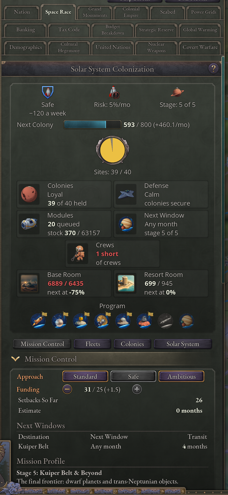

# The space race

The space race is a sequence of journal entries in which great and major powers
compete to reach space milestones, from a first suborbital flight to colonies in
the Kuiper Belt. The first country to finish each of the six single-goal
milestones, or to found a colony on the Moon, keeps a larger permanent reward
than anyone who follows. The entries
start to appear once you research Rocketry in era 6, but you need a Space
Program building, unlocked by Guided Missiles in era 7, before any of them can
make progress. The Space Race game rule controls the system; with it off, the
journal entries and their events never appear. Its Full Colonies setting, the
default, and its Simple Colonies setting also make colony fleets take months or
years to arrive, give colonies settlers and modules, tie Extraplanetary Bases to
the room colonies give, let a colony change hands, and let colonies grow
restless and break away (see [Colony fleets in
flight](#colony-fleets-in-flight), [Colony settlers](#colony-settlers),
[Colony modules](#colony-modules), [Extraplanetary Base
room](#extraplanetary-base-room), [Resort Colony room](#resort-colony-room),
[Ceding a colony](#ceding-a-colony) and
[Colony autonomy and free colonies](#colony-autonomy-and-free-colonies)).
Full Colonies adds warships in space: fleets you build, move between the
planets and fight with, to blockade, seize or destroy colonies, and to hold
Earth orbit (see [Space fleets](#space-fleets)).

## Joining the space race

Only great powers and major powers can run a space program. If you drop below
major power, your running milestones stop and their progress is lost. The one
exception is Solar System Colonization once you hold a colony: it keeps running
whatever your rank. A player country of either rank always makes progress. An AI
country makes progress only while it is in the top three of the global country
ranking, so in practice you race against the AI powers that hold those places.

### The Space Program building

The Space Program is a monument in your capital, and every milestone depends on
it. It is a single, government-built building with a very high construction
cost, but you don't have to build it: once you research Guided Missiles, the
decision Found a Space Program places it in your capital at once, with no
construction cost, running Earth Orbit. It is removed if the state stops being
your capital, for example when you lose it in a war or move your capital. It
employs 40,000 engineers, academics and clerks and consumes Launch Capacity, the
good your Aerospace Industry makes. That weekly bill is what the program really
costs; the Budget panel's Breakdown tab lists it under Program Costs, in the
Space Race row.

Its production method decides which milestones you can run. Each method includes
everything the ones before it allow, so you only ever need the highest one your
program calls for. Each step up uses far more Launch Capacity and gives more
innovation, innovation cap and prestige.

| Production method | Technology | Milestones it allows | Launch Capacity used |
|---|---|---|---|
| Earth Orbit | Guided Missiles (with the building) | Suborbital Flight, Orbital Flight | 500 |
| Moon Mission | Space Exploration | adds Moon Landing and Deep-Space Probe | 1,500 |
| Mars Mission | Knowledge Economy | adds Mars Landing | 5,000 |
| Solar Colonization | Cislunar Infrastructure | adds Solar System Colonization, the Moon and stages 1 and 2 | 10,000 |
| Deep Space Exploration | Space Colonization | lets a country with no colony beyond the Moon start colonizing at stages 3 to 5 | 50,000 |
| Interstellar Mission | Aneutronic Fusion | adds the Interstellar Probe | 100,000 |

> Lowering the production method, or losing the building, fails every running
> milestone the new method no longer supports and wipes its progress. The event
> Program Discontinued (or The Silent Gantry, if the building is gone) lists what
> was lost. Each one starts again from zero a month or two after your Space
> Program can carry it again. Solar System Colonization only pauses once you
> hold a colony.

AI countries run their programs on a budget. An AI program runs the highest
mission whose bill is at most a tenth of its government's income. It drops to a
cheaper mission after six months over a fifth, and to Earth Orbit at once while
the country is in default or bankrupt. A milestone that mission carries that is
three quarters done and still advancing holds the drop, for up to three more
years. After a drop it waits five years before it climbs again. An AI that can't pay even for Earth Orbit for a year pulls its program
down and founds no other for five years. So expect AI rivals to race only as far
as their budgets reach.

### Moving to the next mission

You can switch the production method in the building panel at any time, but the
decisions panel also offers each next mission when you are ready for it. A
"Begin" decision appears once you research the method's technology, and you can
take it once the milestones before it are complete, while you are a great or
major power. It switches the Space Program to that method.

| Decision | Appears while you run | Needs complete |
|---|---|---|
| Begin the Moon Mission | Earth Orbit | Orbital Flight |
| Begin the Mars Mission | Moon Mission | Moon Landing and Deep-Space Probe |
| Begin Solar Colonization | Moon Mission or Mars Mission | Moon Landing |
| Begin Deep Space Exploration | Mars Mission or Solar Colonization | Mars Landing |
| Begin the Interstellar Mission | Mars Mission or any later method | Deep-Space Probe and Mars Landing |

Begin Solar Colonization appears only while there are sites left that Solar
Colonization can reach: those of the Moon, and after your Mars Landing those of
stages 1 and 2, or of any stage once you also hold a colony beyond the Moon.
Every site beyond the Moon needs your Mars Landing. Begin Deep Space
Exploration appears only when you need it: every site of stages 1 and 2 is
claimed and you hold no colony beyond the Moon. You can begin the Interstellar
Mission without finishing colonization, and colonization goes on under it.

Once all 40 sites have been claimed, a site on the Moon that comes free again
is settled only by choice, and no program starts on its own. The decision Resume
Solar System Colonization (or Begin Solar Colonization) runs your program for
the Moon until it is full. A finished program keeps Interplanetary Trade
Networks, and it doesn't start again for a site beyond the Moon. While it runs,
the program bills its funding and approach, and Commercial Space Industry
pauses, as it does whenever one of your programs runs.

## Space race milestones

There are eight space race journal entries: six milestones with a single goal,
the repeatable Solar System Colonization, and a waiting entry that follows the
interstellar probe. Each entry appears, inactive, once you have finished the
milestone before it and researched its technology, and it starts when your Space
Program runs a method that supports it.

| Milestone | Needs completed | Technology | Progress needed | Setback risk | Cost factor |
|---|---|---|---|---|---|
| Suborbital Flight | nothing | Rocketry (era 6) | 50 | 5% | ×1 |
| Orbital Flight | Suborbital Flight | Guided Missiles (era 7) | 100 | 6% | ×1.5 |
| Moon Landing | Orbital Flight | Space Exploration (era 7) | 200 | 6% | ×2 |
| Deep-Space Probe | Moon Landing | Space Exploration (era 7) | 150 | 6% | ×2 |
| Mars Landing | Moon Landing | Knowledge Economy (era 9) | 450 | 9% | ×6 |
| Interstellar Probe | Deep-Space Probe and Mars Landing | Aneutronic Fusion (era 13) | 600 | 9% | ×12 |
| Interstellar Probe: Awaiting Data | Interstellar Probe | none | 132 months | none | none |
| Solar System Colonization | Moon Landing (Mars Landing for the sites beyond the Moon) | Cislunar Infrastructure (era 10) | 300 to 800 per colony | 10% | ×8 (×5 before your Mars Landing) |

The setback risk is the base chance each month; the cost factor scales the
milestone's innovation cost (see [Space race funding and
cost](#space-race-funding-and-cost)). The order is mostly a chain, but it
branches after the Moon Landing: the Deep-Space Probe, the Mars Landing and
colonizing the Moon can then run at the same time, as long as you have their
technologies and methods. The Interstellar Probe needs the Deep-Space Probe and
the Mars Landing finished, and colonies beyond the Moon need the Mars Landing.
The Deep-Space Probe and Mars Landing
show up in the journal as soon as you reach orbit and have their technologies,
but neither can start before the Moon Landing.

### The space milestone panel

A running milestone's journal entry shows its panel: an overview at the top and
sections below it. An entry that hasn't started yet shows only its status text.

The same panels appear on the Space Race tab of the Timeline Extended window,
which the button under the sidebar's Map List opens, and a change made in one
shows in the other. The tab is grayed until your first milestone starts; hover
it for what is still missing. From then on it stays open, whether or not a
milestone is under way. It opens with every milestone you have under way, each
under its own name and followed by an Open Journal Entry button; while none is,
a note stands in their place. Two sections of its own follow, Space Powers and
Orbit (see [The Space Race tab](#the-space-race-tab)), and How the Space Race
Works comes once at the end.

The overview is always shown. Its first row is three icons, each with a label
under it:

| Icon | Reads | Means |
|---|---|---|
| Approach | Standard, Safe or Ambitious | The approach in force. Under Safe and Ambitious, their weekly innovation cost, as in −30 a week. |
| Setback risk | Risk: 6%/mo | This month's chance of a setback. |
| The first | First: Open or First: Claimed | Whether the larger reward is still there to win. The icon is faint once another power has claimed it. |

Below them, the Progress bar fills toward the goal. Beside it are your progress,
the goal and this month's pace, as in "124 / 200 (+3.5/mo)". Hover the bar for
the reward for finishing first and for finishing later. Hover the pace for where
it comes from: each source that adds progress every month, each that multiplies
it, and the pace that results, which is never below 0.5. Every running milestone
gains the same pace.

At the foot of the overview, the Program row has an icon for each entry, in
order. An icon is lit once you have achieved that milestone, with a flag if you
were first. It is half-lit while under way, and faint if you haven't begun it
or another power finished it first. The Lunar Colony icon has no half-lit state:
it lights when you found your first colony on the Moon. The Interstellar Probe and its wait for data
share one icon with four pictures: the probe grayed (not begun), the probe with
a wrench (under way), radio dishes with a clock (launched, awaiting data) and
the dishes with a check (data received). Hover any icon for its state.

Two sections follow the overview:

| Section | Starts | Shows |
|---|---|---|
| Mission Control | Open | The Approach buttons (Standard, Safe and Ambitious; the one in force is grayed, and each tooltip gives its effect and weekly cost), the Funding stepper with your level and the cap, Setbacks So Far, the Estimate of months left at this month's pace (setbacks not counted), the Orbital Debris index on the journal entry (see [Orbital debris](#orbital-debris)), and the Mission Profile. |
| Rivals | Open | The other powers running the same milestone, each with an estimate of its progress. |

The "?" at the top of each milestone's journal entry, and in each milestone's
header in the Timeline Extended window, opens the Help page, How the Space Race
Works. It explains approach and pace, funding, setbacks, the first, rivals, the
program, space powers, and satellites and debris, then solar colonization.

A rival's progress is an estimate. Every rival is listed, furthest along
first, each with a band reaching 25% of the goal to either side of a marker,
which always contains the true figure, with the band's range in percent beside
it. Programs are announced but their schedules are not, so where the marker sits
in the band is drawn again once a year. An agent network in the rival's country
narrows the band to ±10% at strength 50 and ±5% at 75 (see [Agent
networks](11-influence.md#agent-networks)). Hover a rival for its figures. The
list is drawn afresh at the start of each month.

Solar System Colonization's overview shows its stage (Stage: the Moon, then Stage: 2 of 5) in place
of the first, and its bar is Next Colony, the progress toward your next colony.
While a full bar waits for a launch window, Staged in Orbit gives the progress
built so far in colony fleets ("1.4 fleets"); hover it for each destination's
next window. Under the bar, the Sites pie counts the 40 sites: gold for your
colonies, red for other powers' and gray for the sites no one holds; hover it
for the counts. Its Mission Control adds Next Windows, a table of the
destinations your next colony fleet can reach: each one's next window and how
long the fleet takes to get there by your drive (see [Launch
windows](#launch-windows)).
While the program isn't running, because every site is claimed or your Space
Program no longer runs the method it needs, the approach reads Idle, the risk
and progress rows are hidden, and Mission Control shows only the Mission
Profile.

Under Simple Colonies and Full Colonies, a second row of the overview says what
needs you, with the detail on hover. A word turns red when something is due:

| Cell | Reads |
|---|---|
| Colonies | Loyal, with the colonies you hold; or, in red, the name of a colony of 1,000 people or more at autonomy 50 or more, which wants self-rule, and how many more do. Hover it for all of them. |
| Defense | Under Full Colonies only. Calm; or, in red, what threatens you (Under assault, Blockaded, Occupied, Interdicted, Earth blockaded or Launch site lost) and the colony it threatens. Hover it for every colony under threat and any hostile fleet on its way. |
| Modules | How many modules are queued, and fabrication's stock. Queue empty turns red once the stock is full and waiting. |
| Next Window | The months to your chemical rockets' next launch window, Open now, Any month once your drive needs no window, or No site left; and the stage. |
| Base Room | Once you have In-Situ Resource Utilization: your Extraplanetary Base levels, built and queued, against your room (120 +20 / 400 with 20 queued, or their sum once the figures run long), red once they pass it, and the site the next level goes to, queued levels counted, or "next at −75%" once they pass all of your room. Hover it for that site's type, grade and profit a level (see [Extraplanetary Base room](#extraplanetary-base-room)). |
| Resort Room | Once you have Space Colonization: the same for your Resort Colony levels and their room, and the draw the next level would work at (see [Resort Colony room](#resort-colony-room)). |
| Hostile Fleet | Under Full Colonies, while a fleet of a country at war with you is on its way to Earth: Earth in the weeks until the first lands, and their strength at and bound for Earth against your fleets there. Red while a landing would tip the balance: you have no fleet at Earth and it isn't blockaded already, or yours holds against what is there now but not against what is coming too. Hover it for how many are coming. |

Below its overview, Solar System Colonization has four tabs, and the one you
were last on stays chosen while you play:

| Tab | Holds |
|---|---|
| Mission Control | Mission Control (with Next Windows) and Rivals, as every milestone has. Shown first. |
| Fleets | Colony Fleets, then under Full Colonies Space Command and Space Fleets. |
| Colonies | Colonies. |
| Solar System | Solar System. The colonies' rules come last on the Space Race's Help page, under How Solar Colonization Works. |

In the Timeline Extended window's Full Screen the four show at once, with no
tab buttons: Mission Control and Solar System under the overview, Colonies in
the middle column, and Fleets in the right-hand column above Space Powers.

Colonies (open) has a box for every site you hold, with Colonies Held (out of
40) at the top. Each box has a small icon for the kind of body it is on (the Moon, Mars,
the asteroids, a moon of Jupiter, Saturn, Uranus or Neptune, Venus, Mercury, or a
dwarf planet). Hovering its name shows the colony's permanent effects, and
clicking it, or the arrow beside it, opens the colony's page in a window of its
own, Our Colonies. The page sets out People, Autonomy, (under Full Colonies)
Defenses and, with In-Situ Resource Utilization, the colony's Extraplanetary Base
levels on the left, and Modules on the right,
each with its control beside its heading (the settler priority, Clear, Abandon,
and Revoke while the colony has a charter),
its figures in tiles and every module on a line of its own with its full name,
with buttons to queue one more level or take one down.
Every colony you hold is listed down the window's left side: click one to see
its page without closing the window. Escape, the close button or a click outside
the window closes it. Back in the list, the buttons above the rows switch what each box
shows:

| View | Shows | Above the rows |
|---|---|---|
| People (the default) | Each colony's people and room, its crews in use against the crews it has (green with crews to spare for the modules queued and on their way, yellow with just enough, red short) and its settler priority | Settlers a month, last month's settlers and their Launch Capacity a week, and your people off Earth |
| Modules | Each colony's crews against the crews it needs (red while short), its Habitats against their cap (red past it) and its Extraplanetary Base room and grade, then every module's level with a button to queue one more | Fabrication, shipments, module upkeep, Extraplanetary Base and Resort Colony room, and the queue in a box of its own with when its next module is built |
| Autonomy | Each colony's autonomy, how much it moves a month (hover it for that colony's terms), what it is building of its own, its charter or garrison, and Abandon | Free colony trade; the free colonies are listed below the rows |
| Defenses | Each colony's Defenses, integrity and marines, and what threatens it | |
| Bases | With In-Situ Resource Utilization, the Near-Earth Asteroids and each colony: its ground type and grade, your levels there against its room with − and + to assign them, and a level's profit and output (see [The Bases view](#the-bases-view)) | The Assign for the most profit checkbox, your levels against your room, what is moving and why, and your bases' output and profit a week |

The section stays on the panel when the program is Idle, so you can always see
where your colony modifiers come from. Under Races Only, Colonies lists your
sites and their effects without the views.

Interstellar Probe: Awaiting Data has nothing to control, so it has no Mission
Control or Rivals. Its overview is the Transit bar ("40 / 132 months") and the
Program row; hover the bar for the months to go and what the probe might
find.

A new milestone starts on the Standard approach at funding level 1. It moves at
your program's pace and rolls against its base setback risk from its first
month.

### The Space Race tab

After your milestones, the Space Race tab of the Timeline Extended window has two
sections that don't belong to any milestone, so you can follow the race between
milestones too. Both start open.

Space Powers puts your own program first, then every other power that has
started the race, furthest along first: the most milestones achieved, then the
most colonies and the furthest milestone under way. Each row is the country's name, its program as the same
eight icons as the Program row (lit once achieved, with a flag for a first,
half-lit while under way, except Lunar Colony, faint otherwise) and its furthest milestone under way
with its progress, as in "Moon Landing: 35%–85%". Your own progress is exact.
Another power's is an estimate, in the same band as the Rivals rows, which an
agent network in its country narrows. Hover an icon for that milestone's state
and the name for the milestones achieved and colonies held. The other powers are
listed afresh at the start of each month. Unlike Rivals, the list includes AI
powers outside the top three of the world ranking, whose programs have stalled.

Orbit gathers what anti-satellite strikes and debris mean for you now:

| Row | Shows |
|---|---|
| Orbital Debris | The index and its tier, as in a journal entry's Mission Control, which on the tab leaves it to this row (see [Orbital debris](#orbital-debris)). |
| Our Satellites | Intact, Disrupted or None in Orbit. Hover it for the months a disruption has left, or how long until anyone can strike you again. |
| Anti-Satellite Strikes So Far | The strikes since the game began. Hover it for who struck whom last, and when. |
| Anti-Satellite Moratorium | Not Adopted, Bound or Not Bound (see [The anti-satellite moratorium](10-united-nations.md#the-anti-satellite-moratorium)). |
| Our Anti-Satellite Strike | Ready once you have Guided Missiles and a Space Program. Hover it for what is missing, or for the countries at war with you that have something in orbit to strike, each marked if it was struck in the last 12 months. |

Another country's National Info shows its Space Race tab too, less its
approach, setback risk, Mission Control, Rivals and strike row. Its progress
there is an estimate band, a quarter of the goal either side, that your agent
networks don't narrow.

### Standard, Safe and Ambitious approaches

The approach decides how fast a milestone moves, how often it goes wrong and what
it costs on top of funding. You can switch a running milestone between the three
at any time, back to Standard included.

| Approach | Effect | Innovation cost |
|---|---|---|
| Standard | None. | None. |
| Safe | −50% setback risk. | One extra funding level's worth. |
| Ambitious | +50% progress. | Two extra funding levels' worth. |

The approach label in the overview shows the weekly innovation cost of the
approach in force, and each approach button's tooltip gives its own: 15 times
the milestone's cost factor for Safe and twice that for Ambitious, so 30 and 60
a week on the Moon Landing.

Approach, funding and mission choices apply to your whole program, not to the
milestone they sit on, for as long as that milestone runs. Their modifiers appear on each milestone's journal entry,
but the game adds them up for your country as a whole: every running milestone
moves at the same pace, and every milestone's base risk is
scaled by the same total. A Safe approach on one milestone cuts the risk on all
of them, including those on Ambitious, and an Ambitious one speeds up all of
them, including those on Safe. They stack: two Ambitious milestones add +100%
progress, and two Safe ones bring every milestone down to the 1% floor. What
stays with each milestone is its innovation cost and the kind of setback it
suffers, which follows its own approach (see [Space race
setbacks](#space-race-setbacks)). Setback risk never drops below 1% a month or
rises above 50%. The panel's pace and risk figures are the ones the game uses.
They follow a change within a few days, so check them a week after it.

### Mission profile choices

Thirty days after Orbital Flight, the Moon Landing, the Deep-Space Probe or
the Mars Landing starts, an event asks you to choose how to fly it.
While that milestone runs, your choice changes the setback risk, and sometimes
the pace, of your whole program, in the same way as an approach. When the
milestone is finished it also decides a reward that fades over ten years.
The probe's Grand Tour is the one costly choice: it slows the whole program by
a quarter and costs 60 more innovation a week while the milestone runs,
whatever the funding and approach, and its reward fades over twenty years.

| Event | Milestone | Options |
|---|---|---|
| Who Flies First? | Orbital Flight | Civilian volunteer (riskier; prestige, cultural pull); military test pilot (lower risk, faster; military research, influence); scientist (a little riskier; research, innovation cap) |
| Where the Eagle Shall Land | Moon Landing | Shackleton Crater (much riskier, faster; research, innovation cap); Equatorial Plain (lower risk; prestige, research); Sea of Tranquility (a little riskier; prestige, cultural pull); far side of the Moon (riskier, faster; research, innovation cap) |
| Where Shall We Send the Probe? | Deep-Space Probe | Venus (riskier; research, space race progress); Mars (lower risk, faster; the most space race progress, prestige); the asteroid belt (much riskier; space race progress, innovation cap); the Grand Tour past Jupiter and the planets beyond it (slower and costlier; research, space race progress, prestige and innovation cap, each no higher than the best single target's) |
| The Mars Strategy | Mars Landing | Direct landing (much riskier, much faster; prestige, cultural pull); orbital-first (slightly lower risk, faster; research, Space Program throughput); robotic precursors (lower risk; Extraplanetary Base throughput, innovation cap, and Mars Resource Extraction: research speed, space race progress and cultural pull) |

## Space race funding and cost

Each milestone has its own funding level, from 0 to six levels past your cap. The cap starts
at 3 and rises with technology: thirteen space-related technologies from era 7
to era 11 raise it by 1 each, and Cislunar Infrastructure (era 10), three
technologies in era 12 and Microfusion Cells in era 13 raise it by 2 each. With
all of them the cap is 13 by the end of era 10, 18 by the end of era 11, 24 by
the end of era 12 and 26 in era 13. Tier V of the
Advanced Research power bloc principle, its highest, adds another level.

Every funding level up to the cap, on any milestone, adds 0.5 to your monthly pace, and so to
every running milestone. It also raises the Space Program's throughput
by 25%, which makes the building consume more Launch Capacity. Funding and
approach cost weekly innovation: 15 for each funding level, plus nothing for
Standard, 15 for Safe or 30 for Ambitious, multiplied by the milestone's cost factor
from the table above. A Suborbital Flight at funding 1 on Safe costs 30
innovation a week; an Interstellar Probe at funding 3 on Ambitious costs 900.
The Space Program Cost modifier on each journal entry shows the current drain.

You can fund a milestone up to six levels past the cap. Each level past it adds
less pace than the one before: the first adds half a level's pace (+0.25 a
month), the second a third of one, and so on to a seventh for the sixth, so all
six together are worth 1.59 levels. Each still costs the full innovation and
still raises the Space Program's throughput by the full 25%, and with it the
Launch Capacity bill. Past the cap the Funding stepper reads "9 / 7 (+0.8)": the
level, the cap, and the levels' worth of pace the excess adds. If the cap falls
below a level you have set, the level stands and the excess counts past the cap.

Your monthly pace is the sum of your progress sources, raised by your progress
bonuses, and never less than 0.5.

| Progress source | Monthly progress |
|---|---|
| Space Program: Earth Orbit, or any higher method, fully staffed | +0.5, or +1 |
| Each funding level on each running milestone, up to the cap | +0.5 |
| Space Elevator megaproject, each fully staffed level | +1 |
| SpaceX, Lockheed Martin or Roscosmos company, when prosperous | +0.3 each |
| International Space Partnership, for members that ratify the UN's International Space Cooperation | +0.1 |
| Reusable Rocketry and Space Colonization technologies | +0.2 each |
| Mission choices, probe targets and colony specializations | +0.1 to +0.6 each |

| Progress bonus | Effect |
|---|---|
| Ambitious approach | +50% |
| Stolen Rocket Plans, while your Space Program Espionage operation runs | +10%, and −10% setback risk |
| Outer Space Treaty terms of International Space Cooperation | +10% for lagging powers, −5% for the leader |
| Advanced Research principle, tier V | +10% |
| Antimatter Engine, each fully staffed level | +5% |
| Nanofabrication Center, each fully staffed level | −1% setback risk |
| Temporary Safety Review, from some failure options | −10%, and −25% setback risk |

The International Space Partnership and Outer Space Treaty figures are those at
Established enforcement (×1); they scale with the UN's enforcement, as its other
convention effects do.

## Space race setbacks

Each month, every running milestone rolls against its setback risk. A hit fires an event about that milestone, and what it costs depends on
the approach. Setbacks cost months of progress: a month is your monthly pace
when the setback struck, and each option's tooltip gives the months and the
progress they come to. Changing funding while the event waits doesn't change
either.

On an Ambitious approach you get a mission failure: an explosion on the pad, a
lost probe, a habitat breach, a computer that aborts the landing. Most options
cost 4 months of that milestone's progress, at the faster Ambitious pace, give Space Mission Failure (−2% prestige
and −25 innovation cap, fading over five years) and radicalize some academics.
One option usually adds a Temporary Safety Review, which slows progress but
lowers the risk of another setback and fades over ten years, and in some events
also switches the milestone to Safe. Another usually presses on with 5 or 6
months lost and more radicals. Every milestone keeps rolling for setbacks the
month after a failure, as in any other month.
Now and then the roll brings An Unexpected Breakthrough instead: no progress is
lost, and the Space Program's throughput rises by 15% for 18 or 24 months.

On a Safe or Standard approach you get a minor setback: missing parts, bad weather, a
scandal, a quarrel with a foreign supplier. It costs 1 to 4 months of the
milestone's progress, usually 2 or 3, with no lasting modifier. A few setbacks,
on any approach, also cut the Space Program's throughput for some months. A setback never takes more progress than the milestone has, and
in Solar System Colonization never more than one colony's, so fleets staged in
orbit are never lost to a setback.

Because the cost is counted in months, setbacks cost the same share of time on
every milestone, whatever its goal or your pace; later milestones are harder
only because their risk is higher. On Standard, setbacks add roughly a sixth to
a milestone's time at 5% risk and two fifths at 10%. Safe roughly halves that.
Ambitious loses about as much time as Standard, from a pace half again as fast.

A setback never ends a milestone; it only costs time. Two things do: dropping
below major power, or losing the production method or building the milestone
needs.

## First-to-finish rewards

When a milestone completes, its event plays and every other recognized country
gets a notice two weeks later, from which it can push every milestone it has
under way by a month of progress or congratulate you for better relations. The finisher keeps a permanent
reward. The first country to finish a milestone gets the larger version; anyone
who finishes it later gets the smaller one. The milestone's entry lists both
endings, first and later, each with its reward.

| Milestone | Prestige | Innovation cap | Research speed | Influence | Cultural pull |
|---|---|---|---|---|---|
| Suborbital Flight | +2% / +1% | +25 / +10 | none | none | +10% / +3% |
| Orbital Flight | +3% / +1.5% | +50 / +25 | none | none | +15% / +5% |
| Moon Landing | +5% / +3% | +75 / +35 | +5% / +2% | none | +25% / +10% |
| Deep-Space Probe | +4% / +2% | +50 / +25 | +3% / +1% | none | +15% / +5% |
| First lunar colony | +5% / +2.5% | +75 / +35 | +5% / +2% | +5% / +2% | +20% / +8% |
| Mars Landing | +7% / +4% | +100 / +50 | +5% / +2% | none | +30% / +12% |
| Interstellar Probe | +10% / +5% | +100 / +50 | +10% / +5% | +10% / +5% | +25% / +10% |

The first figure is the first-to-finish reward, the second the later one.
The first lunar colony is a milestone of its own: the first colony you found
on the Moon with your own fleet plays Foothold on Another World and earns the
reward, as the first in the race or a later one. A lunar site gained by
treaty, inheritance or seizure doesn't count.
Suborbital Flight's completion event also offers a choice: loyalists, or
Suborbital Momentum, an extra copy of the later finisher's reward (+1%
prestige, +10 innovation cap, +3% cultural pull) that fades over two and a half
years. Cultural pull feeds the cultural hegemony competition described in [Where
cultural pull comes from](11-influence.md#where-cultural-pull-comes-from).

## Interstellar probe results

Finishing the Interstellar Probe launches it toward Alpha Centauri and opens
Interstellar Probe: Awaiting Data, which counts down 132 months (eleven years).
Nothing you do shortens the wait. When it ends, the probe reports one of 30
possible discoveries in four categories, and you keep that category's reward
permanently.

| Category | Chance | Discoveries | Reward |
|---|---|---|---|
| Dead worlds and data | 40% | 8 | +3% prestige, +5% research speed, +50 innovation cap |
| Astrophysical wonders | 30% | 7 | +5% prestige, +8% research speed, +75 innovation cap, +10% cultural pull |
| Biological discovery | 20% | 9 | +8% prestige, +12% research speed, +125 innovation cap, +20% cultural pull |
| Intelligence detected | 10% | 6 | +12% prestige, +15% research speed, +200 innovation cap, +30% cultural pull |

Each discovery has its own event, from barren worlds and asteroid maps through
ocean worlds and alien vegetation to the ruins of a dead civilization. If
another country's probe found the same thing first, the event names it and
confirms its discovery; the reward is the same.

## Colonizing the solar system

Solar System Colonization is repeatable. Each time its bar fills, a colony fleet
leaves for an unclaimed site: the one you chose as its target (see [Choosing a
colony's site](#choosing-a-colonys-site)), or otherwise
one the program picks among those it can reach that month (see [Launch
windows](#launch-windows)). Under Races Only the program picks a random site of
the current stage, and the colony is founded the month its fleet leaves. Under
Simple Colonies and Full Colonies the fleet travels and founds the colony when it
lands (see [Colony fleets in flight](#colony-fleets-in-flight)). Each site can be
claimed once, by anyone, so every other country racing for colonies competes for
the same 40 sites. Under Races Only a stage opens for everyone once every site in
the one before it has been claimed. Each stage needs more progress per colony.

| Stage | Sites | Colonies | Progress per colony |
|---|---|---|---|
| 0 | The Moon (Shackleton Crater, Peary Crater, Tranquility Base, Marius Hills, Daedalus Crater, Mare Imbrium) | 6 | 300 |
| 1 | Mars (Valles Marineris, Olympus Mons, Hellas Planitia, Utopia Planitia, Arcadia Planitia) and the asteroids (Ceres, 4 Vesta, 16 Psyche, 2 Pallas, 10 Hygiea) | 10 | 450 |
| 2 | Jupiter's moons (Io, Europa, Ganymede, Callisto, Himalia, Amalthea) and a Venus cloud habitat | 7 | 525 |
| 3 | Mercury and Saturn's moons (Titan, Enceladus, Rhea, Mimas, Iapetus) | 6 | 600 |
| 4 | Uranus's moons (Titania, Oberon, Miranda, Ariel) and Neptune's (Triton, Proteus) | 6 | 700 |
| 5 | The Kuiper Belt and beyond (Pluto-Charon, Eris, Makemake, Haumea, Sedna) | 5 | 800 |

From stage 3, a country that doesn't yet hold a colony beyond the Moon needs the
Deep Space Exploration or Interstellar Mission method to colonize there; a
country that already holds one carries on through every stage with Solar
Colonization. Under Simple Colonies and Full Colonies the same rule applies site
by site: a country holding no colony beyond the Moon needs one of those methods
to send a fleet to Mercury, Saturn or beyond. A colony on the Moon keeps the
program open, but alone it reaches no further than stage 2.
Each colony's event offers two specializations, and the one you choose becomes a
small permanent modifier on the journal entry. Under Simple Colonies and Full
Colonies you can raise it, and add the other, with modules (see [Colony
modules](#colony-modules)). The options differ by site:
research speed, military research speed, innovation cap, space race progress,
Extraplanetary Base, Fusion Plant or Orbital Solar Collector throughput,
Advanced Materials or Launch Capacity output, cultural pull, influence,
diplomatic reputation or cheaper military goods. Your first colony also brings
the event Beyond the Blue.

The entry stays open for as long as you hold a colony, even if you switch off
the Solar Colonization method, so your colony modifiers are never lost; the
program simply stops (its panel reads Idle), and bills no funding or approach
cost, until the method returns. Once all 40 sites are claimed, Solar System
Colonization finishes within a month for every country that holds a colony,
whoever took the last site and whether or not its program is running.
Finishing grants Interplanetary Trade Networks: +10% prestige, +5% research
speed, +10% influence and +15% cultural pull.

### The Moon

The Moon is stage 0, settled before Mars. You can colonize it once your Moon
Landing is complete, with Cislunar Infrastructure and the Solar Colonization
method; the sites beyond it wait for your Mars Landing, and the Target button on
one says so until then. Its six sites need no launch window
and no transit: under every setting, a colony fleet bound for the Moon founds its
colony the month it leaves, and it never takes one of the six places for fleets
in flight.

| Site | People room | Habitat cap | Base room | Specializations |
|---|---|---|---|---|
| Shackleton Crater | 25,000 | 2 | 75 | Propellant Depot, Polar Outpost |
| Peary Crater | 15,000 | 1 | 50 | Solar Power, Polar Observatory |
| Tranquility Base | 20,000 | 2 | 100 | Heritage Site, Helium-3 Extraction |
| Marius Hills | 40,000 | 3 | 125 | Lava Tube City, Hardened Installation |
| Daedalus Crater | 10,000 | 1 | 50 | Radio Telescope, Deep-Space Relay |
| Mare Imbrium | 25,000 | 2 | 125 | Mass Driver, KREEP Mining |

The landing site your Moon Landing chose (Where the Eagle Shall Land) takes 25% off the
progress of one lunar colony site, for you alone: Shackleton Crater for a Shackleton
landing, Tranquility Base for the Sea of Tranquility, Marius Hills for the
Equatorial Plain and Daedalus Crater for the far side. A site's hover in the
Solar System list says when the discount is yours. Under Races Only it counts
when you choose that site as your target, not when the program draws one for you.

Shackleton's Propellant Depot cracks the crater's ice into rocket fuel. While you
hold it, with its specialization built and the colony neither blockaded nor
occupied, your fleets can leave outside a launch window as they do with Asteroid
Mining (see [Launch windows](#launch-windows)).

A lunar colony has no Spaceport: its fleets dock at Earth, the same location. A colony on the Moon doesn't count
toward the Deep Space rule above. Under Full Colonies the Moon is fought over
with Earth orbit (see [Battles in space](#battles-in-space)).

### Launch windows

Every site but Mercury and the Moon's six is reached on a transfer orbit that lines up only once
in a while. A site's launch window is the month of its best departure and the
month on either side. The windows are worked out from the planets' and
asteroids' real orbits: Mars opens one every 26 months or so, each asteroid
every 15 to 17, Venus every 19, Jupiter every 13, and Saturn, Uranus, Neptune
and the Kuiper Belt about once a year. Next Windows in Mission Control lists
each destination with a site you can target, its next window, and the months
your drive takes to get there. A destination beyond your drive's 15-year reach
is left out and counted under the table.

While no destination with a site left is open, the program keeps building.
Progress past a colony's goal is fleets staged in orbit, shown on the overview
as Staged in Orbit. When a window opens, one fleet departs each month it stays
open while staged progress covers a colony, so a three-month window can send
three. What is left waits for the next window. It carries on to the next stage
if rivals take the stage's last sites, and is lost when the last of the 40
sites is claimed. Cutting funding while you wait gains nothing: whatever you
build now leaves in a later window.

Until you hold a colony, the program starts over whenever it stops: when your
Space Program leaves the Solar Colonization method, when you fall below major
power, or after a revolution. The colony being readied is lost, as an
unfinished bar always is, but whole fleets already staged stay in orbit and
are back on the bar in the program's first month once it runs again. Once you
hold a colony, the program never stops this way and keeps all its progress.

Propulsion technology loosens the windows step by step:

| Technology | Launches |
|---|---|
| Cislunar Infrastructure (opens colonization) | In a window only. |
| Asteroid Mining, or Shackleton's Propellant Depot | In a window as before; outside one, at a premium of extra progress, when your approach judges it worth it. |
| Nuclear Thermal Propulsion | Outside a window at a smaller premium, once Asteroid Mining or Shackleton's Propellant Depot lets you launch there at all. |
| Compact Fusion Reactors | Any month, with no premium. |
| Antimatter Production, with an Antimatter Containment Facility built | Any month, with no premium. |

The premium is the extra propellant an off-window transfer needs, so it climbs
fast away from the window: on Mars, about +40% the month after a window closes
and +150% the month after that. A nuclear thermal engine burns far less
propellant for the same extra speed, so with Nuclear Thermal Propulsion those
figures are about +15% and +45%. With Asteroid Mining, Next Windows shows
today's figure for each closed destination, at your own engines' premium. A fleet leaves outside a window, for the cheapest
destination, when the months it saves (until the stage's next window) are worth
the months its premium costs (the goal times the premium, at your monthly pace).
Standard launches when it saves at least as many months as it costs, Ambitious
when it saves at least half as many, and Safe always waits for a window. A fleet
that leaves outside a window spends the goal plus the premium. In practice a fast
program launches just after a window closes rather than wait two years for Mars,
and almost never just before one, when waiting is cheap.

Fusion Power doesn't change when a fleet can leave, only how long it takes to
arrive under Simple Colonies and Full Colonies (see [Colony fleets in
flight](#colony-fleets-in-flight)).

### Choosing a colony's site

Colony Fleets, in Solar System Colonization, says where your next colony fleet
goes. Click Choose there (Change once you have a target) to open the Colony
Target window. It lists the unclaimed sites your program can send its next fleet
to this month, under their locations, each with who holds it and its launch
window (under Simple and Full Colonies, also its people room, its Habitat cap, its base room
and grade, and the fleets on their way); Show all
lists all 40, and a site you can't target says why on its button. Hover a site's
name for what it offers: its stage, its two specializations and how long your
drive takes to reach it. Click Target to choose that site: Colony Fleets names
it, with Clear beside Change, and its row in the Solar System list reads Our
target. The next fleet waits for that site's launch window, even
if another site's window opens first. Outside the window it leaves at the
premium when your approach judges it worth it, weighing the wait for that site's
own window. Under Simple Colonies and Full Colonies a chosen site costs the
progress of its own stage. Click Clear to let the program pick again; it also
picks again when someone else claims the site first.

Under Races Only you can choose any site of the current stage, or a released
site of an earlier stage. The colony is still founded the month its fleet
leaves. AI programs don't choose ahead; they pick when a fleet is ready.

### Colony fleets in flight

Under Simple Colonies and Full Colonies, a colony fleet takes months or years to
reach its site, and claims it only when it lands. Your drive sets how long:

| Drive | Technology | Leaves | Mars | Jupiter | Uranus | Kuiper Belt |
|---|---|---|---|---|---|---|
| Chemical | (from the start) | In a launch window | 9 months | 33 months | 16 years | 51 years |
| Fusion | Fusion Power | In a launch window | 2 to 3 months | 7 to 9 months | about 3 years | 11 to 25 years |
| Fusion torch | Compact Fusion Reactors | Any month | 1 month | 2 months | 6 months | 1 year |
| Antimatter | Antimatter Production, with an Antimatter Containment Facility built | Any month | 1 month | 1 month | 2 months | 4 months |

Fusion's times are for a departure in the window; a fusion fleet that leaves
outside one, at the premium, takes longer, much longer to the outer planets.
Mercury takes 4 months by chemical rocket, and the Moon none (see [The
Moon](#the-moon)). Colony Fleets names your drive, lists
each fleet in flight with its site and the month it lands, and holds up to six;
with six in flight the bar waits.

The stages are not locks: a fleet can leave for any unclaimed site, and distance
gates the outer system instead. A site costs its own stage's progress, 300 for
the Moon and 450 for Mars and the asteroids, up to 800 for the Kuiper Belt. Without a choice of yours,
the program sends each fleet to the best site it can reach within 15 years:
nearer, cheaper and inner sites first, and away from sites a fleet already on
its way, yours or another country's, will reach first. So a chemical program
settles Mars, the asteroids and Jupiter, and waits for better drives before
Uranus. AI programs pick the same way. You can still choose a site farther out
by hand.

Each site's row in the Solar System list shows the fleets on their way, as the
number of fleets and the months until the first lands, in a brighter color when
the first is yours. The first fleet to land claims the site. A fleet that lands to
find its site taken founds another unclaimed site of the same planet or belt
(Mars, Jupiter, Saturn, Uranus, Neptune or the Kuiper Belt) instead. If none is
free, or it was bound for an asteroid, Venus or Mercury, it is lost with the
progress it cost. Either way an event tells you.

### Colony settlers

Under Simple Colonies and Full Colonies, colonies hold people. A colony starts as
an automated outpost with no one in it, so it grows only once settlers arrive:
then by about 2.4% a year up to its room (3.7% under the Clade Citizenship
law, from Self-Directed Evolution in era 13, whose people are born adapted to
low gravity and radiation), from 10,000 people on the smallest
moons and the farthest dwarf planets to 50,000 at Valles Marineris and the Hellas
and Utopia plains. That starting room is 50% larger with Space Colonization and
50% more with Terraforming, so double with both, and what Habitats and
Terraforming add grows with it, since each adds a share of it. A colony keeps
the most starting room it has had when it changes hands. The Colonies section's People view in Solar System
Colonization sets how many settlers you send from Earth each month: Off, or 500,
doubling with each press of + (1,000, 2,000, 4,000 and on) and halving with each
press of −. A month sends no more than your colonies' free room, and no more than
1% of your people. Every state gives its share by its people, in groups of 500,
half from the middle strata and half from the lower, so a small state gives a
group every few months; each state's census counts them as emigrants.

Each settler takes 3 Launch Capacity, which your Space Program buys beside its
own, listed in its inputs as Settler Launches: 4,000 settlers a month take about
2,800 a week. The People view shows last month's settlers and their Launch
Capacity a week. The bill ends within two months of setting settlers to Off.

Each colony's row shows its people and
room and a priority button that steps through Normal, High, Closed and Low. A
colony's share of each month's settlers is its priority (Closed none, Low 1,
Normal 2, High 4) times its free room, and a colony that fills up passes the rest
of its share to the others. So set the colony you are building up to High and the
ones you don't want settled to Closed.

People are crews: each 10,000 of a colony's people crew one module level, or
each 5,000 with Artificial General Intelligence. A colony's founding
specialization runs without a crew, and Habitats need none. Habitats, and Terraforming on the worlds that
take it, add room for more people (see [Colony modules](#colony-modules)).

Your people off Earth give Off-World Population on Solar System Colonization:
+1% prestige and +2% cultural pull for every 100,000 of them, up to a million.
A colony's people go with it when it changes hands, stay on it when it becomes
a free colony, and are lost if it is released. AI programs that hold a colony or are in the top three of the space race, with
money to spare, send as many settlers as their module fabrication's budget leaves
room for, 500 at the least; others send 500; in default, or when their colonies
are full, none.

### Colony modules

Under Simple Colonies and Full Colonies, you build up each colony with modules,
listed in the Colonies section's Modules view in Solar System Colonization:

| Module | What a level does | Limit |
|---|---|---|
| The two specializations | Adds the specialization's bonus once more: level 3 gives three times the founding bonus | Four levels between the two: one at 4, both at 2, or 1 and 3. The founding choice is level 1 |
| Habitat | Adds half of the colony's starting room for people, more with five technologies (see below) | A cap by the colony's size: four on Valles Marineris and the Hellas and Utopia plains, one on the smallest moons and dwarf planets; past it each costs more |
| Terraforming | Adds 4% of the colony's starting room for people a year while it works, until the world has +300% (see below) | Up to three at once; only on Mars, Venus, Titan, Ganymede and Callisto, with the Terraforming technology |
| Spaceport | Under Full Colonies, a dock for your fleets: they refill supply, repair 10% of their damage a month a level and refit there, and refuel: fully on a site that makes propellant, a quarter of their tanks a month anywhere else. It takes 1,000 [personnel](#space-forces-personnel) a level besides its crew. Under Simple Colonies, nothing | None on the Moon |
| Defenses | Under Full Colonies, guns that fire on enemy fleets closing in on the colony and make it harder to wear down, and on the Moon and Mars your other colonies there too (see [Blockade, seizure and destruction](#blockade-seizure-and-destruction)). They take 1,000 personnel a level besides their crew. Under Simple Colonies, nothing | None |
| Facilities | See the table below | None |

Every module but the Habitat needs a crew (see below), so a colony's people are
what limits the rest.

The facilities each give their bonus for every staffed level, across all your
colonies:

| Facility | A staffed level gives |
|---|---|
| Mining Complex | +50 Extraplanetary Base room at the colony |
| Orbital Yard | +4 module fabrication points a month; under Full Colonies, +0.5 Space Command strength a month while you have a Space Command in a state you control. Modules for your colonies on its world, or on any moon of the same planet, are built at the yard (see below) |
| Research Station | +25 innovation cap, which pays only while your universities make more innovation than you can invest |
| Cultural Center | +3% cultural pull, +1% prestige, and +1 to the colony's Resort Draw |
| Off-World Resort | +10 Resort Colony room at the colony; it needs Space Colonization |
| Black Site | +1 intelligence capacity, +3% covert operation efficiency; under Full Colonies it takes 1,000 [personnel](#space-forces-personnel) |
| Training Ground | +4% army experience gain; under Full Colonies, your marines count 5% more, at most +25% (see [Blockade, seizure and destruction](#blockade-seizure-and-destruction)), and it takes 1,000 personnel |
| Nuclear Command Center | +4 nuclear command reliability, at most +12; +2 Command Redundancy against a salvo on the capital, at most +6; under Full Colonies it takes 1,000 personnel |
| Materials Foundry | +3% advanced materials output |
| Administration | −0.15 a month to the colony's autonomy, for 25 authority |

A blockade stops the Mining Complex, Orbital Yard, resort and foundry; an
occupied colony's facilities give nothing.

Terraforming (an era 13 technology, after Space Colonization and
Geoengineering) works the world itself, on the five Martian sites, the Venus
cloud habitat, Titan, Ganymede and Callisto. Each staffed level adds 4% of the
colony's starting room for people a year. Up to three work at a colony at once,
so a world takes at least 25 years to finish, at +300%, where a Habitat gives
+50% at once and stays for good. The room the work has added belongs
to the world: it stays when the colony changes hands, is released, or takes a
level down. A finished world's Terraforming levels stand down and free their
crews. An occupation stops the work, and a colony short of crews works at its
staffing share. The technology also makes every colony's starting room 50% larger, on
top of Space Colonization's 50%. Once you have the technology, the Modules view shows a
Terraforming line under the facilities, with the room added so far and the
years to go at this month's pace; the colony's page shows the same in its
Terraformed tile.

Each Habitat holds half of the colony's starting room, and 10 points more each
with Nuclear Thermal Propulsion, Orbital Manufacturing, Advanced Nanofabrication,
Space Colonization and Molecular Assemblers, whose tooltips list Habitat Room:
with all five, a Habitat doubles the starting room, itself doubled by Space
Colonization and Terraforming (see [Colony settlers](#colony-settlers)). A colony keeps the best
Habitat room it has had when it changes hands. Past its cap a colony still takes Habitats,
each costing 100 fabrication points more than the last: 200, then 300, with no
top. You can queue one only while your module stock can hold its price (see
below), so without storage or much fabrication you stop at the fourth past the
cap, at 500. One already queued is still built if the stock shrinks later. The
Modules view's Habitats figure turns red past the cap, and its hover gives the
next one's price. Solar System shows each site's Habitat cap, Extraplanetary
Base room and Resort Colony room under its name, and the cap's hover the people
and crews it would hold at the cap, so you can weigh a site before you settle
it; Colony Fleets' target line does the same for your target. When you choose
no site, the program favors one with a higher cap.

The founding event has to be answered before you can add a specialization
level. Each row's buttons add one more level of a module to the end of your
module queue, counting what is already queued and on its way against the
colony's room, and its last button takes all of that colony's modules out of
the queue. The queue holds up to 20 modules and is listed in order above the
rows, each with a button that removes it.

On a colony's page, the minus button beside a module takes one level of it
down. That takes 12 months, one level at a time at each colony, and the module
works until it comes down; a line under its name counts the months left. A
blockade pauses the count, and losing the colony, or its occupation, ends it
with the level still standing, so a colony can't be stripped bare once a rival
moves on it. The founding specialization keeps its first level. A Habitat can't
come down while the colony's people need its room, and while one comes down the
colony takes in no more people than the room it will have. Pressing the button
again stops the work; the months spent are lost. The freed crew takes a new
module once the level is gone.

Modules are built at Earth by your Space Program's third production method
group, Module Fabrication, which starts on No Module Fabrication:

| Method | Technology | Cost a week | Points a month | Cost a module |
|---|---|---|---|---|
| Orbital Assembly | Cislunar Infrastructure | 340,000 | 5 | 29.5 million |
| Orbital Foundries | Space Colonization | 732,000 | 12 | 26.5 million |
| Fusion Shipyards | Compact Fusion Reactors | 1.37 million | 25 | 23.8 million |

The costs are at full staff and base prices. Every method takes Launch
Capacity, Electronic Components, Industrial Robotics and Wireless
Telecommunication Gear, and the two later ones Advanced Materials as well. A
later method costs much more a week but builds each module only about a tenth
cheaper, so take it to get modules sooner, not to save money.

Each module costs 100 points (a Habitat past its colony's cap more), so a fully staffed Space Program builds one every
20, 8 or 4 months, more often with higher funding. Mare Imbrium's Mass Driver
adds 3 points a month a level of its own, with or without a fabrication method.
Von Neumann Machines (era 13) doubles the points from every source, the methods,
the Mass Driver and Orbital Yards alike, so each method builds a module in half
the time and for half the cost in the table. Fabrication builds the queue
in order, first in first out: the module at the top is next. The arrow on each
line from the second on moves that module up a place; Alt+Click moves it to the
top.

Points wait in a stock while nothing is queued, every shipment slot is taken,
or the queue waits for a launch window.
It holds 500, plus a year of your current fabrication, plus what the Space
Program's fourth production method group, Module Storage, adds:

| Method | Technology | Cost a week | Storage |
|---|---|---|---|
| No Module Storage | | | |
| Component Depot | Cislunar Infrastructure | 60,000 | +1,000 |
| Orbital Depot | Space Colonization | 162,000 | +3,000 |

Again at full staff and base prices. The Component Depot takes Electricity,
Electronic Components and Industrial Robotics. The Orbital Depot takes Launch
Capacity, Electricity, Electronic Components, Wireless Telecommunication Gear
and a little Advanced Materials, and holds a point for about a tenth less.

Points made while the stock is full are lost, unless the next module in the
queue costs more, when the stock fills to its price. The Fabrication hover in
the Modules view breaks the stock's size down.

Two alerts at the top of the screen watch for an idle queue. While you hold a
colony and fabrication runs with nothing queued, a green No Colony Modules
Queued alert shows; once the stock is full and each month's points are lost, a
yellow Colony Module Stock Full takes its place. Either can be switched off in
the game's alert settings.

A module for a site with launch windows is built a month before its window
opens, waits at Earth and leaves with the window; with a fusion torch or
antimatter drive it leaves at once. It lands after the transit your drive buys
(see [Colony fleets in flight](#colony-fleets-in-flight)). Until its window is
that near, the module stays in the queue with its points in the stock, and the
next module reads "in N mo", counting down to it. Meanwhile the first module
further down the queue that can launch now, and that your stock covers, is built
ahead of it, and the modules it passes keep their order. So a module for Mercury
or the Moon never waits on a Mars window, and the queue needs no reordering for
it. At four modules a month, about twelve can be built in time for one window,
more than the eight shipment slots below can hold.

Eight modules can wait or fly at once, and a slot is free again only when its
module lands. While all eight are taken the queue waits, and the next module
reads "shipping full"; its hover says when the first can leave and when the
first lands. A module for the Moon takes no slot: it is installed the month it
is built. While Earth is blockaded no module is built but those an Orbital Yard
builds away from the Moon (below), and a module for a
blockaded or occupied Moon colony waits in the queue until the colony is free;
the next module reads "on hold".
A module lands for whoever holds the colony then, and is lost if the site was
released in the meantime, or its specializations' four levels or a finished
world's Terraforming leave no room for it.

A module for a colony within reach of one of your Orbital Yards is built at the
yard instead. It costs the same points, but it is installed the month it is
built: it takes no shipment slot, waits for no launch window and needs no launch
from Earth, so a blockade of Earth doesn't hold it, except on the Moon: your
Moon colonies count as blockaded while Earth is. It also doesn't count toward
the four a month: once those are built, the first such module in the queue is
built next, and so on while your stock covers them. A yard reaches every one
of your colonies on its world, and around a giant planet every one on that
planet's moons: a yard anywhere on the Moon builds for all your Moon colonies,
one on Mars for all your Martian ones, and one on Io for Europa, Ganymede and
Jupiter's other moons, as one on Titan does for Saturn's, and likewise around
Uranus and Neptune. Each asteroid, Venus, Mercury and each world of the Kuiper
Belt has only its own. The moons share nothing else: each moon's Defenses and
marines defend that moon alone (see [Blockade, seizure and
destruction](#blockade-seizure-and-destruction)). The yard's hover in the
Modules view names the colonies it builds for, and its Yard Reach link lists the
sites of every place. The yard must be yours and
neither blockaded nor occupied, and so must the colony. The next module reads "in N mo"
as usual, and its hover says it is built at a yard.

Every level past the first needs a crew of 10,000 people (5,000 with Artificial
General Intelligence), except Habitats, which house the crews. A colony short of
crews runs every crewed module at the share it can staff: eight levels with five
crews run at three quarters each, four with none at a quarter. The Modules view's
Crews figure reads the crews against the crews needed, red while short; a
module's + button says whether the colony has a crew to spare, and the overview
shows a Crews cell while any colony of yours is short. Each level past
each colony's first takes 100 Launch Capacity a week, which your Space Program
buys beside its own: the Modules view's Upkeep row gives the total. Neither the
mission nor funding changes it, and it adds nothing to the program's output,
fabrication included.

A colony's modules stay with it when it changes hands, and the Cede Colony AI
values a colony more for each of them. An AI that holds a colony, or is in the
top three, queues one module a year at each colony when it has money to spare:
a Habitat once its people fill three quarters of its room, within the cap, otherwise the next
specialization level its crews can run, its founding specialization first, then
a facility its crews can run: an Administration where autonomy has reached 25 and is heading for 45
or more and it has 50 authority to spare, a Mining Complex when its bases outgrow their room, an Off-World Resort once
its Resort Colonies, built and queued, fill all of its resort room, Terraforming once its
people fill half its room, a Nuclear Command Center with nuclear weapons, an Orbital Yard with a Space Command, an Orbital Yard, Cultural Center or Materials Foundry that a discovery there doubles, otherwise a Research Station. While
anything is queued it runs the best fabrication method it has whose cost fits
in a twentieth of its government's weekly income, or its cheapest one if none
does. It never builds Spaceports or Defenses, and never pays for a Habitat past
a colony's cap.

### Extraplanetary Base room

Under Simple Colonies and Full Colonies, Extraplanetary Bases need room. With
Asteroid Mining, the near-Earth asteroids give every country room for 10 levels,
and each colony you hold adds its own, from 50 levels on the small outer moons to 300 at 16 Psyche,
and 50 more for each staffed level of its Mining Complexes.
Each colony's room has a base grade (Base Grade, a term you can hover in game),
which raises or lowers the throughput of the levels that work it, their inputs
with their output:

| Sites | Grade |
|---|---|
| 16 Psyche | +30% |
| 4 Vesta, Ceres | +20%, +15% |
| Mars, 2 Pallas | +10% |
| 10 Hygiea, Himalia, Mercury, Tranquility Base, Marius Hills | +5% |
| The near-Earth asteroids, the Moon's other four sites, Ganymede, Callisto, Amalthea | 0 |
| Io, Europa, Venus | −5% to −10% |
| Saturn's moons | −15% to −20% |
| Uranus's and Neptune's moons | −25% to −35% |
| The Kuiper Belt | −35% to −45% |

Each site also has a ground type (Ground Type), which decides which goods its
levels make more and less of. The four mining methods make the same seven goods
in the same proportions, and the type shifts that mix:

| Type | Rich in | Poor in | Sites |
|---|---|---|---|
| Mixed | Nothing: the method's own mix | Nothing | The near-Earth asteroids |
| Metallic | Gold, Structural and Conductive Metals | Chemical and Industrial Minerals, Glass and Plastics | 16 Psyche |
| Rocky | Structural Metals, Glass and Plastics | Gold | 4 Vesta, Valles Marineris, Olympus Mons, Hellas Planitia, Mercury, the Moon's four sites away from the poles |
| Carbonaceous | Chemical and Industrial Minerals, Glass and Plastics, about twice over | Gold | Ceres, 2 Pallas, 10 Hygiea, Himalia, Callisto, Enceladus |
| Sulfurous | Chemical and Industrial Minerals, four times over | Gold | Amalthea, Io, Europa, Venus |
| Hydrocarbon | Glass and Plastics, three and a half times over, and Chemical and Industrial Minerals | Every metal | Titan, Iapetus, Pluto-Charon, Makemake, Sedna |
| Icy | Chemical and Industrial Minerals, Glass and Plastics, less than Carbonaceous | Gold | The Utopia and Arcadia plains, the Moon's two poles, Ganymede, Rhea, Mimas, Uranus's four moons, Triton, Proteus, Eris, Haumea |

At base prices every type earns the same a level, so the grade alone says what
a site earns, and prices decide which type is best. Among sites of one type,
the better grade always earns more. The type matters most on the thin-margin
methods (Regolith Processing, then the Asteroid Mine) and when a good is expensive or
glutted: with Glass and Plastics 50% above its base price, Ceres earns almost a
quarter more a level than 16 Psyche on the Asteroid Mine. Once
Self-Replicating Miners widen the margin, the best grade nearly always wins. A
site's base room hover in Solar System gives its type's figures, so you can
weigh a site before you colonize or seize it.

Levels past all of your room work at −75% and count as Mixed. Before Asteroid
Mining, a country with no colony has no room at all. One country modifier,
Extraplanetary Base Room, carries the average grade over all your levels, so
only the levels past the room pay the penalty: with room for 10 and 20 levels
built, the base works at −37.5%. Every base building carries the same mix, the
average over the sites all your levels work (Extraplanetary Base Ground), so
with every level at one site each building shows that site's type. A new poor colony adds room without lowering what
your levels already earn. The overview's Base Room cell shows your levels, built
and queued, against your room, and names the site the next level goes to, its
hover giving that site's type, grade and profit a level; it reads −75% at once
when your queue passes all of your room. Private investors don't build past your
room, and AI governments don't either; your government can, at the penalty.
Under Races Only, bases have no room limit and no ground types.

#### The Bases view

The Colonies section's Bases view, shown under Simple and Full Colonies once you
have In-Situ Resource Utilization, says where your levels work and what they
make. At the top are:

- the Assign for the most profit checkbox;
- your levels against your room;
- what is moving and why: the pace, the two sites and the gain, or why levels
  stay where they are;
- what your bases make of each good and their profit a week, before other
  modifiers: Now, and If prices hold with the checkbox on or At our assignments
  with it off.

Below them, the Near-Earth Asteroids row and each colony you hold show their type
and grade, the levels working there against the room, − and + buttons, and a
level's profit and output a week at today's prices. A blockaded or occupied
colony says how many of its levels are working elsewhere.

**Assign for the most profit** is on by default, and the AI always uses it.
Each month it moves levels from the site that earns least a level to the one
with room that earns most, while the gap is at least 5% of what a level earns at
grade 0 and base prices: about £360 a week on the Asteroid Mine, and about £1,080
once Tethered Launch and Fusion Tugs cut its Launch Capacity. It never moves
levels to a site that loses money, so when every site loses money, levels stay
where they are until prices recover. A feed notice tells you when it starts
moving your bases to a different type of ground.

**By hand**, the − and + buttons on a site set how many levels you want there:
5 a click, 25 a right-click. A click switches the checkbox off, keeping where
your levels are now as the starting point, a blockaded colony's levels counted
as its own. + needs a level no site is assigned, up to the site's room: with
the checkbox on every built level counts as assigned where it works, so free
some with − elsewhere or queue more. A level you take off a site keeps working
there until + assigns it somewhere else, and the view counts your unassigned
levels above the rows. Queued levels you haven't assigned go to the best grade
with room when they're built. Switching the checkbox back on drops your
assignments.

**Every move is paced**, whoever decides it: a 48th of your levels a month,
rounded up and at least one, so 4 a month for a base of 150 levels and at least
a quarter of the base a year. Since the checkbox and your buttons share the
pace, switching the checkbox off and on gains nothing, and a large base can't
flip its own market in a month. New levels go straight to their place.

**A blockaded or occupied colony** gives no room: at the next monthly update its
levels move, outside the pace, to your other room or past it, and they come back
the same way the month it is freed. A colony
you lose for good drops its assignment, and its levels move to your other room.

### Resort Colony room

Space Colonization brings the Resort Colony, a building of its own. Its Luxury
Resorts method makes Art and Entertainment and Tourism from Launch Capacity, a little
electronics and Advanced Materials, and wine, furniture and fruit for the
guests: about £132,000 a level a week at base prices. Under Simple Colonies and
Full Colonies its levels need room, as bases do, but room of their own. Earth
orbit gives every country room for 10 levels, and each colony you hold adds its
own, from 10 levels on the small moons to 50 on Mars, and 10 more
for each staffed level of its Off-World Resorts. Each colony's room has a draw
(Resort Draw, a term you can hover in game): how many guests it brings in, the
spectacle against the length of the trip. It raises or lowers the output of the
levels that work it, as the grade does for bases:

| Sites | Draw |
|---|---|
| Tranquility Base | +30% |
| Olympus Mons, Valles Marineris | +25% |
| Shackleton Crater, Marius Hills, Venus, Iapetus, Enceladus | +15% |
| Mare Imbrium, Peary Crater, 4 Vesta, Callisto, Titan | +10% |
| Hellas Planitia, Ceres, Rhea, Mimas | +5% |
| Earth orbit, Daedalus Crater, the Utopia and Arcadia plains, 16 Psyche, Europa, Ganymede, Miranda | 0 |
| Mercury, 2 Pallas, Io, Amalthea, Triton | −5% |
| 10 Hygiea, Pluto-Charon, Himalia, Uranus's other moons | −10% to −15% |
| Proteus, and the Kuiper Belt past Pluto | −25% to −35% |

Each staffed level of a colony's Cultural Centers adds 1 to its draw, so
Valles Marineris with two reads +27%; each site has its own, so the other Mars
sites don't share it. Your levels fill the best room first, in the order of the
table above, and any past all of it work at −75%. One
country modifier, Resort Colony Room, carries the average over all your levels,
as Extraplanetary Base Room does for bases. The overview's Resort Room cell
shows your levels, built and queued, against your room and the draw the next
level would work at. The Modules view shows your levels against your room, and
each colony's page and its line in Solar System its own room and draw. Private
investors and AI governments don't build past your room; your government can, at
the penalty. An AI that tends its colonies queues an Off-World Resort once its Resort
Colonies, built and queued, fill all of its resort room. Under Races Only, Resort Colonies have no room limit.

A Resort Colony's hotels are off-world, so the Tourism and Art and Entertainment
bonuses and penalties of the state you build it in don't reach it. The state's
appeal, airports and roads, monuments, studios, pollution, turmoil and
obstinance all stop at the building: a line on it, Off-World Hotels, takes them off its output each
month. Your country's bonuses still reach it. From the state, each staffed
Spaceport level there still gives it +1% throughput, and what slows every
building in the state, such as devastation, slows it too.

### Who holds a colony

Every site records which country holds it. Solar System Colonization's Solar
System section opens on a map: the Sun, the nine locations from the Moon out to
the Kuiper Belt, and under each a marker for every site there. A gold marker is
yours, a flag is the power that holds the site, a ring is unclaimed, a gold ring
circles your colony fleets' target, and a small dart marks a site a colony fleet
is flying to. Click a location to list only its sites below the map (click it
again, or All locations, to go back); click one of your own markers to open that
colony's window. The list under the map, with Show all, has all 40 under their
places in the solar
system: Ours (with an arrow that opens the colony's window), the holder's flag
(hover it for the country's name, click it to
open the country), Another power, or Unclaimed.

A colony stays with its holder until the holder is gone, or, under Simple
Colonies and Full Colonies, until a treaty moves it ([Ceding a
colony](#ceding-a-colony)) or it leaves on its own ([Colony autonomy and free
colonies](#colony-autonomy-and-free-colonies)). When a holder is annexed, each of its colonies passes, with its
specialization and its discoveries, to whoever owns the state region of its last
capital. If no country there can take it, the site reads Unclaimed again: the
next colony fleet that can reach it claims it, at the current stage's cost, even
when its stage is long past or the race is over. Under Simple Colonies and Full
Colonies a colony of 1,000 people or more becomes a free colony instead (see
[Colony autonomy and free colonies](#colony-autonomy-and-free-colonies)). When a revolution wins, the new
government holds the old one's colonies at once. Under Full Colonies an enemy
can also occupy a colony in a war, which keeps its holder but gives it nothing
until the peace (see [Blockade, seizure and destruction](#blockade-seizure-and-destruction)).

A country that comes to hold a colony this way, or by treaty, gets Solar System
Colonization for it even without a space program. Without the Moon Landing it
keeps the colony and its specialization but founds no more, and
the entry reads Idle and costs nothing.

### Ceding a colony

With the Space Race rule on Simple Colonies or Full Colonies, the Cede Colony
treaty article moves one colony from the conceding country to the other. The
treaty draft lists the conceding country's colonies by name, such as Valles
Marineris Colony. The colony moves when the treaty comes into force and stays
moved when the treaty ends, with its specialization and its discoveries. The
article costs no influence, and a treaty can carry it once for each colony, in
either direction, so two countries can swap colonies, or sell one for a Money
Transfer. It can also be demanded as a war goal, for 5 maneuvers and 10 infamy.

AI powers in the race ask for colonies; an AI that holds a colony with no space
program of its own offers it. Any AI accepts a cession when the rest of the
treaty pays more than the colony is worth to it: 30, plus 10 for each stage past
the Moon, 8 for each module level past the first and 1 for each 1,000 people, at
most 170. A giver holds out for 30 more besides, so an empty lunar outpost costs
60 points of acceptance and a large, built-up colony 200.

### Colony autonomy and free colonies

Under Simple Colonies and Full Colonies, every colony you hold has an autonomy
figure from 0 to 100, listed in the Colonies section's Autonomy view in Solar
System Colonization with how much it moves each month; hover that figure for
the terms that move that colony. It changes every month:

| What moves it | A month |
|---|---|
| The pull of home | −0.25 |
| Its people | +0.05 for every 10,000 |
| Its distance: the months your drive takes to reach it | +0.01 a month of transit, at most +0.5 |
| No settlers or module has landed for more than a year | +0.25 |
| You are at war | +0.25 |
| A garrison | +0.2 |
| A charter | −0.4 |
| Its Administration | −0.15 a staffed level |
| Settling | −1% of its autonomy |

Settling makes autonomy level out rather than climb for ever: a colony settles at
100 times the sum of its other terms, and the hover shows where. A colony whose
terms add up to +0.3 a month settles near 30; one demands self-government only
when they reach +0.5, as for a colony far out that goes a year without contact,
or a large one at war. A Mars colony that keeps receiving settlers stays near 0. Better
drives bring the outer colonies closer: with a fusion torch the distance all but
disappears. Keep settlers or modules arriving, on 500 settlers a month if nothing
else, so that no colony goes a year without contact.

A colony of fewer than 1,000 people has none of these terms: its autonomy only
settles, toward 0, and it never demands self-government or breaks away, even at
war.

At 50, a colony of 1,000 people or more demands self-government, once in five
years at most, and you choose:

| Choice | Now | After |
|---|---|---|
| Grant a charter | −30 autonomy | Until you revoke it: its specializations work at 80% for you, and its autonomy falls 0.4 a month |
| Send a garrison | −25 autonomy | For ten years: 200 Launch Capacity a week a garrisoned colony (Colonial Garrisons), and the colony's resentment adds 0.2 a month |
| Let it go | It becomes a free colony, on good terms with you, and your marines there come home | — |

A charter settles a colony at a fifth of its output for as long as it stands; a
garrison buys ten years and costs Launch Capacity. Under Full Colonies a garrison is real
troops: it takes effect only once a fleet lands two marine battalions at the
colony, within a year of the order, or the order lapses. On the Moon and Mars,
your marines at any of your colonies there count. Under Simple Colonies a colony
that reaches 100 declares itself free whatever you chose; under Full Colonies your
marines can hold it (below). A charter stays with the colony when it changes hands;
a garrison goes home. AI powers grant a charter, garrison while at war, and let
a colony go only when they have no Space Program to supply it.

**Holding a colony by force.** Under Full Colonies a colony that reaches 100 with
your marines there doesn't declare at once: they hold it at 100, and its row in the
Autonomy view reads Held.

| Holding a colony by force | |
|---|---|
| Marines needed | One battalion for every 100,000 of its people. On the Moon and Mars your marines at all your colonies there hold every colony of yours there at 100 together |
| Losses | Half a battalion a month for each point a month its terms exceed the 1 that settling takes off at 100: one that would settle at 120 costs a battalion about every ten months, one at 150 about every four |
| At home | Every interest group that disapproves of Colonial Exploitation loses 2 approval for the first colony you hold, 1 more for each after and 5 at most, twice that if it strongly disapproves; each battalion lost adds radicals among its supporters. Protected Speech makes both half again as large, Censorship a quarter smaller and Outlawed Dissent half |
| Its militia | Doesn't count for you against a seizure |

When your marines there fall short, the colony declares itself free, and on the
Moon and Mars every colony you hold there by force goes with it; the marines at
those colonies are lost. The colony's page shows about how many months the
marines hold at this month's losses, and its hover every figure. When a hold
begins you're asked whether to keep it or let the colony go on good terms, with
your marines there coming home. A hold ends by itself once the colony's terms fall
back below what keeps it at 100. AI powers send marines to a colony they hold this
way once it has less than a year left.

**Revoking a charter.** A chartered colony's page has a Revoke button beside
Abandon, which asks first and is grayed out while the colony is occupied.
Revoking gives you back the fifth of its output and ends the charter's −0.4 a
month, at a price:

| Revoking a charter | |
|---|---|
| The colony | Its autonomy goes to 99, a point short of declaring itself free, and it makes no new demand for five years, so you can't answer it with a garrison |
| Your other colonies | Each of 1,000 people or more gains 10 autonomy; one at 90 or more declares itself free the next month |

Settling then brings the colony down slowly: one whose terms add up to +0.5
loses about half a point a month at first, so it stays within reach of 100 for
months, and a rival's Incite Colonial Autonomy, a second revocation or a colony
you destroy can tip it over. It is worth it for a colony whose terms now
settle it low, with Administration staffed and settlers arriving, and in a
year without war. A colony under 1,000 people takes none of the autonomy. The
AI never revokes a charter.

**A colony's own modules.** Autonomy has its use: each month a colony gains its
autonomy ÷ 100 × its people ÷ 10,000 points toward a module of its own, at most
5, shown as Building in the Autonomy view. At 100 it builds one, free and at
once: a Habitat once its people fill three quarters of its room, within the cap,
or, while it has a crew to spare, a level of its founding specialization (up to
3) or of the other, or a Research Station or Cultural Center. A colony at 50 autonomy with 30,000 people
builds one about every five and a half years.

**Abandoning a colony.** Each colony's row has an Abandon button, which asks
first. You can bring its people home to your capital, releasing the site and
losing its modules, or, with 1,000 people or more, leave them to govern
themselves as a free colony. An outpost with almost no one in it can only be
closed. The AI never abandons a colony.

**Free colonies.** A free colony keeps its people, modules and discoveries but
has no holder, so nobody gets its specialization. The Solar System list shows it
as Free, and the Autonomy view lists every one with its people and your ties
with it. Click Supply on a free colony to send it supplies:

| Supplying a free colony | |
|---|---|
| Costs | 300 Launch Capacity a week for each colony you supply (Free Colony Supply) |
| Earns | Free Colony Trade: +1% research speed and +2% influence for every 20,000 of its people, shared among its suppliers, up to five times |
| Ties | +2 a month while you supply it, −1 a month when you don't |

A free colony grows only while someone supplies it. When your ties with it
reach 100, it asks to join you, once a year at most: welcome it and it is yours
again at autonomy 20, with its people and modules; decline and your ties fall
back to 50. A colony you let go or leave free starts at ties 50 with you, so
supplying it brings it back in about two years; one that broke away starts at
0. AI powers in the top three with money to spare supply up to two free
colonies and accept a colony that asks.

Covert operations reach colonies too: Incite Colonial Autonomy raises the
autonomy of every colony of 1,000 people or more the target holds, and needs one
to start, Sabotage Colony kills a share of
the people of its largest, and under Full Colonies Survey Colony Defenses
shows your fleets the target's colony defenses and sharpens their fire on them
(see [The covert operations](11-influence.md#the-covert-operations)).

**Colony life.** Three rare events come with growing colonies. The First Child
fires once, when your first colony reaches 5,000 people, but never sooner than
three years after one of your colonies first held 1,000: prestige, and a choice
between pulling the colony closer or letting it be proud of itself. A Strike can
come at a colony of 10,000 or more and a Dome Breach, which kills a tenth of a
colony's people, at one of 5,000 or more; after either, neither comes again for
ten years, so a nation sees one about every fifteen years. Paying for the strike
costs 500 Launch Capacity a week for three years, and the repairs 1,000 a week
for a year; either lowers the colony's autonomy, and leaving the colonists to it
raises it.

### Rare colony discoveries

New colonies can also produce rare discoveries after their founding event.
Twenty discoveries cover microbial life in Europa's or Enceladus's oceans,
confirmed ancient Martian fossils, buried ice, mineral deposits, ocean
layers, atmospheric waves and local geological hazards.

Each discovery makes one colony module stronger at its own colony: the first
choice studies the find and doubles that colony's Research Stations, and the
second puts it to use and doubles another module there (+100% to its effect).
The bonus belongs to the colony, so it passes to whoever holds it and ends only
when the colony itself does. It does nothing until the colony has
that module, so choose the one you will build there. The colony's page shows
each bonus under the module it doubles, with the discovery's name. Under the
Races Only setting, which has no modules, each choice is instead a small
permanent bonus on the colony journal entry.

| Colony | Discovery | Second choice doubles |
|---|---|---|
| Europa | The Cultures Grew | Cultural Center |
| Europa | Chimneys Beneath the Ice | Orbital Yard |
| Enceladus | Life in the Ice Grains | Cultural Center |
| Titan | An Impact-Born Chemical Laboratory | Materials Foundry |
| Hellas Planitia | The Fossils of Hellas | Cultural Center |
| Olympus Mons | Rooms Inside the Volcano | Habitat |
| Utopia Planitia | The Buried Glacier | Terraforming |
| Arcadia Planitia | Salt Water in the Drill | Orbital Yard |
| Ceres | A Reservoir Below Ceres | Mining Complex |
| 4 Vesta | A Visitor Preserved in Vesta | Materials Foundry |
| 16 Psyche | A Rich Seam in Psyche | Mining Complex |
| 2 Pallas | Water Bound in Stone | Habitat |
| Venus Cloud Habitat | A Wave That Holds Its Ground | Off-World Resort |
| Mercury | An Archive in Permanent Shadow | Mining Complex |
| Io | The Moving Floor of Io | Mining Complex |
| Ganymede | Oceans Between Layers | Orbital Yard |
| Callisto | The Crater Under the Crater | Habitat |
| Titania | Warmth Beneath Titania | Habitat |
| Triton | A Jet Beneath the Landing Field | Orbital Yard |
| Pluto-Charon | Antifreeze at the Edge of the System | Materials Foundry |

A doubled Habitat adds twice the room for people, a doubled Mining Complex or
Off-World Resort twice the room it adds, and doubled Terraforming works twice as
fast. Europa's two discoveries can both double its Research Stations, for +200%.

Each candidate has a hidden 10% chance of being possible when its colony is
founded. A successful founding roll starts a year of surveying. After that,
the discovery has a 1% monthly chance for biological finds or 2% for other finds.
A country can receive at most one discovery every six months. Each discovery
occurs once, and other possible finds wait through that spacing period.
Surveys continue while colonization is idle and after all sites are claimed.

Each event reports a confirmed discovery by an established colony. The
biological finds include living microbes and ancient microbial fossils; other
finds establish geological features or chemical processes. Their probabilities
are game rules, not estimates of how likely those discoveries are in the real
solar system.

## Space fleets

Under the Space Race rule's Full Colonies setting, countries build warships in
space, and the Solar System Colonization panel gains two sections, Space
Command and Space Fleets, and the Colonies section its Defenses view. Nothing
here exists under Simple Colonies.

### Space Command

Space Command is a government building, unlocked by Space Militarization. A
nation runs one: the first is built in a state with a Space Program, and while
you have one the build menu refuses another, with the reason, so after moving
your capital you keep expanding the one you have where it stands, or demolish it
first. Each level builds fleet strength every month, by its production method:

| Method | Technology | Strength a level a month |
|---|---|---|
| Orbital Shipyards | Space Militarization | 0.5 |
| Fusion Yards | Fusion Power | 1 |
| Torch Yards | Compact Fusion Reactors | 1.5 |
| Antimatter Yards | Antimatter Production | 2 |

The figure is scaled by staffing, and the method's tooltip shows it as Fleet
Strength Built a Month. A Space Command in a state you don't control builds
nothing. What a month builds is set in Space Command's Construction table,
which has a row for each of five roles: your fleets' strength in it, what waits
in the reserve, its weight in the build mix and its order.

- **Orders.** An order is a number of hulls of one role. Click − or + for 1
  hull, shift-click for 10 and ctrl-click for 100; the cross withdraws the
  order. Each month's construction goes to the orders first, shared in
  proportion to their size so that they finish together, and an order counts
  down as its hulls are built. An order costs nothing to place, and the hulls
  an order has built stay in the reserve when you withdraw it. Under the
  table, Hulls on order gives the total and Months to build them how long that
  takes at the yards' last pace.
- **The build mix.** Each role has a weight from 0 to 3, set with − and +, with
  its share beside it. The mix shares out what a month has left once the
  orders are filled. With every weight at 0, warships take it all.

Use an order when you need a set number of something, such as carriers for a
landing, and leave the mix to keep the fleet's shape the rest of the time. New
hulls wait on the ground in the reserve until they are launched (see
[Holding Earth orbit](#holding-earth-orbit)). The five roles:

| Role | Fire on fleets | Fire on colony defenses | Months of supply | Also |
|---|---|---|---|---|
| Warship | 1 | 1 | 18 | Takes losses first |
| Rapid response | 0.5 | 0.5 | 12 | Takes losses first; a fleet of these alone flies one drive faster |
| Siege ship | 0.5 | 2 | 18 | |
| Assault carrier | 0.25 | 0.25 | 12 | Carries 2 marine battalions a point of strength |
| Tender | 0.1 | 0.1 | 36 | Adds propellant and supply to its fleet |

Every Space Command uses a maintenance line, the same whatever its method and
however many levels it has: 20 Electronic Components, 20 Wired and 20 Wireless
Telecommunication Gear, 10 Software, 20 Industrial Robotics and 40 Chemicals a
week at full staff, about 8,400 at base prices. Fleets cost upkeep as +900% of
that line for every 10 points of strength at full, the reserve's included, so a
fleet of 300 costs about 2.3 million a week. Switching the yards to a cheaper
method or cutting levels doesn't lower it. If annexed or formed land brings a
second Space Command, the smaller of the two is dismantled, whichever it is (on
a tie, the one outside your capital), and you are told. A large fleet
makes Space Command costlier to run; it builds as fast while those goods can be
bought.
Directed Energy Weapons, Orbital Weapon Platforms and Antimatter Production each
raise your fleets' fire by a quarter.

Three buttons above the table set what the yards do, and the mode in force is
drawn selected:

| Mode | What the yards build |
|---|---|
| Full | The orders first, then the rest of the month by the build mix. The default. |
| Orders Only | The orders and nothing else. What a month has left after the last order is lost, and once nothing is on order the yards stand idle. |
| Paused | Nothing. |

Paused stops construction at once: neither Space Command nor your colonies'
Orbital Yards build fleet strength, Built a month reads Paused, and the yards
buy no Launch Capacity, Advanced Materials or electricity. The maintenance line
and the upkeep are still paid, your orders are kept, and your fleets, Launch
and Auto-launch work as before. Choosing Full or Orders Only again waits for
the next month's construction, which builds nothing; Built a month reads
Resuming until then, and choosing Paused cancels it. From that month the yards
buy their inputs again, and the month after builds. A month is built in one go,
so it is built only if the yards bought their inputs all month. Pausing costs
the inputs bought since the last month's construction, so pause just after
Built a month changes.

Orders Only idles the yards the same way. Once a month's construction leaves
nothing on order, Built a month reads Idle and the yards buy none of those
three inputs. A new order starts them again as leaving a pause does: the next
month's construction builds nothing, and the one after builds. So Orders Only
suits a fleet you top up now and then. If you order often, place the next order
before the last one is finished, or use Full. Switching between Full and Orders
Only doesn't interrupt yards that are building, but the yards go idle only at a
month's construction: if you switch to Orders Only, or withdraw your last
order, and nothing is on order when the month turns, that month's inputs were
bought and nothing is built. Place the order before then, or choose Paused to
stop the yards at once.

### Space Forces Personnel

Every ship needs a crew and every marine is a person. The Space Forces Base, a
government building unlocked by Cislunar Infrastructure and built in any state,
employs Spacers, the mod's own pop type, 1,000 a level, hired as barracks hire
soldiers. It uses no goods. Each level gives 1,000 Space Forces Personnel,
scaled by staffing, and a base in a state an enemy occupies still counts. Each
staffed level also makes the state's people 1% more drawn to the Armed Forces.
What
is in service needs them:

| In service | Personnel |
|---|---|
| A point of fleet strength at full, in a fleet (not the reserve on the ground) | 100, or 50 with Artificial General Intelligence |
| A marine battalion, aboard or landed as a garrison | 1,000 |
| A level of Spaceport, Defenses, Black Site, Training Ground or Nuclear Command Center at a colony you hold that no enemy occupies, besides its crew | 1,000 |

The colony modules take theirs as soon as they land, whatever is spare, so
building one with no personnel to spare leaves everything in service short.
The module's + button says whether you have 1,000 to spare, counting those
already queued and on their way. The base comes with Cislunar Infrastructure,
the technology that fabricates the first modules, so you can staff one from
the first you build, a technology before your fleets. Until you build a base,
those five modules do nothing under Full Colonies. Under Simple Colonies they
need none.

Space Command's Personnel cell gives those in service out of what your bases
give. Personnel to spare are what launches the reserve and fills marines:

- **Launches.** Launch and Auto-launch send up as much of the reserve as the spare
  personnel crew, the same share of each role, and the rest waits on the
  ground; with none to spare, nothing launches. The Reserve cell's hover gives
  the points awaiting crews.
- **Marines.** Marines come aboard at Earth only as far as personnel are spare.
- **Hulls or Marines.** The Crews first button, beside Auto-launch, decides
  which takes the month's spare personnel first: the reserve's launch (Hulls,
  the default) or the marines of your fleets at Earth (Marines).

With more in service than your bases give, as after a base loses staff, a level
is demolished or the reserve went up during an old game's grace (below), your
forces are short of personnel. The Crewed cell gives the share crewed, and a
note above your fleets says so. Every fleet fires at that share, marines,
aboard or landed, count only at that share when a seizure is weighed, and the
five personnel modules give that share of their bonus (Defenses fire at it, and
a Spaceport repairs at it, though it still docks), until the bases hire again
or the forces shrink.

People die with what is lost. Ships destroyed in battle, the strength lost
away from supply, a fleet all but destroyed, marines aboard assault carriers
destroyed in battle, marines lost when their colony is seized, freed or
destroyed, and those killed taking a colony (see
[Blockade, seizure and destruction](#blockade-seizure-and-destruction)) kill as
many Spacers in your bases' states, each state by its share of the personnel.
The census counts them as war dead. The battle report and the occupation
notice give the dead, and the Personnel hover the year's. The bases rehire.

In a game already under way, a country whose fleets, or colony modules, need
more personnel than its bases give gets the base levels they lack, in Space
Command's state or else its capital, and for six months its forces count fully
crewed while the new levels hire.

### Moving fleets

The Space Fleets section shows your fleets, up to nine, each as a card: where it
is, its drive, its ships by role, and bars for its strength, its propellant in
km/s, its months of supply and its marines, each now and at full. The arrow at
a card's right rolls it up to one line. A fleet on its way shows how much of
the trip is behind it and the weeks until it lands. A fleet can be at one of nine
locations: Earth Orbit, Mercury & Venus, Mars, the Asteroid Belt, Jupiter,
Saturn, Uranus, Neptune and the Kuiper Belt.

Fleets move four times a month, on the 1st, 8th, 15th and 22nd, and a trip is
counted in weeks, one for each of those days: a fleet with antimatter engines
reaches Mars in about three, one with a fusion torch in about five. A fleet sent
between two of those days sets out from the last of them.

The go-to arrow beside it opens the fleet in a window of its own, Our Fleets.
Under a picture of a fleet of its drive's day (the fleet's own drive, so one
not yet refitted shows the ships it still flies),
its page sets out Ships (each role now and at full, the drive, and Transfer)
and Condition (the card's four bars, then the fleet's fire on fleets and on
colony defenses as a battle counts it, its dock and the share of its damage
the dock repairs each month) on the left, and on the right its Orders, the same
buttons as on the card, with the trip to the destination chosen (its propellant
in red when the fleet carries too little) and what you know of its target
written out under them, over the Locations strip. Every fleet you have is
listed down the window's left side: click one to see its page without closing
the window. The windows the orders open (below) come up over it, and closing
one brings you back to the fleet.

| Order | What it does |
|---|---|
| The destination button | Opens Fleet Destination, a row for each other location: the trip's weeks and propellant (in red when the fleet carries too little), from Earth its launch window (blank for a fleet with torch or antimatter engines, which leaves in any month), your colonies there, the enemy's strength there and on its way, and Battle, a forecast of a fight there (see [Battles in space](#battles-in-space)). Choose picks it; the button's hover then gives that trip |
| Go | Sends the fleet to the destination chosen. It can't leave while it refits, when it is all but destroyed (below the minimum strength), when its propellant doesn't cover this month's trip (leaving Earth outside a launch window takes more), from Earth while Earth is blockaded or your launch site occupied, or without a Space Command (below). You can choose a destination before it can leave, and Fleet Destination says what holds it back |
| Transfer | Opens a window to move ships and marines into a new fleet, or into another of your fleets at the same location. Each role and the marines start at half; − and + change an amount by 1, with Shift, Ctrl and Alt by 10, 100 and 1,000, and a right-click sets none or all. The marines stay within what the assault carriers on each side can hold, so moving carriers can change them too. Ships moved into another fleet give it the slower drive and the lower share of propellant and supply; moving all of a fleet merges the two |
| Stance | Avoid, Hit and Run, Engage or Fight to the Last: whom the fleet fights and when it breaks off, from the next week (see [Battles in space](#battles-in-space)). On the card one button shows the stance and a click sets the next, while the fleet flies and where its posture buttons show; in the Fleets window a button for each, always. A new fleet engages |
| Land, Embark | Each opens Marines: your colonies at the fleet's location, with your marines at each and Due where a garrison you ordered waits for them, and an amount, which starts at every marine aboard for Land and at the room aboard for Embark (− and + as in Transfer). Land on a row puts up to that many of the marines aboard at that colony; Embark takes up to that many of yours there back aboard, as many as the carriers hold. The window stays open, so you can split the marines between colonies. At Earth, your colonies on the Moon | <!-- style: allow ai-vocab -->

Your fleets take orders only while you have a Space Command level in a state
you control. Without one, none can leave, change posture, target or stance, start a
refit or be repaired, and a refit under way pauses; Space Fleets says so above
its rows. Fleets already on their way land, every fleet fights where it is with the
posture and the stance it had, at half strength, and a docked fleet still takes on supply,
propellant and marines. Demolishing Space Command ends the upkeep and grounds
your fleets: one at Earth still fights there at half strength and keeps Earth
from being blockaded, but can't leave or be repaired.

A fleet in flight can be neither attacked nor recalled. It docks at Earth and at
your colonies with a Spaceport: supply and propellant refill (at a Spaceport,
the tanks fill up on a site that makes propellant, such as Utopia Planitia,
Ceres, Europa or Titan, and by a quarter a month anywhere else), damage is
repaired, and a fleet on an older drive refits to your best
in three months. Away from a dock supply runs down, and a fleet without it loses
5% of its strength a month. Marines fill up at Earth only, as far as your
Space Forces Personnel allow. A fleet that arrives
where you hold a colony counts as contact for the colony's autonomy. When an
enemy fleet sets out for a location where you hold a colony, you are warned
with the weeks until it arrives and Space Command's forecast of the fight.

### Battles in space

Fleets of countries at war that meet at a location fight it out on the spot, on
any of the four days a month fleets move: a fleet that lands fights that day.
Each fleet's stance, among its orders, decides whom it fights and when it
breaks off:

| Stance | Fights | Breaks off after losing |
|---|---|---|
| Avoid | Only a fleet that catches it | A quarter of what it brought |
| Hit and Run | Every enemy fleet it can catch | A quarter |
| Engage | Every enemy fleet it can catch | Half |
| Fight to the Last | Every enemy fleet it can catch | Never: it fights until the enemy breaks or it is destroyed |

- Two fleets that avoid don't fight; any other pair does if one can catch the
  other.
- A fleet catches one that avoids if it is at least as fast, or if
  the other can't slip away: it is where its country holds a colony, at Earth,
  or closing in, interdicting, or standing off where there is a colony it may
  attack. A fleet set to Avoid that lands where you hold no colony takes Station
  rather than Stand off, so it can still slip away; set Stand off to blockade.
- A fleet's speed is its drive's, one step more for a fleet of rapid response
  alone. Fleets are matched one by one, so a slow fleet can be caught while a
  faster one of the same country gets away.

Each fleet shares its fire among the enemy fleets it fights by their strength,
and the fight goes on until no pair is left. Losses follow the square law: each
side loses in proportion to the other's fire, so concentration pays. Warships
and rapid response take the losses before the other roles, and half of every
loss is damage a dock repairs. A fleet breaks once it has lost its stance's
share of the strength it brought to the battle: it drops out and heads for the
nearest dock it can reach other than the one it is at, Earth or a location where
you hold a Spaceport. One with no such dock in reach stays where it is and can be
caught again the next week. Two equal fleets that engage both break; at two to
one the weaker breaks, having cost the stronger about a tenth of its strength.
Two that fight to the last can fight on into the next week.

Fleet Destination's Battle column and the warnings of an enemy fleet on its way
give Space Command's forecast: your fleets there and on their way, with the
fleets of any country at war with an enemy that has fleets there, against the enemy's, each by
strength times fire, Orbital Battlestations counted at Earth. It reads Clear win,
Costly win, Defeat or Rout, and the column's hover gives the strengths and what
the winner would lose if both sides engage. It leaves out the batteries and each
fleet's stance, and the column is worked out when Fleet Destination opens.

Posture decides what a fleet does to the colonies there, set by the four posture
buttons under its orders. The one in force is lit, and one the fleet can't take
is grayed, its hover saying why:

| Posture | What it does | Use it to |
|---|---|---|
| Station | Holds orbit; a fleet arriving where you hold a colony stations | Guard your colonies: while it is there, they can't be seized or destroyed |
| Stand off | Holds orbit out of the colonies' guns | Blockade an enemy's colonies |
| Close in | Attacks the target site, whose Defenses fire on it each month | Seize or destroy a colony |
| Interdict | As Stand off. Offered where a country at peace with you that is not your ally holds a colony; the target button picks its site | Blockade that country's colonies there without a war (see [Interdiction](#interdiction)) |

The target button beside them opens Fleet Target: the sites where the fleet is,
with their holders, and Target on each, grayed with the reason where the fleet's
posture can't take that site. Closing in on a site needs it to be an enemy's, a
free colony or yours under an enemy's occupation; interdicting, a country's at
peace with you that is not your ally. Choosing Close in or Interdict without such
a target takes the first site there that fits.

At Earth every fleet is stationed and none can slip away, so a fleet that
engages there fights every enemy fleet. An Orbital Battlestation fights for its
owner: it always engages and never breaks, fighting until its strength is gone
(25 strength a level, regaining 10% a month; none in a state its owner doesn't
control). Two battlestations with no fleet in the fight exchange only a quarter
of a month's fire a week. Its owner's ground-to-orbit batteries fire once a week before the
battle (see [Holding Earth orbit](#holding-earth-orbit)). The one exception to
Station at Earth is a fleet closing in on a colony on the Moon: the posture
buttons show while there is a lunar colony you can close in on (an enemy's, a
free one, or yours under an enemy's occupation), and only Station and Close in
can be chosen. A fleet closing in there takes the colony's Defenses' fire, and
no longer guards your own lunar colonies, which can't be seized or destroyed
while a fleet of yours or your Orbital Battlestation is stationed at Earth. A
battle at Earth adds to orbital debris. A battle report comes after each battle,
at most one a week, and the war support breakdown shows Battles in space.

### Blockade, seizure and destruction

A colony is blockaded when an enemy fleet stands off at its location and none
of its holder's fleets holds orbit there. A colony on the Moon is blockaded
while its holder's Earth is (see [Holding Earth orbit](#holding-earth-orbit)). Settlers and modules stop reaching it,
it gives its holder no Extraplanetary Base room, and a specialization that
ships goods home (mining, industry, propellant) stops; research and observatory
specializations keep running. The Colonies section's Defenses view lists your
colonies with their Defenses, integrity, marines and status.

A fleet closing in on a site brings its integrity down, from 100 to 0, faster
with siege ships and against fewer Defenses; the site's Defenses fire back.
Integrity returns by 5 a month when the attack stops, 10 with a Spaceport. At
0, with no enemy fleet stationed there, the fleet's next step depends on its
Seize or Destroy button:

| Choice | Needs | What follows | Price |
|---|---|---|---|
| Seize | More marines than half again the site's garrison and militia (a battalion for every 20,000 people, at least one). Each side's marines count 5% more for each staffed Training Ground level of its colonies, at most +25% | The site is occupied: it gives its holder nothing, counts as Colonies occupied in space in the war support breakdown, and goes back at the peace unless a Cede Colony article takes it. Its holder, or anyone at war with the occupier, frees it the same way, with more than half again the occupier's garrison | Marines as many as half the garrison and militia die taking it |
| Destroy | Three months closing in with more fire than its Defenses | The colony and everyone in it are lost, and the site lies ruined for 25 years | 20 infamy, 20 on your UN record of hostile acts in space, +10 autonomy at each of your colonies of 1,000 people or more and their resentment for ten years |

A free colony can be attacked without a war: closing in costs 10 infamy at
once, and seizing it makes it yours at autonomy 60. A party to the
[Convention on the Settlement of Outer Space](10-united-nations.md#the-outer-space-convention)
pays twice the infamy and twice the UN record for destroying a colony or
closing in on a free one. Seizing a colony at war costs a party no more than
anyone else. Without Survey Colony
Defenses against its holder, the target's hover gives a site's Defenses only
roughly, and its integrity and marines not at all.

On the Moon and Mars, where several sites share a world, a holder's colonies
there defend one another:

- **Marines.** Your marines at any of your colonies there are the garrison of
  each, so seizing one takes more marines than half again all of them and the
  colony's militia, and an enemy that seizes one kills them all. A garrison you order
  for one of them needs its two battalions anywhere on that world.
- **Defenses.** Your Defenses at one colony fire at full strength on enemies
  closing in on any other of yours there, and add half their hardness to it, so
  it wears down more slowly. Their fire falls with the integrity of the colony
  under attack. Attacking two of your colonies there at once splits the fire
  between the attackers rather than doubling it.

So the colony with the most Defenses stays the hardest to take, and a colony
with none of its own still holds out longer than it would alone. An occupied
colony shares nothing: its occupier's garrison defends it alone, and its
Defenses fire for no one. The Defenses view's Marines and the target's hover
give the shared figures. The moons of Jupiter, Saturn, Uranus and Neptune share
none of this: each moon is a world of its own, though an Orbital Yard on one of
them builds for all of its planet's moons.

### Interdiction

You can blockade a rival's colonies without going to war, as the United States
quarantined Cuba in 1962. Send a fleet to a location other than Earth where a
country at peace with you, and not your ally (no alliance or defensive pact),
holds a colony, and
set its posture to Interdict; the target button picks which country's site.
While none of that country's fleets is stationed or standing off there, its
colonies at that location are blockaded as an enemy's would be, and its
Locations strip shows the red Interdicted sign there. Nobody fires. If its fleet holds orbit there,
the two fleets face each other and nothing is blockaded; firing on it needs a
war.

| You pay, for each fleet and each country it interdicts | The country you interdict gains |
|---|---|
| 5 infamy, and 10 on your UN record of hostile acts in space | A warning, and a casus belli: for five years, demanding one of your colonies with Cede Colony costs it no infamy |

An interdiction ends, and the fleet stands off, when its target goes to war
with you, signs an alliance or defensive pact with you, or no longer holds a
colony there. A site that passes to another country at peace with you is a new
interdiction, at the same price. In a war against the country you were
interdicting, your fleet standing off blockades it anyway, now as an enemy.

### Holding Earth orbit

Earth orbit is where every launch goes up, so it can be fought over. Your Earth
is blockaded when a fleet of a country at war with you is at Earth and none of
yours is. While it is, nothing of yours leaves Earth: no colony fleet (a full
bar waits), no module shipment (modules are still made, and wait at Earth), no
settlers and no fleet. Your colonies on the Moon are blockaded, and none of
your colonies has contact from home, so their autonomy counts the months. Locations shows the red Blockaded sign at Earth,
Space Command shows a red note, and you are told which country holds your
orbit. Your batteries and your Orbital Battlestation fire on the blockaders but
don't lift the blockade: only a fleet of yours at Earth does.

That fleet comes from the reserve. Space Command's construction waits on the
ground there, in the five roles, and its Reserve row gives the strength (hover
it for the roles). With Auto-launch on, the default, it joins your home fleet at Earth
each month while no enemy fleet is there, so in peace, with the
[personnel](#space-forces-personnel) to crew it, the reserve stays empty.
While an enemy fleet is at Earth it stays on the ground, and Launch sends it up
together as one fleet at Earth, as much of it as your personnel crew, with full
propellant and supply and as many marines as personnel allow, blockade or not.
A blockade therefore faces everything you have built and can crew since it
began, not a month's worth at a time. Turn Auto-launch off to keep a reserve in peace
and launch it when you choose; it costs the same upkeep on the ground.

You hear of each fleet of a country at war with you that is on its way to
Earth, once a leg, within a week of its setting out, or of a war beginning with
it already on its way. A notice in the feed tells you of one whose landing would
change nothing. A popup, Earth Is Threatened, tells you once of one whose
landing would tip the balance: it would find no fleet of yours at Earth (and
Earth not blockaded already), or yours holds against what is there now but not
against that and what is coming. That can come later in the leg too, if your
fleet leaves Earth or theirs grows. One popup a week covers every such fleet
that week, and the others you hadn't heard of get the feed notice. The
overview's Hostile Fleet cell shows the first landing; hover it for each
country's fleets on their way.

Ground-to-orbit batteries are a government building, unlocked by Space
Militarization and built in any state. Each level fires on every enemy fleet at
Earth, a quarter of its month's fire each week, and takes no losses:

| Method | Technology | Each level a month |
|---|---|---|
| Kinetic Interceptors | Space Militarization | 1 fire on enemy fleets at Earth; each point fired adds 0.02 to low-orbit debris |
| Ground Lasers | Directed Energy Weapons, and electricity | 2 fire, no debris; in peace, 0.01 low-orbit debris swept away |

The method's tooltip and the state's modifiers show both figures, scaled by
staffing. A month of fire costs the enemy about a tenth of it in strength:
twenty levels take 2 strength a month on Kinetic Interceptors, 4 on Ground
Lasers. The technologies that raise your fleets' fire don't raise the
batteries'. Ten levels of lasers clear 0.1 low-orbit debris a month: a help
against everyday clutter, no cure for a Kessler Cascade, which lives in the high
orbits they can't reach.

At war, holding Earth orbit supports your troops: while your fleets at Earth
outmatch the enemy's there, or face none, you get Orbital Superiority, up to
+10% offense and +5% defense for your units. It grows with the margin, and is
full when you have twice the enemy's strength at Earth, or 10 against none;
without a Space Command your fleets count half. It stands beside the
anti-satellite strike's Orbital Network Disrupted.

Nothing is launched, built or fired from a state its owner doesn't control.
While your Space Program's state is occupied, nothing leaves Earth, no module is
fabricated and the reserve can't launch, whatever is in orbit; you are told when
the launch site is lost and when it is back. Space Command, the batteries and
the Orbital Battlestation in an occupied state count for no one: not for you,
and not for the occupier, whose gain is that you have lost them. A land war can
shut down a space program.

### How the AI fights in space

AI fleet powers keep their fleets at home in peace, bring fleets home short of
supply or propellant, and land marines for the garrisons they order. Where they
hold colonies and an enemy fleet is there or on its way, or a fleet interdicts
them there, they weigh their fleets and their friends' there and on their way (a friend is a
country at war with an enemy that has fleets there) against the enemy's, each by
strength times fire: winning already, they send nothing; else their
strongest free fleet if it would win alone, else its free fleets that can reach
it, strongest first, until together they would win, else none; while an enemy
fleet is at Earth or on its way, its fleets at Earth stay home. In a battle an AI engages where its
fleets' and its friends' strength times fire is at least the enemy's there, and avoids
otherwise; it uses only those two stances, and without a Space Command its fleets keep the one they had. At war,
once a month, an AI sends one fleet from a dock to the nearest enemy location
within a year's flight, when the fleet is at least half again as strong as the
enemy's fleets and its colonies' Defenses there and can fly home again or dock
there. It closes in on the enemy colony with the most people and modules,
to seize it when its marines outnumber half again the garrison and militia, and otherwise
stands off to blockade. It comes home once the enemy's fleets there outmatch
its own. At Earth, while no enemy fleet is there, the AI picks the enemy lunar
colony with the most people and modules, and its strongest fleet there whose
marines outnumber half again that colony's garrison and militia closes in on it. Its other
fleets at Earth stay stationed. An AI never destroys a colony, never attacks a free one and never
interdicts. With an enemy fleet at Earth, it launches its reserve once the part
of it that it can crew and its fleets at Earth match the enemy's there. It
builds Space Forces Bases while its fleets, its reserve, its carriers'
empty room and its colony modules need more personnel than its built and queued base levels give,
with a fifth to spare, and
puts marines first at war and hulls first in peace. It builds batteries
only while at war with a country that has fleets, up to five levels, and runs
Ground Lasers at war, and in peace once debris is Cluttered. An AI in default,
or in deficit while at peace, pauses Space Command's construction, and resumes
once out of default with a surplus, or at war, after six months at least. It
also pauses while more than six months' construction waits for crews with no
base level queued. It places no orders: it builds in Full by the mix alone.

## After the space race

The race is over for you once you have finished all six single-goal
milestones, all 40 sites have been claimed by anyone, and no program of yours is
still running. A power that gets there after the last site is gone qualifies as
soon as its own six milestones are done. From then on, the progress your
sources still give each month goes into your Extraplanetary Bases and Resort
Colonies as Commercial Space Industry: each point of monthly progress adds +5%
throughput to both, up to +50% at 10 points. The first time it
applies, the event The Commercial Space Age tells you.

Only the flat sources in the table under [Space race funding and
cost](#space-race-funding-and-cost) count: the Space Program's method, the
Space Elevator, the space companies, the International Space Partnership, the
two technologies, and any mission choice, probe target or colony specialization
that adds progress. Funding adds nothing, since no milestone is left to fund,
and neither do progress bonuses such as Antimatter Engines. The figure is
recalculated every month, so a new Space Elevator level or a space company
losing its prosperity shows in the next one.

Commercial Space Industry does nothing until you build Extraplanetary Bases
(In-Situ Resource Utilization). A Space Elevator of 10 levels reaches the cap on its own. The
Space Program's method counts for at most one point, so once the race is over
you can switch it to Earth Orbit, which uses 500 Launch Capacity instead of up to
100,000, and give up only half a point. When you choose a colony's
specialization, an option that adds progress keeps some value after the race:
below the cap, it is worth about a quarter of what the mining options give.
AI powers gain Commercial Space Industry in the same way.

## Orbital debris

Debris in Earth orbit is one figure for the whole world, the orbital debris
index, from 0 to 100. It has two parts. Debris in low orbits is dragged down by
the upper atmosphere within a few years: 1.5% of it goes each month. Debris in
high orbits stays for a century, losing 0.05% a month. Every running Space
Program adds 0.01 to the low orbits each month, so six programs keep about 4
points up, and each [anti-satellite strike](#the-anti-satellite-strike) adds 6
to each part. Mission Control shows the index on every milestone's journal
entry, as "Orbital Debris: 12.3 (Clear)"; the Space Race tab shows it once, in
its Orbit section.
Hover it for the two parts, what the index costs you now and who is cleaning it
up.

| Tier | Index | What changes |
|---|---|---|
| Clear | below 25 | Only the costs below. |
| Cluttered | 25 | AI powers start removing debris. |
| Hazardous | 50 | Space Elevators risk ribbon strikes. |
| Kessler Cascade | 75 | Collisions add 0.2 to the high orbits every month until removal brings the index back under 75. |

Every country that uses orbit pays for each point of the index: one with a
Space Program, a Space Elevator, an Orbital Solar Collector, an Orbital
Battlestation, an Extraplanetary Base or a Resort Colony.

| Each point | At 50 | At 100 |
|---|---|---|
| +1% setback risk | +50% | +100% (risk still stops at 50% a month) |
| −0.3% space race pace | −15% | −30% (pace never drops below 0.5 a month) |
| −0.2% throughput for Extraplanetary Bases, Resort Colonies, Space Elevators, Orbital Battlestations and Solar Receivers | −10% | −20% |

Nothing stops: your milestones keep moving, and every cost fades as the debris
does. An Orbital Battlestation's lower throughput also lowers the military
bonuses it gives, along with its upkeep.

From Hazardous on, a Space Elevator owner has a 0.02% chance per point each
month (1.5% at 75) of a ribbon strike. The event Ribbon Strike runs your
elevator at −50% throughput for six months, or, if you pay for an emergency
repair (the cost grows with your GDP), for two. A ribbon still under repair
isn't struck again.

### Clearing orbital debris

Your Space Program has a second production method group, Debris Removal. It
starts on No Debris Removal. Each other method removes debris every month,
taking it from the high orbits first, and adds a little prestige:

| Method | Technology | Launch Capacity a week | Removed a month |
|---|---|---|---|
| Active Debris Removal | Reusable Rocketry | 300 | 0.05 |
| Laser Broom | Directed Energy Weapons | 300, and 500 electricity | 0.15 |
| Fusion Sweepers | Compact Fusion Reactors | 150 | 0.5 |

Each fully staffed Space Elevator level raises what you remove by 10%, up to
+100% at ten levels, and its Launch Capacity makes every method cheaper in your
market. Removal also follows the Space Program's throughput, so each funding
level raises it along with the bill. Cleaning earns Orbital Cleanup: +1%
prestige for each 0.1 you remove a month. The decision Begin Orbital Debris
Removal switches your Space Program to the best method you have, and appears
again when a better one arrives. Switch removal off in the building's
production methods.

Under the Space Race rule's Full Colonies, ground-to-orbit batteries on
Ground Lasers also sweep the low orbits in peace (see [Holding Earth
orbit](#holding-earth-orbit)). Every country in orbit gains from what anyone
removes. Fusion Sweepers with a
ten-level Space Elevator clear 30 points in about two and a half years. One
program on Active Debris Removal can't stop a Kessler Cascade: that takes
several cleaners, or better technology. AI powers that use orbit take the
decision once debris is Cluttered, more readily at Hazardous, if their weekly
surplus covers the method's Launch Capacity.

### The anti-satellite strike

Anti-Satellite Strike is a diplomatic action against a country you are at war
with. It needs Guided Missiles (era 7), a Space Program of your own, and a
target with a Space Program, a Space Elevator, an Orbital Solar Collector or an
Orbital Battlestation. A country can be struck once every 12 months, by anyone.
The Orbit section of the [Space Race tab](#the-space-race-tab) shows whether
you could strike and whom, the state of your own satellites, and the last
strike anywhere.

| Who | What the strike does |
|---|---|
| The target | Orbital Network Disrupted for a year: −10% unit offense and defense, −20% space race pace, and −25% throughput for its Space Elevators, Orbital Battlestations and Solar Receivers. It lasts six months if its Space Program runs the Mars Mission or a later method, and is half as strong if it has an Orbital Battlestation. It ends on its own. |
| You | 5 infamy, 15 case strength at the UN (see [Grounds for UN censure](10-united-nations.md#grounds-for-un-censure)), twice both as a party to the [Moratorium on Destructive Anti-Satellite Tests](10-united-nations.md#the-anti-satellite-moratorium), and −30 relations with every other country that uses orbit. |
| Everyone | 6 more debris in low orbits and 6 in high orbits, which your own program flies through too. |

The strike suits a war against a power with more in orbit than you, whose
fleet and space race lean on its satellites. Its debris and its diplomatic cost
fall on you as well, and a strike in a crowded orbit can tip the world into a
Kessler Cascade. AI powers strike rarely, only when the enemy has more in orbit
than they do (its Space Program's mission plus its orbital megaprojects'
levels), and almost never once debris is Hazardous, unless they are losing the
war. Communications Disruption, the covert operation, interferes with a
country's networks without the debris (see [The covert operations](11-influence.md#the-covert-operations)).

## Space race events

Besides the choice, setback and completion events above, the space race has
yearly events for programs under way. Some are hard science problems, such as
radiation or orbital debris; others are discoveries, such as water on Mars.
Their options add progress to the milestones they concern, usually 1 to 3
months of it, counted at your pace when the event fires as setbacks are; a few
cost a month or more instead. Some also bring loyalists, radicals or better
relations. A handful tie the race to other systems: the SpaceX company, a
Tourism Industry, the United Nations, the Extraplanetary Base and the Space
Elevator. They are listed in [Space race event
list](19-appendix-events.md#space-race-event-list).

## How the AI races

AI great and major powers found their programs and move them up the missions
through the same decisions you have. An AI takes them only while it is in the
top three of the global ranking, out of default, and only if its weekly budget
surplus covers what the step adds to the Launch Capacity bill. AI powers use
the same entries, approaches and funding, and start each milestone on Standard
as you do; only you can switch a milestone back
to Standard. Only an
AI in the top three of the global ranking makes progress; a weaker one can open
an entry but its bar doesn't move, and the Rivals list leaves it
out. Such an AI winds its funding down to 0 and pays nothing for the approach
it has chosen until it climbs back into the top three. AI great powers prefer
the Ambitious approach, more so when another country is running the same
milestone; AI major powers lean toward Safe. The AI raises funding, never past
the cap, while it has innovation to spare and cuts it when innovation runs short. Launch windows bind
the AI as they bind you, and its approach decides its launches outside a window
the same way. Under Simple Colonies and Full Colonies the AI sends its colony
fleets where the program picks for you when you choose no site, and sets its
emigration and queues its colony modules once a year (see [Colony
settlers](#colony-settlers) and [Colony modules](#colony-modules)).

A revolution's winner continues the old country's program, with its progress
(except progress toward a first colony) and its rewards, and rebels can't start
a program of their own during a civil war; see [After a
revolution](06-politics.md#after-a-revolution).
