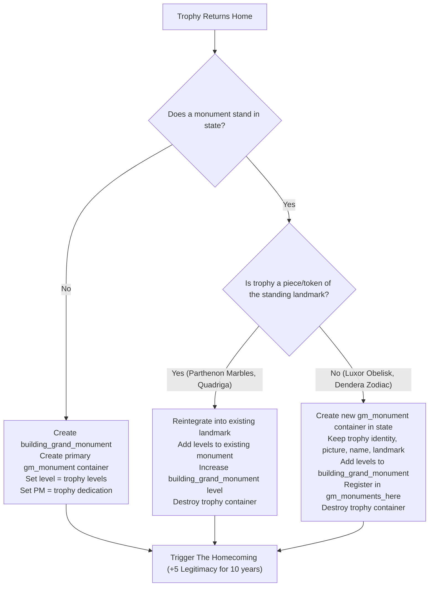

# Grand Monuments: Multiple Monuments per State via Script Containers — Design

**Date:** 2026-10-13  
**Status:** approved design concept by the owner on 2026-10-13: "abstract away that the grand monument building has levels equal to the combined grandeur of the monuments there and the PM of the first. The other effects are all applied by aggregating across monuments anyway."  
**Builds on:**
- `2026-10-12-grand-monument-trophies-design.md` (trophies, looting, and repatriations)
- `2026-10-12-grand-monument-loot-and-1836-trophies-design.md` (19 landmarks to loot and the 1836 trophies)
- `2026-10-12-grand-monuments-landmarks-design.md` (landmark locks, names, pictures)
- `2026-10-05-grand-monuments-v2-design.md` (v2 core numbers, commissions, policy)

---

## 1. Context & Motivation

### 1.1 The Upper Egypt Problem
In 1836, France holds two trophies originating from `STATE_UPPER_EGYPT`:
1. **Temple of Dendera — the Zodiac** (`temple_of_dendera`, piece, 2 levels)
2. **Luxor Obelisk** (`luxor_obelisk`, whole, 5 levels)

Meanwhile, `STATE_UPPER_EGYPT` already has a standing landmark placed in 1836:
- **Obelisks of Karnak** (`obelisks_of_karnak`, whole, 5 levels)

Under the prior design (`2026-10-12-grand-monument-loot-and-1836-trophies-design.md` §2.2), returning a trophy to a state with an existing monument assumed the "Quadriga returning to the Brandenburg Gate" model:
```paradox
gm_state_tr_receive = {
    if = {
        limit = { has_building = building_grand_monument }
        # Simply adds levels to the standing building_grand_monument!
        ...
```
This had severe flaws:
- When France returned the Luxor Obelisk or Temple of Dendera to Egypt, neither was rebuilt as Luxor or Dendera. Instead, their levels were simply dumped into the Obelisks of Karnak (raising Karnak from 5 to 7 or 12 levels).
- The returned artifacts' unique identities, forms, skins, historical descriptions, and custom picture artwork were completely discarded upon homecoming.
- Similar collisions occurred in `STATE_ATTICA`, where returning the **Piraeus Lion** (statue from Piraeus harbor) merged directly into the **Parthenon**, and in states where returning an artifact created `building_grand_monument`, permanently blocking ordinary monument commissions.

### 1.2 Engine Constraints vs. Gameplay Intent
In Victoria 3, the Clausewitz engine strictly prohibits multiple buildings of the same `building_type` in a single state. A state can only ever host one `building_grand_monument`.

However, from a historical and gameplay perspective:
- A state region can easily host multiple distinct landmarks, temples, obelisks, and returned cultural property.
- National bonuses (prestige, cultural pull, Armed Forces approval) already scale from **aggregated grandeur** across the entire nation.
- Local state bonuses (tourism throughput, devotion/prestige) naturally scale with the total monument presence in that state.

---

## 2. Core Decisions & Architecture

| Question | Decision |
|---|---|
| **Physical building** | Exactly **one** `building_grand_monument` per state, with level equal to the **combined grandeur** of all monuments standing there |
| **Production method (PM)** | Inherited from the **primary (first / founding)** monument in that state |
| **Individual monument tracking** | Each monument in the state exists as a **Script Container** (`gm_monument`), preserving its name, skin, form, landmark ID, picture code, dedication, and grandeur |
| **True piece return** | A piece cut from the standing landmark (`gm_tr_landmark = var:gm_landmark` and `gm_tr_share != whole`) rejoins the existing landmark directly (e.g. Quadriga -> Brandenburg Gate, Parthenon Marbles -> Parthenon) |
| **Distinct landmark return** | A trophy that does not match the standing landmark becomes an independent monument container in that state, adding its levels to the state's `building_grand_monument` without destroying its identity |
| **Looting during occupation** | An occupier can choose **which** monument in the state to carry off. Looting one reduces the shared building's level by the taken amount, leaving other monuments standing |
| **UI display** | The state panel displays the primary monument and lists co-located monuments/treasures. The "Our Monuments" tab lists each monument independently |

---

## 3. Data Structures & State Model

### 3.1 The Physical Engine Building (`building_grand_monument`)
- **Building Type**: `building_grand_monument`
- **Level**: `sum(gm_monument.var:gm_grandeur)` across all monument containers in the state.
- **Production Method**: The active dedication PM of the primary monument.
- **Employment & Upkeep**: Standard engine building mechanics scale automatically with the combined level.

### 3.2 The Monument Script Container (`gm_monument`)
Every monument standing in a state is represented by a `gm_monument` script container.
Trophies abroad remain in `gm_trophy` containers; upon homecoming, distinct monuments transition into `gm_monument` containers.

Variables stored on each `gm_monument` container:
- `gm_mon_state`: Link to the host `State`.
- `gm_mon_landmark`: Historical landmark key (e.g. `luxor_obelisk`, `temple_of_dendera`, `obelisks_of_karnak`), or none if custom-built.
- `gm_mon_skin`: Skin key (e.g. `landmark_luxor_obelisk`, `classical_greek_pantheon`).
- `gm_mon_form`: Form key (`obelisk`, `colonnade`, `pantheon`, etc.).
- `gm_mon_picture_code`: Integer picture code (1,000,001+).
- `gm_mon_dedication`: Dedication flag (`flag:civic`, `flag:crown`, `flag:religious`, etc.).
- `gm_mon_grandeur`: Individual grandeur level of this specific monument.
- `gm_mon_name`, `gm_mon_namesake`, `gm_mon_name_year`, `gm_mon_name_char`, `gm_mon_name_occasion`: Name records.
- `gm_mon_built_by`: Country that originally dedicated/raised it.
- `gm_mon_is_primary`: Flag marking the primary monument whose dedication controls the state's `building_grand_monument` PM.

### 3.3 State-Level Indexing
On the `State`:
- `gm_monuments_here`: Variable list of `gm_monument` containers located in this state.
- `gm_state_grandeur`: Sum of `gm_mon_grandeur` across all containers in `gm_monuments_here`.
- `gm_landmark`, `gm_skin`, `gm_form`, `gm_picture_code`, `gm_dedication`: Mirrored from the primary monument container for backward compatibility with existing single-monument trigger reads.

---

## 4. Lifecycle & Flow

### 4.1 Repatriation & Homecoming (`gm_state_tr_receive`)
When a trophy `scope:gm_tr_moving` is returned or brought home to its origin state:



1. **Piece Reintegration**:
   - Condition: `exists = var:gm_landmark` AND `scope:gm_tr_moving.var:gm_tr_landmark = var:gm_landmark` AND `scope:gm_tr_moving.var:gm_tr_share != flag:whole`.
   - Effect: Levels are added directly to the existing landmark. The Quadriga rejoins the Brandenburg Gate.
2. **Distinct Monument Addition**:
   - Condition: No standing monument matches the trophy's landmark key, OR the trophy is a whole independent monument (e.g. Luxor Obelisk).
   - Effect: A new `gm_monument` container is created in the origin state with the trophy's records.
   - The state's `building_grand_monument` is rebuilt to `current_level + trophy_levels`.
   - The existing primary monument's PM is preserved.

### 4.2 Occupation & Looting (`gm_tr_take`)
When an enemy occupies half of a state's provinces in a war:
- If the state contains multiple monuments (`gm_monuments_here` count > 1):
  - The occupier sees each monument individually on the state card.
  - The occupier can choose which monument to carry off.
  - When an individual monument is looted:
    - If whole: The monument container is transferred into a `gm_trophy` container in the taker's capital. The state's `building_grand_monument` level is reduced by that monument's grandeur. If it was the primary monument, the next largest monument becomes primary and its PM is activated.
    - If piece/token: The monument container loses 25% or 10% of its levels; `building_grand_monument` shrinks accordingly; a trophy container with the piece is created in the taker's capital.

### 4.3 Rededication & Demolition
- **Rededicate**: Applied to the primary monument, or chosen per monument if prompted via script.
- **Tear Down**: Tearing down a monument removes that specific monument from the state. If other monuments remain, the primary designation shifts to the next monument and `building_grand_monument` resizes to the remaining total grandeur.

---

## 5. User Interface Specifications

### 5.1 State Panel (`te_state_gm_card`)
- **Single Monument State**:
  - Displays identical to the current layout: monument picture, name, form, Grandeur meter, local effects (tourism, dedication effect).
- **Multiple Monument State**:
  - **Header Card**: Shows total combined Grandeur meter and state-wide tourism / dedication effects.
  - **Monument List**: A vertical container iterating over `State.GetList('gm_monuments_here')`:
    - Row for each monument: 48px picture icon, title, form, dedication icon, individual grandeur level, and "Historical monument" tooltip if a landmark.
    - During enemy occupation: an individual "Carry It Off" button on each lootable row.

### 5.2 Our Monuments Section (`te_gm_sec_monuments`)
- In the Journal Entry and Timeline Extended window:
  - Iterates over all monument containers owned by the country.
  - Shows each monument individually (e.g. Egypt's tab lists *Obelisks of Karnak*, *Luxor Obelisk*, and *Temple of Dendera*, all showing Upper Egypt as their location).

---

## 6. Historical Opportunities Opened by this Architecture

By abstracting `building_grand_monument` into an engine aggregator while holding individual monuments in containers, the mod eliminates the artificial "one landmark per state" constraint:
1. **Upper Egypt**: Obelisks of Karnak, Luxor Obelisk, and Temple of Dendera can all stand together.
2. **Attica**: The Parthenon and Piraeus Lion (and phase 6's Panathenaic Stadium) can co-exist.
3. **Rome / Lazio**: Capitoline Museums and the Colosseum / Roman Forum.
4. **Beijing / Zhili**: Temple of Heaven, the Old Summer Palace, and the Forbidden City.
5. **Paris / Île-de-France**: Arc de Triomphe, Notre-Dame, and the Louvre.
